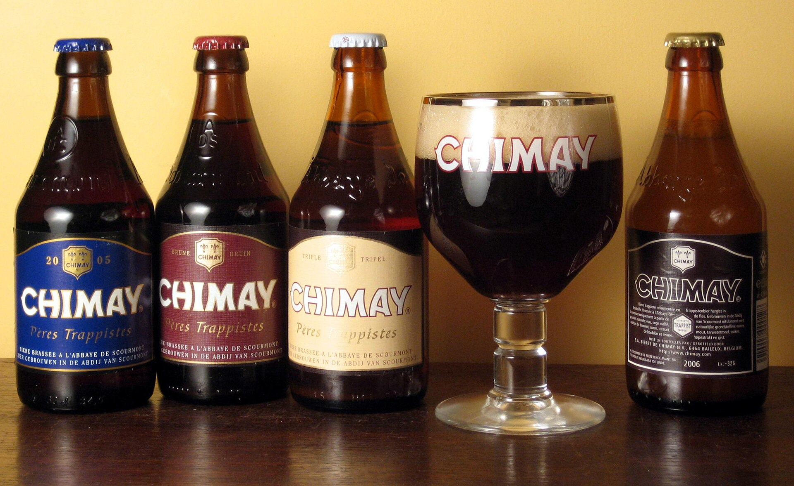

# Belgium

Belgium is a federal state in Western Europe whose beer culture was inscribed on the UNESCO Intangible Cultural Heritage list in 2016. What makes it distinctive is not simply the number of beers, but the survival of two entirely different traditions: Trappist-style abbey ales, built on controlled yeast and monastic craft, and lambic, built on wild microbes from the air and wooden barrels.

Figure: Belgium. Photograph: File:J33 542 Walplein, »De halve Maan«.jpg. Credit: Falk2, CC BY-SA 4.0 ([source page](https://commons.wikimedia.org/wiki/File:J33_542_Walplein,_%C2%BBDe_halve_Maan%C2%AB.jpg)). Category image; not a claim that it shows the exact product, site or event.

## Geography and climate

Belgium borders the North Sea to the west, the Netherlands to the north, Germany and Luxembourg to the east, and France to the south. The terrain is mostly plains and low hills, with a temperate maritime climate: mild winters, cool summers and fairly even rainfall. That climate is poor for large-scale grape growing but suits barley, wheat and hops, as well as the long cool fermentation and maturation some beers need.

Climate affects beer mainly through ingredients and process rhythm: cool conditions help control fermentation temperature and clarify the liquid, while humidity and temperature shape microbial activity in wooden barrels. Treating national climate as a guarantee of a particular beer style ignores equipment and recipe.

## History

Belgian brewing is closely tied to medieval towns, monasteries and guilds. Monasteries developed brewing and provisioning within a self-sufficient system, while towns shaped local styles through guild rules. In the late 20th century, changes in consumption and export growth drove consolidation, yet small breweries and unusual styles survived.

In 2016, Belgian beer culture was inscribed on the UNESCO Intangible Cultural Heritage list. The recognition stresses the community practices around brewing and drinking, not the quality of any single product. Understanding this keeps "cultural heritage" from being read as a quality grade.

## The two beer traditions

The first is abbey ale: controlled yeast, fermentation in relatively closed equipment, and breweries attached to monasteries or historically linked to them; the styles include dubbel, tripel and patersbier. The second is lambic: spontaneous fermentation by wild yeasts and bacteria from the air and wooden barrels, giving an acidic, dry beer that is often blended from lambics of different ages.

The difference is not merely colour or sweetness but the source of microbes and the logic of the process. Abbey ales aim for repeatable house styles; lambic accepts batch variation and long maturation. Grouping both as "Belgian beer" loses the most important information.

## Trappist beer

Trappist beer is made by monasteries or their associated breweries, and some products may carry a certification mark from the International Trappist Association. The requirements concern production site, supervision and the use of proceeds: they are institutional constraints, not taste ratings.

Several breweries have held certification historically, and in recent years some have lost eligibility because monks withdrew or production arrangements changed. At purchase, check the bottle mark and current official information; the phrase "Trappist style" does not by itself imply certification. Chimay Blue belongs to this tradition; see [Chimay Blue](ref:chimay).

## Lambic and spontaneous fermentation

Lambic is made mainly around Brussels and the Pajottenland. Traditionally the boiled wort is cooled in shallow pans so microbes from the air inoculate it naturally, after which it is matured in wooden barrels ([oak ageing](ref:oak-ageing)). Fermentation and maturation take years, and the liquid gradually turns acidic and dry, with citrus, grain and woody notes.

Common forms include unblended lambic, geuze made by blending lambics of different ages, and kriek and similar fruit versions with cherries or other fruit. Some commercial products add sugar or juice before bottling, giving a sweeter, less acidic drink; that is a different product direction from traditional dry lambic. Lindemans belongs to this tradition; see [Lindemans Framboise](ref:lindemans).

## Ingredients and production

The base ingredients of Belgian beer are [barley](ref:barley), [wheat](ref:wheat), [water](ref:water) and hops, with sugar, spices or fruit added in some styles. Barley supplies starch and enzymes for mashing, wheat adds protein and a soft texture, and the mineral content of the water affects fermentation and flavour.

After mashing, [fermentation](ref:fermentation) begins: abbey ales mostly use controlled top-fermenting yeast at warmer temperatures, and some products undergo a second fermentation in the bottle for carbonation and aroma; lambic relies on natural inoculation and takes much longer. Proportions, yeast choice and temperature curves differ by brewery, and no single recipe describes the whole country.

## Rules and labelling

Belgian beer labels usually state ABV, net content, ingredients, producer and batch, and some name the style (dubbel, tripel and so on). The Trappist certification mark must be distinguished from terms such as "abbey beer": the former belongs to a certification system, while the latter is often a commercial style description.

Terms such as "spontaneous fermentation" and "aged lambic" also lack a single mandatory definition, and breweries often explain them through their own ranges. When reading a label, separate the certification mark, the style name and the product name; this region treats no single mark as a quality guarantee.

## Representative beers and producers

Abbey ales are represented by breweries such as Chimay, Rochefort, Westmalle and Orval; lambic by traditional and family breweries around Brussels. The Bavarian [Weihenstephaner Hefe Weissbier](ref:weihenstephaner) is often compared with Belgian wheat beers, but it belongs to the German wheat-beer tradition and is not made in Belgium, so it cannot be placed under this region.

For specific products see the drink pages; a region page describes traditions, geography and institutions rather than judging individual brands. Listing a German beer under the Belgian region is a common classification error.

## Market and drinking

Belgian beer has steady demand at home and in export markets, covering everything from everyday lagers to strong abbey ales and acidic lambic. Serving temperature varies by style: wheat beers and lambic suit cooler temperatures, while dark strong ales suit slightly warmer ones to release aroma.

Strong products call for portion control, and lambic acidity can be unfamiliar to new drinkers. After opening, refrigerate and finish soon rather than warming and cooling repeatedly; excessive drinking is harmful to health, and minors should not drink.

## Common misconceptions

First, treating all Belgian beer as one style. Abbey ales and lambic are two entirely different traditions.
Second, treating "Trappist style" as certification. Certification has its own mark and institutional requirements.
Third, assuming all lambic is sweet. Traditional lambic is dry and acidic, and sweetness usually comes from added sugar or juice.
Fourth, counting German wheat beer as Belgian. Origin and style tradition need separate checks.
Fifth, judging quality by packaging or origin stories. Ingredients, craft and label information are more reliable.

Put [Beer](ref:beer)'s geographic boundary next to [Wheat](ref:wheat)'s climate and soil; the difference marks the boundary.

## Further reading

- [Beer](ref:beer): categories and basic production.
- [Barley](ref:barley): the main ingredient for mashing and fermentation.
- [Wheat](ref:wheat): the base of wheat beer.
- [Water](ref:water): how water chemistry affects fermentation and flavour.
- [Fermentation](ref:fermentation): the difference between top fermentation and spontaneous fermentation.
- [Oak ageing](ref:oak-ageing): the basic logic of lambic maturation.
- [Chimay Blue](ref:chimay): a representative abbey ale.
- [Weihenstephaner Hefe Weissbier](ref:weihenstephaner): a comparative read on German wheat beer.
- [Lindemans Framboise](ref:lindemans): a representative lambic product.

## Related images

Image: Related photograph of Chimay Blue. Credit: Uploaded by photographer., CC BY-SA 3.0, via Wikimedia Commons ([source page](https://commons.wikimedia.org/wiki/File:Chimays.jpg)). Related image for Belgium.

Image: Related photograph of Weihenstephaner Hefe Weissbier. Credit: JIP, CC BY-SA 4.0, via Wikimedia Commons ([source page](https://commons.wikimedia.org/wiki/File:Weihenstephaner_Hefe_Weissbier_aboard_Viking_Mariella.jpg)). Related image for Belgium.
