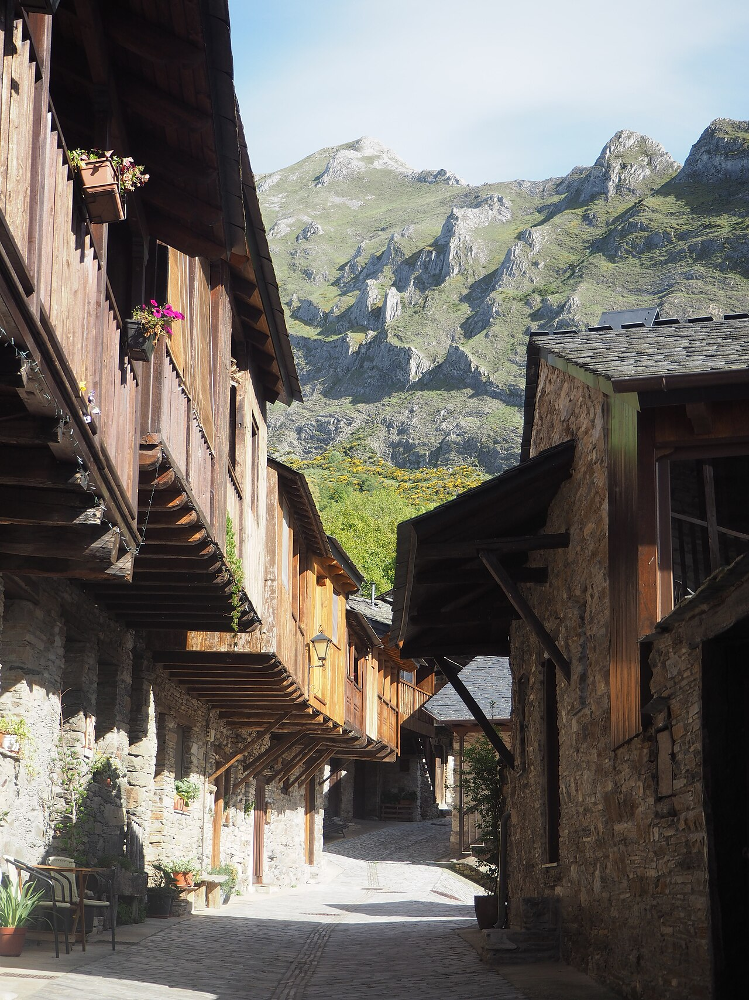
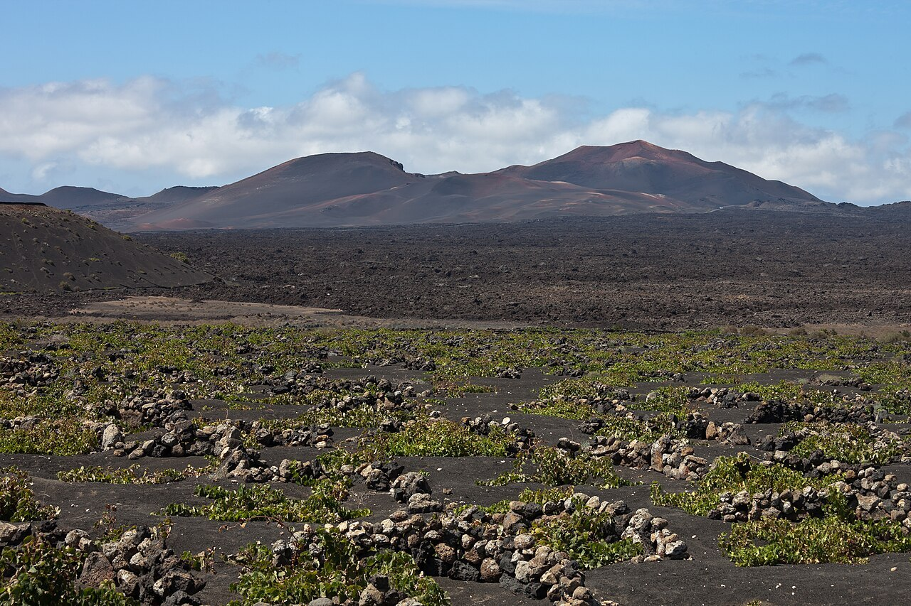
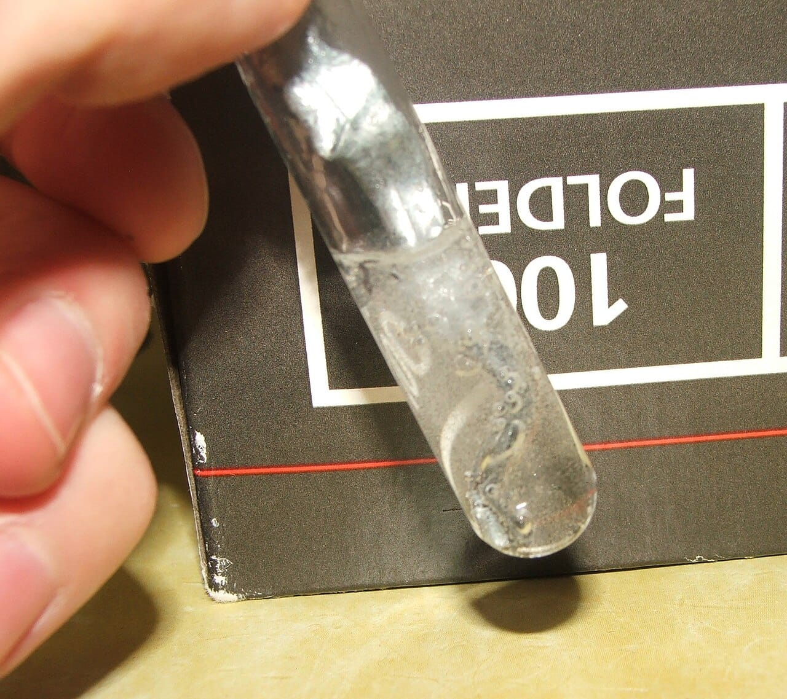

# Bierzo

Bierzo is a wine denomination in western León, Spain, a basin ringed by mountains and known for Mencía reds, slate slopes and old vines. It only became a DO in 1989, yet it is one of the oldest planted areas in north-west Spain.

Figure: Bierzo. Image: Fogar Mozárabe, CC BY-SA 4.0, via Wikimedia Commons ([source page](https://commons.wikimedia.org/wiki/File:Arquitectura_tradicional_de_El_Bierzo.jpg)).

## A red-wine region in a mountain basin

Bierzo sits at the western edge of Castilla y León, beside the Galician border, and geographically it belongs more to the Atlantic watershed than to the Castilian plateau. The Sil river and its tributaries cut a basin whose surrounding mountains block most extreme weather, giving a transitional climate: milder than the plateau, but less wet than the Galician coast.

That position shapes the varieties. Mencía ripens fully here while keeping acidity, with white varieties and a few other reds in support. Reds dominate, but there is also a long white-wine tradition.

## From 1988 to 1989: building a DO

Legal status came in two steps. Bierzo was provisionally recognised on 3 June 1988, and a provisional regulatory board was appointed on 3 October that year. On 11 November 1989, Spain formally recognised the Denominación de Origen Bierzo and approved its rules.

A late institution does not mean a short history of planting. On the contrary, vineyards had long coexisted with mixed farming, and many plots sold only as bulk or local wine before the DO existed. The DO turned scattered resources into a recognisable regional brand.

Compared with older Spanish regions, Bierzo's wineries are generally small, most family-run and producing thousands to tens of thousands of bottles. Cooperatives and smallholders preserve plot diversity while limiting any single winery's market reach, which is why Bierzo's styles are so dispersed.

## Slate slopes and Bierzo Alto/Bajo

The terrain falls into two rough types. The higher mountains and steep slopes to the north and west are commonly called Bierzo Alto; the warmer, flatter valley land to the south is called Bierzo Bajo. Both names are geographic and climatic shorthand, not legal sub-zones, and they do not appear as official tiers on labels.

Slope soils are mainly slate, quartzite, sandstone and clay: acidic, low in carbonate, fast draining and low in fertility. Slate warms quickly in the sun, helping high sites ripen, while low fertility limits yields and gives smaller berries with thicker skins. Valley floors have more alluvium, ripen more easily and give a broader style. These differences are the basis of the region's [terroir](ref:terroir).

## The character of Mencía

Mencía is the core variety, accounting for 70.5% of grape production. It buds and ripens early, with small bunches and thick, dark skins, and yields are modest. Wines are usually medium to deep ruby, with sour cherry, raspberry, violet and black pepper, often herbal and mineral, with moderate tannin and clear acidity.

The style range is wide: whole-bunch fermentation and light extraction give a fragrant, lighter wine, while longer maceration and barrel ageing build a firmer structure. Mencía blends readily with Garnacha, Merlot, Cabernet Sauvignon or Syrah, and the blend share affects which variety names a label may carry.

## Old vines, mixed plots and viticulture

Bierzo's vineyards average about 75 years old, a rare resource in Europe. Many old plots are mixed: Mencía interplanted with Garnacha Tintorera, white varieties and even fruit trees, all sorted after harvest. Such plots complicate single-variety labelling but preserve genetic diversity and layers of terroir.

Vines are mostly bush-trained or on short trellises, and slopes depend on manual work with limited mechanisation. Drought is not the main limit; rain and humidity at ripening drive disease risk. Old vines yield little but root deeply, so they buffer vintage variation better.

Picking usually starts at dawn to keep fruit cool and preserve aroma. Mixed plots must be sorted after harvest or before fermentation to separate Mencía from whites and other reds; the labour cost is high, but it is what allows old-plot wines to stay clean. Some producers ferment old-vine parcels separately to preserve site differences.

## Winemaking and rules

Reds are destemmed or fermented as whole bunches, with maceration length following the intended style. Traditional practice used large old wood or concrete; modern wineries rely more on French oak, usually with restrained new-barrel shares so as not to mask Mencía's aroma. [Oak ageing](ref:oak-ageing) matters for structured wines, but not every wine needs it.

DO rules set permitted varieties, yield ceilings and labelling. Labels should be checked for region, variety, [vintage](ref:vintage) and [alcohol](ref:abv); a single-variety claim must meet the legal share, with the exact figure in the regulatory council's specification. Most reds are [dry](ref:dry), and acidity is a key clue to ripeness and food matching.

## Serving and misconceptions

Bierzo reds are best at about 16 to 18 degrees Celsius, with grilled meat, stews, mushrooms and medium-hard cheese. Young wines are forward and fruity, while old-vine wines show spice and mineral layers after a few years. Whites should be served cooler, with seafood and lighter dishes.

Four misconceptions recur. First, treating Bierzo Alto and Bajo as legal sub-zones: they are geographic terms. Second, assuming Mencía is merely a light Spanish red: its range runs from fragrant and light to firm and structured. Third, treating old vines as a guarantee of quality: age needs the right viticulture and winemaking. Fourth, thinking Bierzo is only red: whites have both history and a legal place.

Begin with the appellation and its permitted varieties, move on to the vintage and the producer, and finish with how the wine is labelled. That order keeps the reading of Bierzo practical.

[Wine](ref:wine) and [Spain](ref:spain) are the nearest useful comparisons: one clarifies geographic boundary, the other tests climate and soil.

**Key facts.**

| Item | Detail |
| --- | --- |
| In one line | Red-wine DO in western León, Spain, provisionally recognised on 3 June 1988 and formally confirmed on 11 November 1989. It has 2,300 hectares registered, 981 growers and 69 wineries. Mencía accounts for 70.5% of grape pr… |
| Level | other |
| Parent | Spain |
| Country code | ES |

**Sources and limits.** The key claims about Bierzo are checked against the following sources: Consejo Regulador de la D.O. Bierzo (the 2,300 hectares registered, 981 growers and 69 wineries; that Mencía accounts for 70.5% of grape production and to check its varietal character), Official Journal of the European Union (the average vineyard age of about 75 years and the Mencía-led variety structure). Prices, batches and status change; the body is project-written and does not reproduce source text.

## References

- [Wine](ref:wine): the broad categories and origin rules.
- [Red wine](ref:red-wine): the framework for red winemaking and style.
- [Spain](ref:spain): the wider map of Spanish wine regions.
- [Fermentation](ref:fermentation): whole-bunch fermentation and extraction choices.
- [Acidity](ref:acidity): Mencía's acidity and food matching.
- [Oak ageing](ref:oak-ageing): how barrel type and new-oak share shape style.
- [Terroir](ref:terroir): slate slopes and the basin climate.
- [Grape](ref:grape): ripeness measures for wine grapes.
- [Vintage](ref:vintage): vintage variation and the stability of old vines.
- [Alcohol by volume](ref:abv): what % vol means on a label.
- [Dry](ref:dry): dry styles versus residual sugar.

## Related images

Image: Uga - Lanzarote - Spain. Vineyards -U16. Credit: Luis Miguel Bugallo Sánchez, CC BY-SA 3.0, via Wikimedia Commons.. Credit: Luis Miguel Bugallo Sánchez, CC BY-SA 3.0, via Wikimedia Commons ([source page](https://commons.wikimedia.org/w/index.php?curid=17458062)). Related image for Bierzo.

Image: Acidity. Credit: Chemicalinterest, Public domain, via Wikimedia Commons ([source page](https://commons.wikimedia.org/wiki/File:Zn_reaction_with_HCl.JPG)). Related image for Bierzo.
