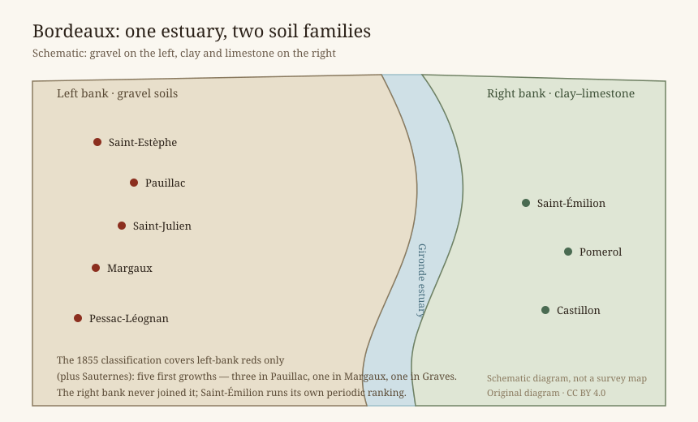

# Bordeaux

Bordeaux is a port city in the Gironde department of south-west France and one of the most influential wine names in the world. The Gironde estuary splits the region into a left bank and a right bank, with the Garonne and Dordogne meeting below the city. An oceanic climate, gravel and clay-limestone soils, and a grape set centred on Cabernet Sauvignon and Merlot together form the basic picture of Bordeaux.

Figure: soil families and main villages on the two banks of Bordeaux. Original schematic, not a survey map, CC BY 4.0.

## Geography and climate

Bordeaux sits close to the Atlantic, with a mild, humid climate and a long growing season. Spring frost, summer hail and autumn rain are the main risks; weather differences between vintages directly affect picking dates and ripeness. The left bank (Médoc, Graves) is dominated by gravel soils that drain well and suit late-ripening Cabernet Sauvignon. The right bank (Saint-Émilion, Pomerol) is dominated by clay and limestone and suits Merlot and Cabernet Franc. The difference between these two areas is often more informative than the single name "Bordeaux".

Harvest usually begins in autumn, depending on variety, plot and ripeness. Properties within one appellation may pick on different dates, and even plots on the same estate may be picked in several passes. A late harvest can pursue riper fruit but carries rain and disease risk; an early harvest keeps acidity but may sacrifice tannin ripeness. Vintage variation is the result of these decisions combined with the weather.

## Sub-regions

- Médoc: the core of the left bank, including the communes of Saint-Estèphe, Pauillac and Saint-Julien.
- Graves and Pessac-Léognan: the southern left bank, producing both red and white.
- Saint-Émilion and Pomerol: the right bank, dominated by Merlot.
- Entre-deux-Mers: the land between the two rivers, where dry white is common.
- Sauternes and Barsac: sweet white appellations reliant on noble rot.

## Varieties and styles

[Red wine](ref:red-wine) is based mainly on Cabernet Sauvignon, Merlot, Cabernet Franc, Petit Verdot and Malbec. The left bank often uses Cabernet Sauvignon as its backbone, giving firmer tannin that develops cedar and cigar-box notes with age; the right bank leads with Merlot, giving a rounder, earlier-maturing and softer profile. [White wine](ref:white-wine) is based mainly on Sémillon, Sauvignon Blanc and Muscadelle; dry whites are fresh, while sweet whites rely on noble rot for concentration and honeyed, apricot aromas.

## Classifications and regulation

Bordeaux sits within the French AOC/AOP system, with detailed rules governed by INAO and the EU regulatory framework. The 1855 classification of the Médoc and Graves is the best-known historical ranking, but it covers only part of the region and is not a quality ranking for all of Bordeaux. Saint-Émilion has its own classification, revised periodically; Crus Bourgeois is another market and review system. When reading a "classed growth" label, check which classification and which version of it the bottle refers to.

## Representative wines and producers

Bordeaux has a large number of estates and merchants. [Château Lafite Rothschild](ref:lafite) is one of the representative first growths of Pauillac, known for Cabernet Sauvignon-based blends and long ageing potential. Beyond it, the Médoc, Graves, Saint-Émilion and Pomerol each have their own notable estates. When assessing a specific wine, vintage, estate, plot and bottling run matter more than the word "Bordeaux".

## Market and drinking

Bordeaux developed an en primeur trade, a merchant system and auction markets. En primeur lets buyers purchase before bottling, which also turns vintage differences into price signals. For everyday drinking, Bordeaux red is usually served at cool room temperature with red meat and hard cheese; white suits seafood and poultry; sweet white is often paired with blue cheese or dessert. The ageing potential of an opened bottle depends on the specific wine, not on the appellation name.

## Common misconceptions

First, that Bordeaux only makes red wine. It also makes dry white and botrytised sweet white, with Sauternes as a leading example.

Second, that the 1855 classification ranks every estate in Bordeaux. It covers only part of the Médoc and Graves, and the right bank is not included.

Third, that older Bordeaux is always better. Ageing potential depends on the structure of the wine, the vintage and storage conditions; ordinary wines are not suited to long keeping.

## Left bank versus right bank

The left bank and right bank are the first key to understanding Bordeaux. The left bank is dominated by gravel soils that drain well and warm quickly, suiting late-ripening Cabernet Sauvignon; the wines are usually tighter in structure with firmer tannin, developing cedar, tobacco and pencil-lead notes with age. The right bank is dominated by clay and limestone that hold water better, suiting earlier-ripening Merlot; the wines are rounder with fuller fruit, and with age often show plum, truffle and chocolate notes. The two areas are not a hierarchy of quality but different answers to the match between variety and soil.

## Soils and drainage

The soil differences of Bordeaux are the physical basis for the left-bank and right-bank styles. Gravel particles are large, drain quickly and warm early in the day, allowing Cabernet Sauvignon to ripen in a cooler climate; clay and limestone hold water strongly and warm slowly, suiting Merlot and Cabernet Franc. Soil is not an isolated variable: it acts together with the water table, slope, aspect and climate. Understanding soil helps explain why different plots within one appellation can perform differently.

## Sweet whites and noble rot

The sweet whites of Sauternes and Barsac depend on the fungus Botrytis cinerea. Humid autumn mornings and dry afternoons let the fungus grow on the grape surface, evaporating water and concentrating sugar and aroma, producing notes of honey, apricot, citrus marmalade and saffron. Noble rot needs specific weather, so not every year yields sweet wine of the same quality. The balance between sweetness and acidity is an important dimension of quality, rather than sweetness alone.

## Labels and vintages

A Bordeaux label usually carries the estate name, appellation, vintage, alcohol content and volume. Estate name and appellation are not the same thing: one appellation contains many estates, and one estate may make wines at different levels. The vintage reflects that year's weather, and ripeness, acidity and disease pressure differ between years, so the same estate can vary noticeably from vintage to vintage. Buyers should read estate, vintage, appellation and bottling information together rather than looking only at the word "Bordeaux".

## Ageing and serving

The ageing potential of Bordeaux red varies widely. Wines with strong structure, concentrated fruit and balanced acidity and tannin suit long keeping; ordinary wines are better drunk young. Serving temperature is usually a little below room temperature, since too warm a serve makes the alcohol stand out; young wines can be decanted, while old wines should see shorter decanting to avoid losing aroma. With food, red suits red meat, game and hard cheese; dry white suits seafood and poultry; sweet white suits blue cheese and dessert. These principles apply to most Bordeaux wines, but specific bottles should still follow producer advice, and the drinking window of a given vintage depends on the condition of the wine.

## En primeur and the market

The Bordeaux en primeur system lets buyers purchase before bottling, with prices closely tied to expectations for the vintage. Merchants, estates and brokers form a complex trading network. En primeur is not a low-risk investment: the wine's actual performance, storage after bottling and market supply and demand all affect value. For ordinary consumers, it is enough to understand that en primeur exists; it is not the only route to buying Bordeaux. Merchants and cooperatives also play an important role in the everyday market, and their ranges do not necessarily appear on en primeur lists.

## Decision table: left bank, right bank and Entre-deux-Mers

| Area | Main varieties | Style | Typical drinking window | Entry advice |
| --- | --- | --- | --- | --- |
| Left bank, Médoc | Cabernet Sauvignon-led | firm structure, high tannin, long ageing | 8–20 years | start with village or cru bourgeois |
| Left bank, Graves/Pessac-Léognan | Cabernet Sauvignon, Merlot | red and white; reds firmer | 5–15 years | a good route to dry white |
| Right bank, Saint-Émilion/Pomerol | Merlot-led | rounder, fruitier, earlier drinking | 5–15 years | start here if tannin worries you |
| Entre-deux-Mers | Merlot, Cabernet Franc, Sauvignon Blanc | mostly fresh dry white | 1–5 years | value for everyday white |

“Bordeaux” is a regional name, not a quality grade; judge a bottle by sub-region, producer, vintage and bottling information.

## Related images

Image: Related photograph of Aconcagua Valley. Credit: Bjørn Christian Tørrissen, CC BY-SA 4.0, via Wikimedia Commons ([source page](https://commons.wikimedia.org/wiki/File:Aconcagua2016.jpg)). Related image for Bordeaux.

Image: Château Lafite Rothschild. Credit: PA, CC BY-SA 4.0, via Wikimedia Commons ([source page](https://commons.wikimedia.org/wiki/File:Ch%C3%A2teau_Lafite-Rothschild.jpg)). Related image for Bordeaux.

## Frequently asked questions

### Should a beginner start on the left or right bank?

If you dislike tannin and want rounder fruit, start with a Merlot-led right-bank wine. Move to the left-bank Médoc when you want to practise recognising tannin and structure. On a budget, village wines, cru bourgeois and Entre-deux-Mers whites are more useful than chasing famous names.

### How should I read a vintage?

A vintage reflects growing-season weather and harvest conditions, not a simple good/bad label. Look at spring frost, summer hail, autumn rain and harvest reports. Ordinary vintages can still have well-made wines; weak vintages need more caution.

### What should I buy at 100–300 RMB?

Prefer village-level, cru bourgeois or Entre-deux-Mers whites with complete information. Avoid bottles that only say “Bordeaux” with no producer, bottler or batch. This price band is for everyday drinking, not long cellaring.

> **Next:** Start with the difference between [red wine](ref:red-wine) and [white wine](ref:white-wine), then read [Château Lafite Rothschild](ref:lafite) for the left-bank first-growth story, and compare other areas on the [France](ref:france) page.

## Scope note

This region describes the geography, varieties and institutional framework of Bordeaux and does not assess specific estates or vintages. For the parent region, see [France](ref:france).

Further reading: [Aconcagua Valley](ref:c-extra-1).
