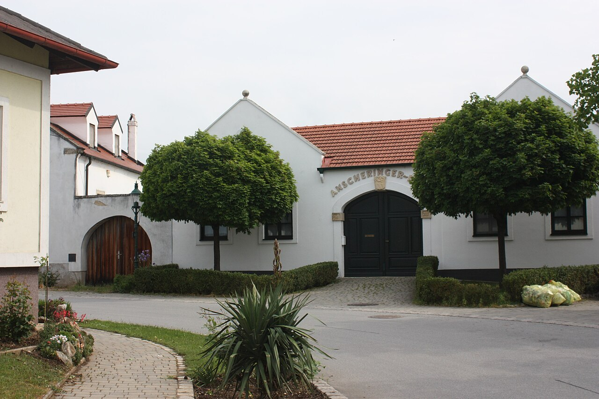
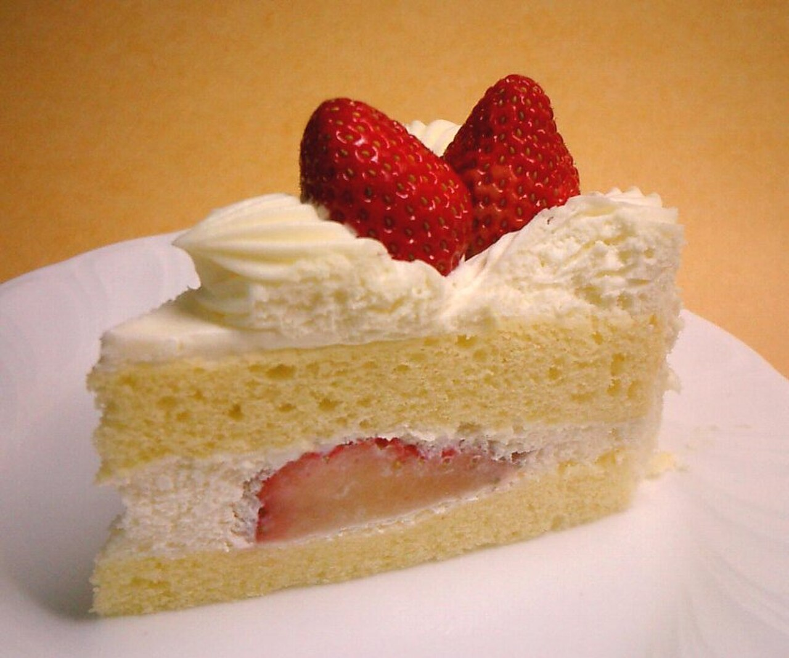

# Burgenland

Burgenland is the easternmost federal-state wine region of Austria, shaped by the hot continental Pannonian climate and known for Blaufränkisch reds and botrytis sweet wines.

Figure: Burgenland. Photograph: Breitenbrunn (Burgenland), vineyard estate house 25 Josef Haydngasse. Credit: Dguendel, CC BY 3.0, via Wikimedia Commons ([source](https://commons.wikimedia.org/w/index.php?curid=31331941)).

## Definition and scope

Burgenland is one of Austria's three federal-state wine regions, alongside Lower Austria and Styria. The region extends west from the Hungarian border, with Lake Neusiedl in the north and the Eisenberg area in the south.

Inside the state it is divided into several sub-zones with DAC status. Red wine accounts for more than half of the total, white wine follows, and sweet wines are concentrated by the lake and in the Seewinkel.

## History

Viticulture in Burgenland is tied to border trade and estate farming in the Austro-Hungarian period. In the late twentieth century the region moved from bulk wine towards a quality path built on variety and origin.

In 2005 Mittelburgenland became the first DAC in Burgenland, centred on Blaufränkisch. Leithaberg, Eisenberg and Neusiedlersee followed; Rosalia became a DAC in its own right in 2018; and in 2020 Ruster Ausbruch became a DAC for sweet wine, completing the family.

## Geography and climate

The region has a Pannonian continental climate, with hot dry summers, abundant sunshine and a stable autumn that ripens grapes better than elsewhere in Austria. Lake Neusiedl is a shallow steppe lake at the western edge of the Eurasian steppe belt; it stores heat by day and releases it at night, extending ripening near the shore.

Geologically Burgenland spans the Styrian and Pannonian Basins, with Austroalpine nappes and the Penninic zone. Much of the north is Quaternary sandy gravel, and Seewinkel gravels cover about one third of the vineyards; Neogene sediments range from clay to hard Leitha limestone; a small share of vines sits on dolomite, limestone, schist, gneiss and serpentinite.

Soil and lake microclimate together create differences in [terroir](ref:terroir): clay and loess give fruit and length, limestone and schist give minerality and tannin.

## Sub-zones and DAC

Burgenland has six DACs, each with permitted varieties and styles:

- Mittelburgenland DAC, established in 2005, centred on Blaufränkisch, with heavy clay and loess soils that give deep colour and concentrated fruit.
- Leithaberg DAC, on the eastern and western slopes of the Leitha Range, with limestone and schist; Blaufränkisch for reds, Pinot Blanc, Chardonnay and Grüner Veltliner for whites.
- Eisenberg DAC in the south, influenced by the Styrian climate, with iron-bearing schist soils where Blaufränkisch shows fine minerality and elegant structure.
- Neusiedlersee DAC east of the lake, led by Blauer Zweigelt and also covering the Prädikatswein of the area.
- Rosalia DAC, promoted from a former Großlage in 2018, with Blaufränkisch and Zweigelt reds and rosé, where loess gives depth and length.
- Ruster Ausbruch DAC, established in 2020 in the free town of Rust, devoted solely to Ausbruch sweet wine from botrytised grapes.

The region, village and site information after a DAC name describes the extent of origin, not a quality ranking.

## Varieties and raw material

Red grapes are mainly Blaufränkisch, Blauer Zweigelt and Sankt Laurent, with Pinot Noir and some international varieties. White grapes include Pinot Blanc, Chardonnay, Grüner Veltliner, Welschriesling, Scheurebe and Traminer. The raw material is [grape](ref:grape).

Blaufränkisch gives deep colour, black fruit, pepper and high acidity, and is the most recognisable variety of the region; Zweigelt is softer and juicier and is used both as a [single varietal](ref:single-varietal) and in [blends](ref:blend); Welschriesling excels in sweet wines. International varieties and red blends have also earned high recognition over the past two decades.

## Winemaking

Red grapes are destemmed, macerated and [fermented](ref:fermentation), with punch-down, pump-over or open fermenters depending on style. Blaufränkisch needs enough maceration to extract colour and tannin without the roughness of over-extraction.

Some wines are [aged](ref:oak-ageing) in large old casks or small oak barrels, and the share of new oak varies by estate; producers who emphasise fruit prefer old wood or stainless steel. White grapes are usually fermented cool and kept from malolactic fermentation to preserve acidity.

## Botrytis and sweet wines

The Seewinkel east of Lake Neusiedl holds many small salt lakes, the Zicklacken, which raise humidity and bring autumn fog, creating conditions for Botrytis cinerea. The fungus concentrates sugar and acidity as the grapes lose water and adds honey, dried apricot and saffron notes.

Under the Austrian Prädikatswein system the sweet wines are mainly Beerenauslese (BA), Trockenbeerenauslese (TBA), Eiswein, Ausbruch, Strohwein and Schilfwein. BA and TBA require rising minimum sugar levels with botrytis infection; Eiswein must be harvested frozen on the vine; Ausbruch is made from botrytised grapes, and Ruster Ausbruch is its DAC-protected representative; Strohwein and Schilfwein dry the grapes on straw or reed mats.

What these categories share is a balance of high [residual sugar](ref:residual-sugar) and high acidity, not [sweetness](ref:sweet) alone. Austrian national grading has no Kabinett and no German Spätlese or Auslese names.

## Labels and serving

The label should be checked for the DAC name, village or site, variety, [vintage](ref:vintage), alcohol, volume and bottler. A wine labelled as a single variety must be made as a [single-varietal](ref:single-varietal) wine; blends must list the varieties under the rules.

Blaufränkisch is served at about 15–17 degrees Celsius, Zweigelt and rosé slightly cooler; Pinot Blanc and Chardonnay at about 10–12 degrees Celsius. BA, TBA and Ausbruch are served at about 8–10 degrees Celsius in small glasses. Refrigerate after opening and finish soon. Excessive drinking harms health and minors should not drink.

## Common misconceptions

First, equating Burgenland with sweet wines. Sweet wines are concentrated by the lake and in the Seewinkel, a small share of the total, and red wine dominates.
Second, treating Blaufränkisch as merely a local grape. It shows clear site differences in Eisenberg and Leithaberg.
Third, taking a DAC name for a grade. A DAC sets varieties and style, while region, village and site describe the extent of origin.
Fourth, assuming sweeter is better in sweet wine. The value of BA, TBA and Ausbruch lies in the balance of acidity and flavour.
Fifth, reading Austrian labels with German grades. Austria has no national Kabinett, Spätlese or Auslese grades.

To read Burgenland, start with the appellation and its permitted varieties, then the vintage and the producer, then how the wine is labelled; no single check settles it.

Start with [Wine](ref:wine) for geographic boundary, then read [White wine](ref:white-wine) for climate and soil. Seeing both keeps Burgenland from being confused with a neighbouring idea.

**In brief:** The easternmost federal-state wine region of Austria, shaped by the hot continental Pannonian climate and covering about 11,538 hectares; known for Blaufränkisch reds, Pinot Blanc and Chardonnay from the Leitha Range, and botrytis sweet wines from the Seewinkel east of Lake Neusiedl; it holds six DACs, Mittelburgenland from 2005, Leithaberg, Eisenberg, Neusiedlersee, Rosalia from 2018 and Ruster Ausbruch from 2020. 

## Further reading

- [Wine](ref:wine): an overview of wine categories, vintages and origin rules.
- [Red wine](ref:red-wine) and [white wine](ref:white-wine): the two main categories of Burgenland.
- [Grape](ref:grape): the structure of wine grapes and ripeness measures.
- [Fermentation](ref:fermentation): the difference between red maceration and cool white fermentation.
- [Oak ageing](ref:oak-ageing): the choice of container for ageing Blaufränkisch.
- [Residual sugar](ref:residual-sugar) and [sweet](ref:sweet): the chemical basis of sweet-wine categories.
- [Terroir](ref:terroir): how lake microclimate and soil create site differences.
- [Vintage](ref:vintage): vintage variation in reds and sweet wines.
- [Single varietal](ref:single-varietal) and [blend](ref:blend): the two labelling paths for variety and composition.

## Related images

Image: Sweet. Credit: Tomomarusan, CC BY 2.5, via Wikimedia Commons ([source page](https://commons.wikimedia.org/wiki/File:Strawberry_shortcake.jpg)). Related image for Burgenland.

Image: Vintage. Credit: Chiusi Painter, Public domain, via Wikimedia Commons ([source page](https://commons.wikimedia.org/wiki/File:Cup_vintage_Cdm_Paris_320_n1.jpg)). Related image for Burgenland.
