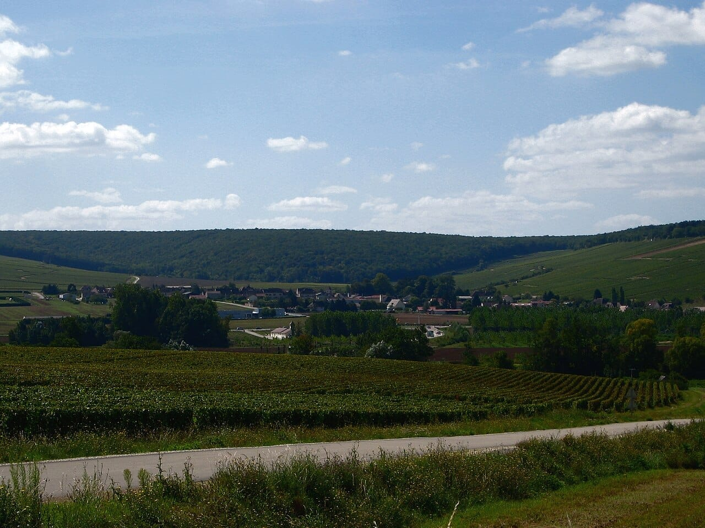

# Burgundy

Burgundy is a wine region in eastern France, west of the Saône, built on Pinot Noir and Chardonnay. It runs north to south in a narrow band, divided into Chablis, the Côte d'Or, the Côte Chalonnaise and the Mâconnais, and its four tiers — regional, village, Premier Cru and Grand Cru — mean that parcel boundaries matter more than estate names.

Figure: Burgundy. Photograph: Burgundy vineyards near Beaune, France. Credit: Mark Gorzynski, CC BY-SA 4.0, via Wikimedia Commons ([source](https://commons.wikimedia.org/w/index.php?curid=65061583)).

## Geography and climate

Burgundy lies in eastern [France](ref:france), and most vineyards sit on the hills and slopes west of the Saône plain in a narrow north-south band. Chablis in the north is cooler and the Mâconnais in the south is warmer; the Côte d'Or slopes face south-east, balancing sunshine and drainage.

The continental climate is clear, with cold winters and warm summers, and spring frost and summer hail are the main risks. Vintage differences directly change ripeness and yield, and the same parcel can perform very differently from year to year. Aspect, altitude and soil drainage together set the pace of ripening; climate is not a uniform backdrop.

## History

Burgundy's viticulture is closely tied to medieval monasteries, and the houses of Cîteaux and Cluny left many parcel records and farming traditions. After the French Revolution land was divided, creating the pattern of many small estates and highly split parcels seen today.

The tier system became institutionalised during the 20th century, when the national appellation authority founded in 1935 drove the creation of the AOC framework, later taken over by INAO. History and regulation together shaped the habit of describing wine by parcel before estate.

## Sub-regions

- Chablis: the northernmost white wine area, in the Yonne department, making only white wine from Chardonnay.
- Côte d'Or: the core, split into the Côte de Nuits in the north and the Côte de Beaune in the south.
- Côte Chalonnaise: south of the Côte d'Or, red and white, with Mercurey, Givry, Rully and Montagny among the better-known names.
- Mâconnais: the southern section, mostly white, with Pouilly-Fuissé and Saint-Véran well known, and Gamay also planted.

The four sections differ in climate, soil and market position. Chablis and the Côte d'Or are often mentioned together, but their varieties and grading histories are not the same.

## Tiers

Burgundy's hierarchy has four levels: regional (such as Bourgogne), village (such as Gevrey-Chambertin), Premier Cru and Grand Cru. Grand Cru sites are limited in number and usually named on the label by the site alone, such as Chambertin, Montrachet or Romanée-Conti.

The tiers are defined by appellation rules, not by market opinion or estate claims. Premier Cru and Grand Cru boundaries were drawn over a long period, and parcels within one village can belong to different tiers. When reading a label, confirm the tier first, then the village and site, and finally the estate.

## Varieties and styles

[Red wine](ref:red-wine) is almost entirely made from [Pinot Noir](ref:pinot-noir), pale in colour with clear acidity and fine tannin, developing red cherry, mushroom and woodland notes with age. [White wine](ref:white-wine) is mostly [Chardonnay](ref:chardonnay), from the lean, mineral style of Chablis to the fuller style of Montrachet.

There is also white Aligoté, red Gamay and Crémant de Bourgogne sparkling wine. The variety structure is relatively simple, yet one variety can perform very differently from parcel to parcel, which is exactly why Burgundy emphasises site.

## The Côte d'Or: Nuits and Beaune

The Côte de Nuits is mostly red, with villages including Gevrey-Chambertin, Chambolle-Musigny, Vougeot, Vosne-Romanée and Nuits-Saint-Georges; the slopes are steeper and drain well, giving Pinot Noir more tension.

The Côte de Beaune has both colours, with Aloxe-Corton, Beaune, Pommard and Volnay known for reds and Meursault, Puligny-Montrachet and Chassagne-Montrachet known for whites. The difference between the two halves comes from aspect, soil and village tradition rather than from a single variety.

## Chablis

[Chablis](ref:chablis) sits at the northern end of the region and is a separate appellation making only white wine from Chardonnay. Kimmeridgian limestone and marl soils, a cool climate and a long ripening season give a lean style with clear acidity and strong minerality.

Chablis is also tiered internally, into Petit Chablis, Chablis, Premier Cru and Grand Cru. The logic matches the Côte d'Or, but Chardonnay is the only variety, so differences come more from site and winemaking than from a variety mix.

## Labels and vintage

Labels usually carry the appellation, village, site, vintage, alcohol, net volume and bottler. Regional and village wines name the village, while Premier Cru and Grand Cru name the specific site; one village can hold parcels at several tiers.

Vintage reflects the weather of that year. Frost, hail and harvest rain change yield and ripeness, and different vintages from one estate can differ markedly. When buying, check tier, village, site, vintage and bottling information together rather than the word "Burgundy" alone.

## Market and drinking

Burgundy's limited production and divided parcels keep market prices high over the long term, especially for famous estates and sites. Tier and site are important price signals, but price does not equal personal preference, and the drinking window depends on vintage and structure.

For serving, reds usually go at slightly below room temperature and whites are well chilled; young wines can be decanted, while old bottles should be decanted for less time. Reds suit poultry, mushrooms and soft cheese, whites suit seafood, poultry and creamy dishes. Storage conditions after opening affect flavour, so refrigerate and drink soon.

## Common misconceptions

First, treating Burgundy as a brand. It is a region containing many appellations and estates.
Second, treating Grand Cru as a guarantee of quality. The tier defines site and rules, not the performance of a particular bottle.
Third, assuming Burgundy reds are always light. Pinot Noir is pale in colour, yet the structure can be tight.
Fourth, confusing Chablis with the Côte d'Or. Chablis makes only white wine and has a different village and tier system.
Fifth, using estate fame in place of label information. Tier, village, site and vintage are more specific.

For Burgundy, begin with the appellation and its permitted varieties. Then look at the vintage and the producer, and finally ask how the wine is labelled. The answers point to different choices, not to a single score.

[France](ref:france) and [Red wine](ref:red-wine) are the two useful reference points for Burgundy. [France](ref:france) sets out geographic boundary; [Red wine](ref:red-wine) brings in climate and soil. Read them together.

## Further reading

- [France](ref:france): the French wine map and the AOC/AOP system.
- [Chablis](ref:chablis): the northernmost white wine area of Burgundy.
- [Chardonnay](ref:chardonnay) and [Pinot Noir](ref:pinot-noir): the two core varieties of Burgundy.
- [White wine](ref:white-wine) and [red wine](ref:red-wine): the two basic styles and their winemaking.
- [Oak ageing](ref:oak-ageing): how barrel size and age shape style.

## Related images

Image: Chablis. Credit: CocktailSteward, CC BY 3.0, via Wikimedia Commons ([source page](https://commons.wikimedia.org/wiki/File:Chablis_and_Premier_Cru_Vaulorent.jpg)). Related image for Burgundy.

Image: Chardonnay. Credit: Jenavive at English Wikipedia, Public domain, via Wikimedia Commons ([source page](https://commons.wikimedia.org/wiki/File:Chardonnay.jpg)). Related image for Burgundy.
