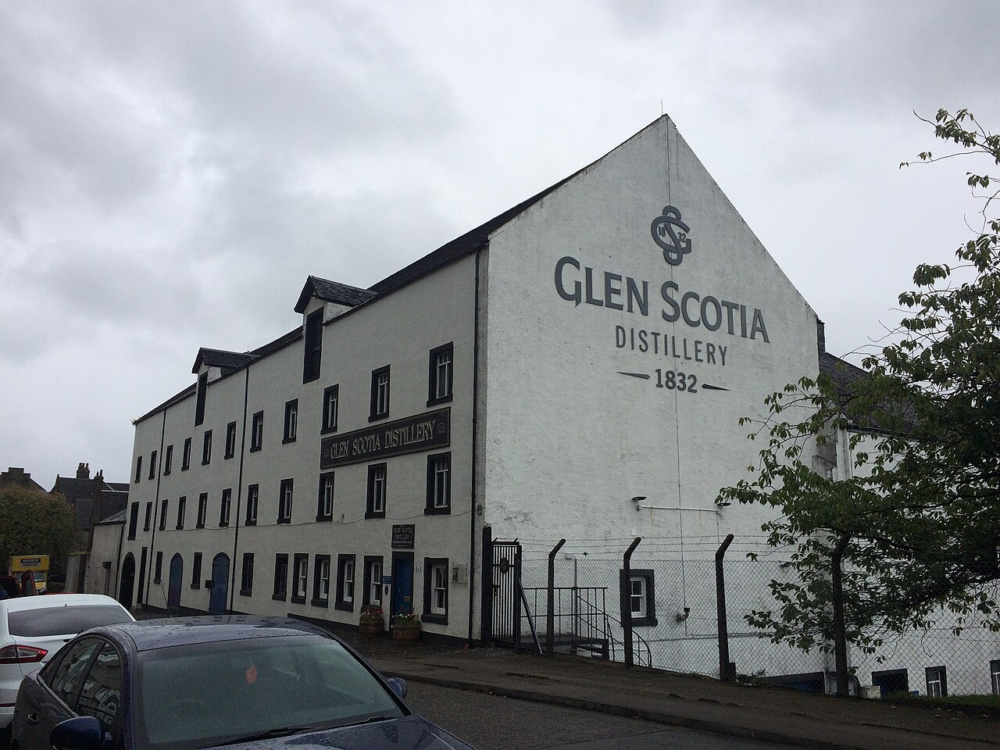

# Campbeltown

Campbeltown is the smallest of the five protected [Scottish](ref:scotland) whisky names, sitting at the southern end of the Kintyre peninsula. In the nineteenth century it was called the whisky capital of the world; today only three distilleries remain. That gap is the best way in: the name protects a place and a tradition, not a volume of output, and it does not guarantee a fixed flavour.

Figure: Campbeltown. Photograph: Glen Scotia Distillery, Campbeltown. Credit: Lirazelf, CC BY-SA 4.0, via Wikimedia Commons ([source](https://commons.wikimedia.org/w/index.php?curid=62323489)).

## A legal area of one peninsula corner

The Scotch Whisky Regulations 2009 define "Campbeltown" as the South Kintyre ward of Argyll and Bute, not the whole peninsula and certainly not the south-west of Scotland in general. The text lists Campbeltown and Islay as protected localities, while Highland, Lowland and Speyside are protected regions. Both kinds of name are protected on labels, but they sit at different levels of the law.

The [regulations](ref:swr) require that a whisky labelled Campbeltown be distilled inside that area and meet every general Scotch condition: matured in Scotland, at least three years in oak, bottled at no less than 40% ABV, and distilled below 94.8% ABV. A distillery outside the boundary cannot use the name, however similar its style.

## The Victorian whisky capital

Campbeltown's position suited sea transport: spirit could leave the harbour for Glasgow, Liverpool and overseas markets, and coal and local barley were easy to obtain. Distillery records state that 22 licensed distilleries were operating in the area by 1814; by the Victorian era the number had passed thirty, packed along the streets and around the port.

Much of that whisky went into the expanding blending trade, and a good share was exported as bulk spirit. Distilleries, piers, warehouses and merchants formed a complete chain, and the town's wealth was tied directly to whisky. In hindsight, the boom rested on shipping, coal and a loose supply of raw material rather than on an unrepeatable terroir.

## From more than thirty to three

The boom did not last. In the 1920s some distilleries cut corners to meet demand and lost quality, blenders turned to other regions, and the loss of orders set off a wave of closures. Glengyle stopped operating in 1925; by 1934, after Rieclachan closed, only Springbank and Glen Scotia were left.

Springbank was founded in 1828 and is among the oldest surviving sites in Campbeltown; Glen Scotia began in 1832. Glengyle was established by the Mitchell family in 1872, closed in 1925, and its buildings were bought back by Springbank's Mitchell family in 2000 before being rebuilt and restarted in 2004. Springbank's own history treats 2004 as the point when Campbeltown was "once again recognised as a distinct whisky region"; in current law it remains a protected locality rather than a large region by output.

## Sea air, oil and light peat

The Scotch Whisky Association summarises Campbeltown as "salt, smoke, fruit, vanilla and toffee" mingling in a robust, rich character. That matches the common impression: a saline edge, a thicker oily texture, light to medium peat smoke, and dried fruit and spice towards the back. The humidity and temperature swings of coastal warehouses are often invoked to explain the heavier body.

Sea air is not a recipe, though. Malt phenol level, still shape, cut point and cask type are the direct sources of flavour. Campbeltown also produces bottles with almost no peat, or with peat held at a very low level; equating the whole region with heavy peat misses the oil and fruit that are more typical.

## Springbank: from malting to bottling

Springbank is the emblem of traditional Campbeltown work. The distillery keeps floor malting, uses locally grown or specified farm barley, and distils, matures and bottles on the same site. One set of equipment produces several styles: Springbank itself is lightly peated and oily, Longrow follows a heavily peated route, and Hazelburn uses triple distillation for a cleaner profile.

The legal conditions for [single malt](ref:single-malt) are fully applied here: one distillery, 100% malted barley, pot-still [distillation](ref:distillation), and at least three years in oak. Springbank's value is not merely "tradition" but the fact that malting, mashing, distillation and [oak maturation](ref:oak-ageing) sit on one visible chain, so stylistic differences can be traced to specific steps.

## Glen Scotia and Glengyle

Glen Scotia is one of the smallest distilleries in Campbeltown, and its own material says it retains fermenters, a stillroom and a dunnage warehouse dating from 1830 onward. It makes both peated and unpeated expressions, with core bottles often showing seawater, dried fruit and vanilla in a more direct body than Springbank. Glengyle was rebuilt in 2004 and bottles under the Kilkerran name; its output is small, with an oily, mineral, lightly smoky profile that makes it another example of the region's revival.

The three distilleries do not share equipment or recipes, yet they share the same geography and legal conditions. Reading "Campbeltown style" as the intersection of the three is more accurate than imagining a single formula.

## The region's identity today

Campbeltown is still the smallest Scotch whisky region, but tourism and small projects are growing. The Campbeltown Malts Festival each May links the three distilleries, the harbour and the town centre into a walkable route; visits to Springbank and Glen Scotia need advance booking, and Glengyle's opening hours follow the production season. Several new projects have publicly announced plans to build locally, but capacity and commissioning dates should be checked with official sources.

The regional identity has two meanings. In law it is a protected locality, and only whisky distilled there may use the name. In the market it is a style label, often used to suggest sea air, oil and light smoke. The two are related but not interchangeable. The [whisky](ref:whisky) regional system is built precisely on this combination of place name and craft tradition.

## Six misreadings of Campbeltown

First, that Campbeltown is legally a "region" on the same level as Highland or Lowland. It is a protected locality. Second, that all Campbeltown whisky is heavily peated; styles run from unpeated to medium peat. Third, that Springbank is the only survivor. Glen Scotia and Glengyle still produce. Fourth, that Campbeltown has faded away. Small output is not the same as an ended industry, and the three sites are operating with expansion plans. Fifth, that a regional name is a quality grade. Sixth, that coastal maturation must taste salty; the influence of sea air is often overstated in storytelling.

In the glass, look first for oil and minerality, then judge the peat level, and finally the dried fruit and vanilla from the cask. A little water helps open the aroma; ice suppresses the oil. Drink in moderation, adults only.

**Key facts.**

| Item | Detail |
| --- | --- |
| In one line | The smallest of Scotland's five protected whisky names, legally the South Kintyre ward of Argyll and Bute; more than thirty distilleries operated in the Victorian era, while today only Springbank, Glen Scotia and Glengyl… |
| Level | other |
| Parent | Scotland |
| Country code | GB |
