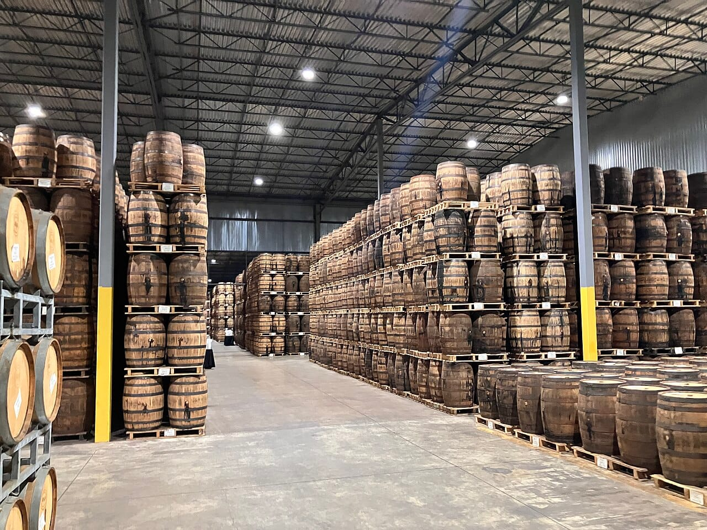

# Canada

The national Canadian whisky category, made from corn, rye and barley, mashed, distilled and aged at least three years in wood; caramel and flavouring (other spirits or wine) are permitted, and the 9.09% figure is an age-claim and export-certificate threshold rather than a compositional cap; the style is usually soft and approachable.

Figure: Whisky maturation barrels at the Forty Creek Distillery in Ontario. Image: Gogerr, CC BY-SA 4.0, via Wikimedia Commons ([source page](https://commons.wikimedia.org/wiki/File:Whisky_maturation_in_barrels_at_the_Forty_Creek_Distillery.jpg)).

## Definition and boundaries

Canadian whisky is a nationally defined spirits category: cereal mash, distillation and at least three years in wood; corn, rye and barley are the usual materials, with rye supplying spice and frame.

The “region” here is a national category and industry belt, not a wine-style parcel. Check the three legal basics first—cereal mash, distillation, three years in wood—then read the mash bill, distillation and blending for style.

## History and naming

The industry grew with Prairie grain, railways and immigrant markets; column distillation and large-scale blending made it an everyday spirit in the twentieth century.

The “9.09% rule” is often misread as a flat cap of 9.09% other spirit. In fact, Canadian whisky may contain caramel and “flavouring” (other spirits or wine); the 9.09% figure is a threshold for age claims and export certificates: where the flavouring’s absolute ethyl alcohol does not exceed 9.090% of the total absolute alcohol, the blend may carry the base whisky’s age, and non-wine flavouring still needs at least two years in wood. For exports, if imported spirits in a blend exceed 9.090%, the certificate must state the shares and the product may not be called Canadian Whisky. It governs age claims and export labelling, not permission to replace the base spirit.

## Geography and terroir

Main producing areas include Ontario, Quebec, Alberta and British Columbia; cold winters slow warehouse maturation, so distillers use warehouse position and temperature control to steer ageing.

Terroir here is grain belt, water and climate, not a vineyard slope. Cold conditions round the spirit slowly, while warmer warehouses move faster; the same mash bill can give different vanilla, caramel and wood in different warehouses.

## Raw materials and styles

Corn brings sweetness and body, rye brings pepper and spice, and barley adds malt aroma. Column distillation usually gives a cleaner, continuous spirit; pot or specialty stills add character.

Styles run from soft, vanilla-caramel blends to high-rye, spicy and structured versions. Read rye share and age first, then whether the label names a single distillery or a blend; the brand name alone says little.

## Representative producers and bottlings

Representative brands include Crown Royal, Canadian Club, Lot No. 40, Pike Creek and Alberta Premium; Crown Royal is among the best-known, while Lot No. 40 is a high-rye marker.

Separate the distillery from the brand: large brands may blend several distilleries, while small distilleries emphasise their own grain and warehouses. Compare one high-rye bottling with one corn-led bottling to see the two ends of the style.

## How to drink and pair

Serve from room temperature to over ice; use a small glass and do not fill it to the brim. A little water opens vanilla and rye spice, but too much ice closes the aroma. Do not decant like wine; Canadian whisky is ready when opened.

Pair with salt, sweetness and smoke: smoked meat, roast chicken, aged cheddar, maple desserts and dark chocolate all meet the vanilla and spice. High-rye versions need fat and salt; very sweet desserts make the spirit feel drier and hotter.

## Labels, buying and misreadings

Read the label for category (Canadian whisky), age (at least three years, with rules for age statements), mash bill or rye share, distillery and blending information.

Common misreadings: taking “rye” to mean 100% rye, or taking “Canadian whisky” as one style. Blending is allowed, and the 9.09% rule is an age-claim and export-certificate threshold, not a compositional cap or a licence to replace the base spirit; store upright, dark and at room temperature—it keeps longer than wine.

## Around and routes

Distillery visits cluster around parts of Ontario, British Columbia and Alberta; most need booking, and production areas are not open to casual walking.

For routing, separate the city centre from the distillery: from Toronto or Vancouver it is usually a half- or full-day trip. Winter roads and opening hours change, so check official channels; one or two distilleries explain more than a rushed circuit.

**Short definition:** The national Canadian whisky category, made from corn, rye and barley, mashed, distilled and aged at least three years in wood; caramel and flavouring (other spirits or wine) are permitted, and the 9.09% figure is an age-claim and export-certificate threshold rather than a compositional cap; the style is usually soft and approachable.

For Canada, begin with the appellation and its permitted varieties. Then look at the vintage and the producer, and finally ask how the wine is labelled. The answers point to different choices, not to a single score.

Read [Niagara Peninsula](ref:niagara) for the geographic boundary side of Canada, and [Barley](ref:barley) for the climate and soil side. Together they locate it.

**Key facts.**

| Item | Detail |
| --- | --- |
| In one line | The national Canadian whisky category, made from corn, rye and barley, mashed, distilled and aged at least three years in wood; caramel and flavouring (other spirits or wine) are permitted, and the 9.09% figure is an age… |
| Level | country |
| Country code | CA |

**Sources and limits.** The key claims about Canada are checked against the following sources: Canadian Food Inspection Agency (whisky categories, Canadian retail labelling and the requirement of at least three years in small wooden casks; Canadian whisky ingredient standards and category requirements such as 40% alcohol strength), Department of Justice Canada (the definition of flavouring and the ageing requirements for Canadian whisky), Spirits Canada (Canadian whisky's legal protection, industry association and trade background). Prices, batches and status change; the body is project-written and does not reproduce source text.

## Further reading

Further reading: it helps to taste Canadian whisky along three lines—corn-led, rye-led and blended. Corn gives vanilla, caramel and a soft body; rye adds pepper, spice and a drier frame; blends assemble the two in proportion. Keep ABV and age close when comparing, or high proof will masquerade as richness. Canadian softness is not absence of flavour; it is grain sweetness, wood and spice held at a lower volume, and high-rye versions turn that volume up. At a distillery, ask about mash bill and warehouse position before age; those answers are more specific than the phrase Canadian style.

Another practical split is softness versus sweetness: softness comes from body and blending, sweetness from corn and wood; anyone who dislikes sweet should look for high rye, longer age or higher proof rather than a famous brand. Age statements are less common than in Scotland, so cask age and ABV are the practical clues. If you want a reference point, compare a high-rye Lot No. 40 with a corn-led Crown Royal; that single pair explains more than a shelf of brands.

- Related: [niagara](ref:niagara), [whisky](ref:whisky), [barley](ref:barley), [distillation](ref:distillation), [oak-ageing](ref:oak).
- This region provides no map, prices or opening hours; confirm before travelling.
