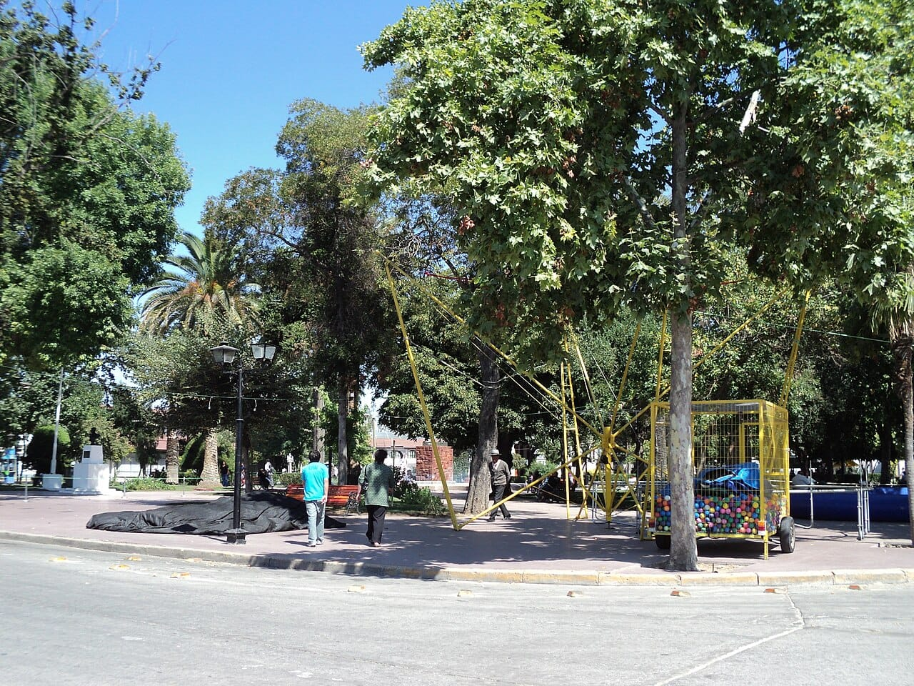
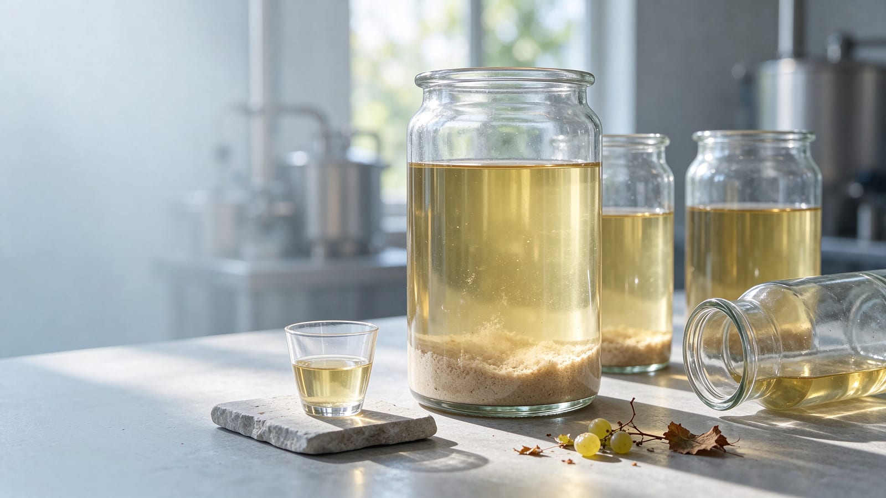
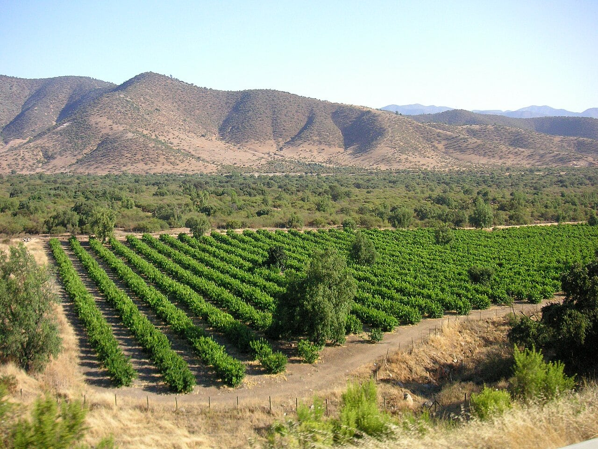

# Casablanca Valley

Casablanca Valley is a cool-climate region north-west of Santiago, on the road to Valparaíso, and a key site in the modernisation of Chilean white wine. It was replanted in the 1980s, gained legal status in 1994 and is known for Sauvignon Blanc, Chardonnay and Pinot Noir.

Figure: Casablanca Valley. Image: Diego Grez, CC BY-SA 3.0, via Wikimedia Commons ([source page](https://commons.wikimedia.org/wiki/File:Plaza_Casablanca.jpg)).

## A young region in the Pacific fog belt

Casablanca sits in Chile's Aconcagua wine region, close to the Pacific, on the transition between coastal hills and valley floor. Compared with the traditional Central Valley red districts, it lies further south and closer to the cold current, and ripening temperatures are clearly lower.

Its modern history is short. Before the 1980s the land grew wheat and raised dairy cattle, and vines were not a normal crop. Today it represents Chilean cool-climate white wine and marks an important westward and southward shift in the country's wine map.

Casablanca is not far from the port of Valparaíso, and export logistics are convenient, which matters for a white-wine region. The international growth of Chilean white wine is closely tied to cool regions near ports that can ship quickly. Ports, roads and cold storage are the invisible part of the region's competitiveness.

## The 1980s trials and the first vineyards

In 1982, Concha y Toro winemaker Pablo Morandé planted the first vines in Casablanca, initially mainly Chardonnay and Sauvignon Blanc. Early plantings were not easy: frost and an unfamiliar terroir made yields and ripeness hard to predict, but the trials proved that a cool climate could make whites quite unlike the Central Valley.

By the mid-1980s the first commercial wines reached the market, and their aromatic intensity and acidity drew international attention. Wineries followed, and Casablanca turned from a farming valley into one of Chile's most watched cool regions.

## 1994 and Decree 464

In 1994 Chile's Ministry of Agriculture passed Decree 464, establishing the country's wine zoning and origin rules. Valle de Casablanca was listed as a sub-region of the Aconcagua region, with its boundary extending to the commune of the same name.

The decree gave Casablanca a legal identity: a wine labelled Valle de Casablanca must come from that sub-region. It also tied the name to an administrative boundary, preventing producers from labelling wine from a wider area as Casablanca.

## How the cool climate forms

Casablanca's coolness has three sources. First, the Pacific Humboldt Current carries cold water, so coastal air stays cool. Second, morning fog lowers temperatures and raises humidity at dawn, slowing ripening. Third, valley openings and sea breezes draw cool air inland.

The result is a longer ripening period, higher acidity and lower potential alcohol. Whites keep citrus, green apple and herbal notes, while reds lean lighter, with spice and red fruit. The same climate brings frost risk, especially on low ground.

Picking timing matters more here: too early and aroma is thin, too late and acidity drops. Wineries pick in several passes by plot and variety, often bringing fruit in during cool mornings to preserve aroma precursors. Differences in fog, frost and heat accumulation between vintages show clearly in acidity and ripeness.

## Varieties: Sauvignon Blanc, Chardonnay and Pinot Noir

Sauvignon Blanc is Casablanca's signature white, typically with lime, passion fruit, cut grass and mineral notes and vivid acidity. Chardonnay was one of the first trial varieties and ranges from crisp stainless-steel styles to lees-stirred and barrel-fermented versions.

Pinot Noir performs well in the cool climate, with red cherry, strawberry and spice, in a light to medium body. Some producers also plant Riesling and other whites. Variety and origin claims must meet the minimum shares in Chilean wine law.

Whites are mostly [fermented](ref:fermentation) cool in stainless steel to keep aroma; wines aiming for texture may get lees stirring or partial barrel fermentation. Reds use lighter maceration and gentler extraction to avoid green tannin in cool years.

## Soils, frost and viticulture

Soils are mainly granite-derived clay and sandy loam, with drainage varying by terrain. Valley floors hold thicker, wetter soils but carry higher frost risk; higher, warmer and frost-free sites suit later-ripening varieties and top-quality whites. Producers therefore place their best plots on mid and upper slopes.

That structure also affects rooting depth and water supply. Granite clay can be too wet in rainy years and compacted in dry ones, so cover crops, deep cultivation and drainage channels are needed. Soil management is not background detail but a key variable in whether a cool region ripens reliably.

Viticulture has to manage humidity and mould pressure from morning fog, plus spring frost on low ground. Canopy management and harvest timing are more precise than in traditional warm districts. Soil, fog and slope together form the region's [terroir](ref:terroir).

## Labels, serving and misconceptions

Casablanca whites are best at about 10 to 12 degrees Celsius, with seafood, shellfish, salads and light poultry. Sauvignon Blanc suits goat cheese and herbs; Chardonnay given [lees](ref:lees-ageing) contact or oak suits grilled fish and cream sauces. Pinot Noir is best at about 14 to 16 degrees Celsius, with poultry and mushrooms.

Four misconceptions recur. First, treating Casablanca as an old traditional region: modern planting began in the 1980s. Second, equating cool climate with cold: it is still Mediterranean, with a dry summer, merely moderated by the ocean. Third, assuming the region only makes white wine: Pinot Noir and a little red perform consistently. Fourth, treating "Valle de Casablanca" as a marketing name: it is a legal sub-region under Decree 464.

For Casablanca Valley, begin with the appellation and its permitted varieties. Then look at the vintage and the producer, and finally ask how the wine is labelled. The answers point to different choices, not to a single score.

Read [Wine](ref:wine) for the geographic boundary side of Casablanca Valley, and [Chile](ref:chile) for the climate and soil side. Together they locate it.

**Key facts.**

| Item | Detail |
| --- | --- |
| In one line | Legal sub-region of Chile's Aconcagua wine region, north-west of Santiago on the road to Valparaíso. It was first planted in 1982 by Concha y Toro winemaker Pablo Morandé and formally defined by Decree 464 in 1994. Pacif… |
| Level | other |
| Parent | Chile |
| Country code | CL |

## References

- [Wine](ref:wine): the broad categories and origin rules.
- [White wine](ref:white-wine): the framework for white winemaking and style.
- [Chile](ref:chile): the wider map of Chilean wine regions.
- [Sauvignon Blanc](ref:sauvignon-blanc): the region's signature white.
- [Chardonnay](ref:chardonnay): one of the first trial varieties.
- [Pinot Noir](ref:pinot-noir): an important red in the cool climate.
- [Acidity](ref:acidity): cool climate and high acidity.
- [Fermentation](ref:fermentation): cool fermentation and aroma retention.
- [Lees ageing](ref:lees-ageing): how lees contact changes texture.
- [Terroir](ref:terroir): granite clay, fog and slope.
- [Alcohol by volume](ref:abv): what % vol means on a label.

## Related images

Image: Editorial illustration of lees ageing: wine layered above fine lees, with a racking tube and sample glass; AI-assisted illustration, not a photograph.. Credit: Hejiu editorial team, AI-assisted with Doubao Seedream 5.5; project-generated editorial figure, not a photograph ([about](https://hejiu.org/about/)). Related image for Casablanca Valley.

Image: A vineyard in the Andean foothills of Chile, with rows of vines running across the slope.. Credit: Beatrice Murch, CC BY-SA 2.0, via Wikimedia Commons ([source page](https://commons.wikimedia.org/wiki/File:Chilean_vineyard_in_Andes_foothills.jpg)). Related image for Casablanca Valley.
