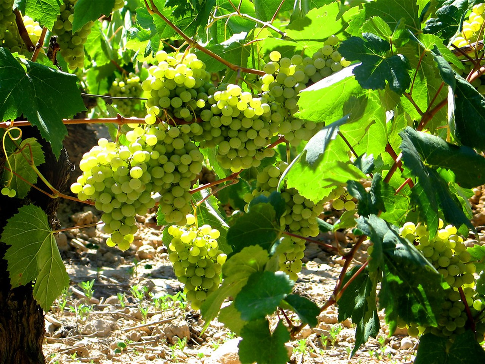

# Cava

Cava is the Spanish appellation for traditional-method [sparkling wine](ref:sparkling-wine). The name covers Penedès in Catalonia and several other authorised areas, with Macabeo, Xarel·lo and Parellada as the main varieties, often supplemented by [Chardonnay](ref:chardonnay) and [Pinot Noir](ref:pinot-noir).

Figure: Cava. Photograph: St. Sadurni d'Anoia - Bunches - Shoes on Wires. Credit: Shoes on Wires, CC BY 2.0, via Flickr / Openverse ([source](https://www.flickr.com/photos/9290458@N07/3087659344)).

## Definition and scope

Start with the levels: [sparkling wine](ref:sparkling-wine) is the category, Macabeo and the others are the varieties, Cava is the appellation name, and individual estates and wines are the producer level. Cava is not a single village but an appellation name covering several authorised areas.

Cava and Champagne relate as the same method in different regions: both use the traditional method with a second fermentation in bottle, but varieties, rules, ageing requirements and price bands differ. Calling Cava "Spanish Champagne" hides those differences.

## History

Modern sparkling wine production in Cava can be traced to the late 19th century, when estates in Penedès began using the second fermentation in bottle. From the 1970s producers unified under the name Cava to avoid confusion with French Champagne, and appellation rules were gradually established.

That history produced two faces: large-volume, affordable everyday sparkling wine, and high-end wines that emphasise long lees ageing and organic farming. Understanding the tier system matters more than memorising brands.

## Sub-zones

The main Cava area is Penedès in Catalonia, with other authorised areas including Aragón, Castilla y León, Castilla-La Mancha, Valencia, Extremadura, Navarra, the Basque Country and Rioja.

Altitude and climate in different areas affect ripeness and acidity. Coastal and inland parcels in Penedès differ clearly, with higher parcels usually keeping better acidity; other authorised areas mainly add volume and stylistic variety.

## Varieties and styles

White Cava is based on Macabeo, Xarel·lo and Parellada, which provide different combinations of acidity, fruit and aroma; Chardonnay adds citrus and creamy notes in some wines. Rosé Cava uses [Garnacha](ref:grenache), Pinot Noir and Trepat among others.

Base wines are usually picked earlier to keep acidity and lower alcohol. Styles range from fresh green apple, citrus and white flowers to bread, nut and cream notes after longer lees ageing.

## Winemaking and ageing tiers

Cava uses the traditional method: the base wine completes a first [fermentation](ref:fermentation), is bottled with sugar and yeast for a second fermentation, and the bubbles form in the bottle. The time on the lees decides the tier and the style.

By bottle ageing on the lees, Cava is divided into Cava de Guarda (minimum 9 months) and Cava de Guarda Superior (minimum 18 months). Within Guarda Superior, Reserva starts at 18 months, Gran Reserva at 30 months and Paraje Calificado at 36 months, with the latter requiring specific parcels and organic farming.

## Soils and terrain

Penedès soils are mainly limestone, clay and alluvial soil, with clear differences between coastal and inland parcels. Drainage and water retention affect root depth and the pace of ripening, and higher parcels have larger day-night temperature swings.

The terrain is hills and river valleys, with aspect and altitude moderating temperature. Parcels near the Mediterranean are more humid and ripen earlier, while inland high parcels keep better acidity, forming the base for Cava base wines.

## Labels and vintage

Labels usually carry D.O. Cava, the ageing tier, the sweetness indication, volume and bottler. Common sweetness terms include Brut Nature, Brut and Extra Dry, with lower numbers usually meaning drier.

Most Cava is non-vintage, based on blends; some top wines carry a vintage and a parcel. When buying, read the tier, sweetness and estate together rather than the word "Cava" alone.

## Market and drinking

Cava is Spain's largest sparkling wine in volume, with prices from everyday wine to high-end bottlings. The market has long centred on value, and the share of premium and organic wines has grown in recent years.

Cava commonly has about 11.5%–12.5% [alcohol by volume](ref:abv) and works as an aperitif or with seafood, salads, poultry and soft cheese. Serve at about 6–8 degrees Celsius; unopened bottles keep best at about 12–15 degrees Celsius. Excessive drinking harms health and minors should not drink.

## Common misconceptions

First, calling Cava "Spanish Champagne". Both use the same method, but regions, varieties and rules differ.
Second, thinking all Cava is cheap. High-end and long-aged wines are not inexpensive.
Third, treating Cava as a variety. It is a sparkling-wine appellation name.
Fourth, thinking longer ageing is always better. Ageing shapes style, not a guarantee of personal preference.
Fifth, thinking Cava is only white. Rosé Cava is also a legal type.

Cava is a Spanish sparkling wine made by the traditional method, not a synonym for Champagne. Macabeo, Xarel·lo and Parellada are the core varieties, and time on the lees determines the Guarda and Guarda Superior tiers. Cava can be produced in authorised areas beyond Catalonia. The word on the label describes a method and a rule set, not a sweetness level or a quality ranking.

**At a glance:** The Spanish appellation for traditional-method sparkling wine, covering Penedès in Catalonia and several other authorised areas; the main varieties are Macabeo, Xarel·lo and Parellada, often with Chardonnay and Pinot Noir, and bottle ageing on the lees splits into Cava de Guarda and Cava de Guarda Superior at minimums of 9 and 18 months. 

For Cava, begin with the appellation and its permitted varieties. Then look at the vintage and the producer, and finally ask how the wine is labelled. The answers point to different choices, not to a single score.

[Spain](ref:spain) and [Chardonnay](ref:chardonnay) are the nearest useful comparisons: one clarifies geographic boundary, the other tests climate and soil.

**Key facts.**

| Item | Detail |
| --- | --- |
| In one line | The Spanish appellation for traditional-method sparkling wine, covering Penedès in Catalonia and several other authorised areas; the main varieties are Macabeo, Xarel·lo and Parellada, often with Chardonnay and Pinot Noi… |
| Level | other |
| Parent | Spain |
| Country code | ES |

**Sources and limits.** The key claims about Cava are checked against the following sources: Consejo Regulador de la D.O. Cava (the authorised areas, varieties, traditional-method process and ageing tiers of Cava), European Union (EU wine categories, geographical indications and traditional terms), Oxford University Press (Consulted for entries on Cava, Macabeo, Xarel·lo and Parellada; Migrated from the former reference list at the end of the article; access date not re-verified). Prices, batches and status change; the body is project-written and does not reproduce source text.

## Further reading

- [Spain](ref:spain): the national framework to which Cava belongs.
- [Sparkling wine](ref:sparkling-wine): the process and style framework of traditional-method sparkling wine.
- [Chardonnay](ref:chardonnay) and [Pinot Noir](ref:pinot-noir): varieties permitted in Cava base wines.
- [Garnacha](ref:grenache): one of the varieties used for rosé Cava.
- [Fermentation](ref:fermentation): the logic of the first fermentation and the second in bottle.
- [Wine](ref:wine): an overview of wine categories, vintages and origin rules.
- [Alcohol by volume](ref:abv): what 11.5%–12.5% vol means on a label.
