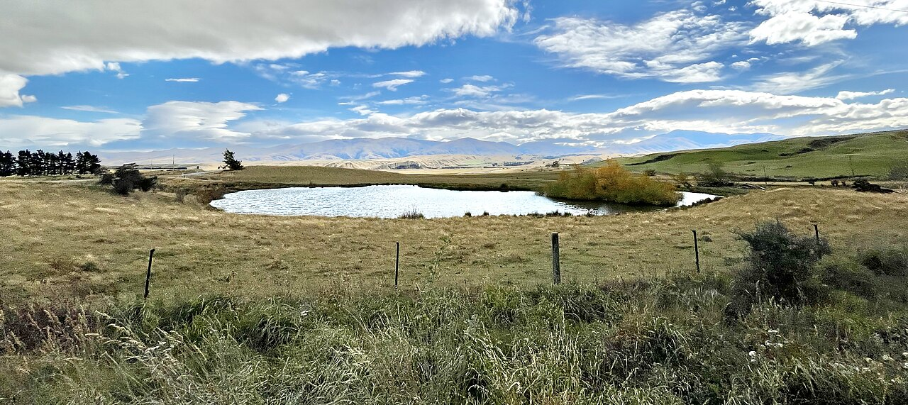

# Central Otago

Central Otago is New Zealand's southernmost wine region and one of the world's southernmost commercial wine regions. It lies inland on the South Island and is known for Pinot Noir, with mountains, lakes and a semi-continental climate shaping a concentrated, clearly structured style.

Figure: Central Otago. Image: AnnWoolliams, CC BY-SA 4.0, via Wikimedia Commons ([source page](https://commons.wikimedia.org/wiki/File:Hills_Creek,_Central_Otago.jpg)).

## Definition and scope

Central Otago lies inland in New Zealand's Otago region, with vineyards around Queenstown, Cromwell and Alexandra, mostly on river terraces, valley floors and hillsides. On New Zealand Winegrowers' 2026 vineyard report, the region has 2,116 hectares planted and 2,045 producing, about 5% of the national planted area.

The Central Otago GI was registered on 29 October 2018, number 1007. The region has six commonly used sub-regions: Gibbston, Bannockburn, Cromwell/Lowburn/Pisa, Bendigo, Wanaka and Alexandra.

## History

Central Otago's wine history goes back to the nineteenth century: in 1881 a local wine won a gold medal in Sydney, and in 1895 Bragato described the area as "pre-eminently suitable" for winemaking. Stonefruit then prevailed for decades until a revival in the 1950s, and a group of pioneers replanted vineyards in the 1970s.

Those pioneers included Chard Farm, Rippon, Black Ridge and Gibbston Valley. From the 1990s Pinot Noir's international reputation rose, and the region became New Zealand's benchmark for premium red wine.

## Geography and climate

Central Otago has a semi-continental climate: dry, with large summer-winter and day-night ranges. Summer days bring ample heat and nights cool sharply; winters are cold with high frost risk. Mountains and lakes redistribute heat: lakes reflect warmth and moderate frost, while aspect and altitude set the ripening pace.

This extreme climate makes site selection critical. North-facing slopes catch more heat, sites near lakes are more even in temperature, and low valley floors collect cold air. Vintages differ clearly: cool years ripen slowly and demand strict fruit selection, while warm years raise sugar faster and make acidity management more important.

Soils are mainly schist-derived, alluvial gravels and loess. Gravels drain quickly and warm early, while schist and loess differ in water and nutrient holding, affecting vigour and ripening. These differences form the basis of [terroir](ref:terroir).

## Sub-regions

Central Otago's six sub-regions differ clearly:

- Gibbston: in the Kawarau Gorge, the highest and cooler, with north-facing slopes ripening later and lighter but concentrated wines.
- Bannockburn: on the south bank of the Kawarau River, among the warmest and driest sites, with harvest up to a month ahead of other sub-regions and complex, distinctive wines.
- Cromwell, Lowburn and Pisa: along the western side of Lake Dunstan, stretching about 25 km north, mostly on low terraces and the valley floor.
- Bendigo: north-east of Cromwell, gentle north-facing slopes and stony soils, with strong contrast between summer heat and cool nights.
- Wanaka: about 80 km north of Queenstown, cooler and slightly wetter than the rest, with the lake moderating frost.
- Alexandra: the most southerly, dry with extreme summer and winter ranges and marked daily variation up to harvest, giving aromatic, finely structured wines.

Sub-regions are geographic and climatic ideas, not quality grades. A place name on a label should be read together with the registered GI rules.

## Varieties and raw material

Pinot Noir is Central Otago's flagship variety, about 80% of the vineyard. Wines often show dark cherry, plum, spice and earth, medium-bodied with fine tannin and clear acidity. Riesling, Pinot Gris and Gewürztraminer cover dry to sweet styles; Chardonnay shows citrus and mineral notes; Sauvignon Blanc and sparkling wine are also made.

The raw material is [grape](ref:grape). The variety structure is heavily concentrated in Pinot Noir, a result of climate, market and the region's history, but the aromatic whites also have a strong reputation.

## Winemaking

Pinot Noir often sees partial whole-cluster fermentation, shorter maceration and cooler fermentation, with some wineries using native yeast. Ageing is mostly in French [oak](ref:oak-ageing) with a low share of new barrels to keep fruit and aroma. Ripening differences between sub-regions affect whole-cluster shares, maceration strength and ageing choices.

Whites [ferment](ref:fermentation) cool. Riesling and Pinot Gris keep residual sugar or go fully dry by style; some Chardonnay sees oak and lees stirring; sparkling wine is made by the traditional method in small volume but draws attention.

## GI and labelling

New Zealand wine GIs are governed by the Geographical Indications (Wine and Spirits) Registration Act, and the Central Otago GI was registered in 2018. A label naming a single variety, vintage or area must have at least 85% of the wine from that variety, vintage or area; blends must be listed in descending proportion.

A GI is a geographic boundary, not a quality grade. New Zealand has no national winery classification, and winery reputation comes from history, wine performance and market assessment. Use of sub-region names must follow the GI rules.

## Labels and serving

The label should be checked for the GI name, variety, [vintage](ref:vintage), [alcohol](ref:abv), volume and bottler. A wine labelled as a [single variety](ref:single-varietal) must meet the 85% variety share; blends must list their varieties under the rules. Pinot Noir is served at about 14–16 degrees Celsius, Chardonnay at about 10–12 and Riesling at about 8–12 depending on style.

Pinot Noir suits poultry, mushrooms, salmon and light red meat; Riesling suits seafood, Asian dishes and spicy food; Chardonnay suits creamy dishes. Refrigerate after opening and finish soon. Excessive drinking harms health and minors should not drink.

## Common misconceptions

First, thinking Central Otago grows only Pinot Noir. Pinot Noir leads, but Riesling, Pinot Gris, Chardonnay and sparkling wine have steady production.
Second, treating "southernmost" as a quality guarantee. High latitude means tighter heat and ripening conditions, and quality still depends on site and vintage.
Third, treating sub-regions as quality grades. They are geographic and climatic divisions and do not judge quality.
Fourth, assuming a semi-continental climate is easy to farm. Frost, extreme temperature swings and water management are real constraints.
Fifth, taking a GI name for a brand. A GI is a geographic boundary; winery names and brands are separate.

**At a glance:** New Zealand's southernmost wine region, inland Otago around Queenstown, Cromwell and Alexandra. The 2026 vineyard report records 2,116 hectares planted and 2,045 producing, about 5% of the national total. Pinot Noir is about 80% of the vineyard and the flagship variety. A dry semi-continental climate with large summer-winter and day-night ranges, frost risk and site selection driven by mountains and lakes. Six sub-regions are Gibbston, Bannockburn, Cromwell/Lowburn/Pisa, Bendigo, Wanaka and Alexandra. The Central Otago GI was registered on 29 October 2018, and labels follow the 85% rule. 

## Further reading

- [Wine](ref:wine): an overview of wine categories, vintages and origin rules.
- [Red wine](ref:red-wine) and [white wine](ref:white-wine): the two main categories in Central Otago.
- [Pinot Noir](ref:pinot-noir): the region's flagship variety.
- [Riesling](ref:riesling) and [Chardonnay](ref:chardonnay): the region's white wine line.
- [Grape](ref:grape): the structure of wine grapes and ripeness measures.
- [Fermentation](ref:fermentation): how Pinot Noir and whites ferment differently.
- [Acidity](ref:acidity): how the day-night range and cool nights affect acidity.
- [Terroir](ref:terroir): how schist, gravels and lakes shape ripening.
- [Oak ageing](ref:oak-ageing): old barrels and low new-oak shares for Pinot Noir.
- [Dry](ref:dry): Riesling styles from dry to sweet.
- [Vintage](ref:vintage): vintage variation and frost risk in Central Otago.
- [Single varietal](ref:single-varietal): the 85% variety labelling rule.
- [Alcohol by volume](ref:abv): what % vol means on a label.
