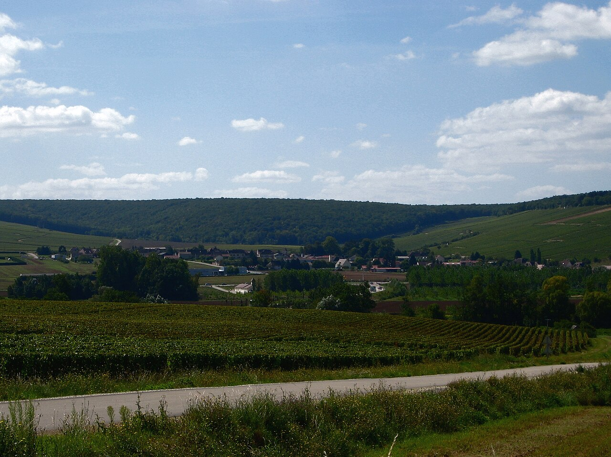

# Chablis

Chablis is the northernmost white-wine region of [Burgundy](ref:burgundy), in the Serein valley of the Yonne, with about 5800 ha of vines. It makes [white wine](ref:white-wine) from [Chardonnay](ref:chardonnay) alone and is known for high acidity and a mineral character in a cool climate. Unlike the Côte d'Or, it has no complex patchwork of villages and named sites but a clear four-tier structure: Petit Chablis, Chablis, Premier Cru and Grand Cru.

Figure: Chablis. Image: CocktailSteward, CC BY 3.0, via Wikimedia Commons ([source page](https://commons.wikimedia.org/wiki/File:Chablis_and_Premier_Cru_Vaulorent.jpg)).

## Location and overall outline

Chablis lies in northern Burgundy, about 140 km from Dijon and closer to the Paris basin than the Côte d'Or to its south. Vineyards spread along the Serein and its side valleys, with the core around the town of Chablis and about 20 villages. The area is large, but the genuinely sunny slopes are limited, so differences between tiers and sites are clear. The climate is semi-continental, cold in winter and mild in summer, with a shorter growing season than the Côte d'Or, and under-ripeness is a constant risk.

## The Serein valley and frost

The Serein runs north through the region and forms a channel for cold air along the valley floor. On spring frost nights cold air sinks to the bottom, so the middle of a slope is often safer than the valley floor; this is why vineyards were historically planted on the slope shoulders rather than the bottom. Modern growers fight frost with sprinklers, heaters, fans and covers, yet the severe frost of 2021 still cut the crop heavily. Hail is another risk, causing losses in some villages before 2021 and again in 2016. Picking usually starts in September and can run into October in cool years.

## Kimmeridgian soils

Chablis is defined by Kimmeridgian limestone and marl, formed about 150 million years ago in the late Jurassic and rich in marine fossils, especially the small oyster Exogyra virgula. These soils drain well, are low in fertility and hold little water, forcing vines to root deeply and naturally limiting yields; they are often used to explain a "oyster shell" mineral note, though minerality is a sensory description, not evidence that the wine contains rock. Portlandian limestone at the plateau edges is more common in Petit Chablis parcels, with thicker topsoil and a more direct wine.

## 1938 and the four-tier system

Chablis was formally granted appellation status in 1938, and the lists of Premier Cru and Grand Cru sites were refined over the following decades. The four tiers are: Petit Chablis, mostly from plateau edges or higher ground; Chablis, the main tier across the valley and surrounding villages; Premier Cru, labelled with a specific site name; and Grand Cru, with only 7 climats. The tier is set by law and is not an absolute quality guarantee; vintage and producer often decide how a bottle performs.

## Petit Chablis and village Chablis

Petit Chablis covers about 1200 ha, with a lighter body and direct acidity, often green apple and citrus, and is best drunk young. Village Chablis covers about 3600 ha and is the backbone of the region, its style varying by site: valley-floor parcels are leaner and sharper, slope parcels fuller. Neither tier requires a named site, so the label carries limited information and the estate, vintage and bottler matter more.

## Premier Cru

Premier Cru covers about 750 ha across sunny slopes in several villages, with familiar names including Montée de Tonnerre, Mont de Milieu, Fourchaume, Vaillons, Montmains and Les Beauregards. Premier Cru wines are usually fuller than village level with better ripeness while keeping clear acidity; soil and aspect differ clearly between names, with Montée de Tonnerre often considered closest to Grand Cru texture and Fourchaume leaning towards fruit and roundness.

## Grand Cru

There are only 7 Grand Cru climats, grouped on a sunny slope on the right bank of the Serein, about 100 ha in total: Les Clos, Vaudésir, Valmur, Grenouilles, Blanchots, Les Preuses and Bougros. Les Clos is the largest and most complete, often with beeswax, nuts and a saline note; Vaudésir is finer; Valmur has more structure; Grenouilles sits lower and is softer; Blanchots and Les Preuses are known for mineral and floral tones; Bougros at the top ripens more slowly. Grand Cru output is limited and marks the region's peak in price and ageing potential.

## Winemaking and style

Only Chardonnay is permitted. Most wines ferment in stainless steel or old barrels, with little [oak ageing](ref:oak-ageing) and even less new oak, so aromas are dominated by citrus, green apple, white flowers and wet stone. Grand Cru and some Premier Cru may use old barrels to add texture without masking acidity. Lees contact can add roundness, while malolactic fermentation lowers acidity and brings a creamy note; whether a producer allows malolactic is an important stylistic divide. With age, Chablis develops honey, beeswax and nuts, but the acid frame stays clear.

## Representative producers

Chablis has family estates, a cooperative and merchants. Raveneau and Dauvissat are often treated as representatives of the traditional style, the first known for density and ageing potential, the second for minerality and tension; La Chablisienne, founded in 1923, is a cooperative with a large share of output; William Fèvre, Christian Moreau and Louis Michel also produce several tiers, with Louis Michel known for avoiding new oak. The cooperative and merchants account for a significant share, and any bottle should still be judged by vintage, site and bottler.

## Vintages and the market

Chablis vintages turn mainly on frost, hail and ripening-season rain. Frost cut output clearly in 2016 and 2021, while 2018 and 2020 were warmer years with fuller bodies and slightly lower acidity. In the market, Chablis has long been the entry point to Burgundy white wine, cheaper than the Côte d'Or, though Grand Cru and top Premier Cru prices have risen clearly. The United Kingdom, the United States and Asia are key export markets; the cooperative and merchants secure supply but also risk stylistic uniformity.

## Common misconceptions

First, treating Chablis as a region separate from Burgundy. It belongs geographically and administratively to northern Burgundy. Second, assuming Chablis is heavily oaked Chardonnay. Most wines use no new oak and are built on lean acidity. Third, reading "minerality" as added minerals. It is a flavour description, not an ingredient list. Fourth, chasing only Grand Cru. Premier Cru and village wines can perform just as well, with vintage and producer mattering greatly. Fifth, confusing Chablis with Côte d'Or whites such as Meursault. Climate, soil and winemaking traditions differ. Sixth, believing Chablis cannot age. Good Premier Cru and Grand Cru can keep for more than a decade.

For Chablis, begin with the appellation and its permitted varieties. Then look at the vintage and the producer, and finally ask how the wine is labelled. The answers point to different choices, not to a single score.

[Burgundy](ref:burgundy) and [White wine](ref:white-wine) are the two useful reference points for Chablis. [Burgundy](ref:burgundy) sets out geographic boundary; [White wine](ref:white-wine) brings in climate and soil. Read them together.

## Further reading

- [Burgundy](ref:burgundy): the parent region of Chablis.
- [Chardonnay](ref:chardonnay): the only permitted variety in Chablis.
- [White wine](ref:white-wine): the drink style of the region.
- [Oak ageing](ref:oak-ageing): how cask type and age affect style.
- [Terroir](ref:terroir): how soil, aspect and climate shape flavour.
