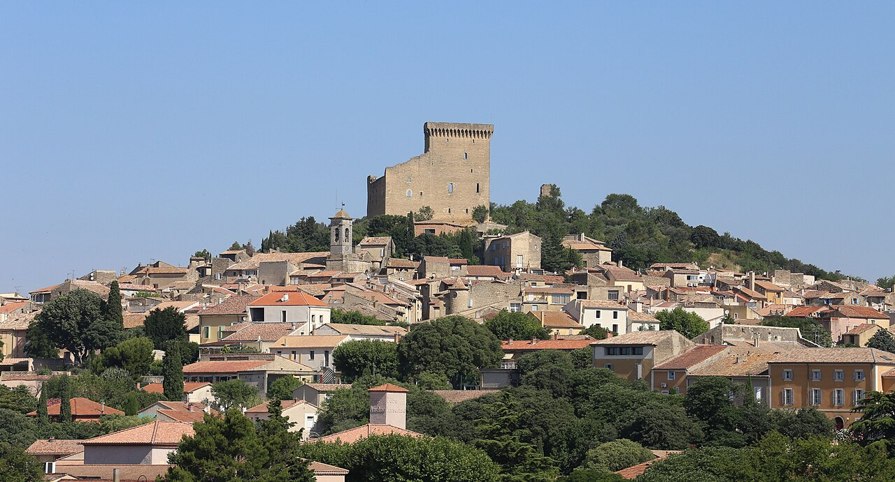

# Châteauneuf-du-Pape

Châteauneuf-du-Pape is an appellation in the Southern [Rhône](ref:rhone), north of Avignon, with vineyards spread across the plateaus and hills of the Rhône's left bank. Its first impression is often "full-bodied, spicy, high in alcohol", but what really shapes the style is the heat of the stone-covered plateaus, the drying mistral and a blending tradition built on [Grenache](ref:grenache).

Figure: Châteauneuf-du-Pape. Image: Aa77zz, CC0, via Wikimedia Commons ([source page](https://commons.wikimedia.org/wiki/File:Village_of_Chateauneuf-du-Pape.JPG)).

## Location and overall outline

The appellation runs from Orange in the north to a few kilometres north of Avignon, mostly within the Vaucluse. Its vineyards cover about 3200 ha, making it one of the largest single appellations in the Southern Rhône. It shares the Mediterranean climate of Gigondas and Vacqueyras, but its size and the variety of its parcels give it a much wider internal range than many smaller appellations. There is only one AOC name, with no Burgundy-style Premier Cru or Grand Cru hierarchy, and labels usually carry only the appellation and the vintage.

## Terrain and the mistral

Vineyards sit mostly between 100 and 150 m, with aspects favouring south-east, south and south-west. The Rhône valley widens here into several east-west side valleys, and cold air can drain down them. The mistral blows from north to south through the valley, often through the year, lowering humidity and reducing rot but also causing wind damage and poor fruit set at flowering; growers rely on low bush vines (gobelet) or low-trained trellising to keep the canopy near the ground. The drying wind allows relatively little chemical intervention, but it also makes young vines harder to establish.

## Rounded stones and three soil types

The most famous feature is galets roulés: rounded quartzite pebbles from an ancient Rhône riverbed, densely covering plateaus such as La Crau. They absorb heat by day and release it slowly at night, while limiting evaporation and wind erosion; beneath them usually lies a mix of sand, clay and limestone that drains extremely fast, forcing old vines to root deeply. The second type is safres, fine sand, characteristic of parcels such as those of Rayas, with poor water retention and quick warming, often giving more delicate wines. The third is the clay-limestone plateau to the north and east, which holds water better and ripens more slowly.

## 1936 and a single-tier appellation

Châteauneuf-du-Pape became one of France's earliest appellations in 1936, a date often cited to underline its place in the history of the AOC system. The name comes from the castle built after the papal court moved to Avignon in the 14th century, but today's legal boundary is not a direct inheritance of papal property. There are no official sub-appellations; growers describe styles by site, such as the stone-covered La Crau plateau, sandy slopes and clay-limestone parcels. The rules limit yields, ripeness and variety proportions, with a recent ceiling of roughly 35 hl/ha and a minimum natural alcohol of 12.5% for reds.

## The thirteen permitted varieties

The legal list is commonly summarised as 13, red and white together. In the usual reckoning it includes Grenache (with black, white and grey colour variants counted as one entry), Syrah, Mourvèdre, Cinsault, Clairette, Roussanne, Bourboulenc, Picpoul, Terret Noir, Counoise, Muscardin, Vaccarès and Picardan. The list is a permitted range, not a recipe: a wine may use one of them or several, with no single template for proportions. Reds are Grenache-led, often with Syrah and Mourvèdre adding colour, tannin and acidity; whites rely on Grenache Blanc, Clairette, Roussanne and Bourboulenc and account for only about 5% of output.

## Red and white styles, and winemaking

Red wines are typically described with ripe blackberry, plum, Provençal herbs, leather, truffle and liquorice, a full body and alcohol that often sits between 14% and 15%. Whole-cluster fermentation can add spice and a freshness from the stems, but also carries a risk of green notes; most estates ferment in concrete tanks or large oak vats (foudres) and then age in old barrels or vats, using relatively little new oak so as not to mask variety and site. Whites are leaner, keeping acidity through early picking and site, and often show white flowers, fennel and a faint saline note.

## Old vines, yields and maturation

The appellation keeps a large stock of old Grenache, some vines over 80 years old, with low yields, small berries and concentrated flavour, though age does not automatically mean greater drought or disease resistance and demands careful pruning and nutrition. Old vines are mostly on stone and sand sites, with deep roots that hold ripeness better in dry years. Maturation runs from one to several years depending on body and market position; excessive barrel ageing strips away fruit and spice detail.

## Notable estates

Château Rayas is known for Grenache from sandy sites, with a delicate, red-fruit and spice profile; Château de Beaucastel, run by the Perrin family, uses all the permitted varieties, with a high share of Mourvèdre and long-standing organic farming; Vieux Télégraphe's La Crau parcel is a classic of the stone-covered plateau; Clos des Papes, Domaine de la Janasse and Domaine du Pégaü are also widely discussed. Large merchants and the cooperative account for a share of output, while family estates stress site and old vines.

## Vintages and the market

Southern Rhône vintages turn mainly on heat and water: the 2003 heatwave gave very high alcohol and low acidity, spring frost in 2021 cut the crop severely, and 2019 and 2020 were successive tests of drought and heat. In the market, Châteauneuf-du-Pape has long been the benchmark for Southern Rhône price and recognition, with the United States, the United Kingdom and Asian restaurants as key export channels; but the name is also easily overused, and quality under it varies widely. Judge a bottle by estate, site, vintage and bottling information rather than the appellation alone.

## Common misconceptions

First, thinking all 13 varieties must appear in one wine. The list is a permitted range, not a recipe. Second, treating the stones as the only source of flavour. Soil, old vines, climate and winemaking all contribute. Third, assuming high alcohol must mean imbalance. Ripeness needs to be read together with acidity and tannin. Fourth, believing Châteauneuf-du-Pape makes only red wine. A little white and rosé is also produced. Fifth, taking the appellation name for an estate. Châteauneuf-du-Pape is an appellation, not a single castle. Sixth, assuming old vines are always better. Vine age is one variable among many, and farming and vintage matter just as much.

For Châteauneuf-du-Pape, begin with the appellation and its permitted varieties. Then look at the vintage and the producer, and finally ask how the wine is labelled. The answers point to different choices, not to a single score.

## Further reading

- [Rhône](ref:rhone): the parent region to which Châteauneuf-du-Pape belongs.
- [Grenache](ref:grenache): the core variety of the Southern Rhône and this appellation.
- [Red wine](ref:red-wine): the main drink style of the appellation.
- [Fermentation](ref:fermentation): how maceration and whole clusters shape style.
- [Terroir](ref:terroir): how stones, soil and wind affect ripening.

## Related images

Image: Rhône Valley. Credit: Béa at French Wikipedia, Public domain, via Wikimedia Commons ([source page](https://commons.wikimedia.org/wiki/File:Thain1.jpg)). Related image for Châteauneuf-du-Pape.

Image: Grenache. Credit: Jules Troncy, Public domain, via Wikimedia Commons ([source page](https://commons.wikimedia.org/wiki/File:Grenache_N.jpg)). Related image for Châteauneuf-du-Pape.
