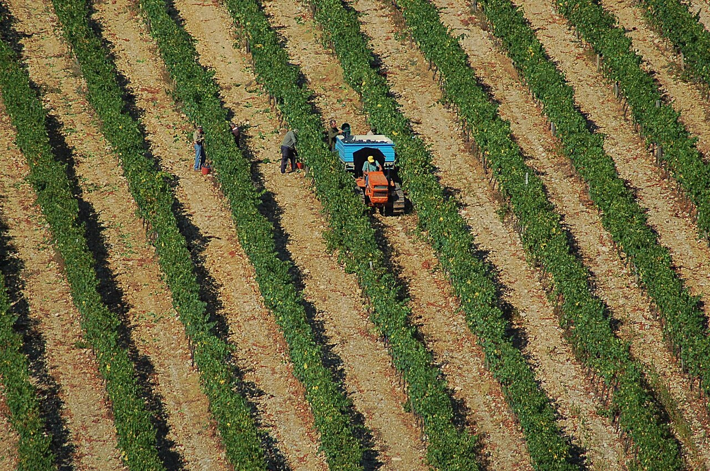
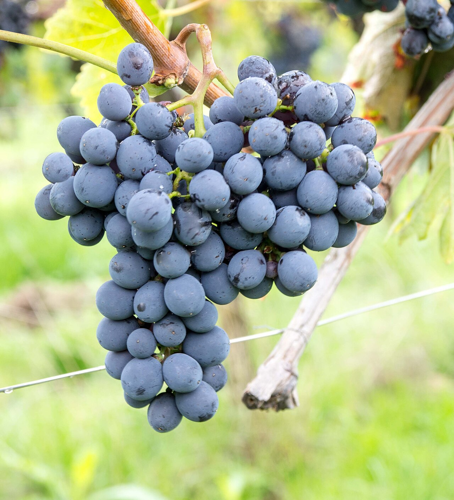

# Chianti Classico

Chianti Classico is the red-wine DOCG of the hills between Florence and Siena in Tuscany, with a production zone of about 71,800 hectares and Sangiovese as its main grape. Since 1996 it has had its own rules, separate from the larger Chianti appellation, and the Black Rooster on the bottle is its most recognisable identity mark.

Figure: Chianti Classico. Photograph: Vineyards in the Chianti Classico valleys (6222951465). Credit: Tom Chance from Peckham, CC BY-SA 2.0, via Wikimedia Commons ([source](https://commons.wikimedia.org/w/index.php?curid=133577648)).

## Definition and scope

Chianti Classico may only be used for red [wine](ref:red-wine) made entirely within the demarcated zone and marked with the Black Rooster. The zone lies in central [Italy](ref:italy), in [Tuscany](ref:tuscany), and covers the entire municipalities of Castellina in Chianti, Gaiole in Chianti, Greve in Chianti and Radda in Chianti, plus parts of Barberino Tavarnelle, Castelnuovo Berardenga, Poggibonsi and San Casciano Val di Pesa.

[Sangiovese](ref:sangiovese) must be at least 80%, with the remaining 20% from red varieties authorised by the Region of Tuscany; since 2006 only red varieties have been allowed, and white grapes are excluded. The wines are classed as Annata, Riserva or Gran Selezione — types within one appellation, not three sub-zones.

The 71,800 hectares include woodland, olives and villages, not only vineyards; Classico identifies the historic core, not a fixed parcel.

## History

The Black Rooster goes back to 1384, when it became the emblem of the Lega del Chianti; in 1398 a notarial document first applied the name Chianti to the wine.

On 24 September 1716 Grand Duke Cosimo III of Tuscany issued a decree fixing the boundaries of Chianti wine production, running from Spedaluzzo to Greve and Panzano and including the podesteria of Radda with Gajole and Castellina, an early exercise in origin protection.

In 1872 Bettino Ricasoli set down the blend recipe based on Sangiovese with Canaiolo and other grapes. On 14 May 1924, 33 producers founded a protection consortium in Radda and chose the Black Rooster as its emblem. In 1932 a ministerial decree divided Chianti into seven production zones, and only wine from within the 1716 boundary could add the suffix Classico; the seven refers to Chianti zones, not seven villages.

Chianti Classico obtained DOC status in 1967 and became DOCG in 1984; the decree of 5 August 1996 made it an autonomous DOCG with rules separate from Chianti. In 2005 the Black Rooster changed from a consortium collective mark into the symbol of the whole appellation and was incorporated into the state-approved neck band; in 2014 Gran Selezione was introduced as a new top type.

## Geography and climate

The zone occupies the hills between Florence and Siena, with vineyards on slopes and ridges; the hill terrain improves air movement, easing summer heat and helping the fruit keep acidity in autumn.

Soils are typified by galestro marl, which breaks into free-draining flakes, and alberese limestone, which is harder and richer in calcium; both are mixed with clay and sandy deposits. The soils are poor and well drained, pushing roots deep and limiting yields, though water-holding capacity varies by site.

The climate combines Mediterranean and continental influences, with warm dry summers, wide autumn day-night swings and rain concentrated in winter and spring. Higher or north-facing slopes ripen more slowly and retain more acidity, while south-facing slopes are warmer and fuller in fruit. Vintage differences come mainly from flowering rain, summer heat and pre-harvest rain rather than from soil type alone.

## Varieties and viticulture

Sangiovese has thin skins, high acidity, moderate to firm tannin and aromas of sour cherry, violet, dried grass and earth; it ripens late, usually from late September to early October.

The legal blend is at least 80% Sangiovese, with the rest from local varieties such as Canaiolo Nero, Ciliegiolo, Colorino, Fogliatonda, Malvasia Nera, Mammolo and Pugnitello, or international varieties such as Cabernet Franc, Cabernet Sauvignon, Merlot and Syrah. 100% Sangiovese has been allowed since 1996, and since 2006 no white variety may appear in the blend.

Yields are kept low for an Italian DOCG to concentrate flavour, with the ceiling changing as rules are revised; viticulture stresses slopes, ventilation and a balanced canopy.

## Winemaking and ageing

Annata is the youngest type, with at least 12% alcohol and 12 months ageing; Riserva needs at least 12.5% alcohol and 24 months, including at least 3 months in bottle; Gran Selezione needs at least 13% alcohol and 30 months, including at least 3 months in bottle. Minimum dry extract is 24, 25 and 26 g/L respectively, and total acidity is at least 4.5 g/L for all three.

Gran Selezione must come only from estate-owned grapes, from a single vineyard or a selection of the best fruit, and may carry an additional geographical unit on the label. Introduced only in 2014, it is a recent top type added above an existing DOCG, not an old hierarchy.

Sangiovese's acid and tannin need [oak ageing](ref:oak-ageing) to integrate, but cask type is not fixed. Large casks stress fruit and acidity, small French barrels add spice and body; the difference between Riserva and Gran Selezione often comes from cask and bottle time rather than vintage alone.

## Classification and rules

Chianti Classico has no legal village classification. Annata, Riserva and Gran Selezione form a pyramid of types, while an additional geographical unit (MGA) is an optional, more specific place name, mainly seen on Gran Selezione. Treating Riserva as a better site, or Gran Selezione as the official first place, misreads the rules.

Before 1996 Chianti Classico shared Chianti's rules; after 5 August 1996 they became separate DOCGs with different zones, varieties and ageing. The seven Chianti zones of 1932 explain the Classico suffix, not today's internal divisions.

Labels must show Chianti Classico and DOCG; the Black Rooster normally sits on the neck or back label and is part of the state band. Only wine made inside the 1716 boundary may use Classico, and other areas cannot borrow the name.

## Style and serving

Annata shows fresh sour cherry, violet and herbs, with bright acidity and moderate tannin, and suits tomato dishes, roast vegetables and medium-hard cheese. Riserva has riper fruit, more spice and leather, and suits braised meat and aged pecorino. Gran Selezione has the deepest structure and most complex perfume, and suits game or drinking on its own.

Serve at 16–18°C; the high acidity makes the wine flexible with food but magnifies greasiness. Young wines can be decanted briefly; old wines need less exposure to keep their perfume.

Choose by type first, then vintage and producer style; altitude, aspect and soil make Annata and Riserva perform differently, and the Black Rooster proves origin, not type.

Read [Italy](ref:italy) for the geographic boundary side of Chianti Classico, and [Sangiovese](ref:sangiovese) for the climate and soil side. Together they locate it on a map.

## References

- [Italy](ref:italy): the national appellation and DOCG framework.
- [Tuscany](ref:tuscany): the regional setting of Chianti Classico.
- [Sangiovese](ref:sangiovese): the dominant variety of the zone.
- [Red wine](ref:red-wine): an overview of still red winemaking.
- [Oak ageing](ref:oak-ageing): cask type, age and micro-oxygenation.
- [Terroir](ref:terroir): a framework for altitude, aspect and soil.

## Related images

Image: Sangiovese. Credit: Please note: This photo can be reproduced. Please quote the source as indicated below: Ursula Brühl, Julius Kühn-Institut (JKI) Bundesforschungsinstitut für Kul, CC BY-SA 4.0, via Wikimedia Commons ([source page](https://commons.wikimedia.org/wiki/File:VIVC10680_SANGIOVESE_Cluster_in_the_field_20354.jpg)). Related image for Chianti Classico.

Image: Tuscany vineyard. Credit: cova69, CC BY 2.0, via Wikimedia Commons.. Credit: cova69, CC BY 2.0, via Wikimedia Commons ([source page](https://commons.wikimedia.org/w/index.php?curid=1393578)). Related image for Chianti Classico.
