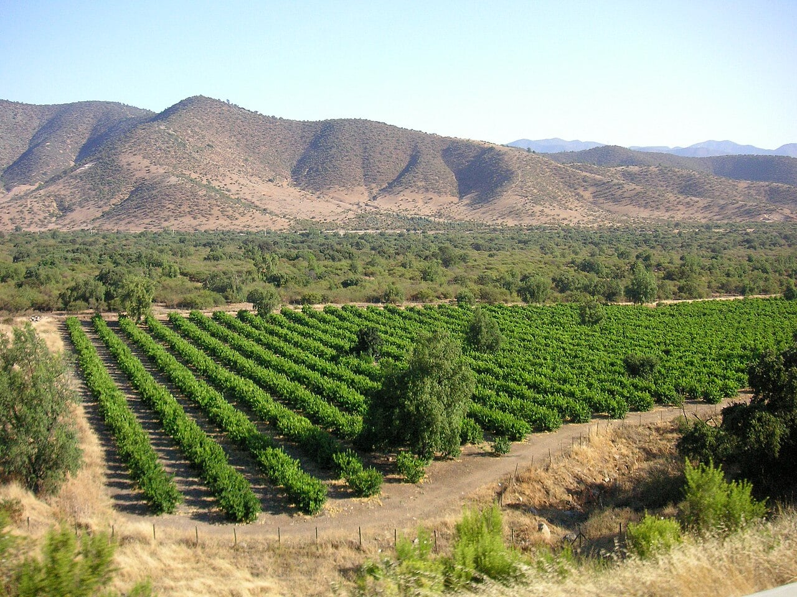

# Chile

Chile is a long, narrow wine-producing country on the west coast of South America, with vineyards between the Andes and the Pacific, from the desert edge in the north to cooler country in the south.

Figure: A vineyard in the Andean foothills of Chile, with rows of vines running across the slope. Image: Beatrice Murch, CC BY-SA 2.0, via [source page](https://commons.wikimedia.org/wiki/File:Chilean_vineyard_in_Andes_foothills.jpg).

## Definition and scope

Chile is a country-level wine region. In the 2024 SAG vineyard census the national vineyard covered about 126,249 hectares, of which 116,961 were wine varieties and 9,287 were Pisco grapes; among wine varieties, reds covered 84,768 hectares, 72.5%, and whites 32,194 hectares, 27.5%.

Vineyards are concentrated in the centre and south. O'Higgins has about 36,026 hectares and Maule about 48,565, together about two thirds of the country; the Metropolitan Region has about 8,898 hectares of wine varieties and Valparaíso about 7,757. From 2023 to 2024 the national vineyard fell by about 7,400 hectares, around 6%, reflecting lower domestic consumption and vine removals.

## History

Viticulture in Chile began in the sixteenth century under Spanish colonisation, based on varieties brought by missionaries and local Criolla types. In the mid-nineteenth century Bordeaux varieties were introduced and irrigation canals and railways expanded the industry; the European vine crises of the late nineteenth century affected Chile relatively little, so some old vines survived.

In the late twentieth century Chile turned to exports and wineries adopted stainless steel, temperature control and international varieties. In the 1990s Carménère was identified among vines long grown as Merlot and became one of Chile's signature varieties. At the same time cool coastal areas were reassessed, and Casablanca grew from trial plantings in 1982 into a separate region.

## Geography and climate

Chile runs about 4,300 kilometres from north to south and its wine regions span several climates. The centre has a Mediterranean climate with hot dry summers, cool wet winters and rain concentrated in winter; the coast is cooled by the Pacific current and morning fog and has a small day-night range, while inland valleys are hotter and drier and depend on Andean snowmelt.

The Andes and the coastal range form two barriers that leave the central valley relatively enclosed. This limits the spread of disease and creates a clear climate gradient, so the same variety ripens and tastes differently in coastal Casablanca and inland Maipo.

Soils are mainly river alluvium, gravel, sand and clay; alluvial fans at the foot of the Andes drain well, while the coastal range tends to have weathered granite and clay. Differences in drainage, water holding and rooting depth create [terroir](ref:terroir) differences within a valley.

## Origin system

Chile's origin naming was established by Ministry of Agriculture Decree 464, drafted in December 1994 and published in May 1995, under the wine law Ley 18.455. The decree divides regions into four levels, Región Vitícola, Subregión, Zona and Área, and sets legal boundaries and permitted varieties for each.

Wines that comply may carry D.O. (Denominación de Origen) and the place name on the label. Mentions such as Reserva, Reserva Especial and Gran Reserva are regulated complementary terms tied to minimum alcohol and wood treatment rather than a uniform quality grade. Chile is not an EU member, and its D.O. runs parallel to, but is not the same as, the EU PDO and PGI framework.

## Maipo

Maipo is a Subregión of the Valle Central region, covering the Metropolitan Region and including the Áreas of Santiago, Pirque, Puente Alto, Buin, Isla de Maipo, Talagante, Melipilla, Alhué, María Pinto, Colina and Calera de Tango. It is the historical core of Chilean red wine, and wineries such as Concha y Toro, founded in 1883, and Santa Rita, founded in 1880, began here.

The climate is Mediterranean, with hot dry summers and cold wet winters. Eastern vineyards sit on alluvial fans at the foot of the Andes with gravel and stones that drain well; western vineyards extend onto sandy soils of the coastal range. Altitude and distance from the mountains create clear differences, and foothill sites have a larger day-night range and slower ripening.

The main variety is Cabernet Sauvignon at about 5,517 hectares, followed by Merlot at about 890 hectares, Syrah at about 869, Carménère at about 709, Sauvignon Blanc at about 604 and Chardonnay at about 602, with Tintorera at about 454; the valley has about 10,000 hectares of vines. Cabernet Sauvignon here usually shows blackcurrant, graphite and firm tannin and is suited to [oak ageing](ref:oak-ageing).

## Casablanca

Casablanca is a Subregión of the Aconcagua region, legally limited to the municipality of Casablanca, about 75 kilometres north-west of Santiago and about 20 kilometres from the Pacific. In 1982 Pablo Morandé planted the first 20 hectares of Chardonnay, Sauvignon Blanc and Riesling, now seen as the start of cool-climate viticulture in Chile.

The region is cooled by the Pacific current, morning fog and afternoon sea breezes, so the growing season is clearly cooler than inland valleys and ripening is slow. Soils are mostly weathered granite and clay with good water retention, in contrast to the gravelly alluvium of Maipo. Higher, warmer and frost-free sites suit reds such as Merlot and Syrah, while lower, cooler sites are mainly white.

The main varieties are Sauvignon Blanc at about 2,235 hectares, Chardonnay at about 1,420 and Pinot Noir at about 853, followed by Merlot at about 238 and Syrah at about 107; the valley has about 5,000 hectares of vines. Sauvignon Blanc usually shows citrus, green herb and mineral notes, while Chardonnay has clear acidity and some wines see oak and lees.

The contrast between Maipo and Casablanca can be summed up as follows. Maipo is inland and warm, dominated by reds such as Cabernet Sauvignon; Casablanca is coastal and cool, dominated by whites such as Sauvignon Blanc and Chardonnay. Neither sells altitude as its only point, and climate and soil are the main drivers of style.

## Varieties and raw material

Cabernet Sauvignon, Sauvignon Blanc, País and Carménère are the four largest varieties, together about 56% of the national wine varieties. Cabernet Sauvignon is the core red; Sauvignon Blanc is widely planted on the coast and in the centre; País is an early-introduced old variety, mostly in the south and among small producers; Carménère comes from Bordeaux and has become a signature Chilean variety, often showing green pepper, spice and supple tannin.

Among whites, Chardonnay and Sauvignon Blanc cover most of the area, along with Moscatel, Torrontés and Pedro Jiménez. The raw material is [grape](ref:grape). Many Chilean vineyards are on their own roots, and some old vines escaped phylloxera, which is linked to the country's geographical isolation, sandy soils and irrigation practices.

## Winemaking

Red grapes are macerated according to variety and style. Cabernet Sauvignon and Carménère often get longer maceration and oak ageing, while Syrah and Pinot Noir aim for fruit and medium body. Some wines use whole-cluster fermentation or a high share of old barrels to reduce the sweet spice of new oak.

White grapes are [fermented](ref:fermentation) cool and mostly keep fresh acidity without malolactic fermentation; Casablanca Sauvignon Blanc is usually fermented in stainless steel with brief lees contact. Some Chardonnay sees oak, lees stirring and malolactic fermentation for a fuller style.

## Labels and serving

The label should be checked for the D.O. and place name, variety, [vintage](ref:vintage), [alcohol](ref:abv), volume and bottler. A wine labelled as a [single variety](ref:single-varietal) must meet the legal variety share; blends must list their varieties under the rules. Mentions such as Reserva should be read together with alcohol and winemaking requirements, not taken as a quality grade.

Maipo Cabernet Sauvignon is served at about 16–18 degrees Celsius, Casablanca Sauvignon Blanc at about 8–10, Chardonnay at about 10–12 and Pinot Noir at about 14–16. Cabernet suits red meat and hard cheese; Sauvignon Blanc suits seafood, salads and Asian food. Refrigerate after opening and finish soon. Excessive drinking harms health and minors should not drink.

## Common misconceptions

First, thinking Chile makes only Cabernet Sauvignon. Whites are 27.5% of wine varieties, and Sauvignon Blanc and Chardonnay cover large areas.
Second, treating Casablanca as part of Maipo. Casablanca belongs to the Aconcagua region and Maipo to the Valle Central region.
Third, treating Reserva as a uniform quality grade. It is a regulated complementary mention tied to alcohol and winemaking.
Fourth, reading Chilean labels with the EU PDO system. The Chilean D.O. is a national four-level system that runs parallel to, but is not the same as, the EU framework.
Fifth, assuming Chilean vineyards rely on natural rainfall. The central regions are dry in summer and depend on Andean snowmelt irrigation.

## Further reading

- [Wine](ref:wine): an overview of wine categories, vintages and origin rules.
- [Red wine](ref:red-wine) and [white wine](ref:white-wine): the two main categories of Chile.
- [Grape](ref:grape): the structure of wine grapes and ripeness measures.
- [Fermentation](ref:fermentation): red maceration and cool white fermentation.
- [Acidity](ref:acidity): how the cool coast and the day-night range affect acidity.
- [Terroir](ref:terroir): how the coastal range, Andean foothills and alluvium create valley differences.
- [Oak ageing](ref:oak-ageing): container choices for Cabernet Sauvignon and Chardonnay.
- [Dry](ref:dry): the dry positioning of Chilean whites.
- [Vintage](ref:vintage): vintage variation and El Niño effects in Chile.
- [Single varietal](ref:single-varietal): the concept behind variety labelling.
- [Alcohol by volume](ref:abv): what % vol means on a label.

## Related images

Image: Vintage. Credit: Chiusi Painter, Public domain, via Wikimedia Commons ([source page](https://commons.wikimedia.org/wiki/File:Cup_vintage_Cdm_Paris_320_n1.jpg)). Related image for Chile.

Image: Wine. Credit: André Karwath, CC BY-SA 2.5, via Wikimedia Commons ([source page](https://commons.wikimedia.org/wiki/File:Red_and_white_wine_in_glass.jpg)). Related image for Chile.
