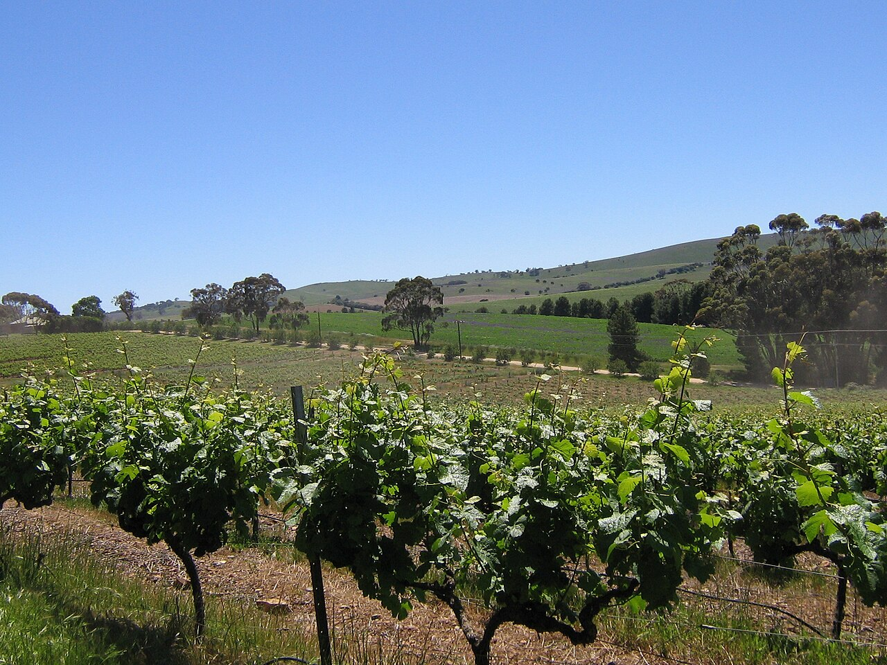

# Clare Valley

A narrow valley in the mid-north of South Australia, known for Riesling and Shiraz; slate, limestone and red soils, a wide diurnal range and old vines make it the core of Australian Riesling, with GI status in the 1990s.

Figure: Clare Valley: Vines in Clare Valley (Wikimedia Commons). Image: Scott Davis, CC BY-SA 3.0, via Wikimedia Commons ([source page](https://commons.wikimedia.org/wiki/File:Vines_in_Clare_Valley.jpg)).

## Definition and boundaries

Clare Valley lies in the mid-north of South Australia, a narrow north-south valley; at 300–500 metres with a wide diurnal range, cool nights preserve acidity.

In an official geographical indication, the boundaries of Clare Valley are not a decorative line but a legal and historical construction made of place names, parcels and maps. It may be a county, a group of villages, or a narrow strip along a river or mountain; the more specific the name, the less freely it can be used on a label.

Clare Valley’s useful units are Auburn, Watervale, Polish Hill, Sevenhill and the surrounding slopes, not the single GI name. Polish Hill’s slate and shallow soil give a tight, mineral Riesling; Watervale’s fuller soils give flowers and citrus; Auburn is warmer and more red-fruit driven. The sub-region on the back label is the first clue.

## History and naming

Riesling is the signature, with lemon, green apple, white flowers and mineral when young, honey, toast and petrol with age; Polish Hill and Armagh are famous sites.

The name Clare Valley usually appears first in local archives, church records or tax rolls, and only later in modern regulations. The name often stabilises later than the boundary, which is why the same place can carry different spellings across languages and periods.

Sevenhill was planted by Jesuits in 1851 for Mass wine, and German and English settlers added Riesling, Shiraz and Cabernet later. The 1970s and 1980s dry-Riesling revival changed the region’s reputation, and the GI arrived in the 1990s. The name Clare comes from an Irish place name, not from a single founding estate.

## Geography and terroir

Shiraz is usually medium-bodied with blackberry, black pepper and earth, not a rich Barossa style; old vines date back to the nineteenth century in places.

The vineyards of Clare Valley sit at particular elevations, aspects and soil parent materials. Distance to the sea, mountain direction, diurnal range and harvest rain all change ripening and acidity; these conditions explain more about style than the name alone.

The valley lies in the northern Mount Lofty Ranges at about 300–500 m, with hills on both sides and a creek floor. Mediterranean conditions bring warm days, cool nights and low growing-season rainfall, so irrigation is normal. Polish Hill’s slate holds little water and forces deep roots; Watervale’s soils are deeper and more fertile.

## Raw materials and styles

Soils are slate, limestone, red earth and sand, well drained; slope and aspect affect ripening.

The vines of Clare Valley determine what can be made. The leading varieties or raw materials, permitted blends, minimum ripeness and maximum yields are usually written into rules; but rules are a floor, and the real style comes from picking dates, fermentation vessels and ageing.

Riesling is picked early, often before alcohol reaches 12%, to keep lime, slate and high acidity; Shiraz is picked later, balancing pepper and black fruit. The window can be a few weeks, and rain or heat can close it quickly. Growers choose between green-lime freshness and riper citrus, and that choice shapes the wine.

## Representative producers and wines

Representative producers include Grosset, Jim Barry, Tim Adams, Mount Horrocks, Pikes and Knappstein; Grosset Polish Hill Riesling is an Australian benchmark.

The representative wineries of Clare Valley usually show the two poles of a region: long-established families or cooperatives with concentrated holdings, and newer arrivals working parcel by parcel. Tasting both explains the region better than a list of famous names.

The region is dominated by family estates and small companies rather than cooperatives. Sevenhill, Skillogalee, Pikes, Tim Knappstein and Jim Barry grow, make and sell largely under their own names. Some brands source fruit from several sub-regions, so the back label’s vineyard information matters more than the front label.

## How to drink and pair

To drink Clare Valley, start with alcohol, acidity and tannin or bitterness, then choose temperature and food. High acidity suits fat and salt, high tannin needs protein and fat, and high alcohol clashes with sweet or very spicy dishes; warmth pushes alcohol over aroma.

Serve Clare Riesling at 8–10°C in a medium white glass and Shiraz at 16–18°C in a large red glass. Oysters, sushi, Vietnamese and Indian food suit the Riesling’s acidity; roast meat, pepper dishes and hard cheese suit the Shiraz. Do not over-chill the Riesling or decant young Shiraz for too long.

## Labels, buying and misreadings

Begin with the appellation and its permitted varieties, move on to the vintage and the producer, and finish with how the wine is labelled. That order keeps the reading of Clare Valley practical.

Cool years give sharper lime and higher acidity; warm years give more flowers and earlier drinkability. Smoke, frost and spring rain can cut the crop, and Riesling’s colour and aroma change markedly with age. Ask for the vintage and storage history, especially for older bottles sold as “museum” releases.

### Key dates and figures

- 1851: Jesuits planted the first vineyard at Sevenhill to make wine for Mass.
- 1970s: from the 1970s–80s, producers re-emphasised dry, high-acid Riesling, with Polish Hill and Watervale as the two signature sites.

## Around and routes

Putting Clare Valley into an itinerary means separating the regional centre from specific wineries: the first is for landscape, markets and food, the second needs bookings, tastings and travel time. Too many stops in one day exhaust both palate and attention.

Clare is about two hours north of Adelaide; Auburn is the southern gateway and Sevenhill and Polish Hill lie further north. A tasting takes 60–90 minutes, and three wineries make a full day. Book cellar doors, check harvest-time closures and turn map distance into driving time before planning the route.

- Related: [australia](ref:australia), [riesling](ref:riesling), [syrah](ref:syrah), [white-wine](ref:white), [red-wine](ref:red).
- This region provides no map, prices or opening hours; confirm before travelling.

**Short definition:** A narrow valley in the mid-north of South Australia, known for Riesling and Shiraz; slate, limestone and red soils, a wide diurnal range and old vines make it the core of Australian Riesling, with GI status in the 1990s.

Clare Valley is a South Australian region known for Riesling from cool, high sites and for Shiraz; its wine is often picked early to keep acidity.

The region also has a strong organic and biodynamic farming community.

## Related images

Image: Renmark South Australia Vineyard. Credit: Feral Arts, CC BY 2.0, via Wikimedia Commons.. Credit: Feral Arts, CC BY 2.0, via Wikimedia Commons ([source page](https://commons.wikimedia.org/w/index.php?curid=9069567)). Related image for Clare Valley.

Image: Riesling. Credit: No machine-readable author provided. T.o.m.~commonswiki assumed (based on copyright claims)., CC BY-SA 3.0, via Wikimedia Commons ([source page](https://commons.wikimedia.org/wiki/File:Riesling_grapes_leaves.jpg)). Related image for Clare Valley.
