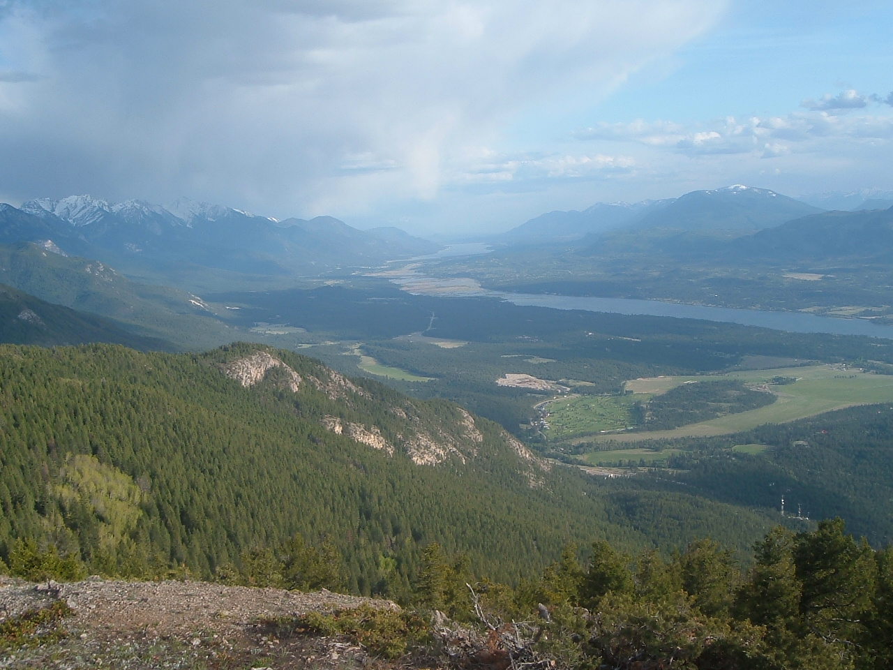

# Columbia Valley

Columbia Valley is the largest wine region in Washington State and the geographic core of wine in the American north-west. It covers central and south-eastern Washington and reaches into north-central Oregon, and is defined by irrigated farming, loess plateaus and Cabernet Sauvignon.

Figure: Columbia Valley. Image: Original uploader was Marcwenger at en.wikipedia, CC BY-SA 3.0, via Wikimedia Commons ([source page](https://commons.wikimedia.org/wiki/File:Columbiavalley_lake.jpg)).

## A giant AVA in Washington

The Columbia Valley AVA totals about 11 million acres, roughly 4.5 million hectares, across Washington and northern Oregon. It is not a narrow vineyard site but a huge geographic frame containing many sub-AVAs; almost every other Washington AVA lies inside its boundary.

Washington is the second-largest wine-producing state in the United States after California, and Columbia Valley holds over 99% of the state's vinifera acreage. Official figures put the Washington-side vineyard at 60,079 acres, or 24,313 hectares. That scale makes it one of the country's most important sources of red wine.

## Designated in 1984 and how the tiers work

Columbia Valley was formally designated on 13 November 1984 through T.D. ATF-190, published in the Federal Register. Its boundary describes a large, treeless basin around the Yakima, Snake and Columbia rivers rather than a single valley.

AVA and sub-AVA are tiers, not quality ranks. Yakima Valley, Walla Walla Valley, Red Mountain, Horse Heaven Hills and Wahluke Slope all sit inside Columbia Valley, each with its own boundary and labelling rules. Whether a label says Columbia Valley or a smaller sub-AVA depends on the wine's origin make-up and the producer's marketing.

Sub-AVAs differ substantially: some rely on altitude and a wide day-night range for structured reds, some sit in warm valley floors suited to later varieties, and some are steep, gravel-rich sites with very fast drainage. Producers often blend across sub-AVAs for a fuller structure, which is what a Columbia Valley label usually means in practice.

## Rain shadow, drought and irrigation

Columbia Valley lies in the rain shadow of the Cascade Range, with an arid to semi-arid continental desert climate. Annual rainfall is only 6 to 8 inches, about 150 to 200 millimetres, and vinifera cannot be grown without irrigation. The Columbia River, its tributaries and aquifers supply the water.

Irrigation is not an emergency measure here; it is the normal production condition. It lets growers control water supply and ripening pace precisely, and it reduces vintage variation. Hot days and cool nights protect [acidity](ref:acidity), and a stable growing season makes wine styles relatively predictable.

Water sustainability is a long-term issue. River flow, snowmelt timing and groundwater extraction are regulated, and wineries are promoting drip irrigation, soil cover and moisture monitoring. Some producers are moving to organic or regenerative farming to cut inputs and improve soil structure, though cost and water rights remain real constraints in a dry region.

## Loess, gravel and basalt

Most vineyards lie below the ancient Missoula flood line. The surface is wind-blown loess of sand and silt, over gravel and slackwater sediment, with basalt as bedrock. Loess balances water holding and drainage, while the gravel layer gives deep drainage and root space.

The mix drains well and holds limited fertility, which helps control vigour. Differences in loess depth, gravel share and aspect create stylistic variation inside one AVA. Soil and rain-shadow climate together form the region's [terroir](ref:terroir).

## Varieties: Cabernet Sauvignon and Syrah

Cabernet Sauvignon is the leading red and the core of Washington's international image. Wines typically show ripe blackcurrant, cherry, cedar and graphite, with clear tannin and higher acidity than many hot regions, and they take well to [oak ageing](ref:oak-ageing).

Syrah is equally important in Washington, with black pepper, violet, smoke and dark fruit, somewhere between the northern Rhône and Australia. Merlot, Chardonnay and Riesling are also leading varieties, and Riesling performs especially well in cooler sub-AVAs. A [single-variety](ref:single-varietal) claim must meet the legal share.

Reds are usually picked at night or early morning to avoid daytime heat, while whites are handled to preserve acidity and aroma. Irrigation timing, canopy management and picking passes are the main tools for controlling ripeness and style in a dry climate.

## AVA rules and labels

The core US rule is that a wine labelled with an AVA must have at least 85% of its contents from that AVA. State or county claims demand higher shares, and variety claims also have minimums. Labels must state [alcohol](ref:abv), volume and bottling details.

An AVA fixes geographic origin only; it does not regulate yields, varieties or winemaking. Producers are free to choose irrigation, cropping levels and barrel regimes, which is why Columbia Valley styles range so widely. Buyers should separate the AVA name, sub-AVA name and brand, and note that a wine may blend several sub-AVAs.

The most useful signal for consumers is the origin tier and variety share: "Columbia Valley" alone usually means a cross-sub-AVA blend, while Red Mountain or Wahluke Slope points to a more site-specific expression.

## Drinking and misconceptions

Columbia Valley reds are best at about 16 to 18 degrees Celsius, with grilled meat, steak, mushrooms and hard cheese. Cabernet Sauvignon often needs decanting; Syrah suits spiced and smoked food. Riesling is best at about 8 to 10 degrees Celsius, with Asian and spicy dishes.

Four misconceptions recur. First, treating Columbia Valley as a small region: it is a giant AVA containing many sub-AVAs. Second, assuming Washington is cool: growing-season days are quite hot, and the coolness comes from nights and latitude. Third, treating an AVA as a quality grade: it defines a geographic boundary only. Fourth, assuming irrigation lowers quality: in a desert, controlled irrigation is the necessary route to consistent ripeness.

**Short definition:** AVA covering central and south-central Washington, south-eastern Washington and north-central Oregon, formally designated on 13 November 1984. It totals about 11 million acres (roughly 4.5 million hectares), with 60,079 acres (24,313 hectares) of vineyard on the Washington side and over 99% of the state's vinifera acreage. Annual rainfall is only 6–8 inches, so irrigation is essential. Loess over gravel and slackwater sediment sits on basalt bedrock. Cabernet Sauvignon, Chardonnay, Merlot, Riesling and Syrah lead. An AVA label requires at least 85% from the named area.

For Columbia Valley, begin with the appellation and its permitted varieties. Then look at the vintage and the producer, and finally ask how the wine is labelled. The answers point to different choices, not to a single score.

## References

- [Wine](ref:wine): the broad categories and origin rules.
- [Red wine](ref:red-wine): the framework for red winemaking and style.
- [United States](ref:usa): the wider map of American wine regions.
- [Cabernet Sauvignon](ref:cabernet): the region's flagship red.
- [Syrah](ref:syrah): an important Washington red.
- [Chardonnay](ref:chardonnay): one of the leading whites.
- [Acidity](ref:acidity): how the day-night range and irrigation affect acidity.
- [Oak ageing](ref:oak-ageing): how barrel type and new-oak share shape style.
- [Terroir](ref:terroir): rain shadow, loess and gravel.
- [Single varietal](ref:single-varietal): variety labelling shares.
- [Alcohol by volume](ref:abv): what % vol means on a label.

## Related images

Image: Cabernet Sauvignon grapes from Château Cos D'Estournel. Credit: Megan Mallen, CC BY 2.0, via Wikimedia Commons.. Credit: Megan Mallen, CC BY 2.0, via Wikimedia Commons ([source page](https://commons.wikimedia.org/w/index.php?curid=13318021)). Related image for Columbia Valley.

Image: Syrah Grapes on the Vine. Credit: U.S. Geological Survey, CC0, via Wikimedia Commons.. Credit: U.S. Geological Survey, CC0, via Wikimedia Commons ([source page](https://commons.wikimedia.org/w/index.php?curid=114429512)). Related image for Columbia Valley.
