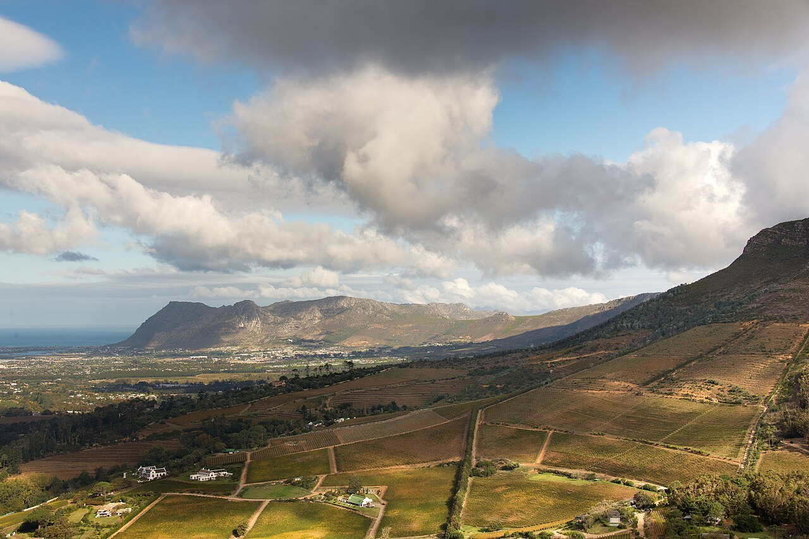

# Constantia

Constantia is a wine ward on the southern side of the city of Cape Town and the starting point of South African wine history. It is known for sea breezes, granite slopes and Muscat sweet wine, but today's wines go well beyond the historic sweet style.

Figure: Constantia. Photograph: Constantia vineyards. Credit: Barry haynes, CC BY-SA 4.0, via Wikimedia Commons ([source](https://commons.wikimedia.org/w/index.php?curid=37639295)).

## Definition and scope

Constantia is a ward of the Cape Town district in the Coastal Region of the Western Cape, on the southern slopes of the Table Mountain range and the east-facing slopes of Constantiaberg, close to False Bay. The Cape Town district also contains Durbanville, Hout Bay and Philadelphia.

The 2024 SAWIS statistics report the Cape Town statistical area at 2,511 hectares, or 2.90% of the national wine-grape area, and note that it includes Constantia, Durbanville, Hout Bay and Philadelphia; the official statistics do not give a separate area for the Constantia ward. The ward is small and has few producers, making it one of South Africa's smallest and oldest wine areas.

## History

In 1685, Simon van der Stel, governor of the Cape, was granted land on the southern slopes of Table Mountain and named it Constantia. He established a wine farm there, regarded as the origin of the South African wine industry. After van der Stel died in 1712, the estate was divided and sold in 1716 into three parts: Bergvliet, Klein Constantia, and Constantia, the portion with the original farm buildings, later known as Groot Constantia.

In the 18th and 19th centuries, Constantia's sweet wine gained a reputation in European courts and in literature, and was mentioned by Napoleon and Jane Austen. Groot Constantia expanded its cellars and plantings under the Cloete family, and its Pontac red wine and sweet wine won awards at international exhibitions in the 19th century. In 1880 the Cape government bought Groot Constantia, which has since operated as a historic estate and heritage site.

In the later 20th century, winemaking in Constantia shrank. In 1980 Duggie Jooste acquired Klein Constantia and began a revival, with the first modern vintage released in 1986; Vin de Constance was relaunched in 1990, bringing the historic sweet wine name back to the market. Today the ward consists of a few historic estates and some newer producers, linked by the Constantia Wine Route.

## Geography and climate

Constantia lies on the southern side of the Table Mountain range, with vineyards climbing the east-facing slopes of Constantiaberg. Cool air from False Bay moves into the valley in the afternoon, lowering temperatures and raising humidity; annual rainfall is about 1,000 mm and the February mean is about 20.6 C, making it one of the wettest and coolest wine areas in South Africa. With so much rain, irrigation is usually unnecessary.

Aspect and altitude create clear differences. East-facing slopes receive morning sun and afternoon sea breezes, so they ripen more slowly; higher sites are cooler and retain acidity better; lower sites and the valley floor are warmer and suit red varieties that need more ripeness. Soils are mainly decomposed granite, well drained and low in fertility, so roots must go deeper for water and nutrients. These conditions form the basis of the [terroir](ref:terroir).

## Estates and sites

Constantia is built around a few historic estates and hillside sites rather than continuous vineyard. Groot Constantia lies on the western side of the valley and retains 18th-century farm buildings and cellars; Klein Constantia sits higher on Constantiaberg and is known for Vin de Constance; Buitenverwachting and Steenberg occupy other parts of the same valley.

Differences between these estates come mainly from altitude, aspect and soil depth, not from an official grade. The Constantia Wine Route is a tourism and tasting route, not a legal appellation level; Constantia on a label is the ward, while estate and route names belong to another layer.

## Varieties and raw materials

Sauvignon Blanc is Constantia's best-known white variety, benefiting from cool sea breezes and a long ripening season, with citrus, grass, white flowers and mineral notes. Chardonnay, Chenin Blanc and Semillon are also planted, some for white wine and some for sparkling wine. Red varieties are led by Cabernet Sauvignon, Merlot and Cabernet Franc, with medium-bodied, clearly structured wines.

Muscat de Frontignan, the local name for Muscat Blanc a Petits Grains, is the core variety of Constantia's sweet wine. Vin de Constance is made from ripe, aromatic Muscat with apricot, orange blossom, honey and spice. Historically Groot Constantia also made dark red wine from Pontac, which is no longer a main variety in the ward. The raw material is the [grape](ref:grape).

## Winemaking

White grapes are gently pressed and fermented cool. Sauvignon Blanc is usually fermented in stainless steel or large barrels without obvious oak; Chardonnay is partly barrel-fermented with lees stirring to add texture and complexity; Semillon can be blended with Sauvignon Blanc to add structure and beeswax notes.

Vin de Constance is made differently from dry white wine. Muscat is picked in several passes, selecting ripe bunches, partly fermented to leave residual sugar, then aged in oak to balance sweetness, acidity and aroma. The exact method varies by vintage and producer, and Vin de Constance on a label is Klein Constantia's wine name, not a legal sweet-wine category.

## Rules and labelling

Constantia labelling follows South Africa's Wine of Origin scheme. A wine labelled Constantia must use 100% of its grapes from the ward; when a variety or vintage is named, the relevant component must reach at least 85%. Certified wines may carry the Wine of Origin seal.

Constantia is a ward name, not a district, and not a quality grade. Vin de Constance is a name the producer uses for its own sweet wine and is not part of the Wine of Origin hierarchy; confusing the two misreads the label. Wine of Origin certifies origin, variety and vintage, not body, price or style.

## Labels and drinking

Check the ward name, variety, [vintage](ref:vintage), [alcohol by volume](ref:abv), volume and bottler. A wine labelled as a [single variety](ref:single-varietal) must contain at least 85% of that variety; blends must list their varieties under the rules. The Wine of Origin seal confirms certification, not quality.

Serve Sauvignon Blanc at 8-10 C, Chardonnay at 10-12 C and Cabernet Sauvignon or Merlot at 16-18 C; serve Vin de Constance and other sweet wines well chilled, around 8-10 C. Sauvignon Blanc suits seafood, salads and goat cheese; reds suit red meat and hard cheese; sweet wine suits blue cheese, fruit desserts or on its own. Chill after opening and finish promptly. Excessive drinking is harmful to health, and minors should not drink.

## Common misconceptions

First, that Constantia is a district. It is a ward within the Cape Town district.
Second, that Constantia only makes sweet wine. Its historic sweet wine is famous, but today the ward is led by Sauvignon Blanc, Chardonnay and red wines.
Third, that Vin de Constance is a legal region or sweet-wine grade. It is Klein Constantia's wine name, not a Wine of Origin place name.
Fourth, that Muscat de Frontignan is a place. It is a grape variety name and not the same as the Constantia appellation.
Fifth, that the Wine of Origin seal is a quality grade. It certifies origin, variety and vintage, not quality.

[Wine](ref:wine) and [Red wine](ref:red-wine) are the two useful reference points for Constantia. [Wine](ref:wine) sets out geographic boundary; [Red wine](ref:red-wine) brings in climate and soil. Read them together.

## Further reading

- [Wine](ref:wine): the broad category, vintage and origin rules.
- [White wine](ref:white-wine) and [red wine](ref:red-wine): the two main categories in Constantia.
- [Sauvignon Blanc](ref:sauvignon): the ward's best-known white variety.
- [Chardonnay](ref:chardonnay): important for white and sparkling wine.
- [Chenin Blanc](ref:chenin): one of the Cape's traditional white varieties.
- [Cabernet Sauvignon](ref:cabernet): the main red variety.
- [Semillon](ref:semillon): a component of white wines and blends.
- [Grape](ref:grape): grape structure and ripening indicators.
- [Fermentation](ref:fermentation): dry white fermentation versus partial fermentation for sweet wine.
- [Acidity](ref:acidity): how sea breezes and aspect affect acidity.
- [Terroir](ref:terroir): granite slopes and sea wind as sources of site difference.
- [Oak ageing](ref:oak-ageing): oak for Chardonnay and Vin de Constance.
- [Dry](ref:dry): dry whites compared with sweet wine.
- [Vintage](ref:vintage): vintage variation in Constantia.
- [Single variety](ref:single-varietal): the 85% labelling rule.
- [Alcohol by volume](ref:abv): what % vol means on a label.

## Related images

Image: Sémillon - Joseph Daurel. Credit: Imprimerie A. Bellier & Cie - Bordeaux, CC0, via Wikimedia Commons.. Credit: Imprimerie A. Bellier & Cie - Bordeaux, CC0, via Wikimedia Commons ([source page](https://commons.wikimedia.org/w/index.php?curid=94839238)). Related image for Constantia.

Image: Chenin Blanc. Credit: Benjamin Smith, CC BY-SA 4.0, via Wikimedia Commons ([source page](https://commons.wikimedia.org/wiki/File:Rochecorbon_-_Vignoble_-_02.jpg)). Related image for Constantia.
