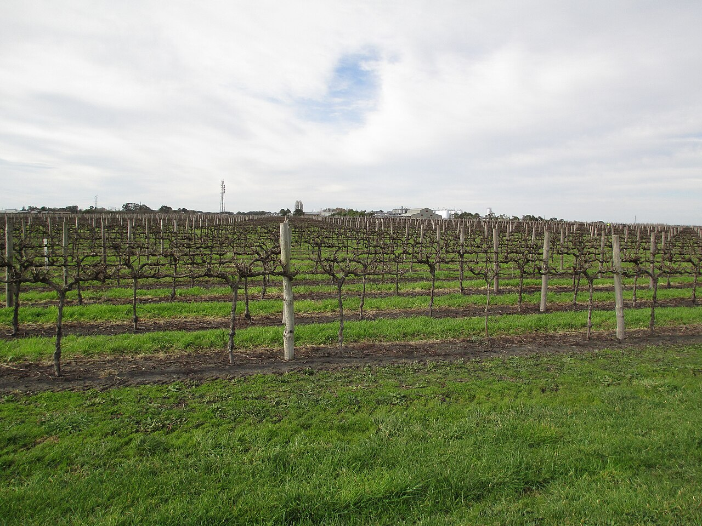

# Coonawarra

Coonawarra sits on the Limestone Coast of South Australia and is one of Australia’s defining Cabernet Sauvignon districts. A cigar-shaped ridge of terra rossa red soil lies over ancient limestone, and a cool maritime climate lets the grapes ripen slowly. The GI covers 398 square kilometres with 5,784 hectares of vineyards, and its official boundary was settled in 2003.

Figure: Coonawarra: Winter vineyard in Coonawarra (Wikimedia Commons). Image: ScottDavis, CC BY-SA 4.0, via Wikimedia Commons ([source page](https://commons.wikimedia.org/wiki/File:Winter_vineyard_in_Coonawarra.JPG)).

## Definition and boundaries

Coonawarra lies in the south-eastern corner of South Australia’s Limestone Coast, within the [Australia](ref:australia) wine framework, about 380 kilometres southeast of Adelaide and 60 kilometres from the Southern Ocean. The GI covers 398 square kilometres with 5,784 hectares under vine, at elevations of 51–127 metres and a latitude of 37.47° south. The district is mostly flat, its core a north-south red-soil ridge ringed by sandy and grey-black loam blocks.

The red ridge runs about 27 kilometres long and 2 kilometres wide, and it carries much of Coonawarra’s reputation. In January 2003, after around seven years of Federal Court arbitration, the name was entered in the Register of Protected Names; the boundary was extended slightly north, south and east to include established red-soil vineyards. Small patches of terra rossa occur elsewhere on the Limestone Coast, but only vineyards inside the designated GI may use Coonawarra on the label. Soils and drainage differ inside and outside the strip, and the wines follow suit.

## History and naming

Before European settlement, the land was the traditional country of the Pinechunga and Boandik peoples. In 1845 the Cameron brothers were among the district’s early pastoralists; in 1861 the Scottish immigrant John Riddoch bought the Yallum holding, including what became Katnook, and built the Katnook woolshed in 1862. In 1890 he launched the Penola Fruit Colony settlement scheme, and in 1891 planted 52 hectares of vines on a larger scale. The first vintage, the Coonawarra Vineyards Claret, was made in 1895; the second vintage was crafted in the Katnook woolshed in 1896, and the local-stone, triple-gabled winery was completed in 1897. The district was officially named Coonawarra in 1897, a name believed to come from an Aboriginal word for “swan”, once interpreted as “honeysuckle”.

Riddoch’s death in 1901 pushed the colony into financial difficulty. Bill Redman, who arrived at the winery at age 14, later kept the table-wine tradition alive while most fruit was distilled into brandy. In 1926 the state government paid soldier settlers to pull out vines for dairy farms, and only 120 hectares remained of the original 360; in 1933 Redman’s wine, bottled under the St Adele label, won first prize at the London Wine Fair. In 1945 and 1946 Woodley bought Riddoch’s old winery and 53 hectares of vines, renaming it Chateau Comaum; in 1951 David Wynn purchased the property and renamed it Wynns Coonawarra Estate, vowing to make Coonawarra famous. The first Black Label Cabernet Sauvignon followed in 1954, and the first Michael Shiraz was bottled in 1955; in 1952 the whole district held just 93 hectares, including 66 hectares of Shiraz, 20 of Doradillo and 3 of Cabernet Sauvignon.

Modern growth ran along family and corporate lines. Wynns began Riesling in 1962; in 1971 Brand’s Laira made the district’s first 100% Cabernet Sauvignon; in 1977 Wynns won the region’s first Jimmy Watson Trophy with the 1976 Black Label Cabernet; in 1979 Katnook made its first modern vintage in the old woolshed. The Coonawarra Vignerons Association was formed in 1980, and Orlando launched St Hugo Cabernet. Wynns’ first John Riddoch Cabernet Sauvignon appeared in 1982; Hollick, Parker and Penley were established in 1983, 1985 and 1988. In 2014 the John Riddoch Cabernet was placed in the Exceptional category of Langton’s Classification of Australian Wine.

## Geography and terroir

The red soil is a paleosol: wind-blown dust from the arid interior settled on Miocene limestone, and over millennia rain leached out carbonates, leaving iron oxides that rusted to a deep crimson. The layer averages about 50 centimetres deep, often under a metre, a permeable light clay that is slightly alkaline over limestone and an aquifer. Roots follow cracks into the limestone, balancing canopy and crop so berries stay small and skins thick, building colour, varietal aroma and fine tannin through slow ripening.

Climate matters as much as soil. Despite sitting at 37° south, the district is cooler than expected, thanks to its proximity to the Southern Ocean and the Bonney Upwelling: each summer strong winds push surface water offshore and frigid, nutrient-rich deep water rises, acting as a natural air conditioner that brings fog-free cool days and cold nights and a long, slow ripening season. Winter daily averages 9.8°C, summer 18.8°C, the January mean 20.1°C, and growing-season rainfall is about 260 millimetres. Extended hang-time builds flavour and phenolic ripeness without excess sugar, giving moderate alcohol and a fresh, vibrant acidity as the ageing backbone.

In the phenological rhythm, white grapes such as Chardonnay burst bud around the second week of September, Cabernet Sauvignon in the third or fourth week; flowering starts in late November. Harvest comes in two waves: sparkling whites in early to mid-February, reds such as Cabernet Sauvignon in late March to early April. Spring frost needs close watching; the free-draining red soil allows limited irrigation from the limestone aquifer in dry years, keeping bunches small and concentrated.

## Raw materials and styles

Of the 2025 crush, [Cabernet](ref:cabernet) Sauvignon made up 59%, Shiraz 20%, [Merlot](ref:merlot) 8%, Chardonnay 6% and Sauvignon Blanc 3%; red varieties account for about 92% of plantings, with 35,295 tonnes crushed in 2025 at an average yield of 6.1 tonnes per hectare. Cabernet Sauvignon is the undisputed king, medium to full-bodied, with blackcurrant, blackberry, plum and dark cherry plus mint and eucalyptus notes; tannins are firm yet plush, and the top examples age gracefully for decades.

Shiraz was the main variety until the 1950s and carries a long local history, in a medium-bodied style with spice and raspberry fruit; blending Shiraz with Cabernet Sauvignon is a Coonawarra tradition. Merlot has a shorter history but works well as a blending partner for Cabernet and as an elegant varietal. Whites, led by Chardonnay, Riesling and Sauvignon Blanc, occupy a small share and mostly run crisp or restrained-oak. The reds lean toward cool-climate acidity and structure rather than the hot, ripe sweetness of inland regions; new-oak proportion, ageing length and blend ratios are decided by each producer.

## Representative producers and wines

Wynns Coonawarra Estate holds the oldest vineyards in the district, and its triple-gabled stone winery is a regional landmark. The Black Label Cabernet Sauvignon is a consistent benchmark; the flagship John Riddoch Cabernet, first released in 1982, has twice been named Australia’s best red wine and reached Langton’s Exceptional in 2014. The Michael Shiraz is the Shiraz flagship, named after David Wynn’s young son.

Other producers worth noting include Balnaves of Coonawarra (The Tally Cabernet, Langton’s Outstanding), Katnook Estate (Odyssey Cabernet Sauvignon), Majella (Mallea Cabernet Shiraz), Bowen Estate, Rymill, Hollick, Brand’s Laira, Parker Coonawarra Estate, St Hugo, Rouge Homme, Zema, Leconfield and Redman. These names are not an official classification; they are reference points built by the market, critics and awards over decades. Flagship single-vineyard wines and entry-level releases differ markedly in fruit source and oak treatment, with a wide price gap between tiers.

## How to drink and pair

Cabernet Sauvignon is served around 16–18°C; young, tight examples can be decanted briefly, in a medium to large-bowl red glass. Shiraz and Cabernet blends sit around 15–17°C. Wines aged a decade or more soften their tannins and develop cedar, leather and bottle spice, and should not be decanted for long. Cool-climate reds keep a clear acid spine, and serving too warm makes the alcohol and green-pepper notes dominate.

For food, the district’s reds go most directly with grilled steak, lamb, venison, game stews, mushrooms and hard cheese, where tannin balances the meat fat. Shiraz suits grilled sausages, game and spice-led dishes; Merlot pairs more softly with braised red meat and tomato pasta. Local cooking centres on grilled meat and field produce, complementing the structure and fruit of the reds. Oak-driven flagship wines match rich, fatty cuts more reliably than light starters.

## Labels, buying and misreadings

Reading a label, first confirm the Coonawarra GI, then the producer, vintage and wine tier. Names such as V&A Lane and Limestone Ridge are block references growers discuss rather than legal rankings; differences in red-soil depth, limestone cover and aspect create nuance between sites. Vintage carries heavy weight in this cool district: spring frost, flowering wind and rain, and harvest rain all alter yield and ripeness, so tannin and fruit can differ noticeably between years from the same producer.

One misconception is that Coonawarra makes only Cabernet Sauvignon: Shiraz, Merlot and small amounts of white varieties are grown here, and Shiraz–Cabernet blending is a local tradition. Another is that all red soil counts as Coonawarra; terra rossa patches exist elsewhere on the Limestone Coast, but only fruit inside the GI may carry the name. Flagship Cabernets can age a decade or more, while entry-level wines are best drunk young. Red wines are sensitive to transport heat and long-term light, so avoid long storage where temperature swings are large.

## Around and routes

The district centres on Coonawarra township, near Penola; wineries line both sides of Riddoch Highway and V&A Lane, most within a fifteen-minute drive of one another. Driving from Adelaide takes about three hours, or the trip can be broken via Mount Gambier. Public transport within the region is limited, so a car or an organised wine tour is the main way around.

Most estates run cellar-door tastings, and flagship releases and weekends are best booked ahead. Harvest falls in the Southern Hemisphere February to April, when estates are busiest and some rooms shorten hours; a single tasting takes about an hour, so two or three stops plus lunch in a day is comfortable. Stay out of working fermentation rooms and vineyard blocks, and do not drive after tasting.

- Related: [australia](ref:australia), [cabernet-sauvignon](ref:cabernet), [merlot](ref:merlot), [red-wine](ref:red), [oak-ageing](ref:oak).

[Australia](ref:australia) explains geographic boundary; [Merlot](ref:merlot) adds climate and soil. Put Coonawarra between them before deciding what it is.
