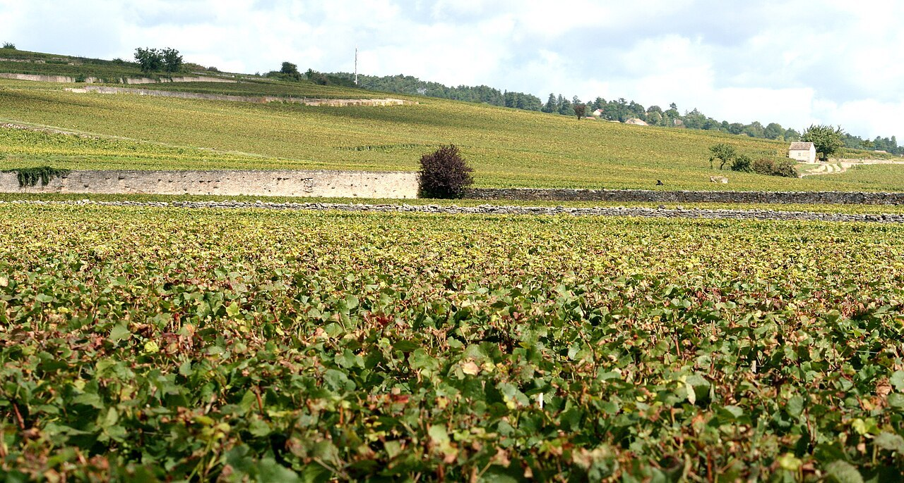

# Côte de Beaune

The Côte de Beaune is the wine region of Burgundy's southern Côte d'Or, running from Ladoix-Serrigny to Santenay. Unlike the Côte de Nuits, which is dominated by Pinot Noir, the Côte de Beaune is famous for Chardonnay white wines, yet it also produces excellent Pinot Noir reds; of its 8 grands crus, only Corton is mainly red, a structure that gives the area a special place on Burgundy's classification map.

Figure: Côte de Beaune. Photograph: Côte de Beaune, Burgundy vineyard. Credit: Megan Mallen, CC BY 2.0, via Wikimedia Commons ([source](https://commons.wikimedia.org/w/index.php?curid=13670776)).

## Definition and scope

The Côte de Beaune is not a single AOC but a collection of villages and sites. Together with the Hautes-Côtes de Beaune it has about 5,000 hectares of vines and 25 AOCs: 1 Hautes-Côtes appellation, 16 village appellations and 8 grands crus, plus around 300 premiers crus below the village level.

There is also a naming trap: Côte de Beaune is a separate AOC on the heights of the commune of Beaune, while Côte-de-Beaune-Villages is a regional AOC covering several communes, and the two are not the same tier. A label reading only Côte de Beaune therefore needs a closer look.

The AOC structure forms a clear pyramid: regional, village, premier cru and grand cru, and the more specific the place name, the smaller the site and usually the higher the price. Compared with the Côte de Nuits, the Côte de Beaune has more village appellations, and its white-wine village names are easier for consumers to remember.

## From Ladoix to Santenay

The vineyards follow the eastern slope of the southern Côte d'Or, from Ladoix-Serrigny in the north to Santenay in the south. The village appellations along the way include Ladoix, Aloxe-Corton, Pernand-Vergelesses, Savigny-lès-Beaune, Chorey-lès-Beaune, Beaune, Pommard, Volnay, Monthélie, Auxey-Duresses, Saint-Romain, Meursault, Puligny-Montrachet, Chassagne-Montrachet, Saint-Aubin and Santenay.

The slope is still mainly Jurassic limestone and marl, but the southern section is wider and gentler, with thicker soil and a higher clay share than the Côte de Nuits. The top drains quickly, mid-slope holds moderate soil, and the foot accumulates more material, so both white and red wines can find suitable sites within one village.

The climate is also continental, with a warm growing season, though spring frost and late-summer hail are the main risks; vintage differences therefore show up in yield as well as ripeness. An east-facing slope warms early in the morning and reduces frost risk, one reason Côte d'Or vineyards generally face east.

## The only red among 8 grands crus

The 8 grands crus of the Côte de Beaune are Corton, Corton-Charlemagne, Charlemagne, Montrachet, Chevalier-Montrachet, Bâtard-Montrachet, Bienvenues-Bâtard-Montrachet and Criots-Bâtard-Montrachet. Apart from Corton, all are mainly Chardonnay whites.

Corton sits on the hill of Corton behind Aloxe-Corton and is the only grand cru of the Côte de Beaune that is mainly red; the same hill also holds Corton-Charlemagne, famous for white wine. This one hill with two grands crus, one red and one white, is rare in Burgundy and makes Corton the entry point to the region's dual red-white system.

Inside Corton there are further named parcels such as Clos du Roi, Bressandes and Renardes, and the reds range from firm to supple; Corton-Charlemagne is concentrated on the white marl near the top. The layering of a single hill illustrates Burgundy's logic that site matters more than estate.

## Chardonnay and the white wines

[Chardonnay](ref:chardonnay) dominates the white wines of the Côte de Beaune, with Meursault, Puligny-Montrachet and Chassagne-Montrachet as the best-known villages. Limestone brings acidity and a mineral edge, while marl and clay supply weight and fruit; differences in slope position and soil depth mean neighbouring parcels can give whites of entirely different texture.

Côte de Beaune whites are usually fuller than Côte de Nuits reds, showing citrus, white flowers and hazelnut in youth and honey, toasted bread and mineral layers with age. Top grands crus are scarce and expensive, but village and premier cru wines still offer relatively accessible entry points.

White winemaking usually involves cool fermentation, bâtonnage and barrel ageing; lees stirring adds creaminess and nuttiness, while new oak brings spice and structure. Whether to stir, the barrel proportion and the time in wood are major sources of the stylistic gap between Meursault and Puligny.

## Beaune, négociants and the auction

Beaune is the administrative and trading centre of the Côte de Beaune and the heart of Burgundy's négociant system. Négociants buy grapes or wine from many owners and complete fermentation, ageing and bottling in their own cellars; this model brings small parcels to market and allows both merchant brands and site brands to exist.

The Hospices de Beaune auction is a major annual event, with proceeds going to the hospital and charity. The négociant system and the auction together form the trading ecology of the Côte de Beaune: the first connects land to market, the second turns vintage performance into public prices.

Beaune's négociant trade goes back to the Middle Ages but took its modern form in the eighteenth and nineteenth centuries; merchants gathered grapes from scattered small parcels so buyers could purchase wine from a particular village or site. The quality of a négociant wine depends on its sources and cellar work and cannot be generalised.

## Premiers crus and villages

Around 300 premiers crus are spread across the 16 village appellations, and their names often appear directly on the label. Pommard and Volnay are mainly red, Meursault and Puligny mainly white, Aloxe-Corton produces both, and Saint-Aubin is known for relatively good-value whites.

Premiers crus also form tiers: parcels closer to a grand cru and on better slope positions usually cost more, and the more specific the site name, the better the buyer can judge position. Compared with the Côte de Nuits, the Côte de Beaune has more premiers crus over a wider area, so choice is broader.

Well-known premiers crus include Caillerets in Volnay, Rugiens in Pommard, Perrières in Meursault and Pucelles in Puligny; these names usually follow the village name on the label and are the first clue to a specific position.

## Drinking and buying

Whites are served at lower temperatures and suit seafood, poultry and creamy dishes; reds suit poultry, pork and medium-strength cheese. Corton reds are firm and need longer ageing than Volnay, while Corton-Charlemagne and Montrachet whites can develop for decades in bottle.

Check the producer, village, premier cru or grand cru name and the vintage. Négociant wines and estate wines are both legitimate, but their style and price logic differ; when the word négociant appears, look at the merchant's history and sources rather than assuming lower quality.

For Côte de Beaune, begin with the appellation and its permitted varieties. Then look at the vintage and the producer, and finally ask how the wine is labelled. The answers point to different choices, not to a single score.

[France](ref:france) and [Chardonnay](ref:chardonnay) are the two useful reference points for Côte de Beaune. [France](ref:france) sets out geographic boundary; [Chardonnay](ref:chardonnay) brings in climate and soil. Read them together.

## References

- [France](ref:france): the AOC system and the national appellation framework.
- [Burgundy](ref:burgundy): the Côte d'Or, climats and the classification system.
- [Chardonnay](ref:chardonnay): the leading variety of Côte de Beaune whites.
- [Pinot Noir](ref:pinot-noir): the variety behind Corton and other reds.
- [White wine](ref:white-wine): an overview of still white wine and winemaking.
- [Terroir](ref:terroir): slope position, soil depth and site differences.
