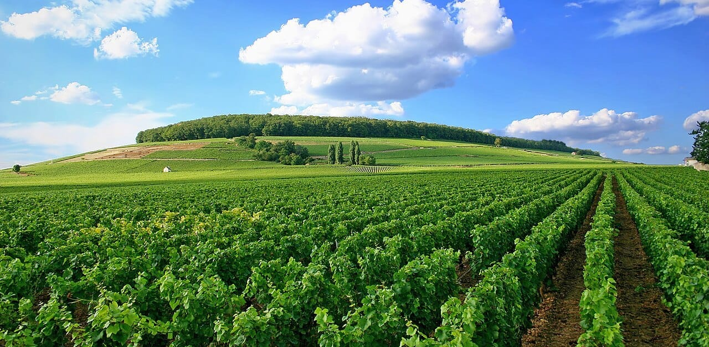
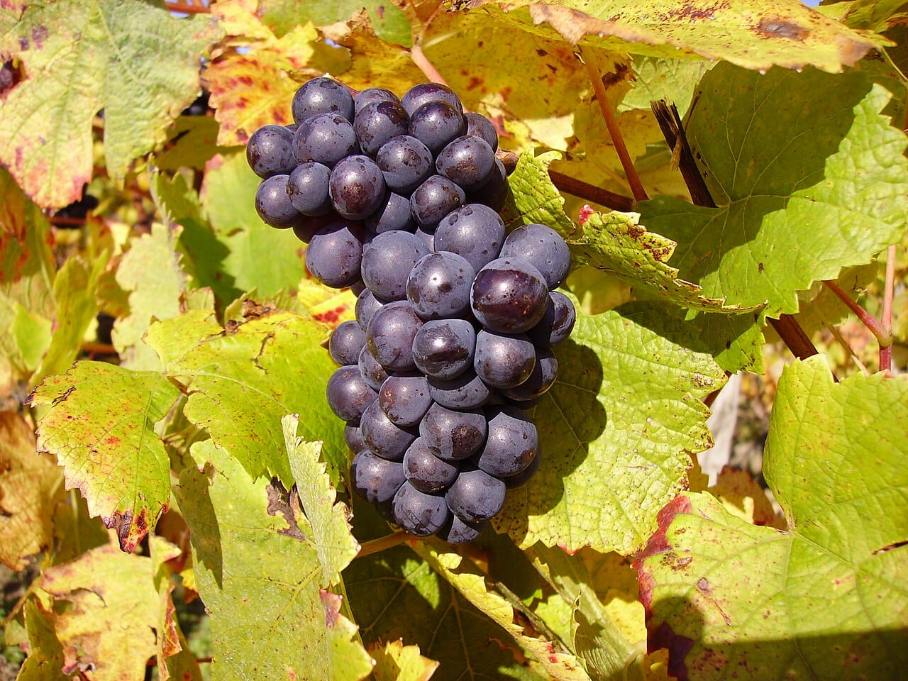

# Côte de Nuits

The Côte de Nuits is the red-wine heart of Burgundy's northern Côte d'Or, running from Marsannay-la-Côte south of Dijon to Corgoloin, a strip of about 40 km. It contains 24 grands crus and Pinot Noir accounts for about 95% of plantings, making it the most direct place to understand Burgundy's red-wine hierarchy and the idea of climat.

Figure: Côte de Nuits. Photograph: Côte de Nuits Wéngert. Credit: Original: Stefan Bauer, http://www.ferras.at Modification: The original uploader was Cornischong at Luxembourgish Wikipedia., CC BY-SA 2.5, via Wikimedia Commons ([source](https://commons.wikimedia.org/w/index.php?curid=21196224)).

## Definition and scope

The Côte de Nuits is not a single AOC but a group of appellations and villages. Together with the Hautes-Côtes de Nuits it has about 3,000 hectares of vines and 39 AOCs: 1 Hautes-Côtes appellation, 14 village appellations and 24 grands crus, plus around 120 premiers crus below the village level.

Administratively it belongs to the Côte d'Or department, with Dijon to the north and the Côte de Beaune to the south. The boundary with the Côte de Beaune runs roughly between Corgoloin and Ladoix-Serrigny. Because appellation, village and site names are stacked on the label, the information has to be read layer by layer.

The regional AOC accounts for modest volume, while village and site wines dominate the market; treating Côte de Nuits as one uniform brand hides differences between villages. Village appellations usually carry the village name, the easiest layer for most buyers to use.

## The limestone slope from Dijon to Corgoloin

The vineyards follow a north-south Jurassic limestone slope facing east toward the Saône plain. Alternating limestone and marl, together with differences in soil depth along the slope, create what Burgundy calls a climat: on the same slope, drainage, sunlight and ripening can differ down to the level of a few rows of vines.

Shallow limestone at the top drains quickly and ripens early; thicker soil at mid-slope balances water retention and drainage; colluvium and alluvium at the foot ripen later. Many grands crus sit in the middle of the slope precisely because it combines light, drainage and cooling.

Small changes in aspect and altitude alter sunlight hours and the day-night temperature range; most Côte de Nuits slopes face south-east, catching morning light without overheating in the afternoon, which helps Pinot Noir keep acidity and fine aroma.

## The 24 grands crus

The 24 grands crus of the Côte de Nuits are spread across Gevrey-Chambertin, Morey-Saint-Denis, Chambolle-Musigny, Vougeot, Flagey-Échezeaux and Vosne-Romanée, among others. The best-known include Chambertin, Chambertin-Clos de Bèze, Musigny, Bonnes-Mares, Clos de Vougeot, Échezeaux, Grands-Échezeaux, Richebourg, La Tâche, Romanée-Conti and Romanée-Saint-Vivant.

Clos de Vougeot is one of the largest, at about 50 hectares, and was cleared by Cistercian monks in the Middle Ages; its wall still stands. Its parcels run from the top of the slope to the bottom, so ripening varies greatly inside one grand cru, which is why different parcels of the same estate can give different wines.

Grand cru names often come from abbeys, landowners or parcel shape, but the name alone does not describe a style; slope position and soil do, and a grand cru is more specific than a village name.

## Premiers crus, villages and climat

Below the grands crus are the premiers crus, then the village appellations and regional AOCs. A village wine usually carries the village name, a premier cru adds Premier Cru and the site name after the village, and a grand cru carries the grand cru name without the village.

Climat is Burgundy's term for a specific site, stressing the long-formed combination of soil, aspect, microclimate and human cultivation. The 24 grands crus are the most famous group of climats; many premiers crus are also individually named, and the site name on a label often says more about style than the village name.

Climat boundaries were fixed by historical cultivation and ownership, and today's labels still follow them, which is why Burgundy's site maps are complex. The more specific the site name, the better the buyer can judge position.

## Pinot Noir and the 95% share

Plantings are overwhelmingly [Pinot Noir](ref:pinot-noir), at about 95%, with white varieties appearing only in a few villages and parcels. Pinot Noir is sensitive to temperature and soil, with thin skins, pale colour and fine tannin, so Côte de Nuits wines usually rely on aroma, texture and complexity rather than body.

Marsannay is the only village appellation in the Côte de Nuits officially allowed to make pink wine, an exception that shows “Côte de Nuits equals red” is only a general impression. Most reds show red cherry, raspberry and flowers in youth and move toward mushroom, forest floor and spice with age.

Pinot Noir is sensitive to yield, and Côte de Nuits estates generally keep yields low to gain concentration; excessive yields thin the body and flatten the aroma. The total grand cru area is small and output is scarce, which is a structural reason for the high prices.

## Winemaking and ageing

Côte de Nuits reds are usually aged in neutral [oak](ref:oak-ageing), with a lower share of new barrels than the top white wines of the Côte de Beaune, so that Pinot Noir aroma and texture stay clear. Oak here mainly provides micro-oxygenation and structure rather than toast.

Fermentation temperatures are usually low, maceration is long but extraction gentle, and estates often complete malolactic fermentation in barrel to soften acidity. Heavy toast or a high proportion of new oak would bury the fruit, so the choice of barrel often matters more than the number of barrels.

Good Côte de Nuits reds enter their drinking window at five to ten years, and grands crus last longer; fine tannin and high acidity suit poultry, mushrooms, game and medium-strength cheese, while heavy sauces bury the aroma.

## Labels and buying

The words Côte de Nuits on a label may be a regional AOC or a prefix to a village name; what matters more is the village, premier cru or grand cru name. Check the vintage, alcohol, bottler and the spelling of the site, and avoid confusing Côte de Nuits-Villages with a specific village appellation.

Grands crus are expensive and scarce, so distinguish grand cru from premier cru labels; within one village the price gap can be large, and site and vintage remain key.

A single grand cru is often owned by several estates, so the producer and site spelling matter as much as the grand cru name; wines from the same grand cru can differ widely. Checking producer and vintage is more reliable than the name alone.

To read Côte de Nuits, start with the appellation and its permitted varieties, then the vintage and the producer, then how the wine is labelled; no single check settles it.

[France](ref:france) and [Pinot Noir](ref:pinot-noir) are the nearest useful comparisons: one clarifies geographic boundary, the other tests climate and soil.

## References

- [France](ref:france): the AOC system and the national appellation framework.
- [Burgundy](ref:burgundy): the Côte d'Or, climats and the classification system.
- [Pinot Noir](ref:pinot-noir): the leading variety of Côte de Nuits reds.
- [Red wine](ref:red-wine): an overview of still red wine and winemaking.
- [Terroir](ref:terroir): the climat idea and site differences.
- [Oak ageing](ref:oak-ageing): how barrels shape Pinot Noir aroma and texture.

## Related images

Image: Pinot Noir. Credit: Cjp24, Public domain, via Wikimedia Commons ([source page](https://commons.wikimedia.org/wiki/File:Grape_near_Sancerre.jpg)). Related image for Côte de Nuits.

Image: Terroir. Credit: Friedrich Petersdorff, CC BY-SA 2.0 de, via Wikimedia Commons ([source page](https://commons.wikimedia.org/wiki/File:080110_zell_mosel.JPG)). Related image for Côte de Nuits.
