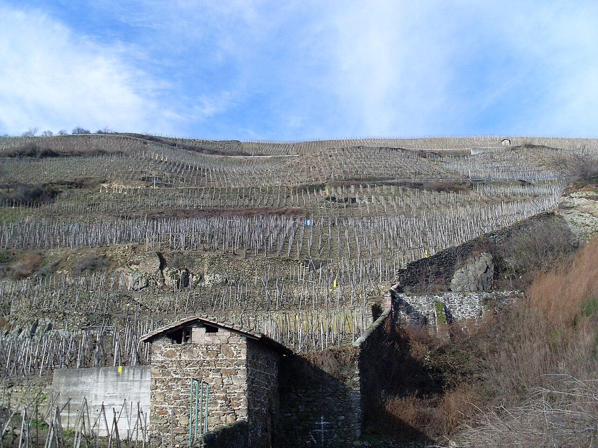
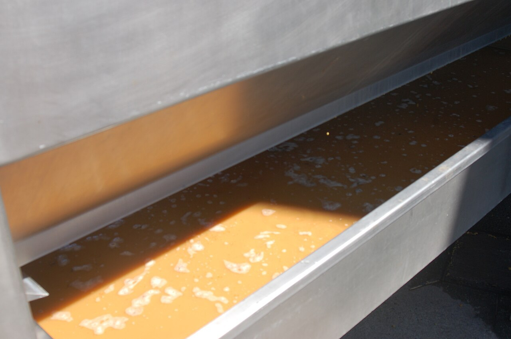
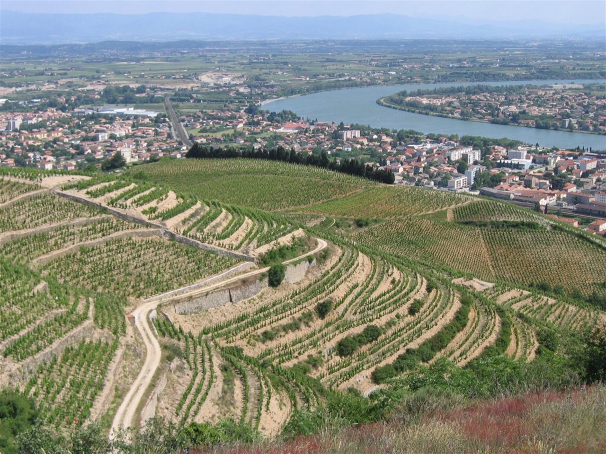

# Côte-Rôtie

The northernmost red AOC of the Northern Rhône, on steep slopes between Ampuis and Saint-Cyr-sur-le-Rhône; led by Syrah with a little permitted Viognier, divided between the Côte Blonde and Côte Brune, and granted AOC in 1940.

Figure: Côte-Rôtie: Terrasse de Côte Rôtie en hiver (Wikimedia Commons). Image: Karen, CC BY 2.0, via Wikimedia Commons ([source page](https://commons.wikimedia.org/wiki/File:Terrasse_de_C%C3%B4te_R%C3%B4tie_en_hiver.jpg)).

## Definition and boundaries

Côte-Rôtie is the northernmost red-wine AOC of the Northern [Rhône](ref:rhone), one of the Rhône Crus, lying about 40 km south of Lyon on the right bank of the Rhône, facing the southern part of the city of Vienne. Harvest, winemaking and ageing take place within three communes of the Rhône department: Ampuis, Saint-Cyr-sur-le-Rhône and Tupin-Semons. The appellation was first recognised by the decree of 18 October 1940, initially covering only Ampuis and Tupin-Semons; an amendment of 21 December 1966 added Saint-Cyr-sur-le-Rhône, and the parcel boundaries were approved by INAO on 12 February 1969.

Inter Rhône puts the 2025 planted area at about 342 ha, with 73 registered lieux-dits. The appellation makes still red wines only, and permits just two varieties: [Syrah](ref:syrah) as the main grape and [Viognier](ref:viognier) as the accessory. Syrah must make up at least 80% of the blend; Viognier may be interplanted in Syrah parcels at up to 20% and the two are vinified together. Rules require hand harvesting, a minimum of 6,000 vines per hectare, a minimum natural alcohol of 10.5%, a base yield of 40 hl/ha and a ceiling of 46 hl/ha.

For drinkers, the AOC name fixes only the broad boundary; style is set by lieu-dit, slope aspect and producer. When a label carries a specific lieu-dit such as La Mouline or La Landonne, soil and slope position can be read more precisely.

## History and naming

Vines have been recorded around Ampuis for about 2,400 years; nearby Vienne was an important Roman centre, and slope viticulture dates back to Roman times. Côte-Rôtie literally means “roasted slope”, referring to the long sun exposure these steep sites receive. The split into Côte Brune and Côte Blonde comes from local legend: a lord had two daughters, one dark-haired and one fair, and gave each one of his best slopes for her marriage portion.

Phylloxera and the two world wars shrank the vineyard to a fraction of its earlier size; the 1940 decree secured the appellation’s status, and the modern revival is closely associated with the Guigal family. Étienne Guigal arrived in Ampuis in 1924 at the age of 14 and made 67 vintages; he founded Maison Guigal in the village in 1946. The young Marcel Guigal took over management in 1961, his wife Bernadette joined in 1973, and their son Philippe, born in 1975, represents the third generation as winemaker. The house bought Vidal-Fleury in the early 1980s and acquired Château d’Ampuis in 1995.

Boundary, variety and yield rules were revised across the decades, so the name on today’s label reflects several rounds of adjustment; parcel memory has proven more stable than the broad regional name.

## Geography and terroir

The vineyards cling to the very steep slopes on the right bank of the Rhône, between 180 and 325 m above sea level, facing generally southeast. This aspect avoids the cold dry north wind while catching southern sun; some gradients exceed 60%, so machinery has little access and land preparation and harvest have long been done by hand. Dry-stone walls hold the soil in narrow stepped terraces.

The climate is semi-continental, still reached by the last Mediterranean influences travelling up the Rhône valley. The local north wind is called the Bise; winters are wet and cold, the wind can last into spring, and fog often settles over the valley in late spring and early autumn, bearing on ripening and disease pressure.

The two slope bands differ in soil. The northern Côte Brune sits on mica schist, with darker, clay-rich soils rich in iron oxide; its wines are weightier, firmer-tannined and built for ageing. The southern Côte Blonde is based on gneiss, granite and schist, with light-coloured siliceous soils; its crumbly sandy clay, locally called arzel, is held by dry-stone walls known as cheys. These wines are finer and more perfumed, and Viognier is more often planted here. Erosion on steep slopes is a standing risk; the walls and terraces are both working infrastructure and part of the terroir.

## Raw materials and styles

[Syrah](ref:syrah) forms the structure; Viognier is blended in to add white-flower and violet perfume and rounder texture. This is one of the few French appellations allowing a white variety into a red blend. Cool vintages show black pepper, green olive and smoke; warmer years lean to blackberry, raspberry and licorice. In good vintages the tannins round out while keeping structure, and top cuvées can age for about 15 years.

Guigal’s Brune & Blonde, for example, blends 96% Syrah with 4% Viognier; the average vine age is about 35 years, the yield 37 hl/ha, maceration about three weeks, followed by 38 months in oak barrels, 50% of them new. New oak use died out after phylloxera in the late 19th century and was brought back by négociants in the 1980s; today new-oak proportions and ageing times vary widely between producers.

Within the Northern Rhône Syrah spectrum, the common style leans to finesse: dark fruit sits alongside spice, floral perfume and mineral notes. Across one slope, the Côte Brune gives weight and longevity, the Côte Blonde perfume and delicacy.

## Representative producers and wines

Guigal is the appellation’s best-known family house; its own 75 ha of vines all sit in the Northern Rhône. Its Côte-Rôtie range includes the single-site wines La Mouline, La Landonne and La Turque, plus Château d’Ampuis and the cross-slope Brune & Blonde. Other names long treated as trade references include Jamet, Rostaing, Chapoutier, Bonnefond, Clusel-Roch, Vidal-Fleury, Delas and Stephan; small family growers and boutique estates coexist here.

These names are not an official classification but a consensus built over years of market reputation. Single-site flagship cuvées are small-production and pricey, suited to vertical vintage comparisons; entry-level village wines are easier to find in restaurants and retail. Before buying, sort out which slope a wine comes from, whether a lieu-dit appears on the label, the new-oak level and the vintage style; that is more useful than memorising a list of estates.

## How to drink and pair

Côte-Rôtie [reds](ref:red) are medium- to full-bodied, with tannins that soften with age; a serving temperature around 16–18°C suits them. Young structured wines can be opened 30–60 minutes ahead or decanted briefly; older bottles are gently transferred and left to settle. They pair well with grilled red meat, braised dishes, game and aged cheese, their spice and pepper echoing the meat; Viognier-containing blends show more perfume and can also take on richer poultry.

A wide glass opens the aromas; young fruity wines do not need long decanting. Close to Lyon, local grilled meats, sausages and cheese platters share the same hearty food tradition as the wines.

## Labels, buying and misreadings

Read the label by confirming AOC Côte-Rôtie first, then lieu-dit, producer and vintage. There is no finer official tier inside the appellation; lieux-dits are parcel references agreed by producers and the market. Vintage variation matters on these steep slopes: fog, rain, north wind and harvest weather all change ripeness, and comparing two producers in one vintage shows slope and soil differences better than jumping across years.

Two common misreadings: first, that the Viognier makes the wine sweet — it adds aroma and texture only, and the finished wine remains a dry red; second, that all appellation wines are heavy, since Côte Blonde and lightly aged vintages can be quite elegant. For storage, cool stability matters most, away from heat and long-term light; after opening, structured reds keep for several days, kept re-corked and cool.

## Around and routes

Ampuis is the central village; across the river lie the Roman remains of Vienne, and the white-wine appellation of Condrieu borders the area to the south. Lyon is about 40 km away. Wine touring follows the right-bank slopes; most cellar visits need advance booking, a tasting lasts 60–90 minutes, and drives between villages take 30–60 minutes, so two or three stops in a day is comfortable.

Harvest runs around September in the Northern Hemisphere, when estates are busiest; weekend and festival opening hours vary widely, so confirm bookings, fees and languages through the estate website or the appellation union beforehand. Stay out of working cellars and parcels, and do not drink and drive; stepped paths and dry-stone walls may not be wheelchair-accessible, so check facilities before bringing older relatives.

- Related: [rhone](ref:rhone), [syrah](ref:syrah), [viognier](ref:viognier), [red-wine](ref:red), [oak-ageing](ref:oak).

## Related images

Image: Viognier Grape must after pressing. Credit: Ian Brown, CC BY 2.0, via Wikimedia Commons.. Credit: Ian Brown, CC BY 2.0, via Wikimedia Commons ([source page](https://commons.wikimedia.org/w/index.php?curid=13317886)). Related image for Côte-Rôtie.

Image: Rhône Valley. Credit: Béa at French Wikipedia, Public domain, via Wikimedia Commons ([source page](https://commons.wikimedia.org/wiki/File:Thain1.jpg)). Related image for Côte-Rôtie.
