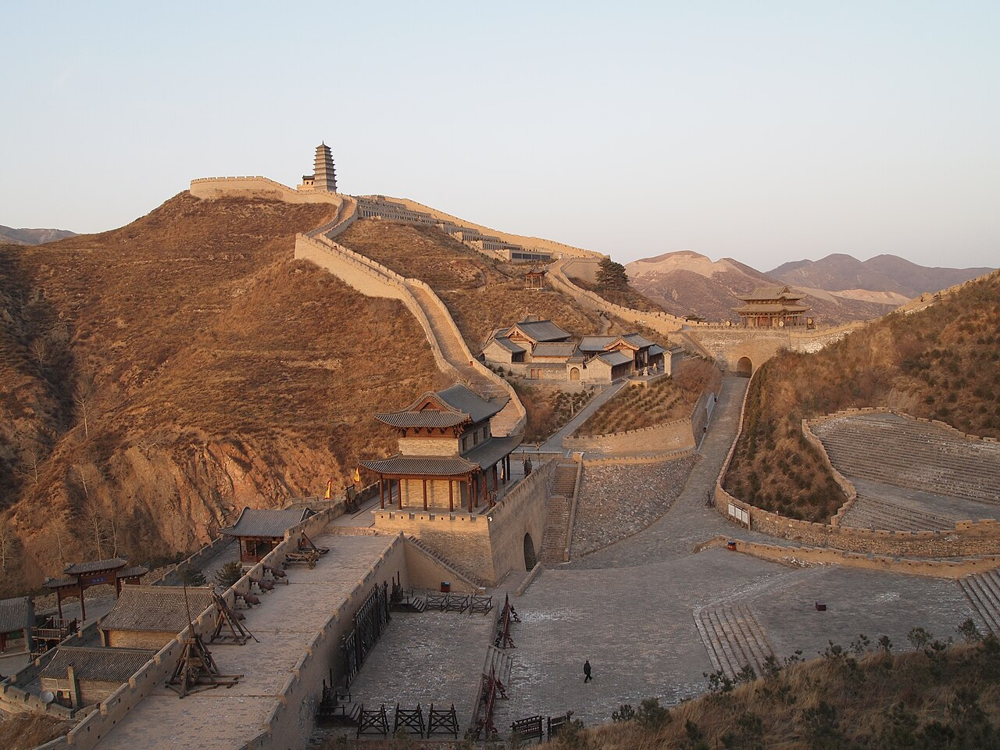

# Fenyang

Fenyang is a county-level city administered by Lüliang in Shanxi, located at the western edge of the Jinzhong Basin and beneath the Lüliang Mountains. Xinghuacun lies within Fenyang and is the production place long associated with Fenjiu. Unlike the humid strong-aroma areas of southern Sichuan, Fenyang has a semi-arid monsoon climate with cold winters, windy springs and large temperature swings between day and night. To understand Fenyang, "light aroma" is only a starting point; the relationship between earthen jars, climate and sorghum matters just as much.

Image: a gold medal from the 1915 Panama-Pacific International Exposition on display in the Fenjiu Museum; this is a museum object, not a production scene. Photo: Fenjiu Group Cultural Centre, public domain, via Wikimedia Commons ([source page](https://commons.wikimedia.org/wiki/File:%E5%B1%B1%E8%A5%BF%E6%B1%BE%E9%85%92%E8%8D%A3%E8%8E%B71915%E5%B9%B4%E5%B7%B4%E6%8B%BF%E9%A9%AC%E4%B8%87%E5%9B%BD%E5%8D%9A%E8%A7%88%E4%BC%9A%E7%9A%84%E2%80%9C%E4%B8%80%E7%AD%89%E9%87%91%E8%B4%A8%E5%A4%A7%E5%A5%96%E7%AB%A0%E2%80%9D_%E6%B1%BE%E9%85%92%E5%8D%9A%E7%89%A9%E9%A6%86%E8%97%8F.png)).

## Location and access

Fenyang is in west-central [Shanxi](ref:shanxi), bordering Pingyao to the east, Xiaoyi to the south, the Lüliang Mountains to the west and Wenshui to the north. It is a county-level city under Lüliang. Road access is the main option, and there are railway stations in the area; travellers usually approach from Taiyuan or Pingyao. Schedules change, so check railway and bus information on the day of travel.

Fenyang is often paired with Pingyao. Pingyao offers walls, draft banks and Shanxi merchant courtyards; Fenyang offers Xinghuacun and the distillery. The drive is not long, but do not overload a single day. From Taiyuan, Fenyang can be a day trip or an overnight stop before continuing into the Lüliang Mountains.

## Industry and production area

Fenyang baijiu is mainly [light-aroma baijiu](ref:light), and [Fenjiu](ref:fenjiu) is the flagship brand. Light aroma stresses clean steaming, clean distillation, separate fermentation in earthen jars and solid-state distillation. The result is usually a clean, refreshing body with a clear aroma. Unlike strong aroma, which uses mud cellars, light aroma uses earthen jars set into the ground, with the jar mouth roughly level with the floor. The jar wall separates the fermenting material from the soil, which helps control contamination and temperature and makes cleaning easier.

"Steam twice, clean twice" is a common summary of light-aroma processing: raw materials and auxiliary materials are steamed separately, and fermentation and distillation are organised in two stages with an emphasis on cleanliness and low temperature. Individual companies use different parameters, so a phrase is not the whole process. Fenyang's climate affects qu making and fermentation directly. Spring is dry and windy, so qu-room humidity must be controlled; winter is cold, so insulation matters; summer has large day-night temperature swings, while the earthen jars provide a relatively stable fermentation environment.

Fenyang's liquor story is closely tied to Xinghuacun. The name is both a place and a cultural symbol. Poems, inscriptions and workshop stories are retold continually, but visitors should separate cultural narrative from production facts. A poem can make a place famous; cellars, raw materials and craft decide how the liquor tastes.

## Flavour and craft

[Light-aroma baijiu](ref:light) is commonly described as having a pure, clean aroma, a soft and slightly sweet entry, a refreshing finish and a relatively short aftertaste. Compared with strong aroma, the aroma is cleaner and more volatile, which suits slow drinking at lower temperatures. Compared with sauce aroma, the layers are more direct, making it a useful entry point into baijiu. Products still differ by raw materials, qu, fermentation period and blending; one brand does not represent all light-aroma baijiu.

Sorghum is a major raw material, while qu often uses barley and peas. The key to earthen-jar fermentation is temperature and cleanliness. If the inlet temperature is too high, unwanted microbes can multiply; if it is too low, fermentation starts slowly. During distillation, the head and tail are cut away and the middle fraction is collected, graded and stored.Clay jars are common for storage, and the liquor changes slowly over time, but "older is always better" is not true without limit.

For an ordinary drinker, compare three things: whether the aroma is clean, whether the entry is soft and sweet, and whether the finish is refreshing. A dull aroma, a bitter entry or a muddy finish suggests a problem in the product or its condition. Pour [baijiu](ref:baijiu) into a small cup, let it stand for half a minute and then smell it; this avoids the sharpness of a freshly opened bottle.

## Visiting and itineraries

The most direct cultural stop is the [Fenjiu Museum](ref:museum) inside the Xinghuacun Fenjiu complex. The museum presents Fenjiu history, tools, medals and corporate culture. Opening hours, booking and whether independent visitors are accepted should be checked on the [official Fenjiu visitor page](ref:museum). The site is still a working production area; follow visitor routes, photography rules and safety instructions.

A half-day route starts at Xinghuacun in the morning with the museum and, if available, a view of the earthen jars, steamers and storage area. Eat lunch in Fenyang or Xinghuacun, then return to Pingyao or Taiyuan in the afternoon. If you care about production details, ask in advance whether a guide is available. Do not trust unofficial "private cellar" offers.

With two days, combine Fenyang with Pingyao and Taiyuan: Pingyao for merchant history and the old city, Fenyang for light-aroma production, Taiyuan for the Shanxi Museum and the provincial capital. Roads are the main connections; in winter, snow can affect mountain roads and expressway access.

## Food and seasons

Fenyang food follows Jinzhong patterns: wheat noodles, vinegar, lamb and coarse grains are common. With light-aroma baijiu, noodles and lighter dishes help the clean body stand out; heavy oil and strong chilli can mask the aroma and should not come first in a tasting. In a banquet, controlling the amount matters more than "drinking someone under the table", and nobody should drive after drinking.

Spring is windy and dusty, so indoor visits are preferable. Summer has large day-night temperature differences and cooler evenings. Autumn is the most comfortable season, with better views around Xinghuacun and the Lüliang foothills. Winter is cold; walking between the museum and the production area requires warm clothing. Apricot blossom timing depends on spring temperatures and cannot be fixed by calendar date.

## Common misunderstandings

First, "light aroma" does not mean "no flavour". Cleanliness and refreshment are a style, not blandness.

Second, earthen-jar fermentation is not just a container. Jar body, mouth, temperature and cleaning all affect microbes.

Third, the stories of Xinghuacun are not production evidence. Poems and inscriptions are cultural narrative; process must be checked in the workshop and against standards.

Fourth, Fenyang is not merely a stop on the way to Pingyao. Xinghuacun and the distillery deserve half a day of their own.

## Further reading

- For the shared language of light aroma, read [Light-aroma baijiu](ref:light).
- To compare Shanxi with southern Sichuan, read [Shanxi](ref:shanxi) and [China](ref:china).
- To place Fenyang in a Jinzhong journey, check transport between Pingyao and Taiyuan before deciding where to stay.

## Related images

Image: Shanxi. Credit: Underbar dk, CC BY-SA 4.0, via Wikimedia Commons ([source page](https://commons.wikimedia.org/wiki/File:Yanmenguan3.JPG)). Related image for Fenyang.

Image: Fenjiu. Credit: N509FZ, CC BY-SA 4.0, via Wikimedia Commons ([source page](https://commons.wikimedia.org/wiki/File:Fen_Jiu_and_Chu_Yeh_Ching_Chiew_at_a_supermarket_in_Beijing_(20241109164541).jpg)). Related image for Fenyang.
