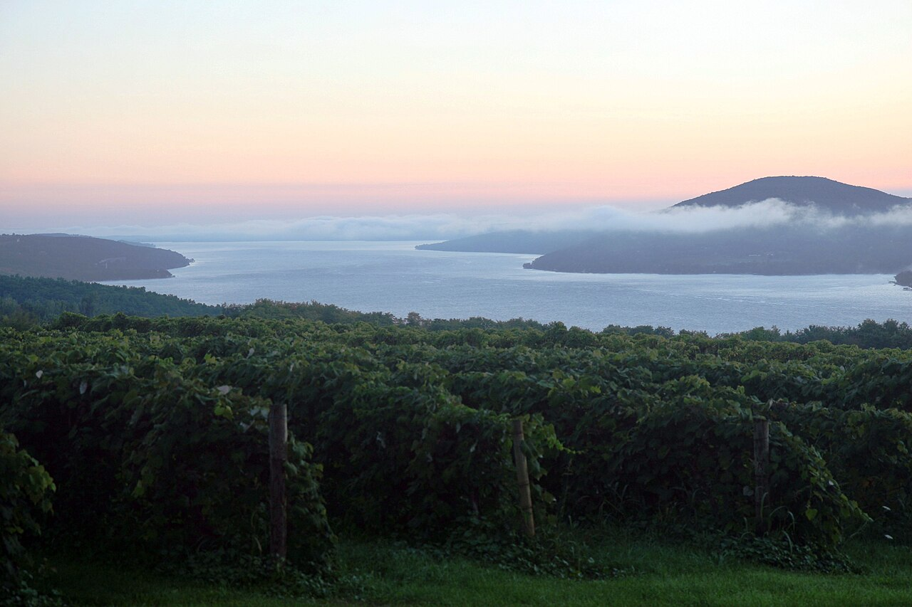

# Finger Lakes

The Finger Lakes are a cool-climate district of eleven narrow, north-south glacial lakes in upstate New York, part of the [United States](ref:usa) wine framework. Riesling is the variety best known internationally, while Chardonnay, Cabernet Franc and traditional-method sparkling wine are equally important. The deep lake waters store heat in summer and release it slowly in autumn, stretching the growing season. The district became a federal AVA in 1982 and remains the largest, most winery-dense wine region in New York State.

Figure: Finger Lakes: Sunrise overlooking a vineyard in the Finger Lakes (Wikimedia Commons). Image: Visit Finger Lakes, CC BY 2.0, via Wikimedia Commons ([source page](https://commons.wikimedia.org/wiki/File:Sunrise_overlooking_a_vineyard_in_the_Finger_Lakes.jpg)).

## Definition and boundaries

The district lies in north-central New York, south of Lake Ontario, covering fourteen counties across roughly 4,060 square miles. Nearly 150 wineries are concentrated around the four largest, most central lakes: Canandaigua, Keuka, Seneca and Cayuga; plantings on the other seven lakes are scattered. Seneca Lake is the deepest, at 632 feet and 37.9 miles long, with the most wineries; Cayuga Lake is 435 feet deep and 38.5 miles long; Keuka Lake has a Y shape, is 187 feet deep and 19.88 miles long; Canandaigua Lake is 262 feet deep and 16.16 miles long.

On a label, “Finger Lakes” is a federal appellation stating only that the fruit comes from the defined fourteen-county district, not from a particular shore or slope. Two sub-AVAs sit beneath it: Cayuga Lake AVA, established in 1988, and Seneca Lake AVA, established in 2003. A sub-appellation name narrows the mesoclimate and soil direction further.

## History and naming

Viticulture here predates Prohibition. In 1829, Reverend William Bostwick planted the first Finger Lakes vineyard in his rectory garden in Hammondsport. In 1860, Pleasant Valley Wine Company became the first bonded winery in the United States; its sparkling wine won gold at the Vienna World Expo in 1873, and by 1900 more than fifty wineries lined the lakes. Prohibition began in 1919 and ended in 1933, breaking the continuous operation of most old estates.

The modern turning point is linked to Dr. Konstantin Frank. From 1953 he ran variety trials for Gold Seal; in 1958 he bought land on the southwestern Keuka Lake slope and grafted European varieties onto North American rootstock; in 1962 he founded Vinifera Wine Cellars, one of the first to prove ripe vinifera could grow in the Northeast. Around 1970, Fournier planted 20 acres on the east side of Seneca Lake and Wiemer planted 140 acres on the west. The Farm Winery Act of 1976 allowed direct-to-public sales; in 1978 Glenora became the first winery on Seneca Lake. The AVA was established in 1982, the three lakeside trails opened in 1983, 1985 and 1986, and the two sub-AVAs were approved in 1988 and 2003. In 1998, semi-dry Rieslings from Dr. Frank and Fox Run won gold in Strasbourg, and the state sustainable certification arrived in 2023.

## Geography and terroir

The terrain was carved by glaciers, which left deep valleys and deep lakes ringed with limestone, shale, gravel and silt. Vineyards mostly sit on slopes facing the water: cold heavy air drains downhill toward the lake, reducing nighttime frost risk, while the slope improves sun exposure and drainage. Shallow shale and gravel sites are low in nutrients, forcing roots downward and producing small, thick-skinned berries with concentrated mineral flavour.

The lakes are the reason this cool district can grow wine grapes at all. In winter cold air drains into the water; in spring the lakes warm slowly and delay budbreak; in autumn stored heat is released gradually, pushing back the first frost. Around Seneca Lake the growing season runs about 190 days, and the diurnal range builds flavour while holding acidity. The main risks are spring frost, flowering wind and rain, harvest rain and winter cold, which is why cold-hardy natives and hybrids such as Niagara, Concord, Baco Noir and Seyval Blanc remain on the coldest sites, while vinifera concentrates on the best lakeshore blocks.

## Raw materials and styles

[Riesling](ref:riesling) is the signature variety, with nearly 1,000 acres planted, more than 200 brands and over 200,000 cases a year. Styles run from dry and off-dry through late-harvest and ice wine; dry examples show green apple, citrus, white flowers and slate mineral, ageing into petrol, flint and stone fruit. Other whites include [Chardonnay](ref:chardonnay), Gewürztraminer, Grüner Veltliner, Pinot Gris and Sauvignon Blanc; some Chardonnay goes into traditional-method [sparkling](ref:sparkling) wine.

Among reds, Cabernet Franc is the most planted: early-ripening, cool-climate tolerant, medium-bodied, with red berry, green pepper and herbal character; Pinot Noir, Merlot, Blaufränkisch and Syrah are also grown. Hybrids and natives such as Cayuga White, Traminette, Vidal Blanc, Vignoles and Niagara still occupy a meaningful area. The overall style leans toward cool-climate precision and acidity; traditional-method sparkling blends Riesling, Chardonnay, Pinot Noir and Pinot Meunier. Residual sugar, oak use and lees contact length pull the same variety in different directions.

## Representative producers and wines

Dr. Konstantin Frank descends from Vinifera Wine Cellars, founded in 1962 on the southwestern Keuka Lake slope; its flagship Rieslings and traditional-method sparkling wines set the early reputation. Hermann J. Wiemer is rooted on the west side of Seneca Lake, known for Riesling and Pinot Noir; Fox Run covers a broad variety range and won gold for its semi-dry Riesling in Strasbourg in 1998. Others include Ravines, Boundary Breaks, Forge Cellars, Red Newt, Wagner, Glenora, Lakewood and Hazlitt 1852, plus O-Neh-Da, founded in 1872, which still makes sacramental wine.

These names are not an official classification; they are reference points built by the market over decades. Flagship single-vineyard Rieslings are small in production and expensive, suited to vertical ageing comparisons; entry-level off-dry Rieslings and blends are easier to find in restaurants and retail. Before buying, separate whether the wine is dry or sweet, which lake its fruit came from, and whether it is a single-vineyard bottling.

## How to drink and pair

Dry Riesling is served around 10–12°C, off-dry and sweet styles at 6–8°C; Cabernet Franc and light reds around 14–16°C, poured and left to settle rather than decanted for long; sparkling is served chilled in a flute or small-bowl glass. The easiest matches are local lake and river fish, roast chicken, pork, charcuterie and salads: high-acid [white wine](ref:white) cuts through sauce and fat, while off-dry Riesling handles Asian dishes and mild curries.

Cabernet Franc suits duck breast, mushrooms, lamb and game stews, where herbal and peppery notes echo the meat; Chardonnay matches white meat, cream sauces and delicate seafood. Sweet Riesling and ice wine finish the meal with blue cheese, fruit tarts or nut desserts; sparkling works as an aperitif with fried and salty snacks. Confirm sweetness and body before choosing the dish, rather than relying on a simple red-with-red-meat formula.

## Labels, buying and misreadings

Reading a label, first separate the broad Finger Lakes appellation from the two sub-AVAs, Seneca Lake and Cayuga Lake, then look for a vineyard or block name. Vintage carries heavy weight in this cool district: flowering frost, harvest rain and winter cold alter yield and ripeness, and the sweetness wording decides the style directly. One misconception is that all Finger Lakes wine is sweet, though dry Riesling has been the award-winning mainstream for decades; another is that a cool climate means a thin wine, when good-vintage Cabernet Franc, Pinot Noir and oaked Chardonnay carry real structure and dry Riesling can age a decade or more.

For storage, steady coolness matters more than extreme cold, and Riesling and sparkling are sensitive to transport heat and long-term light. Comparing two producers of the same variety in the same vintage teaches more about shoreline and soil than jumping between years. Check the importer, cork condition and storage history, and avoid long-term storage where temperature swings are large.

## Around and routes

Wine tourism runs along the main trails. The Cayuga Lake trail opened in 1983, the first organised wine route in the United States; the Keuka and Seneca Lake trails followed in 1985 and 1986, and the Canandaigua Lake trail was added in 1995. Watkins Glen, at the southern tip of Seneca Lake, is the most winery-dense base; northern Cayuga leans on Ithaca, the Keuka core is Hammondsport, and Corning on the west works as an overnight stop.

Nearly 150 wineries are spread along shorelines and country roads. A tasting usually takes 60–90 minutes, and drives between two ends of a lake often run beyond half an hour, so two or three booked stops plus lunch in a day is already comfortable. Harvest falls in the Northern Hemisphere autumn of September and October, when estates are busiest; weekends and festivals draw the largest crowds, so confirm opening hours, booking and fees with winery websites or the trail association first. Stay out of working rooms and blocks, and do not drive after tasting; tracks, steps and thresholds are not always step-free, so ask about facilities before bringing older relatives.

- Related: [usa](ref:usa), [riesling](ref:riesling), [chardonnay](ref:chardonnay), [white-wine](ref:white), [sparkling-wine](ref:sparkling).

Finger Lakes is best approached through the appellation and its permitted varieties, then the vintage and the producer, and then how the wine is labelled. One check alone will not settle it.