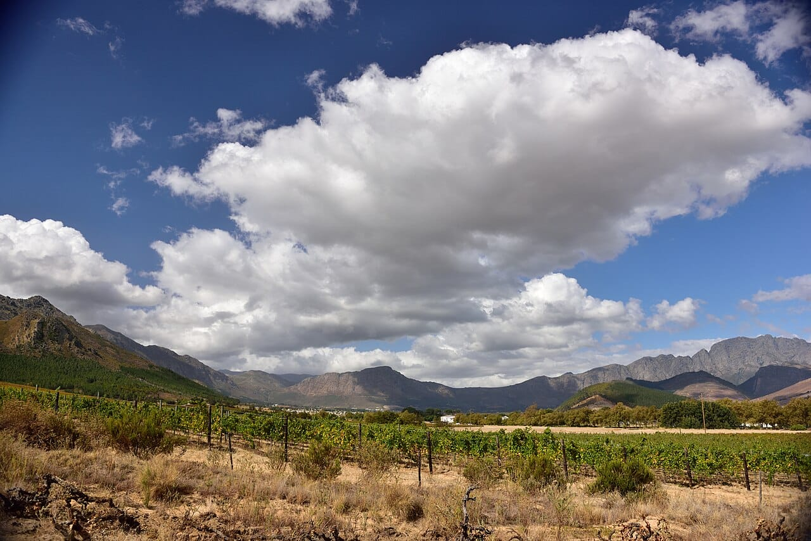
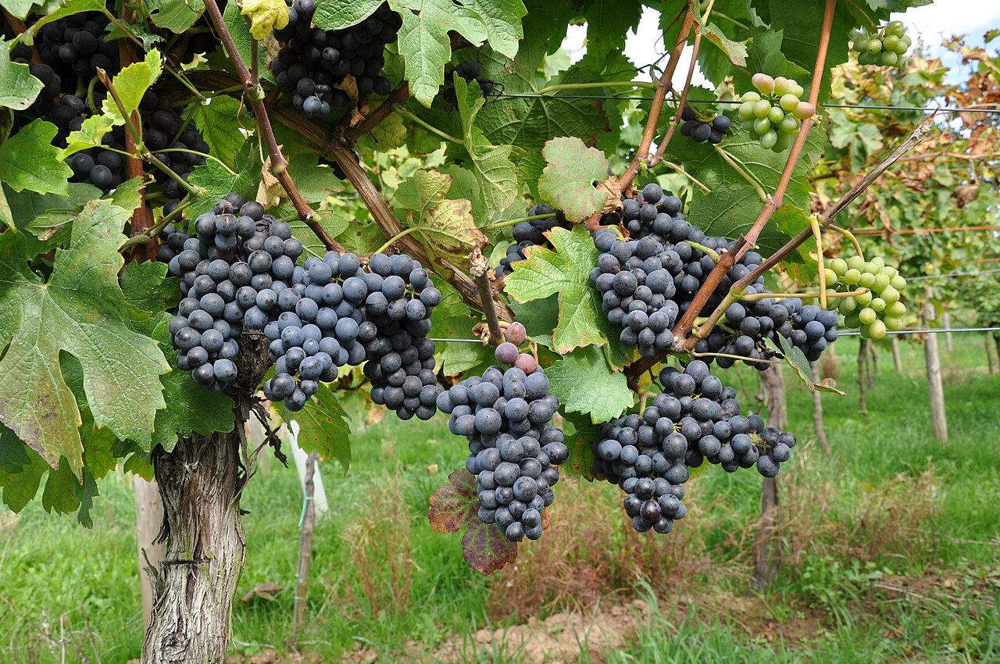

# Franschhoek

A valley region in the Western Cape where French Huguenot settlers arrived in 1688; known for Cabernet Sauvignon, Pinotage, Chardonnay and restaurants, its narrow, scenic valley makes it one of the easiest Cape Winelands regions to drive.

Figure: Franschhoek: Wine Estate, Franschhoek, Western Cape, South Africa (20505659765) (Wikimedia Commons). Image: South African Tourism from South Africa, CC BY 2.0, via Wikimedia Commons ([source page](https://commons.wikimedia.org/wiki/File:Wine_Estate,_Franschhoek,_Western_Cape,_South_Africa_(20505659765).jpg)).

## Definition and boundaries

Franschhoek lies in the Western Cape, where French Huguenot settlers brought viticulture and winemaking in 1688; the valley is narrow and most estates line the main road.

In an official geographical indication, the boundaries of Franschhoek are not a decorative line but a legal and historical construction made of place names, parcels and maps. It may be a county, a group of villages, or a narrow strip along a river or mountain; the more specific the name, the less freely it can be used on a label.

Franschhoek is a narrow valley of small farms, not a single broad appellation. The valley floor, south-facing slopes and north-facing slopes ripen at different speeds; La Motte, Boschendal and Haute Cabrière each work several distinct parcels. The farm name and slope on the back label often explain more than “Franschhoek”.

## History and naming

The climate is Mediterranean, warm and dry in summer, with valley breeze and altitude providing cooling; autumn diurnal range suits red ripening.

The name Franschhoek usually appears first in local archives, church records or tax rolls, and only later in modern regulations. The name often stabilises later than the boundary, which is why the same place can carry different spellings across languages and periods.

Huguenot refugees arrived in 1688 and were granted land in the valley, bringing pruning, irrigation and stone-cellar techniques; the name means “French corner”. In the eighteenth and nineteenth centuries farms mixed wine with fruit and livestock. The late twentieth century turned the valley into a fine-wine and restaurant destination.

## Geography and terroir

Cabernet Sauvignon, Pinotage, Syrah and Chardonnay are the main varieties; Chenin Blanc, Sauvignon Blanc and Semillon are also planted, in styles from rich to crisp.

The vineyards of Franschhoek sit at particular elevations, aspects and soil parent materials. Distance to the sea, mountain direction, diurnal range and harvest rain all change ripening and acidity; these conditions explain more about style than the name alone.

The valley sits at about 300–500 m between mountain ridges, with Mediterranean winter rain and dry summers. Granite, sandstone and alluvial soils drain differently; south-facing slopes are cooler and slower, north-facing slopes warmer. Afternoon valley breezes and mountain shade extend ripening and protect acidity.

## Raw materials and styles

Soils are sandstone, granite, alluvium and clay, with well-drained valley slopes; aspect affects ripening.

The vines of Franschhoek determine what can be made. The leading varieties or raw materials, permitted blends, minimum ripeness and maximum yields are usually written into rules; but rules are a floor, and the real style comes from picking dates, fermentation vessels and ageing.

Chardonnay and Pinot Noir for Cap Classique are picked early to keep acidity; Cabernet Sauvignon and Syrah ripen later on warmer slopes. The harvest can stretch over two weeks across altitudes, and heat spikes or harvest rain force rapid decisions. Cap Classique base wine is usually picked before the same vineyard’s still white.

## Representative producers and wines

Representative producers include La Motte, Boschendal, Rupert & Rothschild, L’Ormarins, Haute Cabrière and Chamonix; French-style dining and estates are a valley signature.

The representative wineries of Franschhoek usually show the two poles of a region: long-established families or cooperatives with concentrated holdings, and newer arrivals working parcel by parcel. Tasting both explains the region better than a list of famous names.

Historic estates, family farms and hospitality-led brands coexist. Some estates grow all their fruit, while others source from neighbouring farms and focus on restaurants, weddings and tasting rooms. La Motte, Boschendal and Haute Cabrière are long-established; Grande Provence and Chamonix combine wine with hospitality.

## How to drink and pair

To drink Franschhoek, start with alcohol, acidity and tannin or bitterness, then choose temperature and food. High acidity suits fat and salt, high tannin needs protein and fat, and high alcohol clashes with sweet or very spicy dishes; warmth pushes alcohol over aroma.

Serve whites at 10–12°C, reds at 16–18°C and Cap Classique at 6–8°C. Seafood, salads and chicken suit the whites; roast meat, game and hard cheese suit the reds; oysters and fried food suit the sparkling wine. The valley’s restaurants often build wine pairings, so book ahead.

## Labels, buying and misreadings

Start with the appellation and its permitted varieties. From there, consider the vintage and the producer, then how the wine is labelled. That is how a practical judgment about Franschhoek is built.

Vintage variation is driven by heat, drought, wind and occasional fire rather than by latitude alone. Warm years give fuller Chardonnay and Cabernet; cool years keep Cap Classique and Pinot Noir sharp. Ask for the harvest year and whether the wine was made from estate fruit or purchased grapes.

## Around and routes

Putting Franschhoek into an itinerary means separating the regional centre from specific wineries: the first is for landscape, markets and food, the second needs bookings, tastings and travel time. Too many stops in one day exhaust both palate and attention.

Franschhoek is about 45–60 minutes from Cape Town and close to Stellenbosch and Paarl. The valley is compact, but three estates plus lunch already fill a day. Book restaurants and tastings, allow 60–90 minutes per stop, and do not add a distant estate just because it looks close on the map.

- Related: [south-africa](ref:south-africa), [cabernet-sauvignon](ref:cabernet), [pinotage](ref:pinotage), [red-wine](ref:red), [white-wine](ref:white).
- This region provides no map, prices or opening hours; confirm before travelling.

**Short definition:** A valley region in the Western Cape where French Huguenot settlers arrived in 1688; known for Cabernet Sauvignon, Pinotage, Chardonnay and restaurants, its narrow, scenic valley makes it one of the easiest Cape Winelands regions to drive.

[South Africa](ref:south-africa) explains geographic boundary; [Pinotage](ref:pinotage) adds climate and soil. Put Franschhoek between them before deciding what it is.

Franschhoek is a Western Cape valley with French Huguenot heritage, known for Chenin Blanc, Semillon and Bordeaux-style reds.

The valley's wine route is compact, and many estates sit within a short drive of the town.

**Key facts.**

| Item | Detail |
| --- | --- |
| In one line | A valley region in the Western Cape where French Huguenot settlers arrived in 1688; known for Cabernet Sauvignon, Pinotage, Chardonnay and restaurants, its narrow, scenic valley makes it one of the easiest Cape Winelands… |
| Level | province or region |
| Parent | South Africa |
| Country code | ZA |

## Related images

Image: Pinotage. Credit: Please note: This photo can be reproduced. Please quote the source as indicated below: Doris Schneider, Julius Kühn-Institut (JKI), Federal Research Centre for , CC BY-SA 4.0, via Wikimedia Commons ([source page](https://commons.wikimedia.org/wiki/File:VIVC9286_PINOTAGE_Full_plant_3638.jpg)). Related image for Franschhoek.

Image: Vineyards in the Cederberg - South Africa. Credit: Ltz Raptor, CC BY-SA 3.0, via Wikimedia Commons.. Credit: Ltz Raptor, CC BY-SA 3.0, via Wikimedia Commons ([source page](https://commons.wikimedia.org/w/index.php?curid=4647540)). Related image for Franschhoek.
