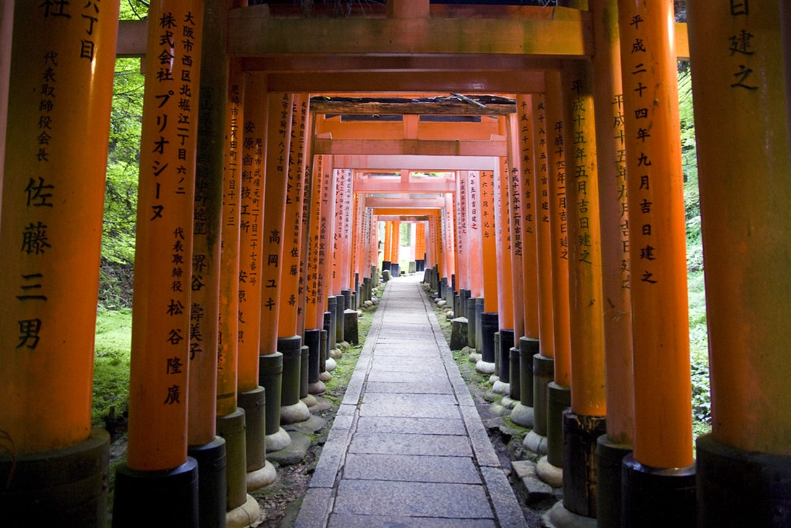

# Fushimi

Fushimi is a sake region in the southern part of Kyoto City, centred on the brewery cluster that runs along the Uji River and the Horikawa canal in Fushimi ward. It is not a separate prefecture, nor a vineyard-style legal appellation. Its reputation rests on the Fushui spring water, brewery architecture, and a shipping history that made sake a visible part of the city. To understand Fushimi, compare it with other sake districts in Kyoto Prefecture and with the harder water and heavier style associated with Nada in Hyogo.

Figure: Fushimi. Photograph: Fushimi Inari-taisha, Kyoto. Credit: Dimitry B, CC BY 2.0, via Flickr / Openverse ([source](https://www.flickr.com/photos/61533954@N00/33775913145)).

## Definition and scope

The first distinction is administrative. Fushimi ward is one ward of Kyoto City, while the Fushimi Sake Brewers Association's member list also covers breweries in Joyo and nearby areas; the association treats Fushimi and Joyo as one brewing cluster. A label saying "Fushimi" may therefore refer to a brewery inside the ward or to the wider local sake tradition, and the brewery or association is the best source for the specific case.

Fushimi is primarily a sake region. Its raw materials are [rice](ref:rice) and water, and its basic process is a parallel [fermentation](ref:sake). What separates it from other [Japanese](ref:japan) sake districts is not the ingredient list but the water, the urban layout, and the accumulated history. Breweries sit beside the Horikawa and Uji rivers, with warehouses, boat landings, and merchants in the same neighbourhood. This "brewery as streetscape" pattern is Fushimi's most immediate signature.

## Fushui and the canal

Local texts write the water as "Fushui." Rain on the Momoyama Hills seeps underground, travels along water veins, and emerges near the foot of the hills. Gokonomiya Shrine's Gokosui spring is among the best-known outlets and is listed among Japan's famous waters. The Fushimi Sake Brewers Association describes the water as medium-hard, containing potassium, calcium, and other minerals, rather than as purely soft.

This point is often misread. Fushimi water is softer than the Miyamizu of Nada and has a lower mineral load, so the sake often feels fine-grained and round. It is not, however, zero-hardness soft water. Calling Fushimi a "soft-water region" hides the role of medium hardness in yeast nutrition, fermentation speed, and the structure of the finished sake. For brewing, hardness, iron content, and mineral balance matter more than the single word "soft" or "hard."

The canal ties water to transport. The Horikawa was dug in 1594 as the outer moat of Fushimi Castle, drawing water from the Uji River. In the Edo period, thirty-koku boats came up from Osaka, and Fushimi became the transfer point between water and land routes. Today the ten-koku Jikkokubune boat runs a sightseeing route; from the water, visitors see the breweries, willows, and old warehouses that the sake transport network left behind. The [Fushimi association's](ref:water) account of the water and [Gekkeikan's](ref:gekkeikan) record of the canal landscape corroborate this water-boat-brewery line.

## Brewery cluster and museums

Fushimi's brewery cluster mixes large companies with small and mid-sized producers. Gekkeikan traces its origins to 1637, when the first-generation Okura Jiuemon came from Kasagi and opened a sake shop in Fushimi. Its Okura Sake Museum occupies a former brewery on the Horikawa and is the main entry point for understanding brewery architecture and modern brewing history. The Kizakura Memorial (Sake Museum and Kappa Museum) stands in Shiokaya-cho, Fushimi ward; admission is free, and models, tools, and video present the old brewing process alongside Kizakura's kappa character and advertising history.

The two museums tell different stories. Gekkeikan leans toward corporate history, brewing equipment, and the Fushimi brewery landscape. Kizakura leans toward popular education about brewing and mass culture. Treating them as two cuts of the same "Fushimi brewery museum" is more complete than visiting only one. The association's list also includes Kinshi Masamune, Tamanohikari, Matsumoto Shuzo (Momono Shizuku), and Fujioka Shuzo (Sokuu), showing that Fushimi is not only large companies; limited releases and unpasteurised sake from small breweries are part of the region's diversity.

The buildings themselves are heritage. White walls, namako walls, red tiles, and riverside warehouses, set among narrow streets and water, create a walkable scale. Visitors should remember that breweries are workplaces, not theme parks. Opening hours, reservations, and tasting availability depend on each brewery and museum's current notice.

## Ginjo's early arena

Fushimi's relationship with ginjo is often reduced to "birthplace." A more accurate statement is that Fushimi was an important early arena for practice and tasting. Gekkeikan's account records that in 1889 Fushimi brewers held a tasting with 35 exhibitors; in 1894 the Niigata brewer Goro Kishi used the word ginjo in Shuzo no Tomoshibi; in 1906 the Brewing Society journal used "ginjo-shu"; and in 1907 the first national sake tasting was organised by the Brewing Society of Japan. These points show ginjo as a term spread through tasting competition across regions, not as an isolated invention in one place.

The modern label rules come from the National Tax Agency's labeling standard for sake. [Ginjo](ref:ginjo) requires rice polished to 60% or less, with rice koji and water, optionally plus added brewing alcohol; daiginjo requires 50% or less. Ginjo brewing emphasises low temperature, roughly 5–10 degrees Celsius, and long fermentation of about 30 days or more, producing apple- and banana-like ginjo aroma. Fushimi breweries took part in tasting and technical innovation from the Meiji period onward, which made ginjo in Fushimi not merely a product name but a craft tradition that could be narrated, displayed, and compared.

## Brewing and water

Fushimi sake cannot be reduced to one adjective. Medium-hard water, low-temperature fermentation, and different yeast starters produce a spectrum from light to rich. Some sake foregrounds ginjo aroma and a crisp finish; others retain rice aroma and umami and suit warm serving. Fushimi breweries also use different [yeast starter](ref:kimoto) routes, including kimoto, yamahai, and sokujo. The starter affects acidity, umami, and fermentation risk; it is not a hierarchy of quality.

At the label level, sake's special designations have hard thresholds. Rice koji must account for at least 15% of the white rice weight; when brewing alcohol is added, its weight must not exceed 10% of the white rice weight; junmai may use only white rice, rice koji, and water. These figures are the first check on a label and say more about the actual category than the word "Fushimi." Water and rice give the region its base, but polishing ratio, starter, yeast, temperature control, and pasteurisation decide the final flavour.

## Visiting and drinking

A visit can follow a water-canal-brewery-museum sequence: first Gokonomiya Shrine and the Horikawa, then the Jikkokubune route for the brewery exteriors, and finally the Gekkeikan Okura Sake Museum or the Kizakura Memorial. This connects water, transport, and architecture instead of treating a museum as an isolated sight. Do not drive after tasting; minors should not drink, and excessive drinking is harmful.

For Fushimi, begin with the appellation and its permitted varieties, then the vintage and the producer, and finish with how the wine is labelled; that order keeps the account grounded.

## Common misconceptions

First, Fushimi is not the whole of Kyoto Prefecture. It is one brewery cluster in southern Kyoto City; the prefecture also includes Rakuchu, Fushimi, Tanba, Tango, Miyazu, and Fukuchiyama brewing areas.

Second, Fushui is not pure soft water. The Fushimi association's water description uses medium-hard language; it is softer than Nada's Miyamizu but not mineral-free.

Third, Fushimi is not the single birthplace of ginjo. It is better described as an important early arena for tasting and technical diffusion; early documentary uses of the word appear across regions and journals.

Fourth, Fushimi is not only large breweries. The association list includes several small and mid-sized producers, with honjozo, junmai, ginjo, unpasteurised, and limited-release products.

Fifth, "Fushimi" is not a quality grade. The place name explains origin and history; it does not determine polishing ratio, starter, or flavour. The special designation and process information on the label are the more specific guide.

[Japan](ref:japan) and [Ginjo sake](ref:ginjo) are the two useful reference points for Fushimi. [Japan](ref:japan) sets out geographic boundary; [Ginjo sake](ref:ginjo) brings in climate and soil. Read them together.

## References

- Fushimi Sake Brewers Association, "The Water of Fushimi": https://www.fushimi.or.jp/guide/water.html
- Fushimi Sake Brewers Association, "Fushimi and the History of Sake": https://www.fushimi.or.jp/guide/history.html
- Fushimi Sake Brewers Association, "Breweries and Producers": https://www.fushimi.or.jp/brewery/
- Gekkeikan, "The History of Ginjo": https://www.gekkeikan.co.jp/enjoy/sake/industry/industry04.html
- Gekkeikan Okura Sake Museum, "The Surrounding Landscape": https://www.gekkeikan.co.jp/enjoy/museum/fushimi/sightseeing/
- Kizakura, "Kizakura Memorial Hall and Kappa Gallery": https://kizakura.co.jp/restaurant/country/memorial/index.html
