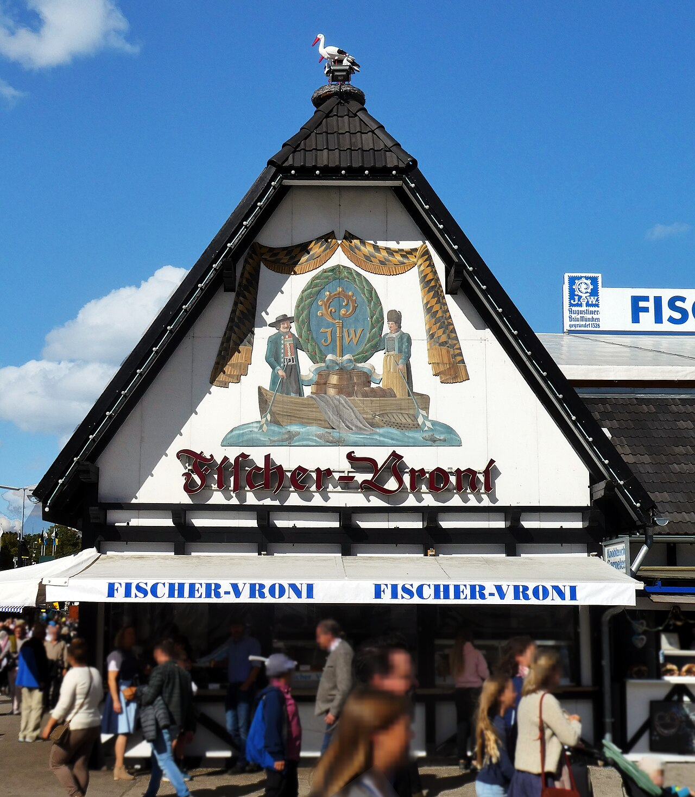
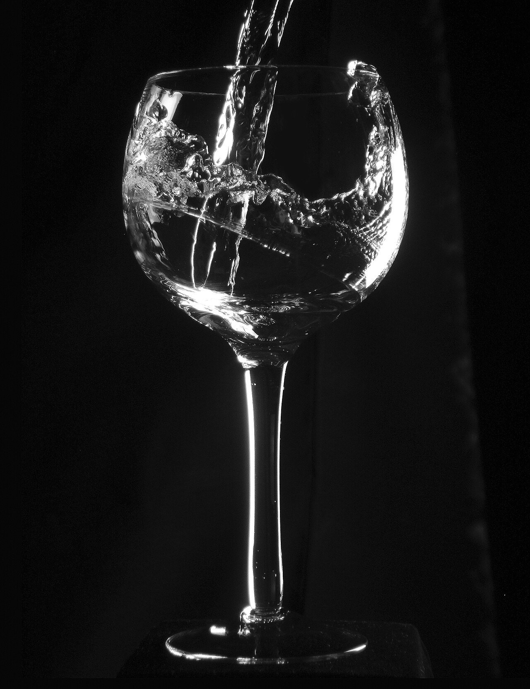

# Germany

Germany is an important wine- and beer-producing country in central Europe. Wine regions are concentrated on river valleys and slopes in the west and south-west, with Riesling as the signature white variety; beer relies on barley, wheat and water and ranges from monastic traditions to modern craft styles. German wine regions and classification are closely tied to the EU framework.

Figure: Germany. Photograph: File:München, Oktoberfest 2022, Fischer-Vroni v S, 1.jpeg. Credit: Renardo la vulpo, CC0 ([source page](https://commons.wikimedia.org/wiki/File:M%C3%BCnchen,_Oktoberfest_2022,_Fischer-Vroni_v_S,_1.jpeg)). Category image; not a claim that it shows the exact product, site or event.

## Geography and climate

German wine regions lie roughly between 47 and 50 degrees north, among the northernmost wine belts in Europe. Slopes along the Mosel, Rhine and Main catch more sun, and rivers reflect heat and extend the growing season; Baden and the Palatinate in the south are warmer and better suited to red grapes. The overall climate is cool, making the balance between ripeness and acidity the most important task each year.

A cool climate means a narrow picking window and marked vintage variation. Under-ripe fruit is high in acidity with green aromas; over-ripe fruit can lose freshness. Producers respond with slope aspect, trellising, yield control and selective picking rather than relying on a single technique.

## History

German wine traditions are linked to monasteries, local princes and river trade. Medieval monasteries left many famous sites, and German wine held a strong position in European markets in the nineteenth century. Late twentieth-century regulation and classification reform raised quality. Beer grew through medieval urban brewing and later industrialisation, shaping German food culture.

## Wine regions

Germany has 13 official wine regions, including Mosel, Rheingau, Rheinhessen, Pfalz, Baden, Franken, Nahe, Ahr, Mittelrhein, Württemberg, Hessische Bergstraße, Saale-Unstrut and Sachsen. Mosel is known for slate slopes and Riesling; Rheingau is fuller; Baden and Pfalz have a higher share of red grapes; Franken is known for its distinctive flagon bottle and Silvaner.

Regions contain village and site names. A more specific place name usually means stricter rules on origin and ripeness, but does not automatically mean higher quality.

## Varieties and styles

[Riesling](ref:riesling) is Germany's signature variety, ranging from dry to sweet and from lean to rich. Mosel's slate soils and cool climate give light body, high acidity and pronounced minerality; Rheingau is fuller. Beyond Riesling, Silvaner, Pinot Blanc and Pinot Gris matter, while Pinot Noir leads among reds, performing well in Baden and Pfalz.

[White wine](ref:white-wine) dominates Germany, with the balance of sweetness and acidity at the core of style; [red wine](ref:red-wine) has grown in share, and some wines gain structure through [oak ageing](ref:oak-ageing). [Sparkling wine](ref:sparkling) is also produced steadily, from fresh to complex styles.

## Representative wines and producers

German wines are often named by region, village, site and variety, so labels carry dense information. Riesling in dry and sweet styles, Pinot Noir reds and sparkling wines all have representative producers. For specific wines, see the wine pages; region pages describe the geographic and regulatory framework and do not judge individual brands.

## Regulation and classification

German wine is linked to the EU PDO/PGI system, with rules for region, variety and ripeness level. Traditionally, classification was based on ripeness, and more recent approaches emphasise origin and variety. Terms such as "Trocken" (dry) and "Halbtrocken" (off-dry) need to be read alongside regulations and the producer's notes.

Classification guarantees rules and origin, not the sensory quality of every bottle. When reading a label, distinguish region, site, variety, ripeness and sweetness terms.

## Climate and soil data

| Area | Climate | Main soils | Representative drinks |
| --- | --- | --- | --- |
| Mosel and Rhine | Cool continental, rivers reflect heat | Slate, gravel | Riesling |
| Pfalz and Baden | Warmer | Limestone, volcanic, loess | White wine, red wine |
| Franken | Continental | Limestone, loess | Silvaner, white wine |
| Rheinhessen | Moderate | Loess, sand | White wine, sparkling wine |

This table is a macro comparison; soil, slope and aspect at a specific site still need to be checked within a single region. Treating the national climate as a guarantee of style ignores slopes and vintage.

## Beer and sparkling wine

[Beer](ref:beer) is central to German food culture. Made from [barley](ref:barley), [wheat](ref:wheat) and [water](ref:water), it goes through mashing, [fermentation](ref:fermentation) and maturation; styles range from light lager to wheat beer, smoked beer and craft styles. German beer tradition emphasises raw materials and process rules, but recipes vary by brewery. Sparkling wine also has a tradition in Germany, some of it made by the traditional method.

## Market and drinking

Germany is a major wine producer and consumer and a large beer market. [Wine](ref:wine) has steady demand at home and in export markets. Riesling suits seafood, poultry and Asian food; Pinot Noir suits poultry and mushrooms; beer suits everyday and restaurant occasions. Drinking should be moderate, and storage after opening and temperature affect the experience.

## Common misconceptions

First, that German wine is always sweet. Dry Riesling and other varieties are common.

Second, that Riesling has only one style. Region, ripeness and winemaking create wide differences.

Third, that Germany only makes beer. It also produces wine, sparkling wine and spirits.

Fourth, that German red wine does not matter. Pinot Noir performs steadily in Baden and elsewhere.

Fifth, that a more complex label means higher quality. Label density and quality are not the same thing.

**Short definition:** A wine- and beer-producing country in central Europe, with 13 official wine regions concentrated in the west and south-west; Riesling is the signature white variety, and beer relies on barley, wheat and water.

Start with the appellation and its permitted varieties. From there, consider the vintage and the producer, then how the wine is labelled. That is how a practical judgment about Germany is built.

Read [Wine](ref:wine) for the geographic boundary side of Germany, and [Red wine](ref:red-wine) for the climate and soil side. Together they locate it.

**Key facts.**

| Item | Detail |
| --- | --- |
| In one line | A wine- and beer-producing country in central Europe, with 13 official wine regions concentrated in the west and south-west; Riesling is the signature white variety, and beer relies on barley, wheat and water. |
| Level | country |
| Country code | DE |

**Sources and limits.** The key claims about Germany are checked against the following sources: Bundesrepublik Deutschland — BMEL (public information on German agriculture, wine regions and food policy), European Union (Used to check EU wine categories, geographical indications and labelling rules), International Organisation of Vine and Wine (OIV) (Used to check the basic scope of global wine production and variety statistics) and 4 sources in total. Prices, batches and status change; the body is project-written and does not reproduce source text.

## Further reading

- [Wine](ref:wine): wine categories, winemaking and the regional framework.
- [Riesling](ref:riesling): Germany's signature white variety.
- [White wine](ref:white-wine) and [red wine](ref:red-wine): the two basic styles and their processes.
- [Sparkling wine](ref:sparkling): German sparkling styles and the traditional method.
- [Beer](ref:beer): German beer ingredients and process.
- [Barley](ref:barley), [wheat](ref:wheat) and [water](ref:water): the base materials of beer and grain drinks.
- [Fermentation](ref:fermentation) and [oak ageing](ref:oak-ageing): key steps in brewing and maturation.

## Related images

Image: Wheat. Credit: kallerna, CC BY-SA 4.0, via Wikimedia Commons ([source page](https://commons.wikimedia.org/wiki/File:Vehn%C3%A4pelto_6.jpg)). Related image for Germany.

Image: Water poured into a glass. Brewing water is also tested for hardness, alkalinity, minerals and microbiology.. Credit: Jorge Barrios, Public domain, via Wikimedia Commons ([source page](https://commons.wikimedia.org/wiki/File:Glass_of_Water.JPG)). Related image for Germany.
