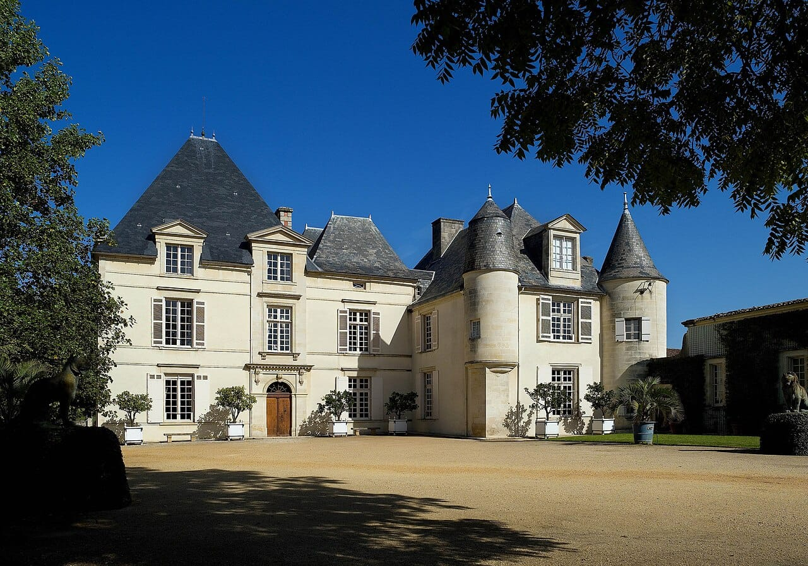

# Graves

Graves is the historic district of southern Bordeaux’s left bank, running from the outskirts of the city south toward Langon. Its name means gravel; it makes both red and white wine, is known for the 1953 classification, and Pessac-Léognan split off in 1987 as a stricter red and white AOC.

Figure: Graves. Photograph: File:Haut Brion exterior.jpg. Credit: BillBl, CC BY 2.0 ([source page](https://commons.wikimedia.org/wiki/File:Haut_Brion_exterior.jpg)). Category image; not a claim that it shows the exact product, site or event.

## Definition and boundaries

Graves lies on the left bank of the Garonne, southeast of Bordeaux city, extending upstream about fifty kilometres toward Langon. It is one of the few Bordeaux districts where red and white carry equal weight: reds are built on Cabernet Sauvignon, Merlot and Cabernet Franc, whites on Sauvignon Blanc, Sémillon and Muscadelle blends. Graves faces the Médoc across the Garonne and was among the left bank's earliest aristocratic and church-established ground; vines run from the city outskirts upstream, and distance from the river sets gravel depth and drainage.

On 9 September 1987 the northern strip closest to the city became the separate Pessac-Léognan AOC, covering about 1,860 hectares and 56 estates today; the south kept the Graves AOC, with more village land and a wider range of style and price. “Graves” and “Pessac-Léognan” on a label are not the same thing: the former is the broader district, the latter the stricter northern sub-region.

## History and naming

Graves is among Bordeaux’s oldest wine-growing ground. The Haut-Brion estate was established by Jean de Pontac in 1525 and became famous in the London market from the seventeenth century; in the 1855 classification it was the only First Growth outside the Médoc. In 1953, at the request of the Graves defence syndicate, the INAO established the Graves classification, beginning with reds and adding dry whites in 1959. In the seventeenth century Bordeaux wine travelled out on British trade routes, and Haut-Brion was among the estates named early in the London market; church and monastery records preserve the early vineyard history of Graves.

The classification lists 16 crus: seven red, three white, and six red and white. It has a single tier, no ranked hierarchy, and no revision. All 16 sit in today’s Pessac-Léognan. Haut-Brion appears on both the 1855 and 1953 lists, the only Bordeaux estate classified twice. Before the classification, Graves reds already carried a reputation in the Bordeaux négociant system; the list fixed the recognised top estates without the multi-tier ladder of 1855.

## Geography and terroir

The district takes its name from its soil: Garonne gravel terraces of rolled pebbles, flint, clay, sand and alios ironstone, freely draining on the terrace tops while roots reach the subsoil. High gravel sites catch sun and warm early in spring; low clayier ground is cooler and moister. The oceanic climate is mild and regular in rainfall, and slope and bench set drainage and ripening rhythm. The gravel is glacial and river-borne pebbles that store heat by day and release it at night, helping ripening; gaps between stones drain fast, forcing roots deep, with low yields and concentrated flavour.

The northern Pessac-Léognan sits beside the city on continuous gravel benches, vineyards separated by rows of pine; the southern Graves village land is more mixed, with more clay and plainer, better-value wines. Valleys around small Garonne tributaries such as the Peugue and the Eau Bourde rarely flood, so vines can root down for water.

## Raw materials and styles

Reds are framed by Cabernet Sauvignon (ref:cabernet), Merlot and Cabernet Franc, with a little Petit Verdot; whites blend Sauvignon Blanc (ref:sauvignon), Sémillon and Muscadelle, often barrel-fermented and aged on lees. Red wines make up about 85% of Pessac-Léognan production, whites about a fifth, and the whites are valued for complexity, fresh acidity and cellaring potential. Merlot share rises with clay proportion, while Cabernet Sauvignon dominates the gravelly benches; whites are blended to balance acidity, roundness and aroma, with Muscadelle adding perfume.

Graves reds usually show dark fruit, cedar and mineral with clear tannin structure; good vintages age for a decade or more. Whites range from crisp citrus to honey, hazelnut and oak spice: Sémillon brings roundness, Sauvignon Blanc acidity and blossom. Southern Graves AOC wines are mostly for everyday drinking, direct-fruited and softly tannined. Barrel fermentation, lees stirring and new-oak proportion set whether a white follows a fresh mineral or a rich buttery route; maceration time and oak ageing shape tannin finesse in reds.

## Representative producers and wines

Pessac-Léognan classified estates include Haut-Brion, La Mission-Haut-Brion, Pape Clément, Smith Haut Lafitte, Domaine de Chevalier, Carbonnieux, Haut-Bailly and Malartic-Lagravière, among others. Haut-Brion’s vineyard covers about 52.82 hectares: red varieties are 46% Merlot, 42% Cabernet Sauvignon, 11% Cabernet Franc and 1% Petit Verdot, and the white varieties are 52% Sémillon and 48% Sauvignon Blanc. Domaine de Chevalier is known for both red and white, Carbonnieux is a Graves dry-white reference, and La Mission-Haut-Brion, beside Haut-Brion, stands for structure and concentration.

The southern Graves also holds family estates, cooperatives and value producers, less famous than the northern classified growths but useful for everyday Bordeaux. These names are not cross-district rankings; within the classified list, estates split by red, white and site style. When buying, separate the AOC level, variety share and producer first. Cooperatives and small family estates carry the southern everyday volume; a classified estate usually splits a grand vin and a second wine, younger and cheaper.

## How to drink and pair

Reds are served at 16 to 18 °C, whites at 10 to 12 °C. Young fruity wines need no long decanting; structured classified reds can be opened half an hour to an hour ahead. A Bordeaux or medium universal glass suits reds; a narrow white glass gathers white-wine blossom, and aged whites can be opened a little early to release perfume.

Pair reds with steak, lamb chops, braised beef and firm cheese; whites with roast poultry, seafood in cream sauce, asparagus and soft cheese. Graves whites suit oysters and fish with their acidity and minerality; sweet Sauternes, within the Graves district, goes with blue cheese and dried fruit.

## Labels, buying and misreadings

Read Graves and Pessac-Léognan separately: the latter is the northern AOC split off in 1987, and all the classified growths lie within it. The 16 Graves crus carry no ranked tiers, unlike the 1855 Médoc first-to-fifth-growth ladder. The Cru Classé de Graves name on a label corresponds only to the 1953/1959 list; check estate spelling and AOC boundary, and vintage matters for both reds and whites.

A common mistake is treating Graves as a famous-estate district, or assuming southern Graves ranks with the northern classified growths. Southern wines are meant young and need no cellaring; classified ageing candidates should come from good vintages, with storage history and bottle condition checked.

## Around and routes

Pessac-Léognan lies about fifteen minutes southwest of central Bordeaux; the southern Graves countryside spreads along the Garonne valley toward Langon, with 20 to 50 minutes between estates. Tastings are mostly by appointment, allowing 60 to 90 minutes per visit, and two or three estates plus lunch makes a comfortable day.

The district sits close to old Bordeaux and the Saint-Émilion touring route, and visits can combine city restaurants, cheese shops and riverside walks. Harvest, from September to October, is the busiest season, so opening hours should be confirmed ahead. Classified-estate visits are generally by appointment only, some restricted to booked tastings.
- Related: [bordeaux](ref:bordeaux), [cabernet-sauvignon](ref:cabernet), [sauvignon-blanc](ref:sauvignon), [red-wine](ref:red), [white-wine](ref:white).
- Classified Graves estates generally require advance booking; check opening hours and tasting arrangements on the Pessac-Léognan committee or estate websites before travelling.

Graves is best read by starting with the appellation and its permitted varieties, moving to the vintage and the producer, and ending with how the wine is labelled.

## Related images

Image: Related photograph of Sauvignon Blanc. Credit: Geolina163 + 1971markus, CC BY-SA 4.0, via Wikimedia Commons ([source page](https://commons.wikimedia.org/wiki/File:HBLA_Klosterneuburg_Sauvignon_Blanc_2.jpg)). Related image for Graves.

Image: Cabernet Sauvignon grapes from Château Cos D'Estournel. Credit: Megan Mallen, CC BY 2.0, via Wikimedia Commons.. Credit: Megan Mallen, CC BY 2.0, via Wikimedia Commons ([source page](https://commons.wikimedia.org/w/index.php?curid=13318021)). Related image for Graves.
