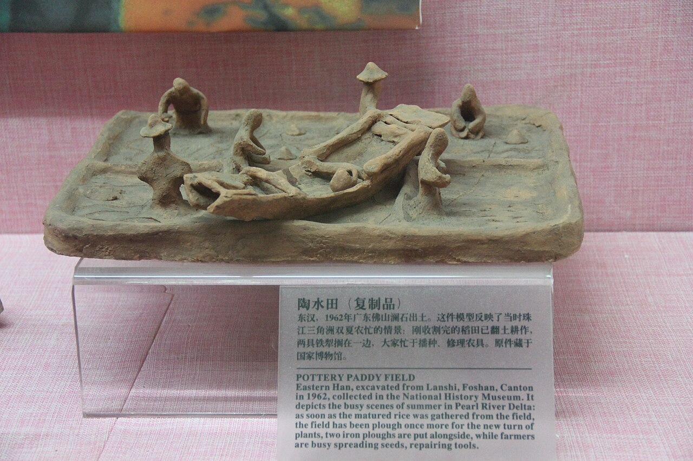
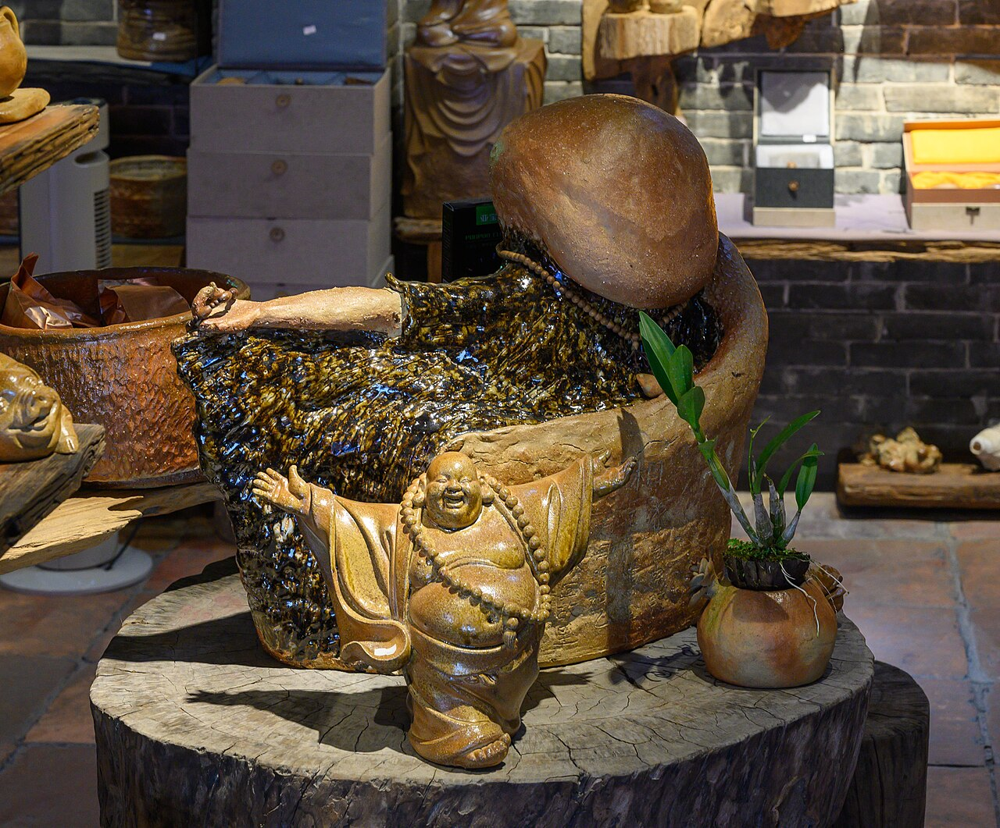
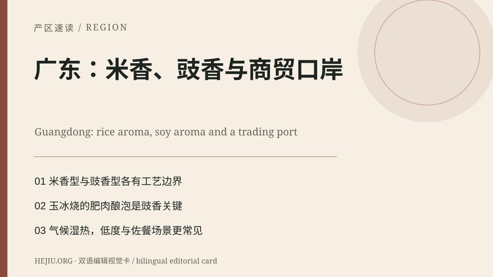

# Guangdong

Guangdong sits in southern China, backed by the Nanling range and facing the South China Sea; the Pearl River Delta is its densest population and industry belt. Unlike northern baijiu regions built on sorghum and wheat, Guangdong's drinks tradition follows rice agriculture: rice, glutinous rice and local water underpin rice aroma, soy aroma and sweet yellow rice wine.

Another trait is "lower strength, everyday, food-facing". Yuk Bing Siu, Jiujiang Shuangzheng and Hakka niang jiu appear on family tables, at morning tea, festivals and in cooking, not only at business banquets. To understand Guangdong drinks, put rice wine and yellow rice wine into the frame, not only baijiu.

Figure: An Eastern Han pottery model of a rice paddy, material evidence of South China's rice agriculture and rice-wine tradition. Image: Gary Todd from Xinzheng, China, CC0, via Wikimedia Commons ([source page](https://commons.wikimedia.org/wiki/File:Eastern_Han_Pottery_Rice_Paddy_Field_(10075468314).jpg)).

## Geography and climate

Guangdong has a subtropical to tropical monsoon climate: high heat, heavy rain, high humidity and long summers. The Pearl River Delta is a web of rivers; eastern, northern and western Guangdong are mostly hills and mountains. Rice is a major crop, and coastal and river transport created a dense urban and food network.

Heat and humidity cut both ways for fermentation and storage: microbes are active and fermentation runs fast, but contamination control and stability are harder. Traditional rice-wine workshops rely on experience with temperature and acidity; modern plants use temperature-controlled rooms, filtration and sterilisation. Climate shapes craft but does not determine flavour by itself.

Figure: Nanfeng Kiln in Foshan, a historic site of Lingnan ceramics and vessel culture. Image: xiquinhosilva, CC BY 2.0, via Wikimedia Commons ([source page](https://commons.wikimedia.org/wiki/File:Nanfeng_Kiln_39152-Foshan_(49042868786).jpg)).

## History

Guangdong's brewing tradition is tied to rice farming, Hakka migration, Cantonese food and coastal trade. Rice wine is common in families and festivals; Hakka niang jiu is linked to birth rituals, festivals and hospitality. In the twentieth century, Shiwan Yuk Bing Siu and Jiujiang Shuangzheng industrialised and became representative Guangdong rice wines and soy-aroma baijiu.

After reform and opening, Guangdong became a national centre for drinks consumption and distribution, with imported wine, beer, foreign spirits and local rice wine side by side. Local producers preserve traditional flavours while facing younger consumers, lower-strength preferences and changing restaurant occasions.

## Aroma and style

The most recognisable Guangdong baijiu is soy aroma. It uses rice, has a clear body, a distinct soy note, mellow entry and a long finish; it contrasts sharply with northern strong, light and sauce aroma. Rice aroma is cleaner and sweeter, stressing rice fragrance and freshness; Jiujiang Shuangzheng is a common example.

Hakka niang jiu belongs to the sweet yellow rice wine or rice-wine tradition, fermented from glutinous rice and starter, high in sweetness and low in strength, used for postpartum care, festivals and cooking. It is not the same category level as rice wine: rice wine can describe raw material and process, while yellow rice wine is a more specific beverage category. Mixing all three obscures Guangdong's structure.

Figure: Guangdong: rice aroma, soy aroma and a trading port. Project-generated bilingual editorial card; schematic, not a photograph.

## Raw materials and craft

Guangdong rice wine uses rice and glutinous rice, water and starter for saccharification, fermentation and distillation. Soy-aroma baijiu's distinction comes from base-wine ageing and later treatment; rice aroma stresses rice saccharification, cool fermentation and clean steaming and distillation.

Starter and blending determine stability. Traditional rice wine often uses small qu; modern plants use pure or composite cultures to control flavour. Ingredients, strength, sugar level and standard on the label say more than words such as "old method" or "handmade".

Figure: Fermentation converts starch into alcohol and flavour compounds, a middle step in baijiu craft. Image: Tjhackmann, CC BY-SA 4.0, via Wikimedia Commons ([source page](https://commons.wikimedia.org/wiki/File:Phylogenetic_tree_of_bacteria_and_archaea,_highlighting_those_that_carry_out_fermentation.png)).

## Representative bottles and local memory

Shiwan Yuk Bing Siu is the representative soy-aroma baijiu from Shiwan, Foshan, made from rice with a clear body and pronounced soy note. Jiujiang Shuangzheng represents rice-aroma rice wine from Jiujiang, Nanhai, Foshan, common in home cooking and daily drinking. Hakka niang jiu is spread across Meizhou, Heyuan and Huizhou, with uneven branding and more workshop or household production.

Guangdong also has beer, wine and imported spirits. Bars and restaurants in Guangzhou, Shenzhen and Zhuhai make the province a front line for Chinese drinks consumption. The value of local rice wine is not "premiumisation" but its connection to Cantonese food, morning tea and family life.

## Market and drinking

Drinking occasions are highly segmented: morning tea and home cooking with rice wine or yellow rice wine; business meals and late-night food with beer, baijiu or foreign spirits; festivals and rituals with Hakka niang jiu. Cantonese food stresses clear, fresh, tender and smooth qualities, so pairing need not chase high strength: rice aroma, lower-strength soy aroma and yellow rice wine suit white-cut chicken, steamed fish and dim sum; heavier roast and braised food can take soy aroma or strong aroma.

Rice wine and yellow rice wine oxidise after opening; refrigerate and finish quickly. Soy-aroma baijiu can be kept at room temperature away from light, but long storage still needs a clean, sealed bottle mouth. Control total intake; do not use sweet rice wine to hide alcohol consumption.

## Rules and regional protection

Baijiu, rice wine and yellow rice wine production is governed by food-safety rules and national standards. GB/T 15109-2021 defines terms for starter, fermentation and distillation; GB/T 17204-2021 sets classification and terminology. Names such as soy aroma and rice aroma must follow their standards. On a label, separate ingredients, sugar level, strength and producer.

## Climate and drinks structure

| Area | Climate and landform | Main drinks | What to check when buying |
| --- | --- | --- | --- |
| Pearl River Delta (Guangzhou, Foshan, Jiangmen) | River plain, hot and rainy | Soy aroma, rice aroma, yellow rice wine | Aroma, ingredients, sugar level |
| Eastern Guangdong (Meizhou, Heyuan, Huizhou) | Hills, Hakka communities | Hakka niang jiu, rice wine | Sweetness, strength, storage |
| Northern Guangdong (Shaoguan, Qingyuan) | Mountains, cooler winters | Rice wine, local small-quar liquor | Ingredients and producer |
| Western Guangdong (Zhanjiang, Maoming) | Coastal tableland, hot and humid | Rice wine, beer | Channel and freshness |
| Coastal cities | Concentrated urban consumption | Imported drinks, beer, rice wine | Label and provenance |

The table is a macro comparison, not a substitute for a distillery's craft. A single city can host both traditional rice-wine workshops and modern plants.

## Common misconceptions

First, Guangdong only has rice wine. It also has soy-aroma baijiu, rice-aroma rice wine, Hakka niang jiu, beer and a wine market.

Second, soy aroma means soy sauce. The soy note comes from base-wine ageing and craft, not from adding soy sauce.

Third, all rice wine is sweet. Rice aroma can range from dry to sweet; sugar level and strength on the label are the evidence.

Fourth, Hakka niang jiu is only postpartum wine. It is also used at festivals, for guests and in cooking; uses vary by family and region.

Fifth, lower-strength means no intoxication. Lower strength is not lower risk; total volume and speed matter.

## Chi-aroma, rice-aroma and the Cantonese table

Guangdong's rice-aroma and chi-aroma styles are often compared at the same table. Jiujiang Shuangzheng is clean, sweet and light in the rice-aroma mode; Yuk Bing Shao adds a chi-aroma and fat-like layer over a rice base, giving a rounder entry and a deeper finish. Hakka niangjiu belongs to the yellow-wine family, where glutinous rice and sweetness take it in a different direction. All three are lower in alcohol and easy to drink with Cantonese food, but they are not the same drink.

With food, white-cut chicken, steamed fish and blanched prawns suit rice-aroma: the clean sweetness does not bury seafood. Roast goose, char siu and claypot rice suit chi-aroma, whose savoury fat note meets the richness of meat. Hakka niangjiu can be warmed to 40–50°C and served with stuffed tofu, salt-baked chicken or dessert; a sweeter version works as an after-dinner drink. Do not use a low-alcohol rice wine as a chilli extinguisher: heat tends to amplify the alcohol.

Everyday rice and chi-aroma bottles usually sit from a few dozen to a few hundred RMB; gift boxes and aged releases can reach several hundred. Hakka niangjiu prices depend more on glutinous rice, age and handwork. Read the category on the label — baijiu, yellow wine or blended liquor — and check sweetness, alcohol content and shelf life rather than assuming every sweet rice drink is a traditional ferment.

A Guangdong visit can link the Nanfeng kiln in Foshan, the Jiujiang Shuangzheng museum and Hakka walled villages: Foshan for chi-aroma and ceramics, Jiujiang for rice-aroma and double distillation, Meizhou for the daily life of Hakka niangjiu. Check current official opening and booking information before travelling.

## Three shortcuts for matching food

First, read the richness of the dish. Steamed, blanched and soupy dishes call for rice aroma; reserve chi-aroma for roast goose, char siu and claypot rice. If the table has both seafood and roast meats, open a rice-aroma bottle first and move to chi-aroma for the second half. Second, read sweetness. Sweet-and-sour pork, honey char siu and dessert amplify bitterness, so a semi-sweet or sweet niangjiu is safer; with a dry wine, taste a savoury dish first. Third, read temperature. Both rice and chi-aroma can take a light chill to 15–18°C, while niangjiu warms to 40–50°C; do not switch the same bottle between ice and heat.

## Common questions

**What does soy-aroma baijiu taste like?** It uses rice, has a clear body, a distinct soy note, mellow entry and a long finish. The note comes from craft and ageing, not added soy sauce or fermented beans.

**How do Yuk Bing Siu and Jiujiang Shuangzheng differ?** Yuk Bing Siu represents soy-aroma baijiu; Jiujiang Shuangzheng is closer to rice-aroma rice wine. Aroma, material handling and typical occasions differ; read the label.

**How should Hakka niang jiu be drunk?** Warm it and serve in small cups, or use it in cooking and festival hospitality. Sweetness and strength vary by product; refrigerate after opening.

**How long does Guangdong rice wine keep?** Rice-aroma baijiu can be stored at room temperature away from light, but rice wine and yellow rice wine oxidise after opening and should be refrigerated and finished quickly. Check the label for shelf life.

## Further reading

- [China](ref:china): Guangdong's place in Chinese drinks geography.
- [Soy aroma](ref:chi): the rice-based route most associated with Guangdong.
- [Rice aroma](ref:rice-aroma): the cleaner, sweeter rice-wine route.
- [Hakka niang jiu](ref:yellow): sweet yellow rice wine in festival and family life.
- [Rice](ref:rice), [glutinous rice](ref:glutinous) and [water](ref:water): basic materials.
- [Starter culture](ref:qu), [fermentation](ref:fermentation) and [distillation](ref:distillation): craft terms.

**Key facts.**

| Item | Detail |
| --- | --- |
| One-line position | A rice-based southern province of soy aroma, rice aroma and Hakka sweet yellow rice wine |
| Level | Province / macro-region |
| Part of | China |
| Country code | CN |
| Representative clues | Yuk Bing Siu, Jiujiang Shuangzheng, Hakka niang jiu |

**Sources and scope.** Geography, aroma and craft information was cross-checked against the Guangdong Provincial People's Government portal, national standards, the China Alcoholic Drinks Association and The Oxford Companion to Spirits and Cocktails. Brand details and prices change; use current official information. The body is project-written; sources are for verification, not copied text.
