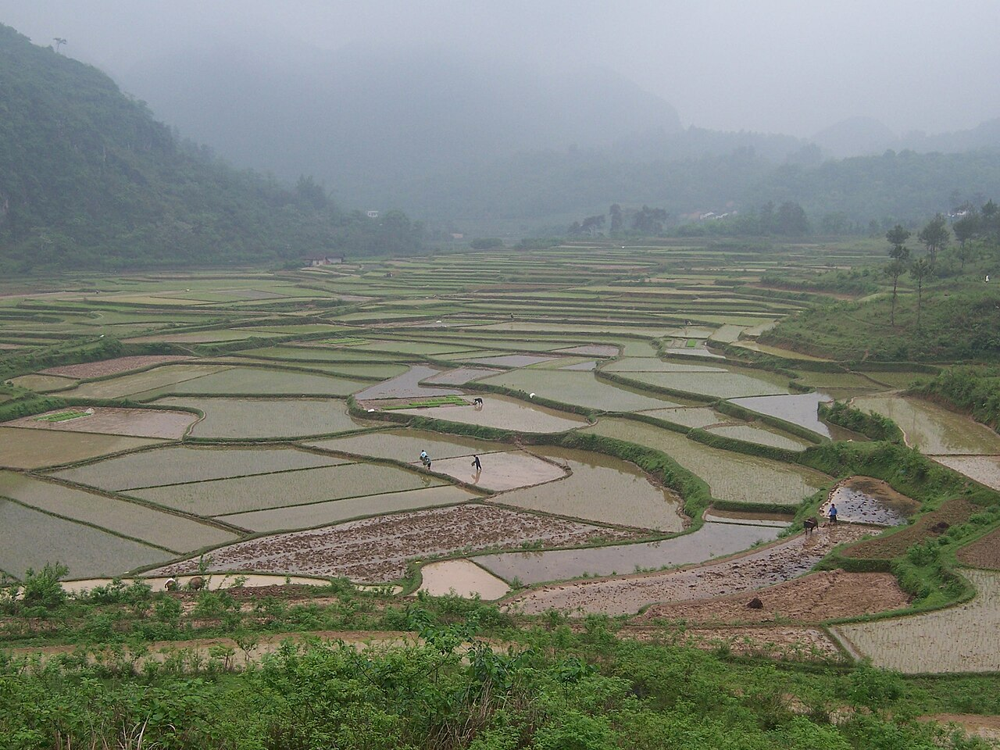
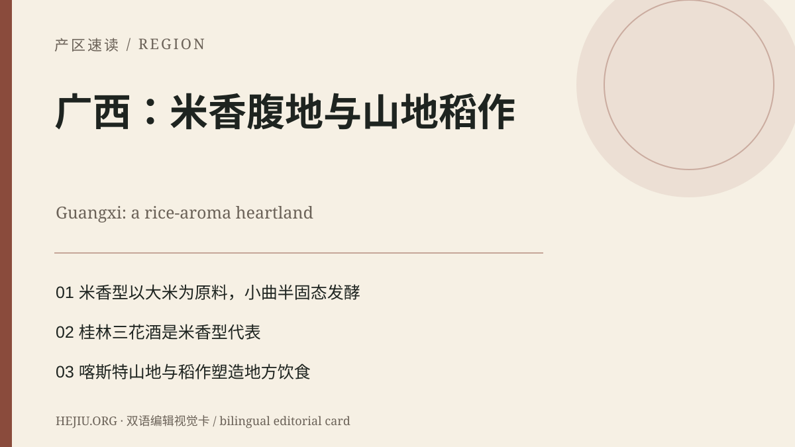

# Guangxi

Guangxi lies in southern China, bordering Guangdong to the east, Hunan and Guizhou to the north, Yunnan to the west and the Beibu Gulf to the south. Mountains, hills, karst landscapes and river plains interlock; the Li, Liu and Hongshui rivers cut many small basins. Rice farming is the agricultural base, and rice wine is the most everyday drinks tradition.

On the national baijiu map, Guangxi's clearest coordinate is rice aroma and Guilin Sanhua. It lacks the scale narrative of Sichuan strong aroma or Guizhou sauce aroma, but has built recognition through clean, sweet, refreshing and pure qualities. Understand rice, starter, fermentation and distillation rather than memorising brands.

Figure: The Li River route from Guilin to Yangshuo, where karst landscapes define Guangxi. Image: Flora-Victoria, CC0, via Wikimedia Commons ([source page](https://commons.wikimedia.org/wiki/File:Li_River_cruise_from_Guilin_to_Yangshuo.JPG)).

## Geography and climate

Guangxi has a subtropical monsoon climate: hot, rainy, humid, with long summers and short winters. Northern Guangxi is mountainous, with karst peaks around Guilin and Liuzhou; the south near the Beibu Gulf is closer to tropical; the west and centre are hills, valleys and basins. Rice, sugarcane, fruit and water are abundant.

For rice-aroma baijiu, water quality and rice matter. Soft water in the Li River basin, local long-grain rice and suitable small qu are part of Guilin Sanhua's traditional story. But water and materials are only the base; steaming, saccharification, fermentation, distillation and storage decide whether the body is clean.

Figure: Rice paddy terraces near Yangshuo, the base of mountain rice and local foodways. Image: McKay Savage from London, UK, CC BY 2.0, via Wikimedia Commons ([source page](https://commons.wikimedia.org/wiki/File:China_-_Yangshuo_29_-_Rice_Paddy_Terraces_(140905203).jpg)).

## History

Guangxi's brewing tradition is tied to the rice farming, festivals and hospitality of Zhuang, Yao and Dong communities. Rice wine, glutinous rice wine and local small-quar liquor are widespread in counties and villages, used at festivals, weddings, for guests and after work. Guilin Sanhua was brought into state ownership and industrial production in the twentieth century and became a national representative of rice aroma.

After reform and opening, the market was shaped by Guangdong rice wine, Guizhou baijiu and imported drinks. Guilin Sanhua kept its local famous-liquor status but limited national reach; local rice wine stayed closer to restaurants, homes and tourism. Guangxi's breadth is not in brand count but in the link between drinks, rice farming and ethnic foodways.

## Aroma and style

The representative baijiu aroma is rice aroma. It uses rice, has a bright body, elegant rice fragrance, mellow sweetness, a clean finish and a pleasant aftertaste. Its relationship with "rice wine" is one of category versus raw material: rice wine can mean a fermented or distilled drink made from rice, while rice aroma is a specific baijiu aroma type.

Guangxi also has yellow rice wine, glutinous rice sweet wine and local small-quar liquor. Glutinous rice wine in Zhuang and Yao areas is sweet and low in strength, tied to festivals, guests and singing. Treating rice-aroma baijiu and sweet glutinous rice wine as the same thing ignores differences in craft and sugar.

Figure: Guangxi: a rice-aroma heartland. Project-generated bilingual editorial card; schematic, not a photograph.

## Raw materials and craft

Rice-aroma baijiu uses rice, water and starter for saccharification, fermentation, distillation and blending. Traditional craft stresses clean steaming and distillation, cool fermentation and small-qu saccharification to preserve rice fragrance and a clean texture. Compared with sauce or strong aroma, rice aroma usually has a shorter fermentation cycle and a lighter body.

Starter is the starting point of flavour. Microbes and enzymes in small qu turn rice starch into sugar, then alcohol; too hot produces off-flavours, too cool ferments incompletely. Modern plants use pure cultures, temperature-controlled fermentation and filtration for stability, while traditional small-qu liquor retains more local variation.

Figure: Rice is the base material for southern rice-aroma baijiu and semi-solid fermentation. Image: China News Service, CC BY 3.0, via Wikimedia Commons ([source page](https://commons.wikimedia.org/wiki/File:20201102.Hengnan.Hybrid_rice_Sanyou-1.6.jpg)).

## Representative bottles and local memory

Guilin Sanhua is the representative rice-aroma baijiu from Guilin, made from rice, with a bright body, clear rice fragrance and mellow sweetness. Its name travels with Guilin's landscape as one of Guangxi's most familiar cultural symbols. Rice wine also appears alongside rice noodles, fermented tofu and pickled fruit.

Beyond Guilin Sanhua, Guangxi has glutinous rice wine, sweet potato liquor, sugarcane liquor and local small-quar liquor. Their standards, sweetness and strength vary widely; read the label, not words such as "farmhouse" or "old method". For visitors, bottled rice-aroma baijiu from reliable channels is easier to trace and store than bulk liquor.

## Market and drinking

Drinking is centred on restaurants, festivals, families and tourism. Rice-aroma baijiu suits rice noodles, white-cut chicken, steamed fish, pickled fruit and light dishes; glutinous rice sweet wine suits festivals, desserts and family meals. The light body can make rice aroma seem harmless, but strength is not low; control total intake.

In Guangxi's hot, humid climate, opened rice wine and yellow rice wine should be refrigerated, kept dark and finished quickly. Rice-aroma baijiu can be stored at room temperature, but seal the bottle and avoid odours. Bulk rice wine sold at tourist sites often has unclear origin and sterilisation; it is not a good gift or long-term collectible.

## Rules and regional protection

Baijiu, rice wine and yellow rice wine production is governed by food-safety rules and national standards. GB/T 15109-2021 defines terms for starter, fermentation and distillation; GB/T 17204-2021 sets classification and terminology. Rice-aroma names, geographical indications and local standards must follow their rules. On a label, separate ingredients, sugar level, strength and producer.

## Climate and drinks structure

| Area | Climate and landform | Main drinks | What to check when buying |
| --- | --- | --- | --- |
| Northern Guangxi (Guilin, Liuzhou) | Karst hills, wet | Rice-aroma baijiu, rice wine | Aroma, ingredients, producer |
| Southern Guangxi (Beihai, Qinzhou) | Coastal, closer to tropical | Rice wine, beer | Channel and freshness |
| Western Guangxi (Baise, Hechi) | Hills and river valleys | Glutinous rice wine, small-quar liquor | Sweetness, strength, storage |
| Central Guangxi (Nanning, Laibin) | Basins and plains | Rice-aroma baijiu, rice wine | Standard and origin |
| Ethnic tourism areas | Mountain villages | Sweet rice wine, local liquor | Hygiene and traceability |

The table is a macro comparison, not a substitute for a distillery's craft. Traditional household wine and modern bottled products can coexist in one county.

## Common misconceptions

First, Guangxi only has rice-aroma baijiu. It also has rice wine, yellow rice wine, sweet glutinous rice wine and local small-quar liquor.

Second, rice aroma is the same as rice wine. Rice aroma is a baijiu aroma type; rice wine describes a broader material or drink category.

Third, sweet rice wine is just for festivals. It is also used in cooking, hospitality and everyday drinking, with family and regional variation.

Fourth, a light body means a low risk. Strength and total volume still matter; light texture is not a licence to drink more.

Fifth, bulk "farmhouse wine" is more authentic. Without traceability, sterilisation and storage information, it is a higher-risk purchase.

## Drinking and buying rice-aroma baijiu

Rice aroma's "clean but not thin" character comes from two layers: a clean base of rice and soft water, and the trace esters and rice notes left by semi-solid fermentation, distillation and resting. Guilin Sanhua is the most cited example, but Guangxi also has small-qu liquor, sanhua series and local bulk rice wine with styles that are not identical. On a first tasting, check whether the liquid is clean, the entry sweet, and the finish free of rice-bran or sour faults.

Serve at about 18–22°C; in summer a light chill to 15–18°C is acceptable, but do not load the glass with ice, which washes out the rice note. With Guilin rice noodles, pickled fruit and vegetables, luosifen and steamed river fish, the clean sweetness meets acidity and umami. The strong sour and chilli notes of luosifen can flatten detail, so taste the broth first, then the wine.

Everyday rice wine often costs a few dozen RMB; sanhua series and gift boxes can reach one or two hundred to several hundred. Aged and small-batch bottles cost more, but an age claim needs a checkable production record. Buy from local supermarkets, brand stores and licensed liquor specialists, and check the standard code, alcohol content and net volume. Bulk rice wine deserves extra attention to source and hygiene.

A Guangxi visit can centre on Guilin, Yangshuo and Sanjiang: Guilin for Sanhua and urban liquor culture, Yangshuo for rice farming and tourist dining, Sanjiang for Dong and Miao rice wine and shared drinking. Distillery and village visits change by season; confirm current opening and whether individual visitors are accepted.

## Common questions

**What is special about rice-aroma baijiu?** It uses rice, has a bright body, elegant rice fragrance, mellow sweetness and a clean finish. The route relies on small-qu saccharification and cool fermentation rather than heavy pit aroma.

**Is Guilin Sanhua a brand or a place?** It is a product name tied to Guilin and a representative of rice-aroma baijiu. Check the producer, standard and strength on the specific bottle.

**How is glutinous rice wine different?** It is usually sweet, lower in strength and fermented from glutinous rice; it belongs to the yellow-rice-wine or sweet rice-wine family rather than the baijiu aroma system.

**What should I eat with Guangxi rice-aroma baijiu?** Rice noodles, white-cut chicken, steamed fish, pickled fruit and light dishes work well. The light body does not mean low strength; serve in small cups.

**Is bulk rice wine safe to buy?** Traceability, sterilisation and storage are often unclear. For gifts or keeping, choose sealed, labelled products from reliable channels.

## Further reading

- [China](ref:china): Guangxi's place in Chinese drinks geography.
- [Rice aroma](ref:rice-aroma): the defining baijiu route.
- [Rice wine](ref:rice-wine): the broader material and drink category.
- [Yellow rice wine](ref:yellow): sweet glutinous rice wine and related traditions.
- [Rice](ref:rice) and [water](ref:water): basic materials.
- [Starter culture](ref:qu), [fermentation](ref:fermentation), [distillation](ref:distillation) and [blending](ref:blending): craft terms.

**Key facts.**

| Item | Detail |
| --- | --- |
| One-line position | A karst-and-rice province centred on rice-aroma baijiu and everyday rice wine |
| Level | Province / macro-region |
| Part of | China |
| Country code | CN |
| Representative clues | Guilin Sanhua, rice wine, glutinous rice wine |

**Sources and scope.** Geography, aroma and craft information was cross-checked against the Guangxi Zhuang Autonomous Region People's Government portal, national standards, the China Alcoholic Drinks Association and The Oxford Companion to Spirits and Cocktails. Brand details and prices change; use current official information. The body is project-written; sources are for verification, not copied text.
