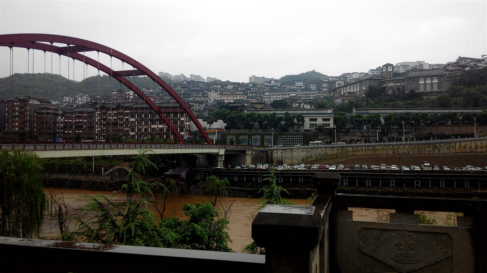

# Gulin County

Gulin County belongs to Luzhou in Sichuan and lies at the southern edge of the Sichuan Basin, at the northern foot of the Yunnan–Guizhou Plateau. Its shape is unusual: the county pushes south into northern Guizhou like a peninsula. Xuyong borders it to the west, while Bijie, Jinsha, Renhuai, Xishui and Chishui in Guizhou surround it on the south, east and north. The official figures give an area of 3,185 square kilometres, 3 subdistricts, 17 towns and 3 Miao townships, with 43 communities and 246 administrative villages; the registered population at the end of 2025 was 873,000.

Image: the Chishui River valley at Maotai Town, used to show the gorge landscape and the liquor belt it cuts; the location is not Erlang Town in Gulin and should not be read as a Langjiu factory view. Photo: Wahsaw, CC0, via Wikimedia Commons ([source page](https://commons.wikimedia.org/wiki/File:Chishui_River_Bank_in_Maotai%28Moutai%29_Town%2C_Renhuai_City%2C_Zunyi%2C_Guizhou.jpg)).

## Location and access

Gulin's “embedded” position shapes both its transport and its liquor industry. From Luzhou city, the road climbs gradually into low mountains and river valleys; from Renhuai or Xishui in Guizhou, it crosses the ridges on either side of the Chishui River. The county has a large elevation range, and the climate of a river terrace, a plateau and a mountain ridge can differ sharply. Actual driving time between townships is often longer than the map suggests.

Roads and scheduled buses are the main way in. Gulin has no civil airport, and rail is not the primary mode of arrival. A Luzhou–Gulin expressway has been progressing, but the opening date and final alignment should be checked against transport-authority notices. Drivers should expect winding mountain roads, fog and rockfall in the rainy season; night driving on unfamiliar mountain roads is not advisable, especially toward highland townships.

Treating Gulin as “a county next to Luzhou” understates the distance. The county seat is several hours by road from Luzhou's urban core, and Erlang Town is another mountain leg beyond it. Approaching from [Zunyi](ref:zunyi) or [Xishui](ref:xishui) in [Guizhou](ref:guizhou) may look close on a provincial map, but the route still has to negotiate river valleys and ridges. Build buffer time into any itinerary; do not use plain-city travel times.

## Industry and production area

Gulin's central liquor landmark is Erlang Town and [Langjiu](ref:langjiu). Erlang sits beside the Chishui River, across the water from Maotai Town in Renhuai, Guizhou. The stretch is often called the Chishui River sauce-aroma valley or part of a “baijiu golden triangle”. Gulin belongs to [Sichuan](ref:sichuan), yet its liquor language is closer to the [sauce-aroma baijiu](ref:sauce) of the Chishui River than to the strong aroma of the Sichuan Basin's interior.

Langjiu's production story revolves around the Chishui River, Erlang Town, Tianbao Peak, Tianbao Cave and Dibao Cave. Natural limestone caves are used for storing liquor, which gives the company a distinctive memory point among sauce-aroma producers. Cave storage is not, however, a legal requirement for sauce aroma, and it cannot by itself determine quality. Read Langjiu through valley climate, qu making and the timing of the grain additions, pit conditions and storage together, not through a single “cave-aged” idea.

Erlang is not the only liquor space in Gulin. Maoxi and other townships also have sauce-aroma production and supporting industries, and the county has built a chain around sorghum, qu, packaging, logistics and sales. Compared with the strong-aroma area around [Luzhou](ref:luzhou) city, Gulin's sauce-aroma route depends more on the microclimate of the Chishui valley and on cross-provincial flows of grain and technical practice. Compared with [Xishui](ref:xishui), it shares the river but differs in administrative structure, company system and industrial-park layout.

## Flavour and craft

The public outline of [sauce-aroma baijiu](ref:sauce) is “qu making at Dragon Boat Festival, grain addition at Double Ninth, nine steamings, eight fermentations and seven draws”. This is not a secret recipe but a production system tied to season, temperature, sorghum grind and qu quality. Gulin lies in the Chishui valley, where summers are hot and humid and winters are comparatively mild. Microbial activity is intense, and workshops rely on ventilation, cooling and stacked fermentation to keep temperatures in range.

Sauce-aroma liquor is often described as having a prominent sauce-like aroma, elegant complexity, a full body and a lingering empty-cup fragrance. For Gulin and Erlang in particular, individual companies, rounds and vintages differ greatly. Some round liquors are sourer, some sweeter, some carry a toasted note; the final style comes from blending. Treating “sauce aroma” as one flavour misses the importance of rounds and blending.

For an ordinary drinker, judge sauce aroma through the cleanliness of the aroma, the balance of acidity and body on entry, and the length of the finish. Smell a small cup first, then sip and let the liquor sit in the mouth; do not evaluate it by large banquet toasts. To compare other routes, read [strong-aroma baijiu](ref:strong) and [baijiu](ref:baijiu), but do not let an aroma category stand in for a specific product.

## Visiting and itineraries

Erlang Town is the core liquor-culture visit in Gulin. The town spreads along the Chishui River and the slopes, with distilleries, old streets and valley roads interwoven. Whether a site is open, how to book and which areas may be photographed depend on company notices and local rules. A working distillery is not an ordinary scenic area; visitors should not enter production halls on their own, and care is needed near traffic and rockfall when photographing by the river.

Beyond Erlang, Gulin has several routes with a different character. Maoxi is useful for seeing another sauce-aroma production area and a river-valley township. The Huangjing old-growth forest area is primarily about forest, streams and summer escape; official material describes it as an ecological area near 28 degrees north. Taiping Old Town preserves spaces associated with the Red Army's four crossings of the Chishui River and suits travellers interested in modern history. These places lie in different directions and cannot all be covered in one day.

A sensible two-day route is to enter Gulin from Luzhou or Zunyi on the first day, visit Erlang Town and its river valley in the afternoon, then return to the county seat or stay nearby. On the second day, choose Huangjing or Taiping according to the weather, then leave by the same road or toward Xishui. With only one day, prioritise Erlang and avoid repeated backtracking on mountain roads.

## Food and seasons

Gulin's food sits at the junction of southern Sichuan and northern Guizhou: spicy chicken, mutton, cured meat, tofu pudding and wild mountain vegetables are common. With sauce-aroma baijiu, savoury, fermented and moderately oily dishes support the body better than heavy chilli, which can mask the finer aromas. At an ordinary meal, a small amount is enough; there is no need to prove expertise through forced drinking.

Spring and autumn suit Erlang and the old-town routes. Summer is hot and humid in the valley; the Huangjing forest is cooler, but the risk of heavy rain and flash floods rises. Winter is damp and cold in the mountains, with a large diurnal range. Fog and condensation affect visibility along the Chishui valley, so drivers should allow extra time and avoid unfamiliar mountain roads at night.

## Common misconceptions

First, Gulin is not a synonym for “Luzhou liquor”. Luzhou's urban core is known for strong aroma; Gulin's core is Chishui River sauce aroma. The two should not be conflated.

Second, cave storage is not a legal requirement for sauce aroma. It is a company choice, not a step that every sauce-aroma liquor must pass through, and it does not by itself represent quality.

Third, Erlang Town and Maotai Town are not the same place. They face each other across the river and share a watershed, but they belong to different provinces, company systems and visiting rules.

Fourth, do not estimate Gulin's mountain distances using plain-city experience. The county seat, Erlang, Maoxi and Huangjing are all separated by substantial drives; itineraries need buffers.

## Further reading

- For the shared language of sauce aroma, read [sauce-aroma baijiu](ref:sauce).
- To place Gulin within Luzhou and Sichuan, read [Luzhou](ref:luzhou) and [Sichuan](ref:sichuan); for the other bank, read [Zunyi](ref:zunyi), [Guizhou](ref:guizhou) and [Xishui](ref:xishui).
- To compare strong and sauce aroma, read [strong-aroma baijiu](ref:strong); for the national picture, read [China](ref:china) and [baijiu](ref:baijiu).
