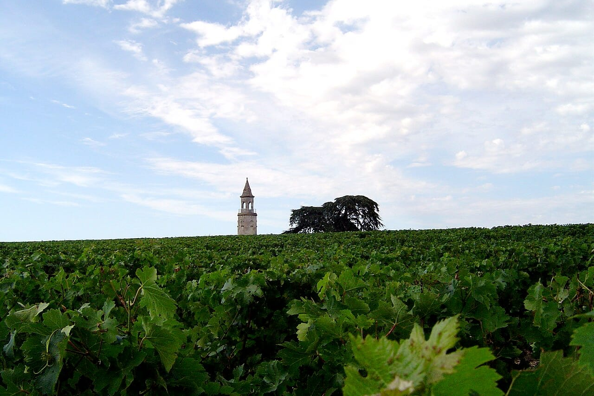

# Haut-Médoc

A broad AOC in the northern Médoc on Bordeaux’s left bank, running from Blanquefort to Saint-Seurin-de-Cadourne and surrounding six communal AOCs including Margaux, Saint-Julien, Pauillac and Saint-Estèphe; Cabernet Sauvignon on gravel ridges dominates, and the area holds many of the 1855 classed growths.

Figure: Haut-Médoc: Vineyard in the Haut-Medoc (Wikimedia Commons). Image: Jonas Roux, CC BY 2.0, via Wikimedia Commons ([source page](https://commons.wikimedia.org/wiki/File:Vineyard_in_the_Haut-Medoc.jpg)).

## Definition and boundaries

Haut-Médoc is not a single village but a wide appellation across the northern Médoc; Margaux, Moulis, Listrac, Saint-Julien, Pauillac and Saint-Estèphe have their own AOCs embedded within it.

In an official geographical indication, the boundaries of Haut-Médoc are not a decorative line but a legal and historical construction made of place names, parcels and maps. It may be a county, a group of villages, or a narrow strip along a river or mountain; the more specific the name, the less freely it can be used on a label.

Haut-Médoc is an AOC that surrounds six more famous village appellations, so its own vineyards are the parcels outside Margaux, Saint-Julien, Pauillac, Saint-Estèphe, Listrac and Moulis. Gravel croupes, clay hollows and riverside flats behave as different units. A château’s commune and soil matter more than the broad AOC name.

## History and naming

In the 1855 classification, the Médoc was the power centre of Bordeaux; most first and second growths still sit on left-bank gravel ridges, making Haut-Médoc the most direct entry to Bordeaux hierarchy.

The name Haut-Médoc usually appears first in local archives, church records or tax rolls, and only later in modern regulations. The name often stabilises later than the boundary, which is why the same place can carry different spellings across languages and periods.

Dutch engineers drained the marshes in the seventeenth century, and eighteenth-century merchants built the export trade. The 1855 classification placed La Lagune, Cantemerle, La Tour Carnet and Camensac in the hierarchy; the Cru Bourgeois system later gave smaller estates a market identity. The rules and the rankings have been revised repeatedly.

## Geography and terroir

The Gironde estuary brings a mild climate, while gravel mounds drain well over clay subsoils; thicker, faster-draining gravel usually suits late-ripening Cabernet Sauvignon.

The vineyards of Haut-Médoc sit at particular elevations, aspects and soil parent materials. Distance to the sea, mountain direction, diurnal range and harvest rain all change ripening and acidity; these conditions explain more about style than the name alone.

The Gironde estuary moderates temperature, while gravel croupes store heat and drain quickly for Cabernet Sauvignon. Clay and sand between the croupes suit Merlot; Listrac and Moulis are cooler and more clay-heavy, producing tighter wines. Spring frost, summer hail and harvest rain are the main risks.

## Raw materials and styles

Cabernet Sauvignon leads, with Merlot, Cabernet Franc, Petit Verdot and Malbec in support; the blend aims at structure, tannin and ageing rather than a single-varietal fruit expression.

The vines of Haut-Médoc determine what can be made. The leading varieties or raw materials, permitted blends, minimum ripeness and maximum yields are usually written into rules; but rules are a floor, and the real style comes from picking dates, fermentation vessels and ageing.

Cabernet Sauvignon ripens slowly on the gravel, usually from late September into October; Merlot is picked earlier on clay. The picking window is narrow because autumn rain can dilute the crop. Producers choose between leaf and fruit ripeness, and the choice explains much of the vintage’s structure.

## Representative producers and wines

Representative estates include Lafite, Mouton, Latour, Margaux and Haut-Brion (some in communal AOCs), plus many second and third growths in Saint-Estèphe and Pauillac; together they define the left bank’s sense of structure.

The representative wineries of Haut-Médoc usually show the two poles of a region: long-established families or cooperatives with concentrated holdings, and newer arrivals working parcel by parcel. Tasting both explains the region better than a list of famous names.

The region is dominated by châteaux, many family-owned, with négociants and cooperatives handling part of the crop. Grands crus, Cru Bourgeois and small estates coexist, and some châteaux buy fruit from neighbours. Knowing who owns the vineyard, who makes the wine and who sells it is more useful than memorising rankings.

## How to drink and pair

To drink Haut-Médoc, start with alcohol, acidity and tannin or bitterness, then choose temperature and food. High acidity suits fat and salt, high tannin needs protein and fat, and high alcohol clashes with sweet or very spicy dishes; warmth pushes alcohol over aroma.

Serve at 16–18°C in a large red glass; young wines need one to two hours of air, older bottles only decanting for sediment. Steak, lamb, duck breast, mushrooms and hard cheese suit the tannin; delicate seafood and spicy food do not. Avoid over-chilling, which makes the tannin feel harder.

## Labels, buying and misreadings

Haut-Médoc is best approached through the appellation and its permitted varieties, then the vintage and the producer, and then how the wine is labelled. One check alone will not settle it.

Vintage is decisive: rain at harvest, spring frost and hail change yield and ripeness, and the same château can taste quite different across years. Warm years give fuller fruit; cool years give tighter structure and need longer ageing. Compare producers within one vintage before comparing vintages.

### Key dates and figures

- 1970s: in the 1970s–80s, new and established estates modernised, moving from a rougher style to finer winemaking.
- Typical red blend: 50–70% Cabernet Sauvignon, 20–40% Merlot, with small amounts of Petit Verdot and Cabernet Franc; alcohol 13–13.5%.

## Around and routes

Putting Haut-Médoc into an itinerary means separating the regional centre from specific wineries: the first is for landscape, markets and food, the second needs bookings, tastings and travel time. Too many stops in one day exhaust both palate and attention.

Haut-Médoc runs from Blanquefort in the south to Saint-Seurin in the north, generally 30–60 minutes from Bordeaux. A château visit takes 60–90 minutes, and three estates plus lunch is a full day. Book in advance, check harvest closures, and group estates by commune rather than by ranking.

- Related: [Bordeaux](ref:bordeaux), [Cabernet Sauvignon](ref:cabernet), [Merlot](ref:merlot), [red wine](ref:red), [oak ageing](ref:oak).
- Haut-Médoc’s white wines are rare and are usually sold under a village name or as Vin de France, not under the Haut-Médoc AOC.

[Bordeaux](ref:bordeaux) and [Merlot](ref:merlot) are the two useful reference points for Haut-Médoc. [Bordeaux](ref:bordeaux) sets out geographic boundary; [Merlot](ref:merlot) brings in climate and soil. Read them together.

## Related images

Image: Merlot. Credit: Felloni claire, CC BY-SA 4.0, via Wikimedia Commons ([source page](https://commons.wikimedia.org/wiki/File:Merlot.jpg)). Related image for Haut-Médoc.

Image: Cabernet Sauvignon grapes from Château Cos D'Estournel. Credit: Megan Mallen, CC BY 2.0, via Wikimedia Commons.. Credit: Megan Mallen, CC BY 2.0, via Wikimedia Commons ([source page](https://commons.wikimedia.org/w/index.php?curid=13318021)). Related image for Haut-Médoc.
