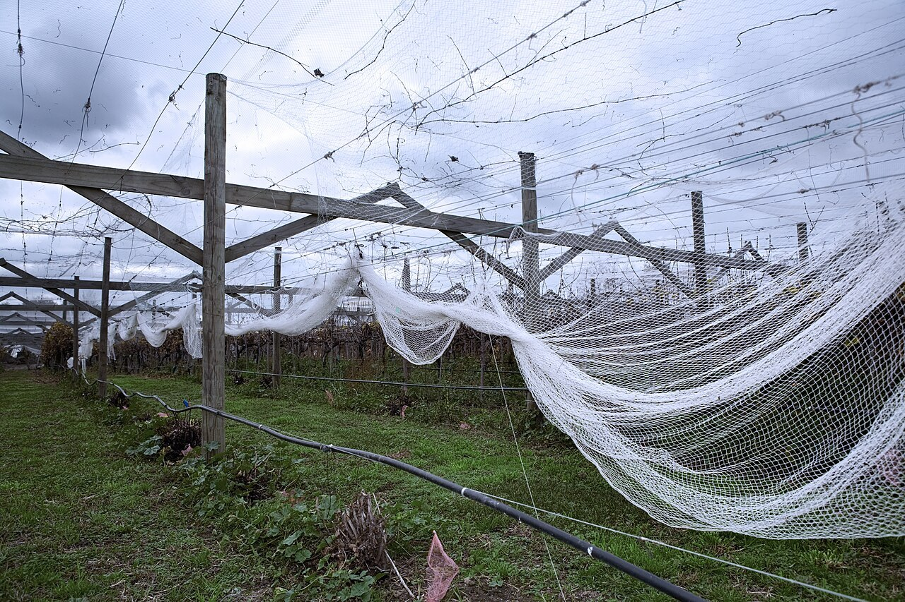

# Hawke's Bay

Hawke's Bay lies on the east coast of New Zealand's North Island and is the country's second largest wine region, warm, dry and sunny. It is known for Bordeaux-style Cabernet/Merlot blends, Syrah and Chardonnay, with the gravels of Gimblett Gravels on the Heretaunga Plains at the core of its reds.

Figure: Hawke's Bay. Photograph: New Zealand - Vineyard - 9878. Credit: Jorge Royan, CC BY-SA 3.0 ([source page](https://commons.wikimedia.org/w/index.php?curid=15897982)). Category image; not a claim that it shows the exact product, site or event.

## Definition and boundaries

The district sits on the Heretaunga Plains between Napier and Hastings, plains built by the Tutaekuri, Ngaruroro, Tukituki and Mohaka rivers. The Hawke's Bay GI covers the whole region, internally divided into areas such as Esk Valley, Bridge Pa, Gimblett Gravels, Mangatahi and Matapiro, and the Tukituki Valley. These area names are customary industry divisions, not separate official AOCs.

The GI name only constrains fruit origin; within one label, coastal lowlands, gravel plains and western inland terraces differ in temperature and ripening rhythm. Read region, area, producer, variety and vintage separately rather than treating "Hawke's Bay" as a fixed flavour tag.

Compared with other New Zealand regions, this is the country's closest thing to a Bordeaux-style red district, built around red varieties rather than the Sauvignon Blanc that leads Marlborough. Whites are a smaller share, but Chardonnay and aromatic whites have a steady following.

## History and naming

In 1851, French Marist missionaries founded Mission Estate at Taradale, New Zealand's oldest winery. The estate moved from Pakowhai to Meeanee in 1858 and made its first commercial sale in 1870. In 1895, Italian viticulturist Romeo Bragato, commissioned by the New Zealand government to survey the country's wine potential, called Hawke's Bay the most suitable province for vines he had visited.

Early estates followed: Te Mata Estate was licensed in 1896, Church Road (then McDonalds Winery) in 1897, Anthony Vidal founded Vidal Estate in Hastings in 1905, and Esk Valley (then Glenvale) was established in 1933. Te Mata was already the country's largest winery by 1901. In the mid twentieth century, Tom McDonald made New Zealand's first commercial Cabernet Sauvignon at the Taradale winery in 1949.

After the Second World War, hybrids and Müller-Thurgau dominated plantings until fine-table-wine planting revived in the 1970s. John Buck took over and revived Te Mata in 1974, releasing the flagship Coleraine in the early 1980s. Stonecroft released New Zealand's first modern commercial Syrah in 1989, and Trinity Hill established its Gimblett Gravels vineyard in 1993. The region's modern red reputation was built across these several restarts.

## Geography and terroir

Hawke's Bay has a warm-maritime climate, around 2,200 sunshine hours a year, with growing-season warmth comparable to Bordeaux. Diurnal swings of 10–15°C help preserve acidity. Annual rainfall is 800–1,000 mm, concentrated outside the growing season, so summers are dry. Main risks are spring frost, flowering wind and harvest rain, and yield and style vary noticeably between vintages.

The Heretaunga Plains mix gravel, loam and clay across their alluvial fans. Gimblett Gravels is a gravel fan exposed after the Ngaruroro River changed course in the 1867 flood, covering about 800 hectares. Its topsoil is about 20 cm of fine sandy loam over gravel mixed with sand; the gravel acts as a thermal blanket, raising soil temperature at 30 cm depth by about 5°C over surrounding localities, with fast drainage and heat retention well suited to Cabernet Sauvignon, Merlot and Syrah.

The areas differ clearly. Bridge Pa, west of Gimblett, sits on older red-clay soils. Esk Valley lies in the low Eskdale country near the coast, cooler and closer to the sea. Mangatahi and Matapiro are older terraces 30 km west of Hastings, cooler still. The Tukituki Valley spreads around Havelock North. Within one GI, gravel parcels give tight, concentrated wines, while clay parcels round earlier and softer.

## Raw materials and styles

Red varieties are led by Cabernet Sauvignon, Merlot and Syrah, with Cabernet Franc, Malbec and Petit Verdot in support; whites are led by Chardonnay, with Sauvignon Blanc, Pinot Gris and Pinot Noir next. Bordeaux-style blends are the traditional strength, with blackcurrant, cedar, blackberry and spice; Syrah has grown fastest in the last two decades, showing black pepper, floral and wild-berry notes.

Red wines are full bodied but retain acidity with ripe tannins. Gravel sites produce tight, concentrated wines; clay sites are rounder and earlier. Chardonnay ranges from fresh fruit to oak-aged styles, some with mineral and nutty character; aromatic whites are consistent but less famous than Marlborough's.

In the winery, Bordeaux blends are assembled by parcel and vintage; Syrah ranges from Northern-Rhone-style whole-cluster fermentation to a newer-oak approach. Picking windows vary between cool and warm vintages, and producers choose between ripe fruit and retained acidity; that choice shapes the wine more than the variety itself.

## Representative producers and wines

Te Mata Estate, founded in 1896, makes the flagship Coleraine Cabernet/Merlot blend, the second-tier Awatea Bordeaux blend and the Bullnose Syrah, and is among New Zealand's oldest family estates. Craggy Range sits at Giants Estate beneath Te Mata Peak, with Gimblett Gravels wines including Le Sol, Sophia and Te Kahu.

Trinity Hill, established in 1993, makes the Homage Syrah, one of New Zealand's Syrah benchmarks. Church Road, Vidal, Mission Estate, Elephant Hill and Stonecroft are other common names on shelves and wine lists. These are not an official classification; they are reference points formed by the market and trade.

Flagship blends and single-vineyard wines are expensive and scarce, while entry wines are easier to find in restaurants and retail. Compare by area first (gravel, clay or coastal), then variety and vintage; within one producer's range, parcels and winemaking investment can differ completely.

## How to drink and pair

Serve by style: Bordeaux blends at 16–18°C, Syrah at 15–17°C, Chardonnay at 10–12°C, aromatic whites at 8–10°C. Full-bodied reds can settle for about half an hour; young wines should not be over-decanted, or their fruit slips away.

For food, red blends match roast lamb, beef, venison, smoked meats and hard cheese; Syrah goes with grilled meats, sausages and spiced dishes; Chardonnay pairs with grilled seafood, chicken and cream sauces. Local produce includes bay fish, lamb, dairy and berries, reflecting the region's strong farming and orchards.

Home cooking leans on barbecue, smoked meats and soft cheese, seasoned with fruit and spice that connect naturally with red-wine fruit and tannin. Choose the wine around the fat and salt of the main course, then decide between a full red blend, a peppery Syrah or a fresh Chardonnay.

## Labels, buying and misreadings

Below the GI name, area names such as Gimblett Gravels and Bridge Pa hint at soil and ripening rhythm; the next level down is single vineyard and cuvée name. Vintage matters even in a warm region: frost, flowering wind and harvest rain change yield and style, and comparing producers within the same vintage reveals area differences more clearly than comparing across years.

Three common misreadings: treating a place name as a quality rank; treating "old vines", "handmade" or "traditional" as legal terms; and treating high alcohol as proof of ripeness. Each may be true, and each may be marketing; read them with the producer and vintage.

For storage, keep full-bodied reds away from light, at a steady temperature, on the side. Young whites are best enjoyed fresh, while good blends can age for a decade or more. When buying imports, check transport and storage record; wine kept too warm can show muted fruit and abrupt acidity after opening.

## Around and routes

Napier is known for its Art Deco architecture, and Hastings is a second accommodation base; estates spread across plains and valleys, so self-drive is easiest, and the region runs wine trails and regular food and wine festivals. A half-day visit fits two or three tasting rooms plus lunch.

A full day can follow the Gimblett Gravels and Bridge Pa line to compare gravel and red-clay parcels, or take the coastal Esk Valley route through cooler lowland whites and light reds. Harvest falls in the southern autumn, March and April, when some tasting rooms shorten their hours; confirm bookings through winery websites or the regional association directory first.

Most estates have a cellar door and restaurant. Arrive on time for appointments and stay out of working areas. Mountain roads, dirt tracks and tasting-room thresholds are not always accessible; ask about step-free access and restrooms before bringing older relatives or children.

- Related: [new-zealand](ref:new-zealand), [cabernet-sauvignon](ref:cabernet), [syrah](ref:syrah), [chardonnay](ref:chardonnay), [red-wine](ref:red).

To read Hawke's Bay, start with the appellation and its permitted varieties, then the vintage and the producer, then how the wine is labelled; no single check settles it.

## Related images

Image: Syrah Grapes on the Vine. Credit: U.S. Geological Survey, CC0, via Wikimedia Commons.. Credit: U.S. Geological Survey, CC0, via Wikimedia Commons ([source page](https://commons.wikimedia.org/w/index.php?curid=114429512)). Related image for Hawke's Bay.

Image: Chardonnay. Credit: Jenavive at English Wikipedia, Public domain, via Wikimedia Commons ([source page](https://commons.wikimedia.org/wiki/File:Chardonnay.jpg)). Related image for Hawke's Bay.
