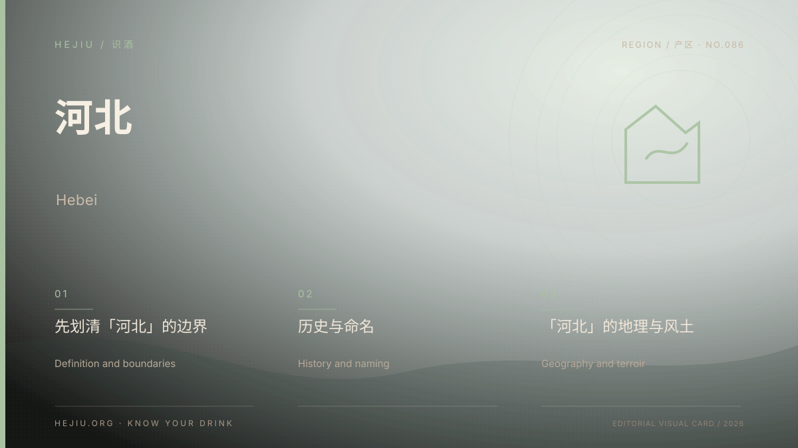

# Hebei

A wine region in northern China, with Huailai (Shacheng) and Changli as cores; a cool, dry climate with a wide diurnal range, known for Cabernet Sauvignon, Chardonnay and brands such as Great Wall, it is one of the earliest areas of China’s modern wine industry.

Figure: Hebei. Project-generated or category illustration used for Chinese alcohol culture context; not a photograph of the subject.

> **Quick verdict**
> **In one line:** This region helps you judge Hebei for flavour and travel, and plan accordingly.
>
> - **Best for:** Anyone comparing Hebei with other regions before buying wine or planning a trip.
> - **Not for:** If you want want a “most expensive region” verdict and do not care about style or vintage.
> - **Check first:**
>   - Grape growing in Huailai reaches back about 1,200 years; in the Ming and Qing dynasties its grapes were tribute to the court in the Xuanhua prefecture area.
>   - Hebei dry reds have medium-to-firm tannins and concentrated fruit, suiting braised meats, roast lamb chops, beef stew and Chinese soy-braised dishes.

## Definition and boundaries

Hebei’s wine grapes are concentrated in two distant zones: the Huailai (Shacheng) Huai-Zhuo basin in Zhangjiakou to the northwest, and the Changli Jieshi Mountains area in Qinhuangdao to the east. The first lies about 100 km northwest of Beijing, an inland basin; the second faces the Bohai Sea, about 270 km from Beijing, on hills between mountains and the coast. The two sit in different climate and soil units, so a label should be sorted into Huailai or Changli before any style comparison.

On the regulatory and brand side, “Shacheng wine” became a national geographical-indication protected product in 2002; “Changli wine” became the first GI-protected wine product nationally in August 2002, with the protection area extended to Lulong and Funing in 2005. The Qinhuangdao Jieshi Mountain Wine Region Protection Regulation, in force from 1 September 2023, brings planting, winemaking and labelling in the eastern zone under local legislation.

Beyond these two cores, table and wine grapes are also grown in Weixian, Shuangluan and Yongnian, but “Hebei region” in the market usually means the Huailai and Changli clusters.

## History and naming

Grape growing in Huailai reaches back about 1,200 years; in the Ming and Qing dynasties its grapes were tribute to the court in the Xuanhua prefecture area. In 1976 China’s first dry white wine meeting international standards was made at the Shacheng winery; in 1978 five central ministries selected the Sanggan River basin after a joint survey as a national wine research base; in 1980 Huailai introduced 13 international wine varieties from Europe and the United States for the Shacheng mother plantation. In 2001 the Sino-French Chateau brought in Marselan and Petit Manseng vines from France, the first planting of these two varieties in China.

Changli has more than 400 years of grape cultivation. On 20 May 1983 the first dry red wine of New China — the “Beidaihe” Cabernet Sauvignon dry red — was produced at the former Changli winery, winning a gold cup at the 1984 national alcohol competition run by the former Ministry of Light Industry; in 1986 the winery imported 50,000 grafted vines, including Cabernet Sauvignon, Cabernet Franc, Chardonnay and Pinot Noir, from Bordeaux in France at US$1 per vine, forming one of the country’s earliest wine-grape bases; in 1988 COFCO Huaxia Great Wall Wine Co., Ltd. was founded.

Around 2000 the two zones received titles such as “Hometown of Chinese Grapes”, “Hometown of Chinese Wine” and “Hometown of Chinese Dry Red Wine”; in 2019 the Jieshi Mountain region was certified by the China Alcoholic Drinks Association as the third Chinese, and first Hebei, designated wine small region, and in 2021 it was named a quality Marselan wine region in China.

## Geography and terroir

Huailai sits near 40°N, backed by the Yanshan Mountains to the north and Taihang foothills to the south; the Sanggan, Yanghe and Yongding rivers run through the Huai-Zhuo basin, and the 230 km² Guanting reservoir moderates the basin climate. The climate is a temperate semi-arid continental monsoon, with four distinct seasons, average annual rainfall about 393 mm, around 3,000 hours of sunshine a year and a diurnal range above 12°C; wine grapes are planted between 450 and 1,050 m elevation, with an average vineyard altitude of about 498 m. Soils are gravelly sandy loam, deep and free-draining, and along the Sanggan River there is a two-million-year-old Nihe paleontological sediment layer.

The Changli Jieshi Mountain region sits near 39°N, with the Jieshi hills to the north, the Bohai Sea to the east and the Luan River to the southwest. The hills block the western monsoon and the Bohai Sea adds mild maritime moderation, giving a longer frost-free period; hill slopes carry gravelly sandy soils rich in potassium and well drained, helping phenolic and aroma compounds ripen. The eastern region is split into six sub-areas, including Liangjiashan, Fenghuang Valley and Wofo Mountain.

Winters in both zones are cold enough that vines are buried for frost protection; rain falls mainly in the growing season, and monsoon wind and slope aspect shape disease pressure. In Huailai the elevation gradient lets white varieties and early-ripening reds sit at different heights; in Changli maritime moderation extends the ripening period.

## Raw materials and styles

[Cabernet](ref:cabernet) Sauvignon leads the reds, with Merlot, Cabernet Franc, Petit Verdot, Syrah and Marselan alongside; whites include [Chardonnay](ref:chardonnay), Riesling, Sauvignon Blanc, Petit Manseng and Pinot Noir. Cool high-altitude Huailai sites carry Chardonnay, Riesling, Sauvignon Blanc and Pinot Noir, while lower, warmer plots hold Cabernet Sauvignon, Merlot and Syrah; Changli builds on Cabernet Sauvignon in a fuller, heavier style.

[Red wines](ref:red) commonly show blackcurrant, blackberry and green-pepper herbal notes, moving to toast and spice after oak ageing; [white wines](ref:white), led by Chardonnay and Riesling, carry crisp acidity and direct fruit. Huailai also makes traditional-method sparkling wine: in 1990 the first Chinese traditional-method sparkling wine was produced at the Great Wall Sanggan estate. Marselan is planted in both Huailai and Changli and has been a rising variety in China in recent years.

Overall, Hebei wines are built on international varieties, with a small share of local grapes; blends and single-varietal wines coexist, and newer estates experiment more with minor varieties and oak practice than the established large houses.

## Representative producers and wines

The Huailai cluster includes China Great Wall Wine Co., Ltd., Great Wall Sanggan Chateau, Sino-French Chateau, Canaan Winery and Zijing Manor. Great Wall Sanggan Chateau was founded in 1979, with about 75 ha of vineyard on the Nihe fossil soil along the Sanggan River; Sino-French Chateau holds 23 ha of vines and introduced Marselan and Petit Manseng in 2001, among the first large plantings of these varieties in the country.

The Changli cluster includes COFCO Huaxia Great Wall, Lange Estate, Moutai Wine, Jinshi Estate, Moutai Phoenix Manor and Geng’s Cellar. Huaxia Great Wall was founded in 1988; its underground granite cellar in the Jieshi hills is built from 62,000 granite blocks, covers 19,000 m² and stores over 30,000 oak barrels. Lange Estate was developed with Austrian capital and was among the enterprises approved to use the Changli wine GI mark in 2006.

These brands and estates are not an official classification but a consensus built over years by the market and the industry. Large houses run lines from entry-level to estate wines; boutique estates are small-production and more experimental. Before buying, sort out the origin (Huailai or Changli), variety, vintage and whether the wine was bottled at the estate.

## How to drink and pair

Hebei dry reds have medium-to-firm tannins and concentrated fruit, suiting braised meats, roast lamb chops, beef stew and Chinese soy-braised dishes; Cabernet Sauvignon works with steak and game, while Marselan blends, with riper fruit, can take spiced roast poultry. Chardonnay and dry Riesling go with seafood, white meat and light cold dishes; sparkling wine serves as an aperitif with fried snacks.

Serving temperatures run around 16–18°C for dry reds, with young wines decanted briefly; whites at 10–12°C and sparkling at 6–8°C. Local food leans on Beijing and Northeast Chinese flavours, where braised meat, barbecue and noodles pair well with full-bodied reds.

## Labels, buying and misreadings

Read the label by checking origin first: Huailai (Shacheng) and the Changli Jieshi Mountains are two terroir units and should not be treated as one style; then look at variety, vintage, producer and ageing method. A GI mark only confirms that grapes and process meet the corresponding rules, not a quality grade within the wine; quality and price differ widely across a large house’s product lines.

Two common misreadings: first, treating “Hebei wine” as a single style, since the cool acidity of the inland basin and the ripe weight of the coastal hills differ greatly; second, assuming domestic wines cannot age, since good vintages of Cabernet Sauvignon and Marselan can keep for several years under proper storage. For storage, cool stability comes first, away from heat, light and vibration; after opening, whites and light reds usually last 1–3 days, structured reds longer.

## Around and routes

Huailai is about 100 km from Beijing and, since the Beijing-Zhangjiakou high-speed rail opened, sits within the capital’s one-hour transport circle; estates spread along the Sanggan and Yanghe rivers. Changli is about 270 km from Beijing and can be combined with trips to Beidaihe and the Qinhuangdao coast. Estates within each cluster are spread out: a tasting lasts 60–90 minutes and drives between villages 30–60 minutes, so two or three stops in a day is comfortable.

Harvest runs in the Northern Hemisphere autumn, September to October, when estates are busiest; most boutique tastings need advance booking, while large-house cellars and showrooms keep more fixed hours. Stay out of working cellars and parcels, and do not drink and drive; hillside paths may not be wheelchair-accessible, so call ahead when bringing older relatives.

- Related: [china](ref:china), [cabernet-sauvignon](ref:cabernet), [chardonnay](ref:chardonnay), [red-wine](ref:red), [white-wine](ref:white).

**At a glance:** A wine region in northern China, with Huailai (Shacheng) and Changli as cores; a cool, dry climate with a wide diurnal range, known for Cabernet Sauvignon, Chardonnay and brands such as Great Wall, it is one of the earliest areas of China’s modern wine industry.

## Related images

Image: Category image for China. Credit: Gary Todd, CC0, via Wikimedia Commons ([source page](https://commons.wikimedia.org/wiki/File:Shang_Bronze_Gu,_Jue,_%26_Jia_Wine_Vessels.jpg)). Related image for Hebei.

Image: Thematic illustration for Red wine. Project-made bilingual editorial figure, not an on-site photograph. Related image for Hebei.
