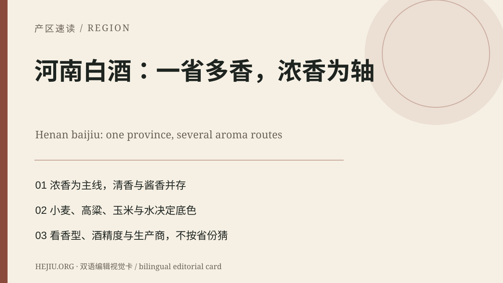

# Henan

Henan sits where the middle reaches of the Yellow River meet the North China Plain, with the Taihang and Funiu mountains framing its western and southern edges. It is not the most dramatic wine region in China, but it is one of the most typical Central Plain regions: broad farmland, reliable grain, dense transport links and a long history of trade.

The key word for Henan drinks is not a single aroma type but "Yu liquor", a regional label covering several routes. Strong aroma dominates the market, while light aroma, sauce aroma and local specialty drinks coexist. Dukang, Songhe, Yangshao and Baofeng carry historical stories and local memory rather than one shared flavour.

Figure: Zhengzhou CBD skyline, the capital and central Chinese transport hub of Henan. Image: 白诗棋, CC0, via Wikimedia Commons ([source page](https://commons.wikimedia.org/wiki/File:Zhengzhou_CBDcity.jpg)).

## Geography and climate

Henan spans the Yellow, Huai, Hai and Yangtze river basins. The west is mountainous, the east is plain, and the south contains basins and hills. The climate moves from warm-temperate to subtropical monsoon, with hot wet summers and cold dry winters. Deep alluvial soils on the Yellow River plain suit wheat, maize and sorghum; the western hills and southern uplands create different microclimates.

For brewing, a plain means stable raw materials and easy transport, but also a risk of uniformity. Temperature, humidity, water and pit conditions separate one distillery from another, yet the consumer most easily perceives aroma type, strength, starter culture and ageing. Treating "Henan" as one flavour misses the differences from the northern plain to the southern hills.

Figure: Longzihu central island skyline in Zhengzhou, a modern Henan of city and water. Image: Windmemories, CC BY-SA 4.0, via Wikimedia Commons ([source page](https://commons.wikimedia.org/wiki/File:20210908_Skyline_of_the_Central_Island_of_Longzihu.jpg)).

## History

Drinking in Henan overlaps with the history of Chinese alcohol. Pottery and grain remains at Yangshao culture sites are often used to discuss early fermentation, while the Dukang legend anchors grain brewing in western Henan. Whatever the detail of the legend, Henan's place in Yellow River agriculture, grain processing and trade gave brewing a long foundation.

Modern distilleries such as Songhe, Baofeng and Yangshao were largely brought into state ownership and industrial production in the twentieth century, then entered brand competition after reform and opening. Their common trait is strong local standing: steady recognition at banquets, gifts and local hospitality, but uneven national reach. To understand Yu liquor, look at current raw materials, craft and product structure, not only advertising history.

## Aroma and style

Strong aroma is the main line. Its shared features are pronounced pit aroma, mellow sweetness and coordinated fragrance, but pit age, grain-to-ferment ratio, starter temperature and ageing create a range from heavily aromatic to soft and easy-drinking. For daily drinking, strong aroma has a low entry barrier and works with Henan dishes and home cooking.

Light aroma also has a base in Henan. It emphasises cleanliness, purity and freshness, with a fermentation route closer to northern traditions. It suits drinkers who dislike heavy pit aroma and is easier to make crisp and direct. Some distilleries also produce sauce aroma or other styles, creating a multi-aroma product matrix.

Aroma is not a quality grade. The classification describes starter, fermentation, distillation and ageing routes; within one aroma type, prices can run from tens of yuan to thousands, with differences in raw materials, craft, base-wine ratio and brand premium. "Henan famous liquor" does not tell you the aroma type or grade.

Figure: Henan baijiu: one province, several aroma routes. Project-generated bilingual editorial card; schematic, not a photograph.

## Raw materials and craft

The main materials are wheat, sorghum, maize and water. Wheat can be used for starter and sometimes for brewing; sorghum supplies starch and tannin structure; maize adds sweetness and body. Distilleries do not publish every proportion, but the ingredient list on the label is the most direct clue.

Starter culture sets the aroma direction, fermentation sets the frame, and distillation and blending shape the final style. Strong aroma usually stresses old pits and continuous grain fermentation; light aroma stresses clean steaming and separate fermentation in jars or pits. These differences leave clear traces in aroma and texture.

Figure: Wheat is a key material for starter and brewing, and a common entry on Henan ingredient lists. Image: kallerna, CC BY-SA 4.0, via Wikimedia Commons ([source page](https://commons.wikimedia.org/wiki/File:Vehn%C3%A4pelto_6.jpg)).

## Representative bottles and local memory

Dukang, Songhe, Yangshao and Baofeng are the four names most often attached to Henan baijiu. Dukang carries the "origin of wine" legend; Songhe and Baofeng are often treated as local famous liquors; Yangshao links Yangshao culture, pottery and distillery storytelling. Their product lines, aroma types and price bands differ, so read the bottle rather than the place name.

Henan also makes wine, beer and yellow rice wine, but none has national influence comparable to baijiu. For visitors or gifts, the safest choice is a mainstream product with clear aroma type, strength, producer and origin; for collectors, batch, vintage and authenticity need separate checks.

## Market and drinking

Henan is a populous province and a large consumer market. Baijiu has steady demand at banquets, business meals and holiday gifting. Everyday drinking leans toward medium- and low-strength strong aroma; business settings care more about brand and packaging. Consumers increasingly watch claims such as "pure grain solid-state", "vintage" and "pit age", but those words are not quality guarantees; return to raw materials, craft and actual taste.

With food, strong aroma suits roast chicken, braised meats, red-braised pork and noodles; light aroma suits steamed dishes, cold plates and lighter flavours. High-strength liquor should not be gulped, and low strength does not mean unlimited. Temperature, glassware and water intake all affect how the next morning feels.

## Rules and regional protection

Baijiu production in Henan is governed by food-safety rules and national standards. GB/T 15109-2021 defines terms for the baijiu industry, including starter, fermentation and distillation; GB/T 17204-2021 sets terms and classification for alcoholic beverages. Geographical indications, regional names and "pure grain solid-state" claims must follow their own rules. When reading a label, separate origin, aroma type, strength and producer.

## Climate and drinks structure

| Area | Climate and landform | Main drinks | What to check when buying |
| --- | --- | --- | --- |
| Northern plain (Anyang, Puyang, Xinxiang) | Warm-temperate monsoon, mostly plain | Strong and light aroma baijiu | Aroma, strength, producer |
| Western hills (Luoyang, Sanmenxia) | Hills and river valleys | Strong, light and local baijiu | Ingredients, pit and ageing information |
| Central plain (Zhengzhou, Xuchang, Luohe) | Plain, good transport | Strong aroma, concentrated brands | Product line, batch, channel |
| Eastern plain (Shangqiu, Zhoukou) | Plain, strong farming base | Strong and local baijiu | Price band and true origin |
| Southern Henan (Nanyang, Xinyang) | Basins and hills, wetter | Strong, light and yellow rice wine | Taste preference and food pairing |

The table is a macro comparison, not a substitute for a distillery's own craft. Water, pits and product structure vary greatly between cities; the label and official information remain the final reference.

## Common misconceptions

First, Henan only makes strong aroma. Strong aroma is the main line, but light, sauce and local specialty drinks also exist.

Second, Dukang is one distillery. Dukang is a legend and also a trademark used by several market participants; check the producer and the specific product.

Third, all Henan liquor is cheap. There is a mass-market band and also premium products; price reflects brand, base wine and channel.

Fourth, older is always better. Storage conditions, base-wine quality and blending ratio matter more than a simple age number.

Fifth, the food must be heavy. Strong aroma can work with braised dishes, but light aroma can also pair with steamed food; match weight and intensity.

## Price bands, channels and visiting clues

Henan baijiu falls into three practical price bands: roughly RMB 100–300 for everyday bottles, RMB 300–800 for banquets and gifts, and above RMB 800 for flagship products. Price is not a map of aroma style: two brands in the same category can sit far apart. Decide who will drink, how many people, and whether a gift box matters before comparing the liquid.

Buy from brand flagship stores, large local supermarkets, or licensed liquor dealers. Phrases such as "internal supply", "special supply" or "a bottle through a friend at the distillery" are risk signals, not provenance. Check the production licence, standard code, alcohol content and net volume; for a full case, compare carton and bottle codes and production dates, and for a single bottle inspect the seal and fill level.

For food, strong-aroma baijiu suits braised noodles, roast chicken, braised meats and the savoury depth of Henan cooking. Light-aroma bottles work better with steamed fish, cold dishes and soups, where chilli and strong spice do not bury the grain. Small cups, food first, and a slow pace are more useful than speed.

Visiting clues run through Zhengzhou, Luoyang, Ruyang and Baofeng: Zhengzhou is the transport and museum base, Luoyang connects the Du Kang cultural narrative, while Ruyang and Baofeng show concrete distillery and production settings. Tours, tastings and retail policies change by season; use the brand's current official notice rather than an old blog post as a booking reference.

## Common questions

**Is Henan baijiu mainly strong aroma?** Strong aroma is the market main line, but light, sauce and local styles also exist. Read the aroma type on the bottle instead of guessing from the province.

**Is Dukang a historical figure or a brand?** Both. Dukang is a widely told legendary brewer and also a trademark used by several market entities; check producer, origin and standard.

**Is Yu liquor worth buying?** Henan has stable local famous brands and mass-market products, as well as premium lines. Value depends on the specific bottle's materials, craft, batch and price, not the regional label alone.

**How should Henan baijiu be paired with food?** Strong aroma works with braised food, roast chicken, red-braised pork and noodles; light aroma suits steamed dishes, cold plates and lighter flavours. Do not gulp high-strength liquor.

**Does Henan make wine or other drinks?** Yes, wine, beer and yellow rice wine are produced, but their national influence is smaller than baijiu. Check origin, ingredients and producer.

**Is all Henan liquor high-strength?** No. Common strengths include 38%, 42% and 52%, and lower-strength products exist; strength does not map neatly to aroma or price.

## Further reading

- [China](ref:china): Henan's place in Chinese drinks geography.
- [Baijiu](ref:baijiu): definition, aroma types and craft.
- [Strong aroma](ref:strong) and [light aroma](ref:light): the two most common flavour routes in Henan.
- [Wheat](ref:wheat), [sorghum](ref:sorghum), [maize](ref:maize) and [water](ref:water): the basic materials.
- [Starter culture](ref:qu), [fermentation](ref:fermentation), [distillation](ref:distillation) and [blending](ref:blending): five craft terms for understanding Henan baijiu.

**Key facts.**

| Item | Detail |
| --- | --- |
| One-line position | A Central Plain province on the middle Yellow River; strong aroma leads, with light, sauce and local styles |
| Level | Province / macro-region |
| Part of | China |
| Country code | CN |
| Representative clues | Dukang, Songhe, Yangshao, Baofeng and other local famous liquors |

**Sources and scope.** This page's geography, aroma and craft information was cross-checked against the Henan Provincial People's Government portal, the National Standards Information Public Service Platform, the China Alcoholic Drinks Association and The Oxford Companion to Spirits and Cocktails. Brand history, product lines and prices change; use current official company information for those fields. The body is project-written; sources are for verification, not copied text.
