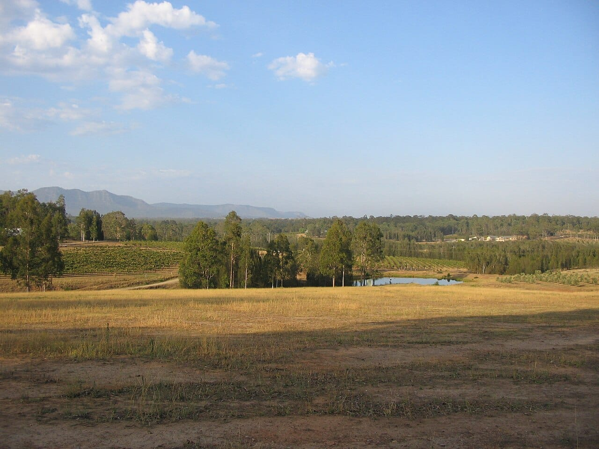

# Hermitage

The granite hill behind Tain-l’Hermitage in the Northern Rhône, made up of 13 lieux-dits; reds are mainly Syrah, whites Marsanne and Roussanne, with small volumes and long ageing potential, one of the Rhône’s most famous hill appellations.

Figure: Hermitage: The view of the vineyards from the Hermitage Hideaway - Taken on the Saturday, 3rd February 2007 at 7-49am. - panoramio (Wikimedia Commons). Image: Christopher Wood, CC BY-SA 3.0, via Wikimedia Commons ([source page](https://commons.wikimedia.org/wiki/File:The_view_of_the_vineyards_from_the_Hermitage_Hideaway_-_Taken_on_the_Saturday,_3rd_February_2007_at_7-49am._-_panoramio.jpg)).

## Definition and boundaries

Hermitage’s vineyards sit on a granite hill behind Tain-l’Hermitage; south-facing steep slopes get strong sun, while the Rhône moderates temperature and humidity.

In an official geographical indication, the boundaries of Hermitage are not a decorative line but a legal and historical construction made of place names, parcels and maps. It may be a county, a group of villages, or a narrow strip along a river or mountain; the more specific the name, the less freely it can be used on a label.

Hermitage is a small hill of thirteen lieux-dits, not a broad region. Les Bessards is granite and gravel, the tightest and most mineral; Le Méal is warmer and fuller; Les Greffieux and Les Murets are softer and earlier. A producer’s blend proportions reveal which parcels are doing the structural work.

## History and naming

Reds are mainly Syrah with a little permitted Marsanne and Roussanne; whites are mainly Marsanne with Roussanne for acidity and perfume, far smaller in volume than the reds.

The name Hermitage usually appears first in local archives, church records or tax rolls, and only later in modern regulations. The name often stabilises later than the boundary, which is why the same place can carry different spellings across languages and periods.

The name comes from a hermit knight, Gaspard de Stérimberg, whose chapel still stands on the hill; the story is legend, but the terraces and chapel are real. Hermitage wine reached papal and aristocratic tables in the Middle Ages, and the AOC arrived in 1937. Chapoutier, Jaboulet and Chave built its modern reputation.

## Geography and terroir

Soils are granite, schist and loess, thin and fast-draining; old Syrah performs especially well in dry years.

The vineyards of Hermitage sit at particular elevations, aspects and soil parent materials. Distance to the sea, mountain direction, diurnal range and harvest rain all change ripening and acidity; these conditions explain more about style than the name alone.

The hill faces south above the Rhône, with narrow granite terraces and poor, draining soils. The river moderates temperature and the mistral dries the fruit and reduces disease. Steep slopes prevent mechanisation, so everything is done by hand and yields are tiny.

## Raw materials and styles

Hermitage was granted AOC in 1937; its 13 lieux-dits include Les Bessards, Le Méal and Les Greffieux, with clear differences between parcels in both colours.

The vines of Hermitage determine what can be made. The leading varieties or raw materials, permitted blends, minimum ripeness and maximum yields are usually written into rules; but rules are a floor, and the real style comes from picking dates, fermentation vessels and ageing.

Syrah ripens late on the granite, usually in September; Marsanne and Roussanne for white wine are picked earlier on cooler, higher parcels. The harvest window is short and the terraces are so small that a few days of rain can decide the vintage. Producers often pick parcel by parcel rather than in one pass.

## Representative producers and wines

Representative producers include Chapoutier, Jaboulet, Chave, Bernard Faurie and Marc Sorrel; Chapoutier’s Le Pavillon and Chave’s Cathelin are among the rarest wines.

The representative wineries of Hermitage usually show the two poles of a region: long-established families or cooperatives with concentrated holdings, and newer arrivals working parcel by parcel. Tasting both explains the region better than a list of famous names.

Small family estates and négociants dominate. Chave, Chapoutier, Jaboulet and Delas own or buy parcels across the hill, and some cuvées are single-lieu-dit. Growers may own a few rows on several terraces; the blend, not the estate name alone, tells you which soils are in the bottle.

## How to drink and pair

To drink Hermitage, start with alcohol, acidity and tannin or bitterness, then choose temperature and food. High acidity suits fat and salt, high tannin needs protein and fat, and high alcohol clashes with sweet or very spicy dishes; warmth pushes alcohol over aroma.

Serve red Hermitage at 16–18°C and white at 12–14°C. Young reds need one to two hours of decanting; older bottles only need sediment removed. Steak, lamb, game, mushrooms and hard cheese suit the red; roast chicken, cream sauces, lobster and nuts suit the white. Avoid delicate seafood with the white’s low acidity.

## Labels, buying and misreadings

For Hermitage, begin with the appellation and its permitted varieties, then the vintage and the producer, and finish with how the wine is labelled; that order keeps the account grounded.

Cool years give a tighter, peppery Syrah that needs longer; warm years give blackberry and earlier approachability. Hail, frost and the mistral can cut the crop, and production is small enough that one bad vintage is felt. For older bottles, storage and bottling history matter as much as the year.

### Key dates and figures

- 1980s: after phylloxera, war and frost, replanting from the 1980s restored terraces that had been abandoned.

## Around and routes

Putting Hermitage into an itinerary means separating the regional centre from specific wineries: the first is for landscape, markets and food, the second needs bookings, tastings and travel time. Too many stops in one day exhaust both palate and attention.

Hermitage is based around Tain-l’Hermitage, about an hour south of Lyon. The terraces are steep and visits are limited, so appointments are essential; three stops in a day is optimistic. Combine Hermitage with Crozes-Hermitage only if travel time is realistic, and allow 60–90 minutes per tasting.

- Related: [rhone](ref:rhone), [syrah](ref:syrah), [viognier](ref:viognier), [red-wine](ref:red), [white-wine](ref:white).
- This region provides no map, prices or opening hours; confirm before travelling.

**Short definition:** The granite hill behind Tain-l’Hermitage in the Northern Rhône, made up of 13 lieux-dits; reds are mainly Syrah, whites Marsanne and Roussanne, with small volumes and long ageing potential, one of the Rhône’s most famous hill appellations.

Hermitage is a single hill appellation in the Northern Rhône, with 13 lieux-dits; its reds are Syrah and its whites Marsanne and Roussanne.

**Key facts.**

| Item | Detail |
| --- | --- |
| In one line | The granite hill behind Tain-l’Hermitage in the Northern Rhône, made up of 13 lieux-dits; reds are mainly Syrah, whites Marsanne and Roussanne, with small volumes and long ageing potential, one of the Rhône’s most famous… |
| Level | other |
| Parent | Rhône Valley |
| Country code | FR |

## Related images

Image: Viognier Grape must after pressing. Credit: Ian Brown, CC BY 2.0, via Wikimedia Commons.. Credit: Ian Brown, CC BY 2.0, via Wikimedia Commons ([source page](https://commons.wikimedia.org/w/index.php?curid=13317886)). Related image for Hermitage.

Image: Rhône Valley. Credit: Béa at French Wikipedia, Public domain, via Wikimedia Commons ([source page](https://commons.wikimedia.org/wiki/File:Thain1.jpg)). Related image for Hermitage.
