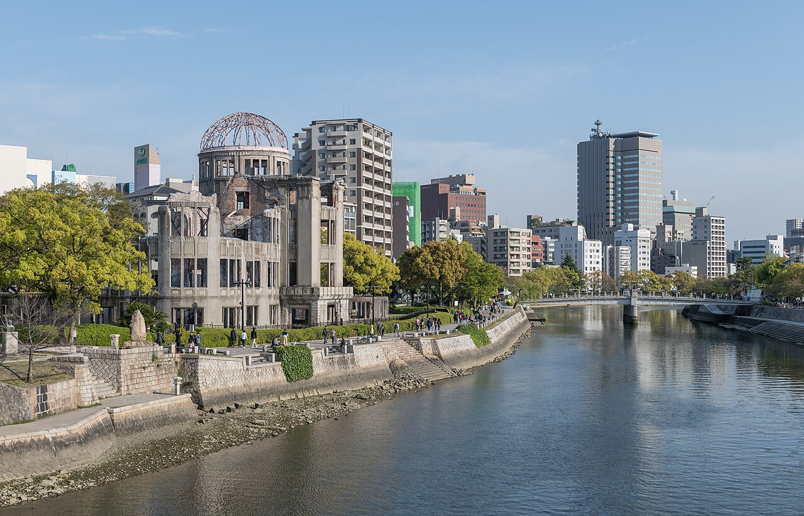

# Hiroshima

Hiroshima is a [sake](ref:sake) region on [Japan's](ref:japan) Seto Inland Sea coast and is usually mentioned together with three keywords: the Saijo brewery cluster, soft-water brewing, and ginjo. Its geography is not a single city but a combination of breweries in Saijo, Aki-tsu, and Kure, inland and coastal. Understanding Hiroshima means looking at brewery architecture, water hardness, toji tradition, and the technical routes of sake rice and yeast.

Figure: Hiroshima. Image: DXR, CC BY-SA 4.0, via Wikimedia Commons ([source page](https://commons.wikimedia.org/wiki/File:Atomic_Bomb_Dome_and_Motoyaso_River,_Hiroshima,_Northwest_view_20190417_1.jpg)).

## Definition and scope

Hiroshima Prefecture lies in southwestern Honshu, facing the Seto Inland Sea to the south and the Chugoku Mountains to the north. Its breweries are distributed across Saijo and Aki-tsu in Higashihiroshima City, Kure, Takehara, Miyoshi, Akitakata, and Shobara. The Hiroshima Sake Brewers Association handles brewery introductions, technical promotion, and origin promotion, and treats soft-water brewing, Hiroshima toji, and Hiroshima yeast as the core of local technique.

"Hiroshima sake" is not a legal appellation grade but a prefecture-level industry and brand concept. It covers the Saijo cluster, the ginjo origins of Aki-tsu, the coastal breweries of Kure, and inland local breweries. Equating Hiroshima with Saijo ignores Aki-tsu's and Kure's contributions to soft-water brewing and ginjo; equating Hiroshima with "soft water" ignores differences in water and style within the prefecture.

## The Saijo brewery cluster

Saijo is Hiroshima's most concentrated sake brewery cluster, in the Saijo area of Higashihiroshima City. City materials state that near JR Saijo Station seven breweries stand side by side with red-tiled, white-walled, and namako-walled warehouses, and twelve red-brick chimneys rise above Saijo Sake Brewery Street. These figures make the density concrete: the breweries are not scattered through the countryside but concentrated in a walkable district beside the station.

On 2024-02-21 the Saijo brewery cluster was designated a national historic site, in the category of transport and communication facilities, mountain and water management facilities, production facilities, and other sites related to economic and production activity. This shows that Saijo's value is not only that it still brews, but that the warehouses, chimneys, streets, and production system are preserved as modern industrial heritage. For visitors, Saijo is about the building group and street scale; for researchers, it is about how breweries organised production, transport, and sales within a settlement.

Representative Saijo breweries include [Kamotsuru](ref:kamotsuru), Kirei, [Kamotsuru Izumi](ref:kamoizumi), Saijo Tsuru, and E Shuzo. Their ranges cover junmai, ginjo, honjozo, and local limited releases; the red-brick chimneys and white warehouses are Saijo's most direct visual markers. Treating Saijo as a brewery theme park ignores that it is still a production site, and visitors should follow each brewery's opening rules.

## Soft-water brewing

Hiroshima's technical reputation is closely tied to Miura Senzaburo of Aki-tsu. The Hiroshima association records that Miura established soft-water brewing in Aki-tsu Mitsu in Meiji 30 (1897). At the time soft [water](ref:water) was considered unsuitable for brewing because it was low in minerals and weak in fermentation power, but Miura compensated with low-temperature, long fermentation, producing sake that was fine, soft, and savoury. At the first national sake tasting held in Tokyo in 1907, Hiroshima sake scored overwhelmingly, and the region's reputation was established.

The core of soft-water brewing is not "the softer the water, the better," but "adapting the process to the water." Soft water lacks mineral stimulation, yeast ferments more slowly, and acidity and temperature control in the mash are harder; extended fermentation, temperature control, and careful starter management are needed to turn softness into fineness. Treating soft water as a natural advantage and ignoring process adaptation misunderstands Miura's contribution. The Hiroshima association also calls soft-water brewing a Hiroshima-style traditional technique, showing that it is a transferable method, not a water-quality label.

The coastal breweries of Aki-tsu and Kure continue this line. Senfuku (Miyake Honten) in Kure was founded in 1856 and uses spring water from Hikami-mine, described as soft water with a moderate mineral content; Senfuku's brewing description explicitly lists "ginjo brewing (soft-water brewing)" as its technical tradition. Fukucho in Aki-tsu takes Miura Senzaburo's motto "hyaku-shi sen-kai" as its own and treats soft-water brewing and ginjo brewing as the core of its regional identity.

## Female toji and brewery culture

Among Hiroshima's toji traditions, female toji deserve separate treatment. Miho Imada of Fukucho is the representative figure: born into Imada Shuzo Honten, she joined the brewery in 1994 and later became representative director and toji. She promoted the replanting of the heirloom rice Hattan-so and worked on white-koji brewing, and in 2020 she was selected for the BBC's "100 Women." Her career shows that Hiroshima's toji tradition is not a closed hereditary structure; women can act in technique, management, and regional storytelling at the same time.

The meaning of a female toji is not only a gender topic. Sake brewing combines physical work, time, and judgment; the toji manages the starter, mash, temperature, acidity, and the whole brewing season. Women entering this role means that brewery organisation, technical transmission, and market communication are changing. The Fukucho case places Aki-tsu's soft-water brewing, ginjo technique, and female leadership in one narrative, so Hiroshima's image is not only "old breweries" but also contemporary innovation.

Kure and Aki-tsu add another cultural strand. Aki-tsu is a small port town on the Seto Inland Sea and was a rice storehouse site for Hiroshima Domain in the Edo period; Kure is a naval port city, where Senfuku and Morokawa Shuzo use spring water and soft water in a coastal setting. The scale and market of coastal breweries differ from inland Saijo, but together they form Hiroshima's "water-port-sake" geography.

## Aki-tsu, Kure, and the coastal breweries

Aki-tsu lies in southern Higashihiroshima City, facing Mitsu Bay. Fukucho's materials describe Aki-tsu as a small port town on the Seto Inland Sea and a Hiroshima Domain rice storehouse in the Edo period, which supported brewing; the bay's sea bream, octopus, small fish, and oysters are part of the local food culture. Aki-tsu's reputation is directly tied to Miura Senzaburo, soft-water brewing, and ginjo brewing, making it a key site in Hiroshima's technical history.

Kure is a port city in southwestern Hiroshima Prefecture, facing the Seto Inland Sea. Senfuku (Miyake Honten) was founded in 1856 and draws spring water from 60 metres underground at Hikami-mine; Morokawa Shuzo's Hakuko uses extremely soft groundwater from the Noro mountain system as brewing water. Kure's brewery scale differs from Saijo, but soft water and ginjo brewing remain its technical base. Placing Aki-tsu and Kure side by side shows that Hiroshima's soft-water tradition is not a single point but a coastal network.

Takehara, Miyoshi, Akitakata, and Shobara represent inland and mid-mountain areas. The Hiroshima association locates sake-rice production in Higashihiroshima, Miyoshi, Akitakata, and Shobara, showing a spatial division: coastal breweries brew, while inland mid-mountain areas grow rice. This division makes "Hiroshima sake" not only a coastal story but also one grounded in mountain agriculture.

## Sake rice, yeast, and ginjo

Hiroshima's technical route has two main lines: sake [rice](ref:rice) and yeast. The association lists three systems, Omachi, Hattan, and Yamada Nishiki, with six varieties; representative rice includes Hattan-nishiki, Senbon-nishiki, Kairyu Omachi, Hiroshima Hattan, Hiroshima Omachi, and Koi Omachi. Hattan-nishiki is known for high aroma and a light body; Senbon-nishiki belongs to the Yamada Nishiki line and is often used for tanrei karakuchi; the Omachi line brings a fuller, richer body.

On yeast, the Hiroshima Prefectural Food Technology Centre has cultured Hiroshima yeast 2, 5, 6, and 21, Setouchi 21, and Reiwa 1, and named "Hiroshima Momiji Yeast" together with the brewers association. In October 2013 the yeast was presented at the association's general meeting; sake made with it can receive a quality-assurance mark after review. This system turns "yeast-aroma-quality" into an identifiable local technical brand.

Ginjo is another main technical line. Higashihiroshima City calls Saijo the "birthplace of ginjo sake" and treats Miura Senzaburo's soft-water brewing as the foundation of modern ginjo. Under the National Tax Agency's labelling standard, [ginjo](ref:ginjo) requires [polishing](ref:polishing) to 60% or less, and daiginjo requires 50% or less; junmai ginjo and junmai daiginjo also require no added brewing alcohol. Hiroshima's ginjo range covers junmai ginjo through daiginjo, using both prefectural rice and external rice such as Yamada Nishiki.

Treating a "ginjo ratio" as a fixed number is unreliable, because product mixes differ by brewery and public statistics may not split the ginjo category. A more reliable judgment is the label: polishing ratio, special designation, whether it is junmai, and whether Hiroshima yeast is used. These details say more about the technical route than a broad ratio.

## Visiting and drinking

A Hiroshima visit can follow a Saijo-Aki-tsu-Kure sequence. Saijo is for the brewery cluster and red-brick chimneys, suited to walking and architectural observation; Aki-tsu is for Miura Senzaburo and Fukucho's origin story, suited to understanding soft-water brewing and the ginjo source; Kure is for coastal breweries and spring water, suited to connecting water, port, and sake. Opening hours, reservations, and tastings depend on each brewery's current notice.

Hiroshima is best approached through the appellation and its permitted varieties, then the vintage and the producer, and then how the wine is labelled. One check alone will not settle it.

Do not drive after tasting; minors should not drink, and excessive drinking is harmful. When buying, pay attention to unpasteurised and chilled sake; transport temperature matters more than price.

## Common misconceptions

First, Hiroshima sake is not another name for Saijo. Saijo is the largest cluster, but Aki-tsu, Kure, Takehara, Miyoshi, Akitakata, and Shobara all have breweries with different technical lines.

Second, soft water is not a natural advantage. Soft water ferments weakly and requires low temperature, long time, and careful management to make good sake; Miura Senzaburo's contribution was process adaptation, not the discovery of magic water.

Third, "birthplace of ginjo" is not a single-origin story. Saijo and Aki-tsu made important technical contributions, but ginjo was a concept spread across regions and journals in the Meiji period; Hiroshima's strength is the combination of soft-water brewing and ginjo.

Fourth, a female toji is not a marketing label. Miho Imada's career includes rice replanting, white-koji development, management, and technical control; gender is only one entry point for understanding change in Hiroshima's breweries.

Fifth, "Hiroshima sake" is not one style. Hattan-nishiki lightness, Omachi richness, ginjo aroma, and junmai umami form different product lines; label information is more specific than the place name.

## References

- Hiroshima Sake Brewers Association, "Sake Brewing in Hiroshima": https://hirosake.or.jp/brewing/
- Hiroshima Sake Brewers Association, "The History of Hiroshima Sake": https://hirosake.or.jp/history/
- Agency for Cultural Affairs, "Saijo Sake Brewery Group": https://kunishitei.bunka.go.jp/bsys/maindetails/401/00004190
- Higashihiroshima City, "Higashihiroshima, Birthplace of Ginjo Sake": https://www.city.higashihiroshima.lg.jp/material/files/group/73/3002houkoku8_2.pdf
- Imada Shuzo Honten, "The Philosophy of Fukucho": https://fukucho.jp/pages/philosophy
- Miyake Honten, "Sempuku's Sake Brewing": https://sempuku.co.jp/efforts/award/
- National Tax Agency, "Notice Establishing Labelling Standards for the Manufacturing Method and Quality of Sake": https://www.nta.go.jp/taxes/sake/hyoji/seishu/kokuji891122/03.htm
