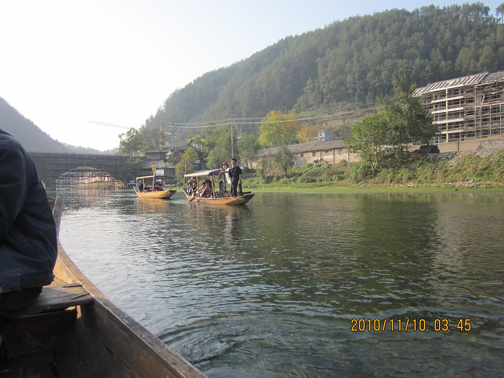
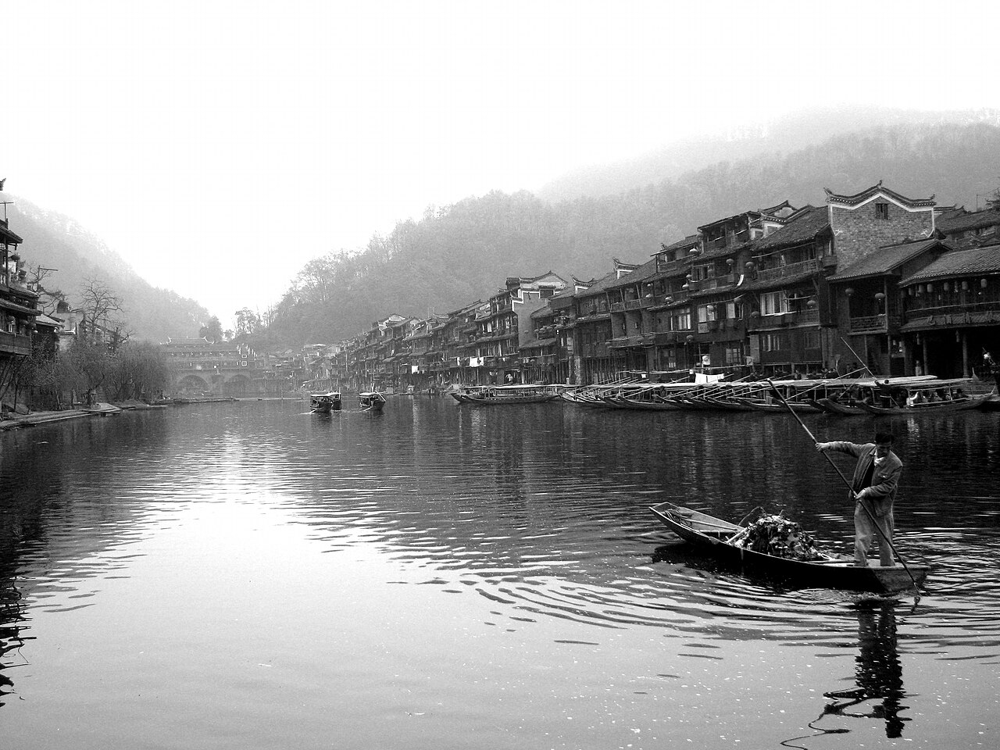
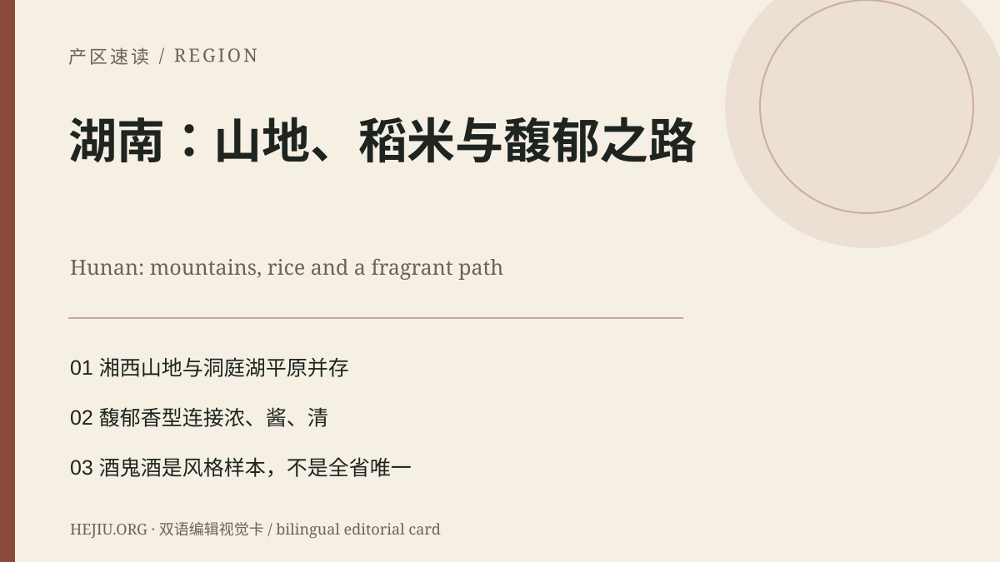

# Hunan

Hunan lies south of the middle Yangtze, ringed by mountains on the east, south and west, and open to the Dongting Lake plain in the north. Wet, mountainous country with dense river networks gives the province a different drinks landscape from the northern plains: high-strength baijiu alongside rice wine, yellow rice wine and local fermented drinks.

In baijiu, Hunan is best remembered for Jiugui and "fuyu aroma". But the province is not one-dimensional: Wuling in Changde follows a sauce-aroma route, while rice wine and yellow rice wine in western and southern Hunan sit closer to everyday food. Read famous brands and local drinks separately.

Figure: The Tuo River in Fenghuang County, western Hunan, where mountains and water shape the region's brewing geography. Image: Huangdan2060, CC0, via Wikimedia Commons ([source page](https://commons.wikimedia.org/wiki/File:Tuo_River_in_Fenghuang_County,_Hunan,_China4.jpg)).

## Geography and climate

Hunan has a subtropical monsoon climate: hot wet summers, damp cold winters, high rainfall and high humidity. Western and southern Hunan are mountainous and hilly; the north is the Dongting plain; the centre is hills and basins. This affects starter culture, fermentation and storage: heat and moisture help microbes grow, but also demand tighter control of starter rooms, pits and warehouses.

Valleys and mountains in western Hunan are often used to explain the "composite aroma" of fuyu. Plains and lake areas around Changde and Yueyang suit large-scale grain farming and logistics. Geography is not the only cause of flavour, but it changes raw materials, water, microbes and storage.

Figure: A boatman on the Tuo River in Fenghuang, a glimpse of western Hunan's river transport and everyday life. Image: Robert Baxter from China（中国）, CC0, via Wikimedia Commons ([source page](https://commons.wikimedia.org/wiki/File:Boatman_Fenghuang,_Hunan_(9449805344).jpg)).

## History

Hunan's brewing tradition is tied to rice farming, ethnic minority foodways and river trade. Rice wine and maize liquor in western Hunan belong to festivals and village life; the centre and north joined the baijiu craft network of the middle Yangtze earlier. In the twentieth century, Jiugui, Wuling and Xiangquan moved through industrialisation and branding.

Jiugui built recognition around fuyu aroma in the late twentieth century; Wuling entered the Hunan famous-liquor sequence with sauce aroma. Both turn wet climate and composite fermentation into brand narrative, but they follow different aroma routes, raw-material structures and price bands. Local rice wine remains mostly county-level and domestic, with less branding.

## Aroma and style

The main baijiu routes are fuyu and sauce aroma. Fuyu is often described as strong, light and sauce aromas coexisting: mellow sweetness on entry, composite fragrance and a long finish. It is not a simple blend of three aroma types; starter, fermentation, distillation and ageing create the composite style. Sauce aroma stresses pronounced sauce notes, elegance, full body and an empty cup that keeps fragrance.

Strong aroma also has a market in Hunan, mostly where outside brands meet local products. Rice wine and rice aroma form another line: rice or glutinous rice, a cleaner and sweeter profile, usually lower strength, suited to daily drinking and cooking. Treating fuyu, sauce aroma and rice wine as one thing erases the province's layers.

Figure: Hunan: mountains, rice and a fragrant path. Project-generated bilingual editorial card; schematic, not a photograph.

## Raw materials and craft

Hunan baijiu commonly uses sorghum, rice, glutinous rice and water. Fuyu producers often use multiple grains and composite starter, stressing starter culture, fermentation and multiple rounds of distillation; sauce aroma stresses high-temperature starter, piled fermentation and long ageing. Rice wine relies more on rice saccharification and fermentation, a different route from baijiu.

Craft differences appear on the label: ingredients, aroma type, strength, standard and producer are the shortest path to judging a bottle. Do not rely on place names such as "western Hunan" or "Dongting"; they may be brand storytelling rather than the actual origin or process.

Figure: Rice is the base material for southern rice-aroma baijiu and semi-solid fermentation. Image: China News Service, CC BY 3.0, via Wikimedia Commons ([source page](https://commons.wikimedia.org/wiki/File:20201102.Hengnan.Hybrid_rice_Sanyou-1.6.jpg)).

## Representative bottles and local memory

Jiugui is one of Hunan's most nationally recognised baijiu brands, from Jishou in western Hunan, known for fuyu aroma. Its range spans mass to premium prices, and individual products differ in materials, strength and standard. Jiugui Co., Ltd. is the entry point for understanding the brand-origin relationship.

Wuling represents sauce-aroma baijiu in Changde; Xiangquan is another product line within the Jiugui system. Hunan also has rice wine, glutinous rice wine, bayberry wine and local small-quar liquor, mostly on family tables, at festivals and in local snack culture. For visitors, buy mainstream products with complete labels and reliable channels; for local drinks, confirm sweetness, strength and storage first.

## Market and drinking

Baijiu consumption is centred on banquets, business meals and gifts; fuyu and sauce aroma carry more premium conversation, while rice wine and yellow rice wine stay closer to daily food. Hunan cooking is hot, aromatic and oily; heat amplifies the burn of alcohol. Strong or fuyu aroma can partner heavier dishes, while rice wine and lower-strength drinks suit cold plates, desserts and family meals.

For high-strength baijiu, small cups and slow drinking are safer than large gulps; do not use "sobering up" as a reason to press others. Keep opened baijiu sealed, dark and cool. Rice wine and yellow rice wine oxidise faster after opening and should be refrigerated and finished quickly.

## Rules and regional protection

Baijiu production is governed by food-safety rules and national standards. GB/T 15109-2021 defines terms for starter, fermentation and distillation; GB/T 17204-2021 sets classification and terminology for alcoholic beverages. Geographical indications, aroma names and company standards must follow their own rules. On a label, separate origin, aroma type, strength and producer.

## Climate and drinks structure

| Area | Climate and landform | Main drinks | What to check when buying |
| --- | --- | --- | --- |
| Western Hunan (Jishou, Fenghuang) | Mountain valleys, wet and rainy | Fuyu baijiu, rice wine | Aroma, ingredients, producer |
| Changde, Yiyang | Lake plain, hot and humid | Sauce and strong aroma baijiu | Standard, base wine, ageing |
| Changsha, Zhuzhou, Xiangtan | Hills and basins, urban | Baijiu, rice wine, yellow rice wine | Product line, channel, price band |
| Southern Hunan (Chenzhou, Yongzhou) | Hills near the Nanling range | Rice wine, local small-quar liquor | Sweetness, strength, storage |
| Dongting Lake area | Wet plain, strong farming base | Rice wine, baijiu | Ingredients and true origin |

The table is a macro comparison, not a substitute for a distillery's craft. Different plants in the same city can use entirely different aroma types and materials.

## Common misconceptions

First, Hunan only has Jiugui. Jiugui is a representative brand, but Wuling, Xiangquan and many local rice wines also exist.

Second, fuyu aroma is a blend of three aroma types. It is a craft and flavour category, not a simple mixture of strong, light and sauce.

Third, all Hunan liquor is "hot". The burn depends more on strength, acidity and serving temperature than on the province.

Fourth, rice wine has no craft threshold. Sweetness, acidity, strength and microbial control all require technique.

Fifth, Hunan food must be matched with high-strength liquor. Heat amplifies alcohol; lower-strength drinks, rice wine and water can also work.

## Drinking and buying fuyu-aroma baijiu

Fuyu aroma is often described as a third route beyond strong, light and sauce aromas: the entry shows the grain and cellar notes of strong aroma, the middle is cleaner and lighter, and the finish brings a sauce-like toasted note and aftertaste. It is not one chemical marker but a composite result of qu-making, fermentation, distillation and blending. On a first tasting, do not force yourself to decide whether it is "strong" or "sauce"; note sweetness, grain, acidity and the return of flavour instead.

Temperature matters. A room at 18–22°C, a small cup and a modest sip open the layers; too cold suppresses the cellar note, too warm pushes alcohol forward. With Hunan food, chopped chilli, cured meat and smoke add salt and savoury echoes, but heavy heat can flatten detail. Taste a dish, then a sip, rather than drinking continuously.

Price bands are roughly RMB 100–300 for everyday and friends, RMB 300–800 for banquets and gifts, and above RMB 800 for flagship or collectible releases. Buy through official channels and large local supermarkets, and check the standard code, production date and bottle code. Claims such as "internal edition" or "cave-aged old stock" that cannot be verified are a reason to leave the bottle on the shelf.

A Hunan visit can combine Jishou, Fenghuang and Changsha: western Hunan provides the geography and ethnic-cultural context around Jiugui, while Changsha shows the market and restaurant side. Distillery tours and tastings require current official booking; a scenic-area performance schedule is not a distillery opening time.

## Common questions

**What exactly is fuyu aroma?** It is the composite aroma most associated with the Jiugui system, often described as strong, light and sauce notes coexisting. It is not a simple blend of three liquors; materials, starter, fermentation, distillation and ageing create it.

**How are Jiugui and Xiangquan related?** Both belong to western Hunan baijiu branding, but products, prices and channels differ. Check producer, standard and strength, not just the brand name.

**What aroma type is Wuling?** Wuling is known for sauce-aroma baijiu from Changde. It is a different route from western Hunan fuyu.

**How should Hunan rice wine be drunk?** Chilled on its own or warmed with food; sweet glutinous rice wine suits small cups. Refrigerate after opening and finish quickly.

**What should I drink with Hunan food?** Heavy chopped-chilli dishes, cured meat and braised food can take fuyu or strong aroma; steamed dishes, cold plates and rice noodles suit rice wine, yellow rice wine or lower-strength drinks. Heat amplifies alcohol, so do not force high-strength liquor.

## Further reading

- [China](ref:china): Hunan's place in Chinese drinks geography.
- [Baijiu](ref:baijiu): definition, aroma types and craft.
- [Strong aroma](ref:strong) and [rice aroma](ref:rice-wine): two contrasting routes.
- [Jiugui](ref:jiugui) and [Jiugui Co., Ltd.](ref:jiugui-brand): brand and origin.
- [Sorghum](ref:sorghum), [rice](ref:rice), [glutinous rice](ref:glutinous) and [water](ref:water): basic materials.
- [Starter culture](ref:qu), [fermentation](ref:fermentation) and [blending](ref:blending): three craft terms for Hunan liquor.

**Key facts.**

| Item | Detail |
| --- | --- |
| One-line position | A wet, mountainous province where fuyu and sauce aroma baijiu coexist with rice wine |
| Level | Province / macro-region |
| Part of | China |
| Country code | CN |
| Representative clues | Jiugui, Wuling, Xiangquan and local rice wine |

**Sources and scope.** Geography, aroma and craft information was cross-checked against the Hunan Provincial People's Government portal, national standards, the China Alcoholic Drinks Association and The Oxford Companion to Spirits and Cocktails. Brand history, product lines and prices change; use current official company information. The body is project-written; sources are for verification, not copied text.
