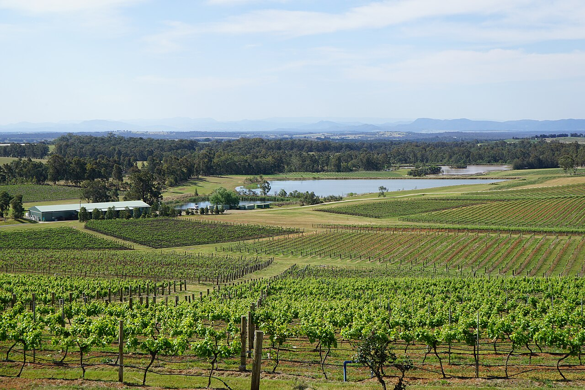
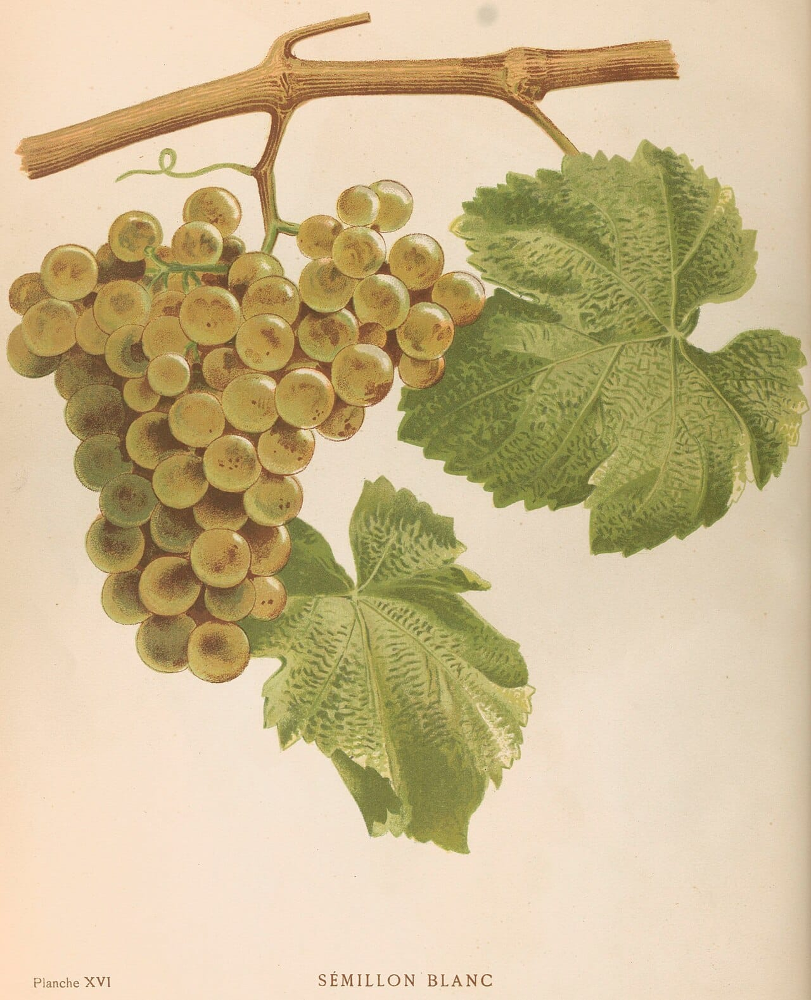

# Hunter Valley

A historic wine region in New South Wales, Australia, about two hours north of Sydney; warm and humid, known for young Semillon and Hunter Shiraz, with GI status in the 1990s and one of Australia’s oldest commercial wine districts.

Figure: Hunter Valley: Hunter Valley Vineyards (23754582745) (Wikimedia Commons). Image: thinkrorbot, Public domain, via Wikimedia Commons ([source page](https://commons.wikimedia.org/wiki/File:Hunter_Valley_Vineyards_(23754582745).jpg)).

## Definition and boundaries

Hunter Valley lies north of Sydney and is one of Australia’s oldest commercial wine districts; warm and humid with summer rain, harvest and disease management are challenges.

In an official geographical indication, the boundaries of Hunter Valley are not a decorative line but a legal and historical construction made of place names, parcels and maps. It may be a county, a group of villages, or a narrow strip along a river or mountain; the more specific the name, the less freely it can be used on a label.

Hunter Valley is divided into Upper and Lower Hunter, with Pokolbin, Lovedale, Broke and the river flats behaving differently. Lower Hunter is warmer and more humid; Upper Hunter is higher and cooler at night. The word Hunter on a label can cover both, so the sub-region and vineyard are better clues.

## History and naming

Semillon is the signature: light, low-alcohol and high-acid when young, with lemon and grass; with age come honey, toast and nuts, one of Australia’s most distinctive white styles.

The name Hunter Valley usually appears first in local archives, church records or tax rolls, and only later in modern regulations. The name often stabilises later than the boundary, which is why the same place can carry different spellings across languages and periods.

Commercial planting began in the 1820s and 1830s, making Hunter one of Australia’s oldest wine regions. Semillon, Shiraz and Verdelho were established by the late nineteenth century; floods and disease removed many old vineyards. The 1970s and 1980s revival, led by Tyrrell’s and Brokenwood, re-established Semillon’s ageing reputation.

## Geography and terroir

Hunter Shiraz is usually medium-alcohol with red fruit, spice and earth, not a Barossa fruit bomb; old-vine resources are strong.

The vineyards of Hunter Valley sit at particular elevations, aspects and soil parent materials. Distance to the sea, mountain direction, diurnal range and harvest rain all change ripening and acidity; these conditions explain more about style than the name alone.

The Hunter River valley lies west of the Brokenback Range, with a warm, humid subtropical climate and frequent afternoon thunderstorms. Alluvial soils on the flats hold water; red-brown and sandy soils on the slopes drain better. The range’s shadow and valley breezes cool the nights, helping Semillon keep acidity.

## Raw materials and styles

Soils are sand, alluvium, clay and limestone, with valley form affecting drainage and ripening; sub-regions such as Pokolbin and Upper Hunter differ.

The vines of Hunter Valley determine what can be made. The leading varieties or raw materials, permitted blends, minimum ripeness and maximum yields are usually written into rules; but rules are a floor, and the real style comes from picking dates, fermentation vessels and ageing.

Semillon is picked early, often at 10–11% alcohol, to preserve lime and herb; Shiraz is picked later, balancing ripeness and acidity. The harvest is compressed by humidity and rain, so growers pick selectively and often in several passes. Early picking is a quality decision, not a sign of unripeness.

## Representative producers and wines

Representative producers include Tyrrell’s, Brokenwood, Mount Pleasant, Lindeman’s, McWilliam’s and Tulloch; Tyrrell’s Vat 1 Semillon is a classic.

The representative wineries of Hunter Valley usually show the two poles of a region: long-established families or cooperatives with concentrated holdings, and newer arrivals working parcel by parcel. Tasting both explains the region better than a list of famous names.

Family estates such as Tyrrell’s, Brokenwood and McWilliam’s Mount Pleasant dominate the historical image, alongside larger companies and tourism-led cellar doors. Some brands source fruit from several vineyards; others own only a few hectares. The back label’s vineyard and vintage are more useful than the estate’s gatehouse.

## How to drink and pair

To drink Hunter Valley, start with alcohol, acidity and tannin or bitterness, then choose temperature and food. High acidity suits fat and salt, high tannin needs protein and fat, and high alcohol clashes with sweet or very spicy dishes; warmth pushes alcohol over aroma.

Serve Semillon at 8–10°C and Shiraz at 16–18°C. Young Semillon suits oysters, sushi and Vietnamese food; older Semillon needs roast chicken, mushrooms and cream sauces. Shiraz suits roast meat, game and hard cheese. Do not over-chill Semillon or long-decant young Shiraz.

## Labels, buying and misreadings

Start with the appellation and its permitted varieties. From there, consider the vintage and the producer, then how the wine is labelled. That is how a practical judgment about Hunter Valley is built.

Rain, hail, humidity and afternoon storms make vintage variation large. Cool years give sharper Semillon and tighter Shiraz; warm years give more flesh and earlier drinkability. Older Semillon develops honey and toast, but colour and storage history decide whether a bottle is sound.

### Key dates and figures

- 1960s: Vat 1 Semillon began bottling in the 1960s, proving low-alcohol white wine could age for decades.
- 1970s: in the 1970s–80s, Tyrrell’s and Brokenwood re-emphasised Semillon’s ageing potential.
- Picking: Semillon is often picked at 10–11% alcohol to keep high acidity and lime notes.

## Around and routes

Putting Hunter Valley into an itinerary means separating the regional centre from specific wineries: the first is for landscape, markets and food, the second needs bookings, tastings and travel time. Too many stops in one day exhaust both palate and attention.

Hunter Valley is about two hours from Sydney. Pokolbin and Lovedale are close together, but Broke and Upper Hunter add significant driving. Three cellar doors plus lunch is a full day; book tastings, avoid summer heat and check harvest closures before setting the route.

- Related: [australia](ref:australia), [semillon](ref:semillon), [syrah](ref:syrah), [white-wine](ref:white), [red-wine](ref:red).
- This region provides no map, prices or opening hours; confirm before travelling.

**Short definition:** A historic wine region in New South Wales, Australia, about two hours north of Sydney; warm and humid, known for young Semillon and Hunter Shiraz, with GI status in the 1990s and one of Australia’s oldest commercial wine districts. 

[Australia](ref:australia) and [Syrah](ref:syrah) answer different questions about Hunter Valley: geographic boundary and climate and soil. Read them as a pair, not as alternatives.

Hunter Valley is one of Australia's oldest wine regions, known for Semillon picked early and Shiraz.

**Key facts.**

| Item | Detail |
| --- | --- |
| In one line | A historic wine region in New South Wales, Australia, about two hours north of Sydney; warm and humid, known for young Semillon and Hunter Shiraz, with GI status in the 1990s and one of Australia’s oldest commercial wine… |
| Level | province or region |
| Parent | Australia |
| Country code | AU |

## Related images

Image: Sémillon - Joseph Daurel. Credit: Imprimerie A. Bellier & Cie - Bordeaux, CC0, via Wikimedia Commons.. Credit: Imprimerie A. Bellier & Cie - Bordeaux, CC0, via Wikimedia Commons ([source page](https://commons.wikimedia.org/w/index.php?curid=94839238)). Related image for Hunter Valley.

Image: Renmark South Australia Vineyard. Credit: Feral Arts, CC BY 2.0, via Wikimedia Commons.. Credit: Feral Arts, CC BY 2.0, via Wikimedia Commons ([source page](https://commons.wikimedia.org/w/index.php?curid=9069567)). Related image for Hunter Valley.
