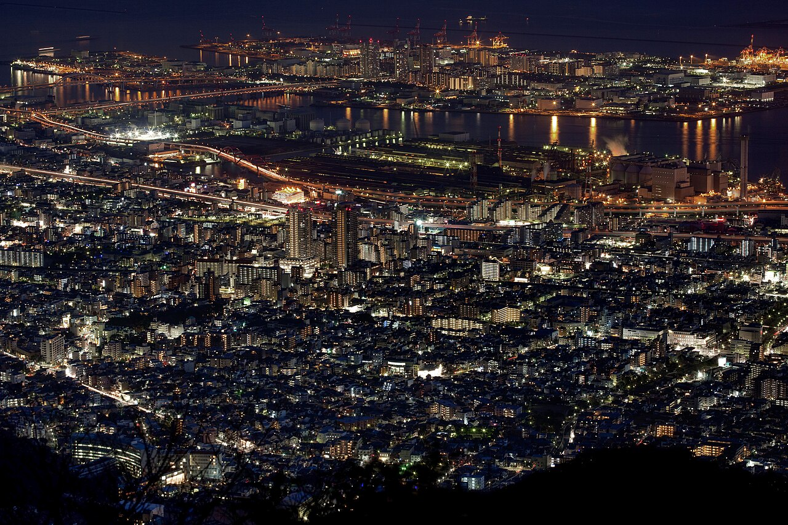

# Hyogo Prefecture

Hyogo's sake reputation is often reduced to two words: Nada and miyamizu. That is not wrong, but it misses a regulatory change. On 28 June 2018, "Nadagogo" was designated by the Commissioner of the National Tax Agency as a geographical indication (GI) for sake, making it a place name bound by production standards rather than only a historical label. Hyogo sake has to be read through the coastal Nada wards, the inland rice areas, and the separate junmai and ginjo product routes.

Figure: Hyogo Prefecture. Image: Laitr Keiows, CC BY-SA 3.0, via Wikimedia Commons ([source page](https://commons.wikimedia.org/wiki/File:Night_view_of_Rokk%C5%8D_Island_and_Higashinada-ku,_Kobe,_Japan.jpg)).

## Geography: between the Rokko mountains and the Seto Inland Sea

Hyogo lies in Japan's Kansai region, with the Sea of Japan to the north and the Seto Inland Sea to the south; Kobe is the prefectural capital. Sake production is concentrated in the five Nada wards on the coast of Kobe's Nada and Higashinada wards, Ashiya and Nishinomiya, with the Rokko range to the north and Osaka Bay to the south, a band about 10 kilometres long. The five wards are Nishigo, Mikagego, Uozakigo, Nishinomiyago and Imazugo. This division comes from historical brewing settlements, not an administrative rank. The prefecture also has Itami, Himeji, Kakogawa, Tanba and northern Kobe, so equating Hyogo with Nadagogo ignores smaller areas built on different water and rice.

## Climate: Rokko winds and winter brewing

In winter, seasonal winds from the west descend the Rokko slopes as the so-called rokko-oroshi, bringing cold conditions suited to low-temperature fermentation. Traditional sake is brewed in the coldest part of winter, a practice called kanzukuri; slow fermentation gives finer aroma and lowers the risk of spoilage. The sake is pasteurised around spring, matured through summer, and by autumn its aromas have settled, which is called akiagari. Sake shipped without reheating once temperatures fall is hiyaoroshi, traditionally released after September in Nadagogo. Hot, humid summers are the other side of the climate, and modern breweries rely on temperature control to brew all year.

## Water: the hardness and low iron of miyamizu

Nadagogo's core natural condition is miyamizu. It is groundwater drawn around Nishinomiya, filtered through the gravel of the Rokko range. It is hard water with moderate calcium, potassium and phosphate and very low iron. Iron promotes oxidation and colours sake, so it is the impurity brewers most want to avoid; moderate minerals support yeast growth and fermentation and give the sake more structure. Miyamizu is therefore treated as the material basis of Nada's dry style. Other water sources in the prefecture differ in hardness and minerals and often give softer or lighter sake, so miyamizu cannot be treated as the default for the whole prefecture. The Nadagogo association, together with Kobe and Nishinomiya, has also run groundwater and miyamizu surveys, a reminder that the source is not a fixed and infinite resource.

## Rice: Yamada Nishiki in 1923 and 1936

Hyogo is a leading region for Yamada Nishiki. In 1923, the Hyogo Prefectural Agricultural Experiment Station crossed Yamada Ho as the mother with Tankan Wataribune as the father; after selection and stabilisation, the variety was registered and named as a Hyogo recommended variety in 1936. Yamada Nishiki has a large shinpaku, plump grains, fast water uptake and good dissolution, which suits high polishing ratios and ginjo aroma. Its taller stalks make it prone to lodging, however, and it demands careful cultivation, with yields sensitive to weather. Hyogo grows other sake rice too, including Gohyakumangoku and Omachi; differences in shinpaku size and protein content change [qu making](ref:qu-making) and [saccharification](ref:saccharification). Brewing uses [rice](ref:rice) and [water](ref:water), with polishing, washing, steeping and steaming before parallel [fermentation](ref:fermentation).

## Legal rules: GI Nadagogo

"Nadagogo" received GI designation on 28 June 2018, and use of the name requires meeting production standards. The area covers the five Nada wards in Kobe's Nada and Higashinada wards, Ashiya and Nishinomiya. Rice and rice koji must be Japanese-grown and graded at least third class under the Agricultural Products Inspection Act; brewing water must be drawn within Nadagogo; brewing, storage and bottling for consumers must also take place inside the area. If brewing alcohol is used, it may not exceed 25% of the weight of the rice, including koji rice. The GI certifies origin and process, not a parcel hierarchy and not a quality ranking; it follows the logic of a French AOC but has no Burgundian vineyard tier.

## Designations and polishing ratios

Sake designations are defined by polishing ratio and ingredients. Junmai daiginjo and daiginjo have a polishing ratio of no more than 50%, junmai ginjo and ginjo no more than 60%, and junmai and honjozo no more than 70%. Junmai styles add no brewing alcohol, while honjozo allows a small amount to adjust aroma and palate. Ginjo aroma comes from long, cool fermentation and high polishing and often shows apple, pear, banana or flowers; junmai emphasises rice aroma, umami and texture. These are labelling categories, not a quality order, and one brewery's range can span several of them.

## Yeast starters: kimoto, yamahai and sokujo

The starter is the stage in which yeast is built up, and it sets the fermentation and the flavour direction. Kimoto relies on natural lactic acid bacteria and on yamaoroshi, the pounding of koji and steamed rice; it is slow, labour-intensive and risky, but gives deeper acidity and umami. Yamahai omits the pounding while still relying on natural lactic acid bacteria. Sokujo adds lactic acid directly, is stable and quick, and is the modern mainstream. Nadagogo traditionally used large wooden tanks and long cool fermentation, and modern breweries mostly use temperature-controlled tanks, though some still keep [kimoto and yamahai](ref:kimoto-yamahai) routes. The starter changes flavour and risk; it is not a rank.

## Style: dry, akiagari and hiyaoroshi

Nada sake is often called "men's sake": dry, firmly built, balanced between acidity and umami, with a clean finish, suited to warm drinking and food. The minerals in miyamizu and the dissolution of Yamada Nishiki support that frame. Ginjo follows another route on the same coast, stressing fruit, lightness and cold serving. By contrast, Fushimi in Kyoto is often described as "women's sake", softer and sweeter; this is a style comparison, not a judgement of origin. Akiagari and hiyaoroshi add a time dimension: the same sake tastes different in spring, summer and autumn, and the seasonal words on the label have real production meaning.

## Breweries and product ranges

Representative Nadagogo breweries include Hakutsuru, Kikumasamune, Ozeki, Kenbishi, Sakuramasamune, Sawanotsuru and Hakushika. Their ranges usually run from honjozo and junmai to ginjo and daiginjo, with prices from everyday table sake to gift level; large breweries offer stable supply and distribution, while small ones rely on limited releases, namazake and specific rice. Tatsuriki (Honda Shoten) in Himeji lies outside Nadagogo, yet shows that Hyogo sake does not depend only on the coast: an inland brewery can still make high-polishing ginjo from Yamada Nishiki.

## Market and vintage

Japanese sake consumption at home has fallen over the long term, the share of ginjo and junmai has risen, and exports have become a growth area. Hyogo ranks first in Japan for sake output, and Nadagogo is the largest producing area within the prefecture, but "first in volume" does not mean every bottle follows the same route. Vintage matters less than in wine, yet rice year, temperature and brewing conditions still affect flavour; akiagari, hiyaoroshi, namazake and aged sake offer other time labels. When judging a Hyogo sake, origin, rice, polishing ratio, starter and pasteurisation tell more than the single word Nada.

## Common misconceptions

First, that Hyogo sake means Nadagogo only. Itami, Himeji and Tanba also produce sake.
Second, that miyamizu is available everywhere. It is a specific groundwater and does not represent all water in the prefecture.
Third, that kimoto is always better than sokujo. The starter affects flavour and risk, not rank.
Fourth, that Yamada Nishiki comes only from Hyogo. Other prefectures grow it, and Hyogo is one main producer.
Fifth, that dry equals high quality. Dry describes a sweetness leaning, not a quality judgement.
Sixth, that GI Nadagogo is a vineyard-style hierarchy. It governs origin and process, not parcels.

## Further reading

- [Japan](ref:japan): the regional, regulatory and consumer background for sake.
- [Sake](ref:sake): definition, designations and basic process.
- [Junmai](ref:junmai-sake): sake with no added brewing alcohol.
- [Kimoto and yamahai](ref:kimoto-yamahai): traditional starters built on natural lactic acid bacteria.
- [Rice](ref:rice) and [water](ref:water): sake rice and miyamizu as the material base.
- [Qu making](ref:qu-making), [saccharification](ref:saccharification) and [fermentation](ref:fermentation): the parallel fermentation sequence.
