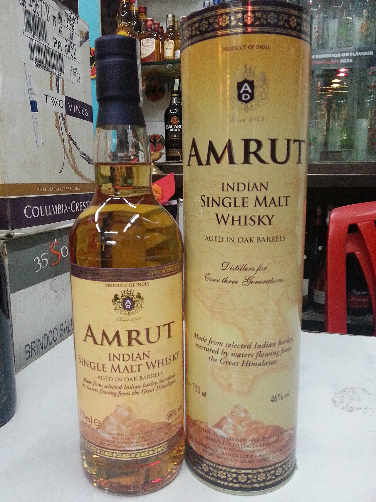

# India

The national Indian whisky region, among the world’s largest by volume; materials include molasses neutral spirit, grain and malt, with styles from mass-market blends to single malts, and a tropical climate that ages whisky very fast.

Figure: A bottle of Amrut Indian Single Malt Whisky. Image: User:Vikrambj, CC BY-SA 3.0, via Wikimedia Commons ([source page](https://commons.wikimedia.org/wiki/File:Amrut_singlemalt_whisky_2013-06-11_18-39.jpg)).

## Definition and boundaries

India is one of the world’s largest spirits markets, and whisky is its most important category. Materials range from molasses neutral spirit to grain and malt, and styles from mass-market blends to single malts.

The “region” is national, not a wine-style parcel. “Whisky” on the label does not always mean Scotch-style malt; read the base (molasses, grain or malt), whether it is blended, the ABV and the producer before judging style.

## History and naming

The modern industry grew around molasses spirit, licensing and mass demand; after the 2000s, Amrut, Paul John and Rampur brought Indian single malt into international view.

Tropical maturation is fast, with angel’s share sometimes 8–12% a year; distilleries often use younger ages to reach a full style. Fast ageing is an advantage and a risk: aroma comes quickly, but wood and alcohol can overrun.

## Geography and terroir

Main producing states include Karnataka (Bangalore), Goa, Uttar Pradesh and Maharashtra; water, grain and climate differ, and distilleries sit near materials, ports or consumers.

Indian climates vary sharply: humid south, wider temperature swings in the north, monsoon coasts. Warehouse temperature and humidity set the pace; the same spirit can differ between warehouses, so read the distillery as well as the state.

## Raw materials and styles

The base decides style: molasses neutral spirit gives a clean, lower-cost foundation, while grain and malt add aroma and structure. Single malt stresses malt share, pot distillation and age; blends rely on proportions.

Styles run from light, approachable everyday blends to rich single malts with tropical fruit and spice. High alcohol and sweetness need balance; “Indian whisky” is too broad to describe one product.

## Representative producers and bottlings

Representative single malts include Amrut, Paul John and Rampur; Amrut entered international view in the 2000s and helped start India’s fine-whisky movement.

Mass brands cover a wider price range. Distinguish a distillery’s own malt from a business that buys molasses spirit and blends it; the first stresses material and distillation, the second recipe and price.

## How to drink and pair

Start with ABV and sweetness: single malt can be sipped neat or with a little water, while blends suit ice or soda. In a tropical room, ice melts fast, so use one large cube rather than a handful.

Pair with spice, fat and grilling: curry, roast meat, spice-braised dishes and nuts can carry the body. High alcohol plus very hot chilli amplifies heat; take a bite of fat or yoghurt first, then sip.

## Labels, buying and misreadings

Read the base (molasses, grain or malt), the category (single malt or blended), ABV, age and producer. A label that says only “whisky” leaves the style unclear.

Common misreadings: treating all Indian whisky as cheap blend, or treating high ABV as quality. India also makes serious single malt; store upright, dark and at room temperature, and avoid heat in a tropical climate.

## Around and routes

Distillery visits cluster around Bangalore, Goa and some northern areas; most need booking, and a car or driver is the practical way to travel.

Separate the city from the distillery: Bangalore can be a day trip, Goa can combine with the coast. Climate and transport vary widely, so check official pages and weather; one or two visits explain more than a rushed circuit.

**Short definition:** The national Indian whisky category, among the world’s largest by volume; materials include molasses neutral spirit, grain and malt, with styles from mass-market blends to single malts, and a tropical climate that ages whisky very fast. 

For India, begin with the appellation and its permitted varieties, then the vintage and the producer, and finish with how the wine is labelled; that order keeps the account grounded.

[Scotland](ref:scotland) explains geographic boundary; [Barley](ref:barley) adds climate and soil. Put India between them before deciding what it is.

Indian whisky is a broad category that includes molasses-based spirit, grain whisky and malt; the tropical climate ages spirit quickly, and the label should say whether it is a blended whisky or a single malt.

**Key facts.**

| Item | Detail |
| --- | --- |
| In one line | The national Indian whisky category, among the world’s largest by volume; materials include molasses neutral spirit, grain and malt, with styles from mass-market blends to single malts, and a tropical climate that ages w… |
| Level | country |
| Country code | IN |

**Sources and limits.** The key claims about India are checked against the following sources: Food Safety and Standards Authority of India (India's alcohol-beverage regulations on whisky categories, labelling and alcohol strength), Amrut Distilleries (Amrut's single-malt products, ingredients and tropical-ageing account in Bangalore), John Distilleries (Paul John's single-malt products, ingredients and no-additives/non-chill-filtered description in Goa) and 4 sources in total. Prices, batches and status change; the body is project-written and does not reproduce source text.

For India, this page was last checked in 2026; prices, batches and availability change, so confirm them against the sources below.

## Further reading

Further reading: Indian whisky is often obscured by two words—“cheap” and “tropical”. Cheap describes a mass-market price band, not the material in the glass; tropical describes fast maturation, not a guarantee of intensity. Separate them and three lines appear: molasses-based mass blends, grain-and-malt blends, and single malt. The first chases smoothness and scale, the second balances price and aroma, and the third stresses distillery, malt share and cask. Compare base and category first, then ABV and age; within one distillery, cask differences can matter more than distillery differences. In Bangalore or Goa, put booking and travel time in the same plan, and do not treat a “region” as a walkable neighbourhood.

One more point is often missed: Indian “single malt” does not automatically mean old. Tropical ageing can make three years taste full, so read ABV, cask and batch before the number. When comparing two distilleries, match age and cask first; otherwise warehouse differences can masquerade as material differences. State taxes and retail channels also vary, so the same brand can cost very different amounts across cities. If you buy only two bottles, pair one single malt with one mass blend; the gap is not only price—it is also malt share, distillation, cask and body too.

A bottle can be mass-market and still well made; judge the liquid and the label together, not the price band alone.

- Related: [scotland](ref:scotland), [whisky](ref:whisky), [barley](ref:barley), [distillation](ref:distillation), [terroir](ref:terroir).
- This page provides no map, prices or opening hours; confirm before travelling.
