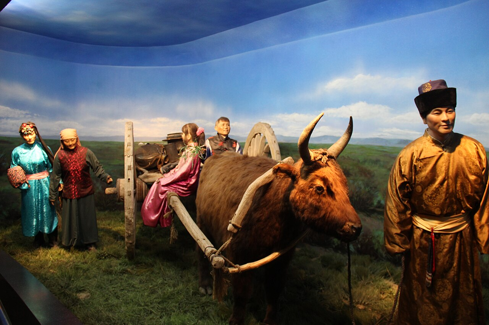
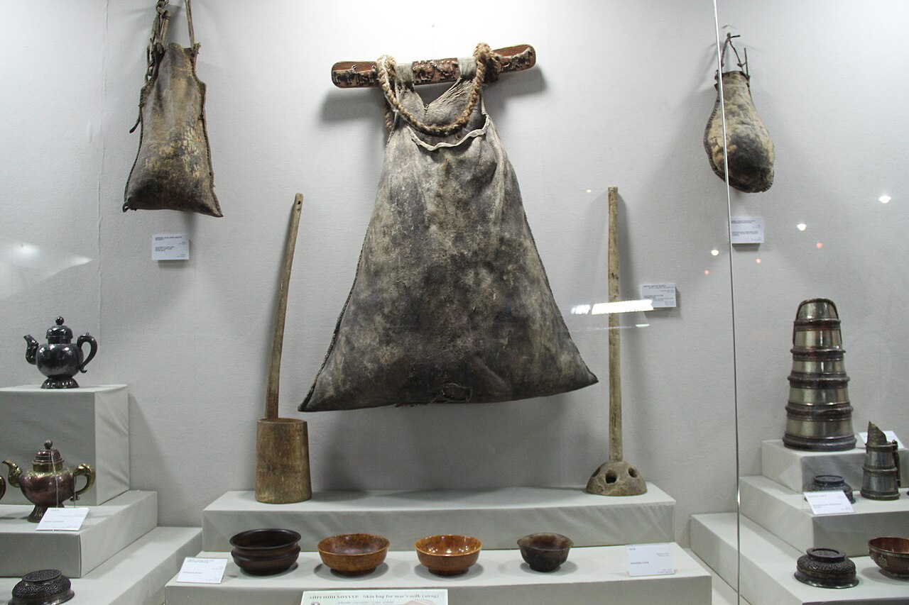
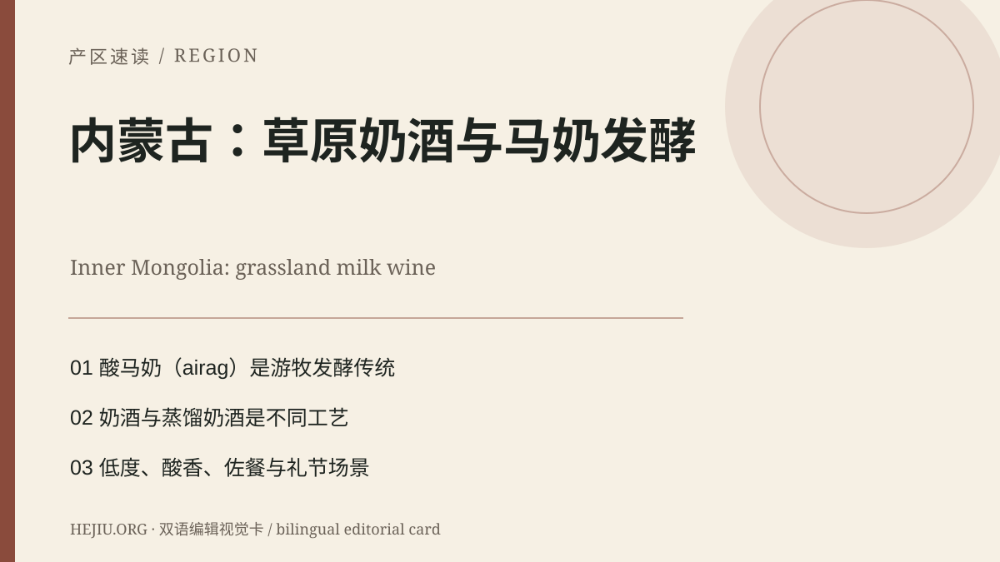
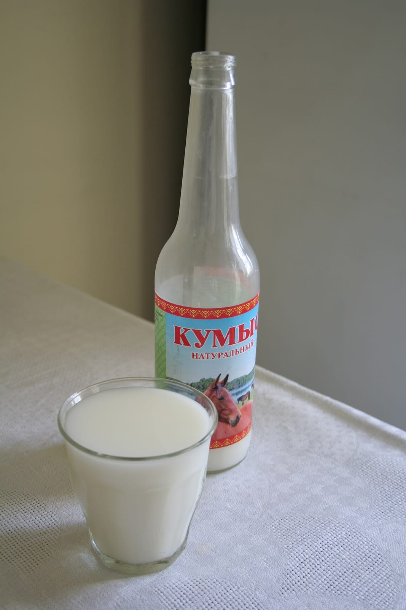

# Inner Mongolia

Inner Mongolia stretches across northern China, from the Greater Khingan range in the northeast to the Gobi in the northwest, with grassland, sand, mountains and the Hetao plain. It is not a traditional "baijiu giant", but it has two clear drinks traditions: grain baijiu on the Hetao plain and mare's-milk wine on the grassland.

Only by holding both lines together can you understand Inner Mongolian drinks: Hetao Wang and Mongol King represent high-strength grain spirits with a banquet role; airag is a fermented milk drink, low in alcohol, sour and milky, tied to Naadam, pastoral life and hospitality. They are not the same drink and should not share one tasting standard.

Figure: Inner Mongolian grasslands, the setting for pastoral geography and the milk-wine tradition. Image: Gary Todd from Xinzheng, China, CC0, via Wikimedia Commons ([source page](https://commons.wikimedia.org/wiki/File:Inner_Mongolia_Grasslands_Scene_(19170728093).jpg)).

## Geography and climate

Inner Mongolia is long and narrow: humid east, dry west, with the Yinshan mountains and Hetao plain in the centre. The Hetao plain relies on Yellow River irrigation and has good conditions for wheat, maize and sorghum, the base of grain baijiu. Grassland areas such as Hulunbuir and Xilingol are pastoral, with abundant mare's milk, cow's milk and dairy.

The climate moves from cold-temperate to arid, with long cold winters and short summers. Low temperatures challenge fermentation and storage, but also slow oxidation; temperature swings and dry air affect milk-wine fermentation and keeping. Geography acts through materials, microbes and storage.

Figure: A traditional Mongolian skin bag for mare's milk, a material reference for airag and milk-wine vessels. Image: Gary Todd from Xinzheng, China, CC0, via Wikimedia Commons ([source page](https://commons.wikimedia.org/wiki/File:Mongolian_Traditional_Life_Skin_Bag_for_Mare%27s_Milk_(35575509081).jpg)).

## History

Grain baijiu is tied to Shanxi-Shaanxi migration, Hetao agriculture and border trade. The Hetao plain formed farming and market towns in the Qing and modern periods, and distilleries followed; in the twentieth century, Hetao Wine Industry and Mongol King industrialised and built brands.

Mare's-milk wine has a longer history, tied to pastoral life, Naadam, weddings and hospitality. Traditional airag ferments mare's milk, with noticeable acidity and low alcohol; it is both a thirst drink and a social one. Its occasions, craft and flavour differ completely from grain baijiu.

## Aroma and style

Grain baijiu is mainly strong aroma, with some light aroma and other styles. Hetao Wang and Mongol King are common brand clues, covering mass to upper-middle price bands. Strong aroma's pit note, sweetness and body suit northern banquets and beef or mutton dishes.

Airag is a fermented milk drink, not baijiu. It is usually low in alcohol, with lactic acidity, milk aroma and a slight sparkle, suited to chilling. Treating airag as "low-strength baijiu" misunderstands its materials, craft and drinking mode.

Figure: Inner Mongolia: grassland milk wine. Project-generated bilingual editorial card; schematic, not a photograph.

## Raw materials and craft

Grain baijiu uses sorghum, wheat, maize and water through starter-making, fermentation, distillation and blending. Hetao grain supply and Yellow River water underpin the local industry; pits, starter cultures and storage time create stylistic differences.

Airag uses mare's milk, fermented naturally or with selected cultures to produce lactic acid and a little alcohol. The key is milk source, temperature and fermentation time, not distillation. Traditional methods are tied to households and pastoral life; industrial pasteurisation, filling and cold chain change the flavour.

Figure: Airag (fermented mare's milk) in a bottle, a reference for the grassland milk-wine tradition. Image: A.Savin, CC BY-SA 3.0, via Wikimedia Commons ([source page](https://commons.wikimedia.org/wiki/File:Kumys-bottle.jpg)).

## Representative bottles and local memory

Hetao Wang is the representative brand of Hetao Wine Industry in Bayannur, mainly strong-aroma baijiu; Mongol King is another common Inner Mongolian brand with several price bands. Both appear at banquets, in gifts and in business settings; check aroma, strength and producer on the specific bottle.

Airag appears more often as local brands, household production and tourism products. At Naadam, grassland weddings and yurt hospitality, it joins dairy foods and boiled mutton. For visitors, sealed, cold-chain products are easier to confirm as safe than bulk airag.

## Market and drinking

Drinking splits clearly: urban banquets and business favour strong-aroma baijiu; grassland tourism and festivals feature airag. Beef, mutton, dairy and noodles are common companions. Strong aroma suits boiled mutton, roasted lamb ribs and hotpot; airag suits chilled drinking or dairy foods and should not be mixed with high-strength baijiu.

Airag contains milk protein and lactic acid; refrigerate after opening and finish quickly. Grain baijiu should be sealed, dark and cool. Grassland temperature swings are large; when travelling, protect bottles from freezing and impact.

## Rules and regional protection

Baijiu and airag production is governed by food-safety rules and national standards. GB/T 15109-2021 defines terms for starter, fermentation and distillation; GB/T 17204-2021 sets classification and terminology. Fermented milk drinks, milk wine and baijiu are different categories; ingredients, strength, standard and producer on the label are the most direct information.

## Climate and drinks structure

| Area | Climate and landform | Main drinks | What to check when buying |
| --- | --- | --- | --- |
| Hetao plain (Bayannur, Baotou) | Irrigated plain, large temperature range | Strong-aroma baijiu | Aroma, ingredients, producer |
| Hohhot, Ulanqab | South of the Yinshan, urban | Baijiu, milk drinks | Product line and channel |
| Hulunbuir, Xilingol | Grassland, cold and dry | Airag, milk wine | Cold chain, sterilisation, source |
| Tongliao, Chifeng | West Liao River plain, farming base | Baijiu, local liquor | Standard and price band |

The table is a macro comparison, not a substitute for a producer's craft. One league or city can host grain baijiu plants and pastoral dairy traditions.

## Common misconceptions

First, Inner Mongolia only has strong-aroma baijiu. It also has light aroma, other grain spirits and fermented milk drinks.

Second, airag is a low-strength baijiu. It is a fermented milk drink with different materials, microbes and drinking mode.

Third, airag can be kept at room temperature. It contains milk protein and lactic acid; refrigeration and quick consumption are safer.

Fourth, grassland brands are all pastoral products. Many baijiu brands are industrial grain spirits from the Hetao plain; check origin and producer.

Fifth, strong aroma cannot pair with dairy. It can, but balance matters; airag is the more natural match for dairy foods.

## When to choose milk wine and when to choose grain baijiu

Inner Mongolian tables often hold two different things: grain baijiu such as Hetao Wang and Mongol King, and fermented mare's milk (airag) or milk wine. The first is a distilled spirit, usually higher in alcohol, judged by aroma, body and food pairing. The second is a fermented milk drink, lower in alcohol, with acidity and dairy notes, tied to grassland life, festivals and hospitality. Both can be called Mongolian drinks, but they are not substitutes.

Milk wine is best chilled to 5–10°C, which preserves acidity and a light sparkle; grain baijiu is better at 18–22°C in a small cup. Hand-held mutton, roast lamb ribs and dairy suit the weight of grain baijiu, while milk wine works as an opener or mid-meal acidity to cut fat. Do not drink milk wine at baijiu volumes: low alcohol does not mean unlimited.

For grain baijiu, check brand, standard code, alcohol content and production date. For milk wine, read whether the ingredient is raw fermented milk, whether sugar or flavouring is added, and check shelf life and cold-chain conditions. A "freshly fermented" tourist product without a label or production information is an experience, not a bottle to age or buy in quantity.

A visit can centre on Hohhot, Xilingol and Hulunbuir: Hohhot for museums and urban markets, Xilingol for pastoral areas and milk-wine life, Hulunbuir for a larger grassland landscape and seasonal tourism. Grassland events and herder hospitality are highly seasonal; confirm current reception before departure.

## Hosting rhythm on the grassland

Grassland hospitality has its own rhythm: milk tea and dairy come first, then meat, and alcohol is not necessarily the opening act. When a host offers a cup, receive it with both hands and take a small sip; if you do not drink, say so early and substitute tea or milk, which is usually easier to accept than forcing a cup. Do not import urban drinking pressure into a pastoral setting, and do not measure sincerity by volume.

Milk wine fits the opening or middle of a meal, where its acidity cuts the fat of hand-held mutton; grain baijiu fits the later savoury courses, in a small cup and at a slow pace with meat and dairy. Grassland day-night temperature swings are large: add clothing after drinking and avoid getting chilled. Never drink before a long drive or riding session; that rule matters more than any hangover remedy.

At a Naadam, a wedding or a herder's family meal, ask about the schedule and drinking customs first. Do not open a host's cabinet or offer alcohol to minors on your own. Ask before photographing people, herders or ceremonies; treat the visit as being a guest, not as a "drinking-culture field trip".

## Common questions

**Is airag the same as kumis?** The names overlap in different languages and regions; both refer to fermented mare's milk. Check the product label and origin rather than assuming one recipe.

**How is airag made?** Mare's milk is fermented by natural or selected cultures, producing lactic acid and a small amount of alcohol. It is not distilled.

**Is Inner Mongolian baijiu all strong aroma?** No. Strong aroma is the main line, but light aroma and other styles exist. Read the bottle.

**What should I eat with Hetao Wang or Mongol King?** Beef, mutton, roasted lamb ribs and hotpot suit strong aroma; dairy and light dishes can work with lower-strength drinks. Serve small cups and avoid drink-driving.

**Can I carry airag while travelling?** Use a sealed, cold-chain product and protect it from heat and impact. Opened airag should be refrigerated and finished quickly.

## Further reading

- [China](ref:china): Inner Mongolia's place in Chinese drinks geography.
- [Baijiu](ref:baijiu): the grain-spirit frame.
- [Strong aroma](ref:strong): the main baijiu route in the Hetao plain.
- [Airag](ref:airag): fermented mare's milk and its pastoral context.
- [Sorghum](ref:sorghum), [wheat](ref:wheat), [maize](ref:maize) and [water](ref:water): grain-spirit materials.
- [Starter culture](ref:qu), [fermentation](ref:fermentation), [distillation](ref:distillation) and [blending](ref:blending): craft terms.

**Key facts.**

| Item | Detail |
| --- | --- |
| One-line position | A northern province of Hetao grain baijiu and grassland fermented mare's-milk wine |
| Level | Province / macro-region |
| Part of | China |
| Country code | CN |
| Representative clues | Hetao Wang, Mongol King, airag |

**Sources and scope.** Geography, aroma and craft information was cross-checked against the Inner Mongolia Autonomous Region People's Government portal, national standards, the China Alcoholic Drinks Association and The Oxford Companion to Spirits and Cocktails. Brand details and prices change; use current official information. The body is project-written; sources are for verification, not copied text.
