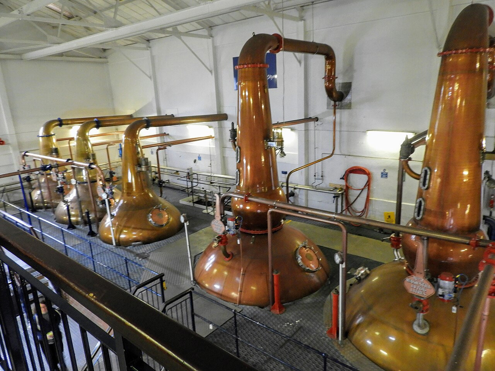

# Islands

The “Islands” of Scotch whisky are not a legal region but a grouping of island distilleries outside Islay, including Arran, Jura, Skye, Lewis and Orkney; styles range from light and floral to peated and maritime, so no single flavour defines them.

Figure: Copper pot stills at Talisker Distillery on the Isle of Skye. Image: Reading Tom, CC BY 2.0, via Wikimedia Commons ([source page](https://commons.wikimedia.org/wiki/File:Stills_at_Talisker_Distillery.jpg)).

## Definition and boundaries

Scotch whisky’s legal regions are Highland, Speyside, Islay, Lowland and Campbeltown; “Islands” is not legal, but a trade and consumer grouping of island distilleries outside Islay.

The group spans Arran, Jura, Skye, Lewis and Orkney, with styles from light floral to peated maritime. Treat “Islands” as a descriptive label, not a legal rank; distillery, peat level and age tell you more.

## History and naming

Island distilling grew with island farming, fishing, smuggling and local fuel; many distilleries date from the nineteenth century, and several have closed, reopened or been joined by new builds in the past two decades.

The name has no single statute, and distilleries sit in different administrative areas. The name boundary and the terroir boundary do not coincide; one island can hold peated and unpeated, maritime and floral styles.

## Geography and terroir

Island climates are wet and windy, warehouse humidity is high and maturation is usually slower than inland; sea air, salt spray and peat fuel influence materials and drying, though not every distillery uses peat.

Island terroir is ocean, peat, water and warehouse, not a vineyard slope. High humidity rounds the body and slows aroma; warehouses and batches within one distillery can still differ.

## Raw materials and styles

Malted barley is the base, and the level of peat drying sets the smoke; pot distillation and ageing vessels shape the body. Styles range from Arran’s light fruit and flowers and Jura’s oily maritime notes to Talisker’s pepper and peat and Highland Park’s heather honey and light peat.

Do not reduce the group to one “island flavour”. Read peat ppm, distillery location and ageing vessel first, then ABV and batch; those predict style better than the word Islands.

## Representative producers and bottlings

Representative distilleries include Arran, Jura, Talisker, Highland Park and Scapa; visits usually need ferries and booking, and some shorten hours in winter.

Judge a producer by its own malt versus purchased malt, peat source, stills and warehouse. Large brands may blend several distilleries; small ones stress single-distillery and batch differences.

## How to drink and pair

Start with peat intensity and ABV: light peat suits neat sipping or a little water, heavy peat opens with water; do not bury the smoke and sea air under a glass full of ice.

Pair with seafood, smoke and salt: smoked fish, oysters, salty cheese and dark chocolate meet the peat and maritime notes. Heavy peat plus heavy sweetness can clash; start with salt, then sip.

## Labels, buying and misreadings

Read the distillery name, peat or unpeated status, age, ABV, cask type and batch. “Islands” alone gives no legal guarantee; it is a style hint.

Common misreadings: treating Islands as a legal appellation, or assuming every island whisky is peated. The group is internally diverse; store upright, dark and at room temperature, and give heavily peated bottles time.

## Around and routes

Island routes usually start with a ferry from the Scottish mainland: Arran is convenient from near Glasgow, Islay and Jura need longer crossings, Orkney and Lewis are further.

Put ferry times, weather and bookings in the same plan; winter swell can change the schedule. One island and two distilleries is more realistic than island-hopping; local transport or a driver helps.

**In brief:** The “Islands” of Scotch whisky are not a legal region but a grouping of island distilleries outside Islay, including Arran, Jura, Skye, Lewis and Orkney; styles range from light and floral to peated and maritime, so no single flavour defines them.

For Islands, begin with the appellation and its permitted varieties. Then look at the vintage and the producer, and finally ask how the wine is labelled. The answers point to different choices, not to a single score.

[Scotland](ref:scotland) explains geographic boundary; [Barley](ref:barley) adds climate and soil. Put Islands between them before deciding what it is.

An administrative place name is not a safe shorthand for Islands. Check where its boundary lies, then which climate and legal category it has; where they diverge, prefer the specific source.

Island drinks often depend on imported spirits and local fruit, and the category overlaps with rum, fortified wine and liqueurs.

**Key facts.**

| Item | Detail |
| --- | --- |
| In one line | The “Islands” of Scotch whisky are not a legal region but a grouping of island distilleries outside Islay, including Arran, Jura, Skye, Lewis and Orkney; styles range from light and floral to peated and maritime, so no s… |
| Level | province or region |
| Parent | Scotland |
| Country code | GB |

**Sources and limits.** The key claims about Islands are checked against the following sources: The Scotch Whisky Association (that Highland includes the islands and the flavour differences between regions), UK Legislation (the statutory framework for regions and geographical indications in the Scotch Whisky Regulations 2009), VisitScotland (island distillery visits and island whisky-tourism background in Scotland). Prices, batches and status change; the body is project-written and does not reproduce source text.

## Further reading

Further reading: read the Islands along three axes—peat, maritime character and fruit/flower—rather than memorising island names. Peat comes first: unpeated Arran and heavily peated Talisker do not sit on the same coordinate. Maritime character comes next: Jura’s oil and sea air and Highland Park’s heather honey and light peat are two different island expressions. Fruit, flower and body come last: some distilleries are light, others broad. Crossing the axes explains why one island can hold internal differences. For visits, put ferry, weather and booking on one sheet: Arran is relatively easy, Islay and Jura need longer crossings, Orkney and Lewis suit multi-day trips. Do not island-hop for checkmarks; one island and two distilleries already give a comparison.

If you choose one island, decide the experience first: Arran works as a day trip from Glasgow, Jura and Islay reward an overnight stay, and Orkney or Lewis need a flight or a long ferry in the plan. Beyond the distillery, weather, food and walking routes are part of reading the style; sea air is not an abstract word—it shows up in warehouses, peat and daily life. Try a sample or distillery exclusive before committing to a full bottle; island batches are small and popular releases often sell out online first. Book ferries early in summer.

Small island batches often sell only at the distillery or online, so check stock and booking before travelling.

- Related: [scotland](ref:scotland), [whisky](ref:whisky), [barley](ref:barley), [distillation](ref:distillation), [peat-phenol-ppm](ref:peat).
- This page provides no map, prices or opening hours; confirm before travelling.
