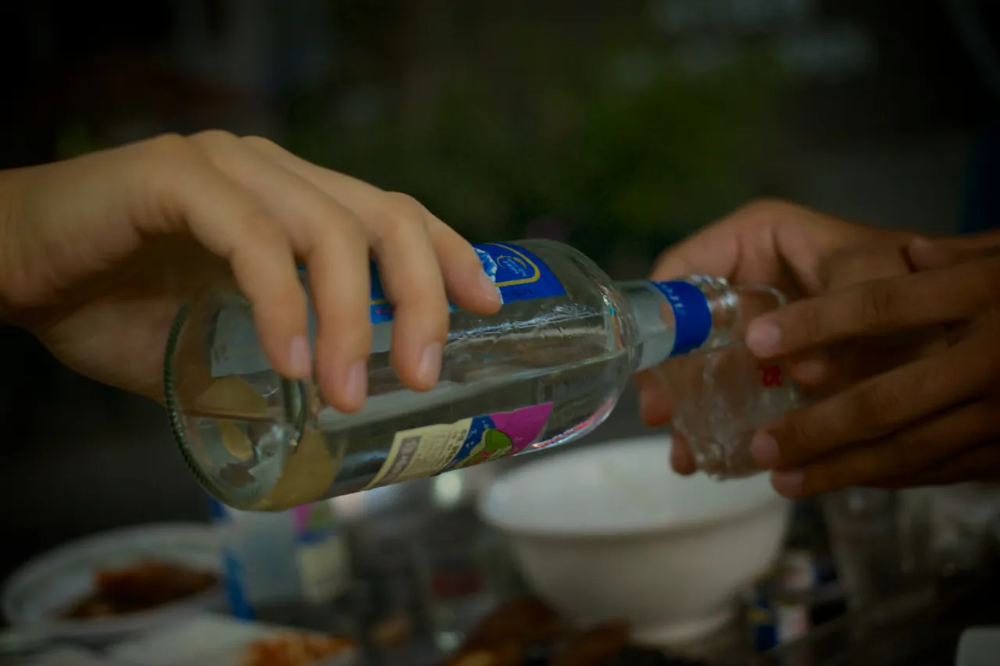
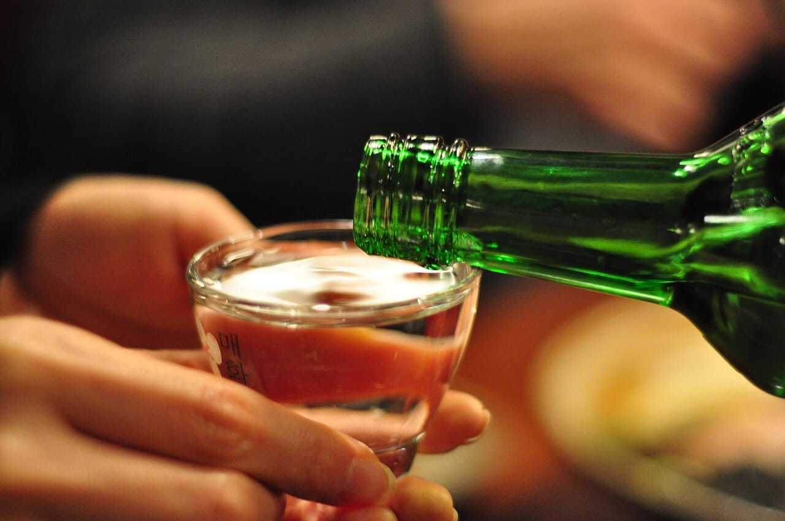

# Jeju

The soju and local-drink region of Jeju Island, South Korea, known for volcanic groundwater, rice and local ingredients such as citrus; Jeju soju is softer than mainland diluted soju, and the island’s volcanic terroir is closely tied to tourism.

Figure: Hallasan soju, a Jeju rice spirit, being poured at a table. Image: ecodallaluna, CC BY-SA 2.0, via Wikimedia Commons ([source page](https://commons.wikimedia.org/wiki/File:Hallasan_soju.png)).

## Definition and boundaries

Jeju is the soju and local-drink region of Jeju Island, known for volcanic groundwater, rice and local ingredients such as citrus; Jeju soju is usually softer than mainland diluted soju.

Here the “region” is an island and a local-drink tradition, not a wine-style parcel. Check the product type first—soju, makgeolli, fruit wine or craft beer—because materials, ABV and serving differ completely.

## History and naming

Jeju’s drink history is tied to island farming, fishing and rites; rice, citrus and seafood shape local food, and soju and rice wine have long been part of daily and guest hospitality.

After industrial diluted soju took the mass market, Jeju’s local drinks moved toward tourism and regional identity; volcanic groundwater and citrus became differentiators. The name Jeju is both an origin and a tourism brand.

## Geography and terroir

Jeju is a volcanic island, with Hallasan and volcanic-rock groundwater shaping a distinct water environment; water filtered through lava differs from the mainland in minerals and mouthfeel.

The island climate is moderated by the sea, humid in summer and mild in winter; fermentation temperature and warehouse humidity need control. Terroir here is water, volcanic soil and maritime climate, not a vineyard slope.

## Raw materials and styles

Soju uses rice or local materials, and some products add citrus, plum or herbs; makgeolli relies on a culture and a short fermentation, while fruit wines and craft beer use local citrus and other crops.

Styles run from soft rice-led soju to sweet-sour citrus liqueurs and crisp beer. Read ABV and sweetness first, then materials; do not treat every Jeju drink as the same local soju.

## Representative producers and bottlings

Representative brands include Jeju Soju, Hallasan and Jeju Beer; Jeju soju is one of the easiest entries to Korean regional drink.

Distinguish a large diluted-soju producer, a traditional local workshop and a small brewery; water, citrus share and materials set the style. Tourist areas carry many products at very different prices, so try a small bottle before buying a case.

## How to drink and pair

Soju is best chilled in small cups; makgeolli and fruit wine go colder, and beer follows normal serving. Do not shoot high-ABV soju; sip it with food.

Pair with Jeju seafood, black pork, citrus and fermented sides: grilled black pork, seafood stew, kimchi and citrus desserts can carry the body. Sweet fruit wine suits dessert and fruit; soju with heavy sweetness feels hotter.

## Labels, buying and misreadings

Read the product type (soju, makgeolli, fruit wine, beer), materials, ABV, producer and origin. A label that says only “Jeju” leaves the type unclear.

Common misreadings: assuming all Jeju soju is low-alcohol diluted soju, or assuming citrus flavour means real juice. Keep opened bottles cold and dark, finish makgeolli and fruit wine quickly; soju keeps longer but still loses aroma.

## Around and routes

A Jeju route can follow Hallasan, the coast and a distillery: the town is for buying and eating, distillery visits need booking, and east–west distances are real.

Self-driving is easiest, and public transport is limited; typhoons and winter swell can affect boats and outdoor plans. Choose one area and one distillery plus a local restaurant rather than circling the island.

For Jeju, begin with the appellation and its permitted varieties, then the vintage and the producer, and finish with how the wine is labelled; that order keeps the account grounded.

**Short definition:** The soju and local-drink region of Jeju Island, South Korea, known for volcanic groundwater, rice and local ingredients such as citrus; Jeju soju is softer than mainland diluted soju, and the island’s volcanic terroir is closely tied to tourism.

A frequent error is to treat Jeju as an administrative place name. Establish where its boundary lies, then which climate and legal category it has. Neither answer settles the question alone.

Sources for Jeju include Jeju Special Self-Governing Province, Korea.net, Jeju Economic Promotion Institute, Tokyo, Hallasan Soju.

Jeju soju uses volcanic groundwater and local rice, and the island's citrus and camellia add flavour to some products.

The island also makes citrus liqueurs and herbal wines from local fruit.

**Key facts.**

| Item | Detail |
| --- | --- |
| In one line | The soju and local-drink region of Jeju Island, South Korea, known for volcanic groundwater, rice and local ingredients such as citrus; Jeju soju is softer than mainland diluted soju, and the island’s volcanic terroir is… |
| Level | province or region |
| Parent | South Korea |
| Country code | KR |

**Sources and limits.** The key claims about Jeju are checked against the following sources: Jeju Special Self-Governing Province (Jeju Special Self-Governing Province's volcanic-island geography, groundwater and local-industry background), Korea.net (Jeju's traditional drinks (omegisul/gosorisul), Hallasan soju and the volcanic-rock groundwater account), Jeju Economic Promotion Institute, Tokyo (Hallasan soju's 1950 founding, Jeju upland rice ingredient and oak-cask-aged product information) and 4 sources in total. Prices, batches and status change; the body is project-written and does not reproduce source text.

For Jeju, this region was last checked in 2026; prices, batches and availability change, so confirm them against the sources below.

## Further reading

Further reading: the key to Jeju is not the phrase “volcanic island” but the combination of water, materials and product type. Volcanic groundwater affects mouthfeel and minerals, yet what decides the glass is whether it is diluted soju, traditional distilled soju, makgeolli or fruit wine. Mixing them yields empty words such as soft, citrus and tourism. A better comparison is in three groups: same type at different ABV; same type with different materials; same type from different producers. That shows what water and materials actually do instead of treating the place name as a flavour. For visits, separate Hallasan, the coast and the distillery; east–west distances are often underestimated, self-driving or a driver is more realistic than buses, and typhoon season needs a rebooking margin.

Jeju’s tourism narrative is strong, and the symbols—volcanic rock, citrus, haenyeo—can carry you away. Return to the label when buying: type, materials, ABV, producer and storage. Return to the glass when drinking: temperature, sweetness and food. Keeping symbols apart from products stops a plain diluted soju from being sold as volcanic terroir. For a distillery visit, confirm language, booking and transport; east and west Jeju do not fit one day, so stay central or split the trip. Buy the traditional distilled soju before the flavoured diluted one; it shows the local craft more clearly.

- Related: [south-korea](ref:south-korea), [soju](ref:soju), [rice](ref:rice), [fermentation](ref:fermentation), [terroir](ref:terroir).
- This region provides no map, prices or opening hours; confirm before travelling.

## Related images

Image: Category image for South Korea. Credit: Matt and Nayoung Wilson from Atlanta and surrounding, US, CC BY 2.0, via Wikimedia Commons ([source page](https://commons.wikimedia.org/wiki/File:Korean_distilled_liquor-Andong_soju-01.jpg)). Related image for Jeju.

Image: Soju. Credit: Graham Hills, CC BY 2.0, via Wikimedia Commons ([source page](https://commons.wikimedia.org/wiki/File:Soju.jpg)). Related image for Jeju.
