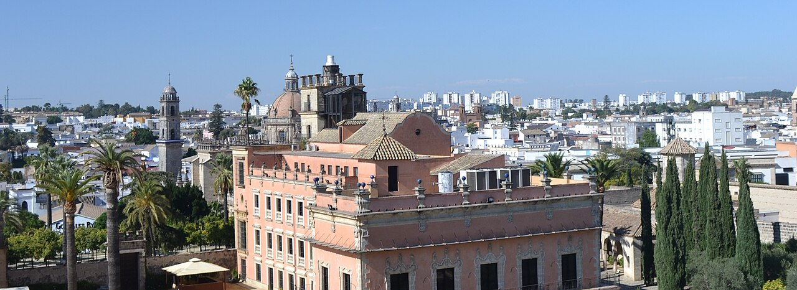

# Jerez

Jerez is a [fortified-wine](ref:fortified-wine) region in southern Cádiz, Andalusia, [Spain](ref:spain), comprising the Jerez-Xérès-Sherry and Manzanilla-Sanlúcar de Barrameda appellations. It is based on Palomino and aged in the solera and criaderas system.

Figure: Jerez. Image: Annie and Andrew, CC BY 2.0, via Wikimedia Commons ([source page](https://commons.wikimedia.org/wiki/File:(Jerez_de_la_Frontera)_DSC_0560_(6271831479)_(cropped).jpg)).

## Definition and scope

Jerez is not one appellation name but two neighbouring appellations: Jerez-Xérès-Sherry and Manzanilla-Sanlúcar de Barrameda. Both are managed by the same regulatory council, but Manzanilla has different requirements for where it is aged and how it tastes.

Sherry is the general English name for these wines. Labels may read Jerez, Xérès or Sherry; identity should be judged by the appellation name and wine type, not by the commercial name alone.

## History

Jerez's wine trade was closely tied to the British market in the modern era, which is how the word Sherry entered English. Appellation rules were built up during the 20th century, writing fortification levels, ageing methods and wine-type names into law.

The resulting system is unusually complete: from light dry Fino to rich Oloroso and sweet Pedro Ximénez, it covers everything from an aperitif to an after-dinner drink. Understanding this system matters more than memorising a brand.

## Geography and climate

The region lies at the southern tip of the Iberian Peninsula near the Atlantic, with a warm Mediterranean climate, hot summers, mild winters and mainly autumn and winter rain. Atlantic humidity and sea breezes affect the growth of flor in the cellars.

Soils are mainly the local white chalky albariza, which holds water well and crusts over at the surface, supplying moisture in the dry season. Jerez, Sanlúcar and El Puerto de Santa María are among the core localities, and their different humidity affects biological ageing.

## Varieties and ingredients

The main variety is Palomino Fino, which has low acidity and a neutral aroma and suits fortification and long ageing; sweet wines use Pedro Ximénez and Moscatel. The raw material is [grape](ref:grape).

Palomino yields must be controlled at ripeness to keep acidity, because fortification and oxidation further reduce freshness. Grapes for sweet wines are often sun-dried to raise sugar concentration.

## Winemaking and the ageing system

After the base wine completes [fermentation](ref:fermentation), it is fortified according to the target wine type and enters the ageing system. The solera is a stack of barrels: the bottom row is the solera, and the rows above are the first, second and further criaderas; when wine is drawn from the solera for bottling, it is replaced from the row above, and so on up the stack.

This "drawing and replenishing" (saca y reposición) keeps different vintages blending continuously and gives a stable style. Ageing uses [oak barrels](ref:oak-ageing), usually of modest size, and the Manzanilla rules require butts of no more than 1000 litres.

## Biological versus oxidative ageing

The dividing line starts with [alcohol by volume](ref:abv): base wine for biological ageing is fortified to about 15% vol, so flor yeast can form a film on the surface and, in the absence of oxygen, consume alcohol and oxygen while producing bread, almond and saline notes; base wine for oxidative ageing is fortified to at least 17% vol, flor cannot survive, and the wine contacts oxygen directly.

Biological ageing (crianza biológica) is represented by Fino and Manzanilla; oxidative ageing (crianza oxidativa) by Oloroso. Amontillado and Palo Cortado follow a sequential route, first biological and then oxidative: they age under flor, and after the flor declines the wine is fortified further and moves into oxidative ageing.

The legal minimum ageing is generally two years; Manzanilla must complete at least two years of biological ageing in cellars in Sanlúcar de Barrameda.

## Main wine types

- Fino: dry, biologically aged, about 15%–17% vol, pale, with almond, bread and saline notes, served chilled as an aperitif.
- Manzanilla: dry, biologically aged, made only in Sanlúcar de Barrameda, lighter and saltier than Fino, often with chamomile notes.
- Amontillado: first biological then oxidative, darker than Fino, with hazelnut and saline notes and usually higher alcohol than Fino.
- Oloroso: oxidatively aged, at least 17% vol, dark, with walnut, caramel and spice and a fuller body.
- Palo Cortado: first biological then oxidative, with aromas close to Amontillado and a body close to Oloroso, produced in small quantities.
- Pedro Ximénez and Moscatel: sweet, often from sun-dried grapes, high in sugar and rich on the palate.

## Labels and vintage

Labels usually carry the appellation name, wine type, alcohol, volume and bottler. The wine-type name is the key to style; Fino, Manzanilla, Oloroso and the others are not interchangeable.

"En rama" marks wines with less filtration, closer to the wine as it is in the cellar, but it is not a legal wine-type category. Most Jerez wines are non-vintage solera blends; a few carry a vintage.

## Market and drinking

Fino and Manzanilla are served chilled at about 7–10 degrees Celsius and should be finished soon after opening; Oloroso and Amontillado suit a slightly higher temperature of about 12–15 degrees Celsius.

Fino and Manzanilla suit seafood, olives, ham and fried food; Oloroso suits game, mushrooms, hard cheese and braised dishes; sweet wines suit desserts and blue cheese. Excessive drinking harms health and minors should not drink.

## Common misconceptions

First, treating Sherry as a sweet wine. Fino and Manzanilla are dry.
Second, conflating biological and oxidative ageing. Their fortification levels and flor conditions differ.
Third, treating Manzanilla as another name for Fino. It can be made only in Sanlúcar de Barrameda.
Fourth, thinking Amontillado is simply older Fino. It goes through a switch from biological to oxidative ageing.
Fifth, treating solera as a single aged wine. It is a multi-level system of continuous replenishment.

**In brief:** A fortified-wine region in southern Cádiz, Andalusia, Spain, comprising the Jerez-Xérès-Sherry and Manzanilla-Sanlúcar de Barrameda appellations; based on Palomino and aged in the solera and criaderas system, with biological ageing under flor and oxidative ageing producing Fino, Manzanilla, Amontillado, Oloroso and Palo Cortado.

**Key facts.**

| Item | Detail |
| --- | --- |
| In one line | A fortified-wine region in southern Cádiz, Andalusia, Spain, comprising the Jerez-Xérès-Sherry and Manzanilla-Sanlúcar de Barrameda appellations; based on Palomino and aged in the solera and criaderas system, with biolog… |
| Level | other |
| Parent | Spain |
| Country code | ES |

**Sources and limits.** The key claims about Jerez are checked against the following sources: Consejo Regulador (the region, varieties, fortification levels and biological and oxidative ageing routes), Junta de Andalucía (that Manzanilla must undergo at least two years of biological ageing in Sanlúcar de Barrameda), European Union (EU fortified-wine categories, geographical indications and labelling rules) and 5 sources in total. Prices, batches and status change; the body is project-written and does not reproduce source text.

## Further reading

- [Spain](ref:spain): the national framework to which Jerez belongs.
- [Fortified wine](ref:fortified-wine): the category and its process framework.
- [Grape](ref:grape): the basic structure of wine grapes and ripeness measures.
- [Fermentation](ref:fermentation): the basic step of base-wine production.
- [Oak ageing](ref:oak-ageing): the containers used in solera and criaderas.
- [Wine](ref:wine): an overview of wine categories, vintages and origin rules.
- [Alcohol by volume](ref:abv): what 15%–17% vol means in the biological and oxidative routes.

## Related images

Image: Fortified wine. Credit: Jon Sullivan, Public domain, via Wikimedia Commons ([source page](https://commons.wikimedia.org/wiki/File:Port_wine.jpg)). Related image for Jerez.

Image: Uga - Lanzarote - Spain. Vineyards -U16. Credit: Luis Miguel Bugallo Sánchez, CC BY-SA 3.0, via Wikimedia Commons.. Credit: Luis Miguel Bugallo Sánchez, CC BY-SA 3.0, via Wikimedia Commons ([source page](https://commons.wikimedia.org/w/index.php?curid=17458062)). Related image for Jerez.
