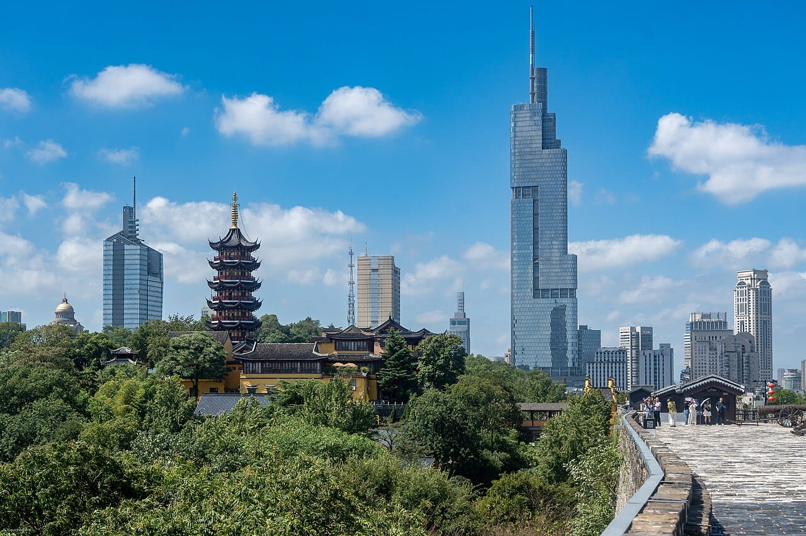

# Jiangsu Province

Jiangsu lies on the east coast of China along the lower Yangtze. In the map of alcoholic drinks it has both a strong aroma baijiu industry, represented by Yanghe and Shuanggou, and yellow wine traditions represented by Danyang sealed-jar wine and Wuxi Huiquan wine. This region focuses on the yellow wine regions and mentions baijiu only where necessary.

Figure: Jiangsu Province. Image: xiquinhosilva, CC BY 2.0, via Wikimedia Commons ([source page](https://commons.wikimedia.org/wiki/File:Nanjing_CBD_from_City_Wall.jpg)).

## Geography and climate

Jiangsu is flat and densely covered with waterways, with the Yangtze and the Grand Canal running north to south through the province. The climate is monsoon, transitional from subtropical to warm temperate, with four distinct seasons, hot and humid summers, mild winters, and rain concentrated in the plum rain season and high summer.

Waterways and climate act directly on yellow wine: high humidity and moderate temperatures help [fermentation](ref:fermentation) start and keep the mash stable, while the damp plum rain season also brings mould and souring risk, so workshops and factories manage qu-room humidity and load grain in batches. Water quality and rice variety are the base variables of Jiangsu yellow wine style.

## History

The yellow wine tradition of Jiangsu is bound up with rice farming, canal transport and urban consumption. Danyang sits on the lower Yangtze and was historically a grain and wine trading centre; around Wuxi, workshops and famous wines were already recorded in the Ming and Qing periods, and Huiquan wine appears often in literati writing.

In the twentieth century, nationalisation and industrialisation merged some traditional workshops and raised output. After reform and opening, shifts in the low-alcohol and sweet-wine markets brought new competition to traditional yellow wine, while local famous wines such as sealed-jar wine regained attention through tourism and the gift market.

## Yellow wine regions

Danyang and Wuxi are the most representative yellow wine areas of Jiangsu. Danyang is known for sealed-jar wine, Wuxi for traditions such as Huiquan wine. Both sit in the lower Yangtze rice belt with similar materials and water, but differ in qu, sweetness and ageing.

For Jiangsu Province, place names describe tradition and process origin, not quality grades. Within one area, producers differ clearly in material ratios, qu and ageing time; taking a place name as a quality guarantee ignores those differences.

## Raw materials and process

Jiangsu yellow wine uses [glutinous rice](ref:glutinous-rice) as its main material, wheat qu made from [wheat](ref:wheat) as the saccharifying and fermenting agent, and [water](ref:water). Glutinous rice is high in branched starch and gives a soft, rounded mouthfeel after saccharification; wheat qu brings strong saccharifying power and qu aroma, a key difference from Fujian hongqu yellow wine.

See the general principles of [qu making](ref:qu-making). The process covers steeping the rice, steaming, cooling, mixing with qu, jar [fermentation](ref:fermentation), pressing, clarification, pasteurisation and storage. The distinctive step of sealed-jar wine is sealing the liquid in jars during fermentation or ageing, which limits oxidation and spoilage and preserves sugar and aroma.

## Style and types

Jiangsu yellow wine is mainly semi-dry and sweet. Semi-dry types are fresher and suit meals; sweet types carry more sugar and a fuller body and are better as dessert or after-dinner drinks. Danyang sealed-jar wine is a sweet type, often deep brown, with aromas of caramel, rice and qu.

For Jiangsu Province, under GB/T 13662-2018, Yellow wine, the category is divided by sugar content and process, and labels state the type and alcohol content. Sweetness is a style description, not a quality ranking; treating sweet as inferior, or dry as superior, misreads the category.

## Representative products and producers

Danyang sealed-jar wine is the representative sweet yellow wine of Jiangsu, made from glutinous rice, wheat qu and water and finished by sealed ageing. Wuxi Huiquan wine is a traditional famous wine with a long written record, and modern products are mainly semi-dry or sweet. Jiangsu has other yellow wine and baijiu producers, and specific products are covered on the drink pages.

This region page describes geography, materials and the regulatory frame and does not rate individual brands. Company scale, vintage and bottling batch decide more about a bottle than a place name does.

## Regulation and regional protection

Production and labelling of Jiangsu yellow wine fall under food safety rules and national standards. GB/T 13662-2018, Yellow wine, sets terminology, classification, technical requirements and labelling; GB/T 17204-2021, Terminology and classification of alcoholic beverages, governs beverage classification. The current texts govern in detail.

For Jiangsu Province, geographical indications and protection of local famous wines involve origin range, process and material requirements. On a label, distinguish origin, type, alcohol content and producer; the use of a local famous name also follows the relevant rules.

## Market and drinking

Jiangsu yellow wine is sold mainly locally and also reaches outside markets through e-commerce and restaurants. Semi-dry types suit river fish, braised foods and home cooking; sweet types suit desserts or after-dinner drinking. Cooking wine and drinking wine have different quality requirements and are not interchangeable.

For Jiangsu Province, semi-dry types can be served at room temperature or gently warmed, sweet types slightly chilled. After opening, keep the bottle chilled and drink it soon to avoid oxidation. Excessive drinking is harmful to health, and minors should not drink.

## Common misconceptions

First, assuming Jiangsu only makes baijiu. It also has yellow wine traditions such as Danyang sealed-jar wine and Wuxi Huiquan wine.
Second, treating sealed-jar wine as a compounded liquor. It is a yellow wine, and sealing describes the ageing method.
Third, believing darker colour means older wine. Colour depends on materials, qu and ageing, and cannot stand alone as evidence.
Fourth, treating a place name as a grade. Danyang and Wuxi describe tradition and origin, not a guarantee for every bottle.
Fifth, assuming sweet yellow wine is always low in alcohol. Sweetness and alcohol content are separate, and the label is the reference.

Start with the appellation and its permitted varieties. From there, consider the vintage and the producer, then how the wine is labelled. That is how a practical judgment about Jiangsu Province is built.

The comparison with [China](ref:china) and [Glutinous rice](ref:glutinous-rice) runs through geographic boundary and climate and soil. Each answers a different question.

**Short definition:** An eastern coastal province and one of China's important yellow wine regions; Danyang sealed-jar wine uses glutinous rice and wheat qu with sealed ageing for a sweet style, and Wuxi has traditions such as Huiquan wine.

## Further reading

- [China](ref:china): the geographic and regulatory frame for Chinese drinks.
- [Yellow wine](ref:yellow-wine): definition, classification and process.
- [Glutinous rice](ref:glutinous-rice) and [wheat](ref:wheat): the base material and the qu material of Jiangsu yellow wine.
- [Water](ref:water): how water quality shapes yellow wine style.
- [Qu making](ref:qu-making) and [fermentation](ref:fermentation): wheat qu and jar fermentation.

## Related images

Image: Glutinous rice. Credit: 국립국어원, CC BY-SA 2.0 kr, via Wikimedia Commons ([source page](https://commons.wikimedia.org/wiki/File:Chapssal_(glutinous_rice).jpg)). Related image for Jiangsu Province.

Image: Wheat. Credit: kallerna, CC BY-SA 4.0, via Wikimedia Commons ([source page](https://commons.wikimedia.org/wiki/File:Vehn%C3%A4pelto_6.jpg)). Related image for Jiangsu Province.
