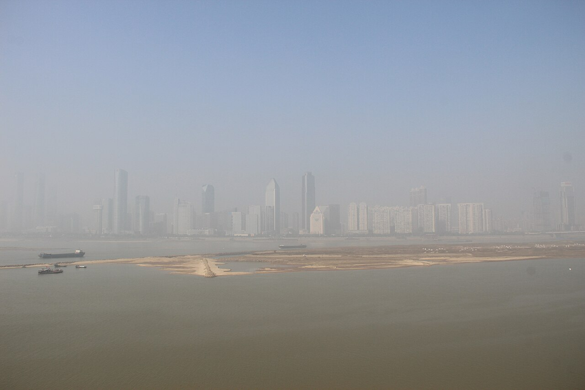
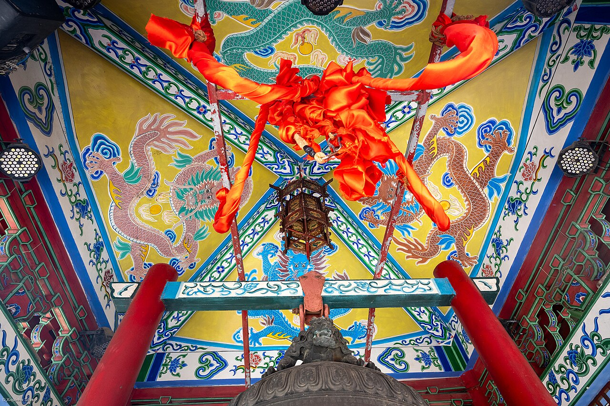
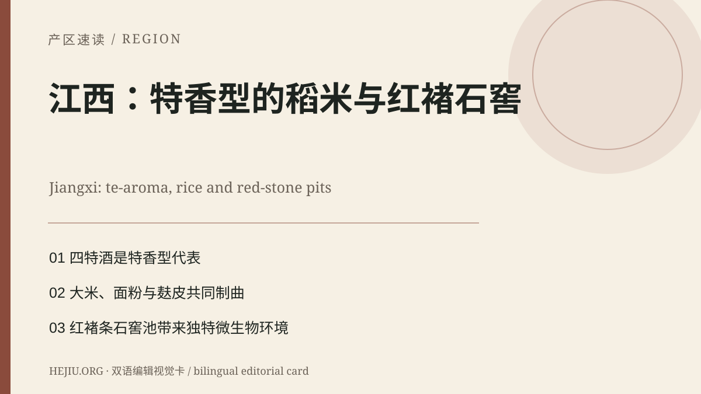
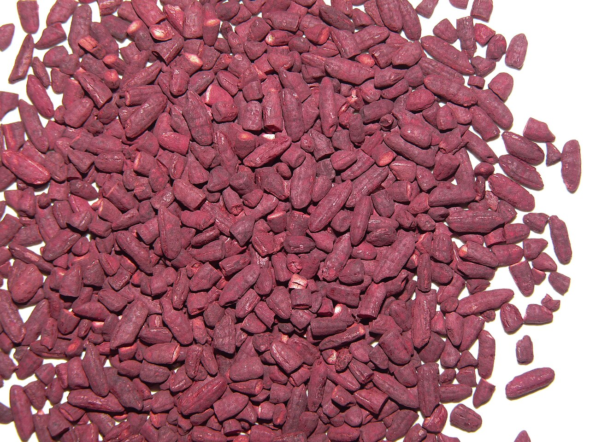

# Jiangxi

Jiangxi lies south of the middle-lower Yangtze, ringed by mountains on the east, south and west, with the Poyang Lake plain in the north. The Gan River runs through the province from south to north. Red soils, hills, rice fields and abundant rain create a classic Jiangnan agricultural landscape and a long base for rice-based brewing.

The province's most distinctive baijiu coordinate is Site and te-aroma. It does not win on pit aroma like strong aroma, nor on pure cleanness like light aroma; it combines some features of strong, light and sauce. The key is to understand that "composite" is not "mixed", and how a rice base supports the style.

Figure: The Gan River seen from Tengwang Pavilion, the relationship between Jiangxi's waterways and cities. Image: Gary Todd from Xinzheng, China, CC0, via Wikimedia Commons ([source page](https://commons.wikimedia.org/wiki/File:Gan_Jiang_River_Viewed_from_Top_of_Tengwangge_(Prince_of_Teng_Pavilion)_(31431802671).jpg)).

## Geography and climate

Jiangxi has a subtropical monsoon climate: hot wet summers, damp cold winters, short spring and autumn. The Poyang Lake plain is a web of water; southern, eastern and western Jiangxi are mountainous and hilly; central Jiangxi contains the Jitai basin. The terrain supports both large-scale rice farming and relatively closed local brewing traditions.

Heat and humidity help microbes but demand tighter control of starter rooms, pits and warehouses. Zhangshu, home of Site, sits where the central plain meets hills, with river transport and rice supply. The mountains of southern and eastern Jiangxi retain more rice wine, glutinous rice wine and local small-quar traditions.

Figure: Tengwang Pavilion in Nanchang, a landmark of Gan culture and Jiangnan architecture. Image: xiquinhosilva, CC BY 4.0, via Wikimedia Commons ([source page](https://commons.wikimedia.org/wiki/File:%E6%BB%95%E7%8E%8B%E9%98%81_2024-08-05_12.jpg)).

## History

Jiangxi's brewing tradition is tied to rice farming, river transport, merchant groups and the medicine-trade culture of Zhangshu. Zhangshu was a historical centre of medicinal materials and commerce, with developed food and fermentation trades. Site was brought into state ownership and industrial production in the twentieth century and gradually became the province's representative baijiu. Lidu and Zhanggongwang, in Jinxian and Ganzhou, form another layer.

Jiangxi is also a red-culture region, and local narratives often combine mountains, rice fields, old pits and handmade brewing. Brand story is not quality; consumers still return to materials, craft, aroma type and price.

## Aroma and style

The representative aroma is te-aroma. It is usually described as combining strong, light and sauce qualities: a bright body, composite aroma, mellow sweetness and a long finish. It is not a proportional blend of three base liquors; materials, starter, fermentation, distillation and storage create the composite profile.

Strong and light aroma also have markets in Jiangxi, but te-aroma is most recognisable. Rice wine, glutinous rice wine and yellow rice wine sit closer to rice-based foodways. Treating te-aroma as "strong plus sauce" ignores its independent route through materials and craft.

Figure: Jiangxi: te-aroma, rice and red-stone pits. Project-generated bilingual editorial card; schematic, not a photograph.

## Raw materials and craft

Te-aroma baijiu uses rice as the main material, with water and composite starter for starter-making, solid-state fermentation, distillation and blending. Rice makes the body cleaner and sweeter; composite starter and pit microbes add aromatic complexity. Compared with sorghum-based baijiu, the grain note is lighter and the texture softer.

Fermentation temperature, pit material and storage time change the degree of composite aroma. Ingredients, aroma type, strength and standard on the label are the shortest path to judging a bottle. Do not stop at the word "te-aroma"; products from different plants vary widely.

Figure: Starter culture grows microbes and enzymes and sets the direction of fermentation; te-aroma uses rice, flour and bran. Image: Uranassbandit, CC BY-SA 3.0, via Wikimedia Commons ([source page](https://commons.wikimedia.org/wiki/File:Hongqu_3.jpg)).

## Representative bottles and local memory

Site is the representative te-aroma baijiu from Zhangshu, made mainly from rice, with products from mass to premium. Lidu, from Jinxian, Nanchang, builds its story on a Yuan-era distillery site; Zhanggongwang, from Ganzhou, represents southern Jiangxi baijiu. Their aroma types, prices and channels differ; check the specific product.

Jiangxi also has glutinous rice wine, rice wine, bayberry wine and local small-quar liquor. Rice wine in Hakka southern Jiangxi accompanies stuffed tofu and salt-baked chicken; rice wine around Poyang Lake is closer to daily dining. For visitors, sealed bottled products are easier to trace and store than bulk liquor.

## Market and drinking

Baijiu consumption centres on banquets, business, gifts and daily dining. Te-aroma carries more premium conversation; the mass band is led by strong, light and local products. Jiangxi food is spicy, savoury and oily; heat amplifies alcohol. Te-aroma and strong aroma can partner heavier dishes; rice wine and lower-strength drinks suit cold plates, rice noodles and home cooking.

Drink high-strength baijiu in small cups and slowly; keep opened bottles sealed, dark and cool. Rice wine and yellow rice wine oxidise after opening and should be refrigerated and finished quickly. "Te-aroma is softer" is not a reason to overdrink.

## Rules and regional protection

Baijiu production is governed by food-safety rules and national standards. GB/T 15109-2021 defines terms for starter, fermentation and distillation; GB/T 17204-2021 sets classification and terminology. The te-aroma name, geographical indications and company standards must follow their rules. On a label, separate ingredients, aroma type, strength and producer.

## Climate and drinks structure

| Area | Climate and landform | Main drinks | What to check when buying |
| --- | --- | --- | --- |
| Poyang Lake plain | Wet plain, dense water | Rice wine, strong aroma baijiu | Ingredients, standard, producer |
| Central Jiangxi (Zhangshu, Ji'an) | Basin and hills | Te-aroma baijiu | Aroma, standard, batch |
| Southern Jiangxi (Ganzhou) | Mountains and hills, Hakka area | Rice wine, local baijiu | Sweetness, strength, storage |
| Eastern Jiangxi (Shangrao, Jingdezhen) | Mountains and river valleys | Rice wine, local small-quar liquor | Ingredients and traceability |
| Provincial cities | Concentrated consumption | Baijiu, rice wine, beer | Channel and price band |

The table is a macro comparison, not a substitute for a distillery's craft. One city can host both traditional rice-wine households and modern plants.

## Common misconceptions

First, Jiangxi only has te-aroma. Strong, light and local aromas also exist, alongside rice wine and yellow rice wine.

Second, te-aroma is simply strong plus sauce. It is an independent composite route built from materials, starter, fermentation and storage.

Third, rice-based baijiu is always light. Rice can produce a clean body, but strength and craft still vary; read the label.

Fourth, old pit stories prove quality. A pit site is heritage; the product's materials, batch and standard still decide what is in the bottle.

Fifth, spicy Jiangxi food needs high-strength liquor. Heat amplifies alcohol; lower-strength drinks and water can work better.

## Comparing and buying te-aroma baijiu

Te-aroma is difficult because it carries some features of strong, light and sauce aromas at once: the nose has cellar and grain notes, the entry is clean and crisp, and the finish returns a little sauce-like toast. Calling it a simple "three-aroma blend" misses the point: the structure comes from rice, wheat and bran qu, and the red-stone cellar, not from pasting three styles together.

The most useful exercise is a comparison tasting: at one price point, set a strong-aroma, a light-aroma and a te-aroma bottle side by side and record nose, entry and finish. Te-aroma usually has a broader entry and a longer finish, but less overt aromatic lift than strong aroma; if you only look for an explosive first impression, you may wrongly call it "light". With Jiangxi food, clay-pot soup, steamed pork with rice flour and stir-fried bacon with artemisia suit the middle; for Nanchang rice noodles and hot stir-fries, take smaller sips.

Roughly RMB 100–300 is everyday, RMB 300–800 is banquet and gift, and above RMB 800 is flagship territory. Si Te, Lidu and Zhanggongwang each have very different product lines; compare the specific bottle and age statement, not the brand name alone. Check the standard code, production date and anti-counterfeit information. "Internal supply" or "old-wine blend" without a verifiable batch is not a reason to pay more.

A Jiangxi visit can link Zhangshu, Nanchang and Poyang Lake: Zhangshu for qu-making and cellars, Nanchang for the market and restaurants, Poyang Lake for rice farming and water. Distillery tours and tastings usually need booking; follow the company's current official schedule.

## Common questions

**What is te-aroma?** A baijiu aroma type associated with Jiangxi, often described as combining strong, light and sauce features. It is formed by materials, composite starter, fermentation, distillation and storage, not by blending three liquors.

**Is Site the only te-aroma brand?** It is the representative, but other producers also make te-aroma products. Check the specific bottle's producer, standard and strength.

**What is Lidu's connection to the Yuan dynasty?** Its brand narrative draws on a Yuan-era distillery site in Jinxian. Archaeology supports the site's importance; it does not by itself certify every modern bottle.

**How should Jiangxi rice wine be served?** Chilled or warmed depending on the product, often in small cups; sweet glutinous rice wine suits festivals and cooking. Refrigerate after opening.

**What pairs with Jiangxi food?** Spicy, savoury and oily dishes can take te-aroma or strong aroma; cold plates, rice noodles and lighter dishes suit rice wine or lower-strength drinks. Do not use high strength to fight heat.

## Further reading

- [China](ref:china): Jiangxi's place in Chinese drinks geography.
- [Te-aroma](ref:te-aroma): the province's defining baijiu route.
- [Strong aroma](ref:strong) and [light aroma](ref:light): neighbouring style families.
- [Rice](ref:rice) and [water](ref:water): the material base.
- [Starter culture](ref:qu), [solid-state fermentation](ref:solid), [distillation](ref:distillation) and [blending](ref:blending): craft terms.
- [Te-aroma](ref:te-aroma) and [solid-state fermentation](ref:solid): representative style and process.

**Key facts.**

| Item | Detail |
| --- | --- |
| One-line position | A rice-based Jiangnan province defined by te-aroma and its composite fragrance |
| Level | Province / macro-region |
| Part of | China |
| Country code | CN |
| Representative clues | Site, Lidu, Zhanggongwang, local rice wine |

**Sources and scope.** Geography, aroma and craft information was cross-checked against the Jiangxi Provincial People's Government portal, national standards, the China Alcoholic Drinks Association and The Oxford Companion to Spirits and Cocktails. Brand details and prices change; use current official information. The body is project-written; sources are for verification, not copied text.
