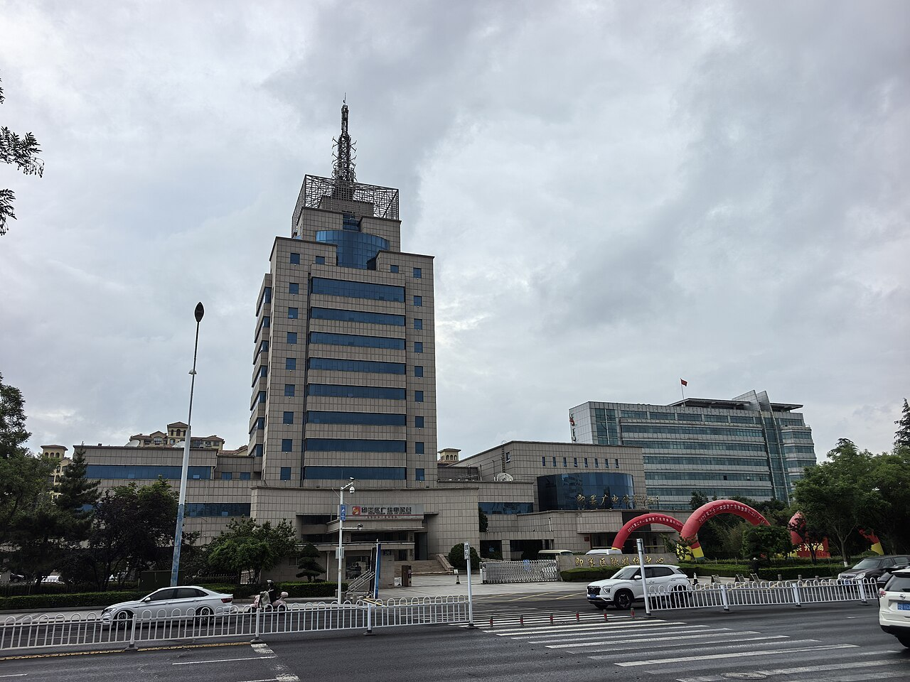

# Jimo

Jimo is in the southwest of the Shandong Peninsula and is now the Jimo District of Qingdao. It is the representative region for northern millet huangjiu. Local production combines millet, summer-made aged wheat qu and the jiaomi method to create a style distinct from the glutinous-rice huangjiu of [Shaoxing](ref:shaoxing). [Jimo Laojiu](ref:jimo-laojiu) is the most representative product of this tradition.

Figure: Jimo. Photograph: Jimo District Converged Media Center in Qingdao, Shandong, China 20260607. Credit: 4084470 0.smil, CC BY 4.0, via Wikimedia Commons ([source](https://commons.wikimedia.org/w/index.php?curid=194207475)).

## Geography and tradition

Jimo faces the Yellow Sea to the east and has a temperate monsoon climate with four distinct seasons. That climate shaped a rhythm of making qu in summer and brewing in autumn and winter, and made millet a stable staple. Jimo Laojiu is a [huangjiu](ref:yellow-wine), not a distilled spirit, a point often confused by consumers in the north.

Local huangjiu production has a long history, but accounts of its exact origin are not consistent, so local gazetteers and producer disclosures are the better reference. Local practice is summarised as the six methods handed down from antiquity, a verbal summary of tradition rather than a legal grade or standard classification.

## Millet as the main material

Jimo Laojiu uses millet, also called yellow millet, as its main material. Millet is sticky and its starch is mostly amylopectin, so it gelatinises easily after cooking and suits a thick porridge-like mash. Compared with glutinous rice, millet brings a stronger cereal note and a toasted quality, which is the starting point of the northern huangjiu difference.

Preparation includes steeping and cooking the mash. Steeping lets the grains absorb water evenly, and cooking gelatinises the starch for easier saccharification. Grain age, steeping time and heat all affect later fermentation and yield.

## Summer-made aged wheat qu

Jimo Laojiu uses summer-made aged wheat qu. The qu is made during the hottest part of summer and stored for ageing before use, hence the name. Heat and humidity in that season favour mould growth, while ageing stabilises enzyme activity and the microbial community.

[Qu making](ref:qu-making) remains the first gate of this process route. The saccharifying power, fermenting power and aroma contribution of the qu determine whether the mash converts well. If qu quality is unstable, later temperature control cannot fully compensate.

## The jiaomi method

The jiaomi method is the most recognisable step in Jimo Laojiu. Millet is cooked into a mash, the bottom of the vessel becomes hotter and partially scorches, and a toasted aroma forms. This single step combines gelatinisation with part of flavour development, which differs from the cool-and-spread approach of Shaoxing wine.

Heat control is the key to the jiaomi method. Too little scorching gives a weak toasted note, while too much lets bitterness and a burnt quality overwhelm the body. Traditional practice judges the bottom of the vessel and the thickness of the mash by experience, while modern production uses equipment and parameters for consistency.

## Flavour and types

Jimo Laojiu is usually reddish-brown to dark brown, with toasted, rice and qu aromas and a full, sweet-leaning palate. By sugar level, products usually fall in the semi-sweet or sweet range, and the actual type should follow the label and the standard applied.

GB/T 13662-2018, Huangjiu, classifies huangjiu by total sugar and sets corresponding technical requirements and test methods. Strength also follows the label; products under the same brand may combine different strengths and sugar levels at different price points.

Under that total-sugar classification, huangjiu is divided into dry, semi-dry, semi-sweet and sweet categories, with boundaries expressed as grams of total sugar per litre; higher sugar usually means a fuller body and different advice on storage and serving temperature. Because millet starch is rich in amylopectin and the jiaomi step leaves more dextrin, Jimo Laojiu usually falls in the semi-sweet to sweet range; the same producer may also make drier products for different cuisines. Whether caramel colour or food-medicine ingredients are used is information the label should disclose, and the exact total-sugar figure follows the bottle label.

## Standard and labelling

As a huangjiu product, Jimo Laojiu should show the standard applied, sugar type, strength, net content and producer information on the label. Reading laojiu as aged baijiu confuses huangjiu with a distilled spirit; lao here refers more to traditional craft and an aged style.

Vintage and ageing statements mean different things across companies. Buyers should combine the label, producer notes and price band rather than infer quality from the words laojiu alone.

## Common misconceptions

First, treating Jimo Laojiu as baijiu. It is a fermented huangjiu and is not distilled.
Second, assuming the toasted note comes from added caramel colour. The main toasted character comes from scorching at the bottom of the vessel during the jiaomi step, while whether caramel colour is used depends on the label.
Third, assuming darker colour means older wine. Colour depends on raw material, degree of scorching and ageing, and cannot date a wine alone.
Fourth, assuming all northern huangjiu tastes the same. Jimo's millet and jiaomi method differ clearly from Shaoxing's rice and tanfan method.
Fifth, treating the six methods handed down from antiquity as a legal grade. It is a summary of traditional experience, not a standard classification.

**At a glance:** A glutinous-millet huangjiu region in the southwest of the Shandong Peninsula, now part of Qingdao. Millet, summer-made aged wheat qu and the jiaomi method give a toasted, full-bodied northern huangjiu. 

Read Jimo through the appellation and its permitted varieties, then the vintage and the producer, and finally how the wine is labelled. The sequence matters.

Read [China](ref:china) for the geographic boundary side of Jimo, and [Jimo Laojiu](ref:jimo-laojiu) for the climate and soil side. Together they locate it.

**Key facts.**

| Item | Detail |
| --- | --- |
| In one line | A glutinous-millet huangjiu region in the southwest of the Shandong Peninsula, now part of Qingdao. Millet, summer-made aged wheat qu and the jiaomi method give a toasted, full-bodied northern huangjiu. |
| Level | other |
| Parent | China |
| Country code | CN |

**Sources and limits.** The key claims about Jimo are checked against the following sources: State Administration for Market Regulation; Standardization Administration of China (classification, sugar types and technical requirements for huangjiu; no standard text is reproduced), Jimo District People's Government of Qingdao (administrative divisions and public local profile), China Alcoholic Drinks Association (Used to check industry terms and regional descriptions; no association text is reproduced) and 5 sources in total. Prices, batches and status change; the body is project-written and does not reproduce source text.

For Jimo, this page was last checked in 2026; prices, batches and availability change, so confirm them against the sources below.

## Further reading

- [Huangjiu](ref:yellow-wine): the definition, classification and process overview.
- [Jimo Laojiu](ref:jimo-laojiu): a representative product page for this region.
- [Qu making](ref:qu-making): the microbial and enzyme basis of wheat qu.
- [Shaoxing](ref:shaoxing): a contrasting rice-based huangjiu region.
- [GB/T 13662-2018 Huangjiu](ref:gbt-13662-2018): the standard basis for classification and technical requirements.
- [China](ref:china): the national regional background.
