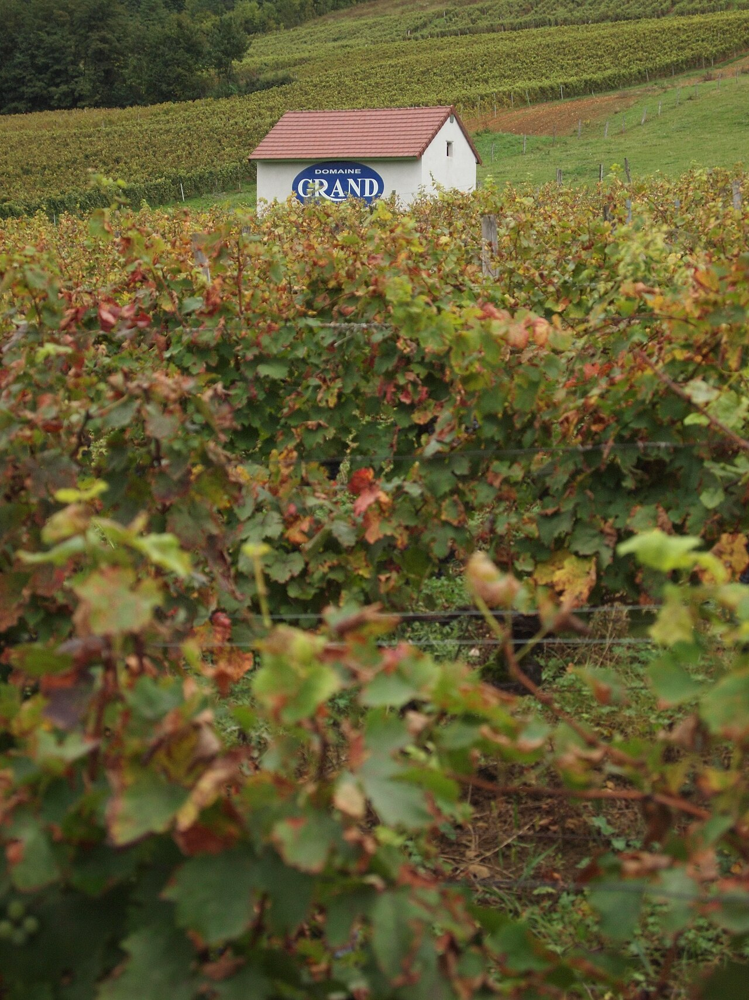

# Jura

Jura is a narrow wine region in eastern France, squeezed between Burgundy and the Swiss border. It is best remembered for vin jaune: a white wine made from Savagnin, aged in old oak barrels without topping up or racking, under a film of yeast, for more than six years. But Jura is not only vin jaune. Light-coloured reds from Poulsard and Trousseau, "non-oxidative" whites from Chardonnay and Savagnin, vin de paille and sparkling wine together make a region with very specific varieties and rules.

Figure: Jura. Photograph: File:Bodegas Grand vineyard in Passenans, Jura, France.jpg. Credit: Francisco Gonzalez, CC BY 2.0, via Wikimedia Commons ([source](https://commons.wikimedia.org/w/index.php?curid=25637605)).

## Geography: an 80-kilometre north-south band

Jura vineyards run about 80 kilometres north to south, on slopes between 250 and 450 metres, mainly in the Jura department and partly in Doubs. The western side is the limestone fold of the Mont Jura, and the eastern side gradually gives way to the Swiss plateau. The northern end approaches Alsace and Franche-Comté, and the southern end lies near Lyon and Burgundy. Main towns include Arbois, Lons-le-Saunier, Château-Chalon and L'Étoile.

## Climate: continental with mountain influence

Jura has a continental climate: cold winters, warm summers, large day-night temperature swings and a slightly shorter growing season than Burgundy. The mountains block part of the Atlantic influence and make autumn cooler, which keeps acidity high and stretches ripening. Frost, hail and harvest rain are the main risks, especially on higher parcels.

## Soils and slope: marl and limestone

Jura soils are mainly limestone, marl and scree, especially the grey marl of the Lias period, which is considered an important source of the vin jaune style. Slopes drain well and have thin topsoil, so roots go deep; south or south-east facing parcels are warmer and suit Poulsard and Trousseau, while north-facing or high-altitude parcels keep more acidity and suit fresh whites.

## Legal framework: six main AOCs

The main Jura AOCs are Arbois (1936), Château-Chalon (1936), Côtes du Jura (1937), L'Étoile (1937), Crémant du Jura (1995) and Macvin du Jura (1991). Arbois is the largest and makes red, white and rosé; Château-Chalon makes only vin jaune; L'Étoile is mostly white and also makes vin de paille; Crémant du Jura is sparkling; Macvin is fortified. Arbois also has the geographical name Arbois Pupillin.

## Vin jaune: 60 months and 6 years 3 months

The rules for vin jaune are precise: only Savagnin, aged in old oak barrels without topping up, with a yeast veil on the surface, at least 60 months under the veil and at least 6 years 3 months from harvest before bottling. The finished wine uses the 62 cl clavelin bottle, which is a legal capacity rather than a marketing choice. Vin jaune commonly shows nuts, curry, beeswax, citrus peel and savoury notes, with high acidity, and it oxidises quickly once opened.

## Other styles: non-oxidative white, pale red and vin de paille

Non-oxidative, or ouillé, whites are mainly Chardonnay and Savagnin and sit closer to Burgundy: citrus, white flowers, hazelnut and minerality. Reds are mainly Poulsard, Trousseau and Pinot Noir, pale in colour, light in tannin and high in acidity, often with red cherry, cranberry, pepper and earth. Vin de paille is made from dried grapes, with high sugar and low yield; Macvin is fortified with grape spirit.

## Producers

Leading Jura producers include Jean-François Ganevat in La Châtelaine, Stéphane Tissot in Arbois, Domaine de la Pinte in Arbois, Domaine Rolet in Arbois, the Fruitière Vinicole d'Arbois, Michel Gahier in Arbois and the retired Jacques Puffeney. They represent natural, traditional, cooperative and small-grower routes, with wide stylistic differences.

## Vintages and market

Jura has about 2000 hectares of vines and produces small volumes, long centred on the French domestic market and a fine-wine export market. Vintage variation comes mainly from frost, hail and harvest rain; vin jaune and vin de paille need years of ageing and usually cost more than ordinary reds and whites. Export markets are led by Japan, the United States, northern Europe and the United Kingdom, and prices for top vin jaune and Trousseau have risen clearly over the past decade.

## Drinking and pairing

Serve vin jaune at 12-14℃ with nuts, mushrooms, foie gras, Comté and curry dishes; non-oxidative whites with seafood, poultry and cream sauces; Poulsard and Trousseau at 14-16℃ with charcuterie, grilled meat and game. Vin jaune should be refrigerated and drunk soon after opening, without long exposure to air.

## Common misconceptions

First, treating vin jaune as an ordinary white wine; it undergoes long oxidative ageing, so its flavours and storage needs differ. Second, thinking Jura makes only vin jaune; it also makes red, white, sparkling and fortified wines. Third, conflating Jura with Burgundy; they are neighbours but have different varieties and regulatory systems. Fourth, assuming vin jaune improves indefinitely with age; oxidation accelerates decline after opening. Fifth, treating the 62 cl clavelin as an ordinary bottle size; it is the legal format for vin jaune.

For Jura, begin with the appellation and its permitted varieties. Then look at the vintage and the producer, and finally ask how the wine is labelled. The answers point to different choices, not to a single score.

[France](ref:france) and [White wine](ref:white-wine) are the two useful reference points for Jura. [France](ref:france) sets out geographic boundary; [White wine](ref:white-wine) brings in climate and soil. Read them together.

**At a glance:** A wine region in eastern France between Burgundy and Switzerland, known for limestone and marl slopes and local varieties such as Savagnin, Poulsard and Trousseau; vin jaune and vin de paille are its signatures, and it also has appellations for red, white and sparkling wines.

Jura's wines include vin jaune, made from Savagnin and aged under a yeast layer, and vin de paille, made from dried grapes.

**Key facts.**

| Item | Detail |
| --- | --- |
| In one line | A wine region in eastern France between Burgundy and Switzerland, known for limestone and marl slopes and local varieties such as Savagnin, Poulsard and Trousseau; vin jaune and vin de paille are its signatures, and it a… |
| Level | other |
| Parent | France |
| Country code | FR |

**Sources and limits.** The key claims about Jura are checked against the following sources: INAO (the areas and rules of Jura's appellations, including vin jaune and vin de paille), European Union (EU wine categories, geographical indications and labelling rules), Oxford University Press (Consulted for entries on Jura, vin jaune and Savagnin; Migrated from the former reference list at the end of the article; access date not re-verified) and 6 sources in total. Prices, batches and status change; the body is project-written and does not reproduce source text.

## Further reading

- [France](ref:france): French wine regulation and the appellation system.
- [Burgundy](ref:burgundy): the neighbouring region to the west of Jura.
- [White wine](ref:white-wine) and [red wine](ref:red-wine): the two basic categories of Jura.
- [Vin jaune](ref:yellow-wine): the region's most distinctive oxidative white style.
- [Chardonnay](ref:chardonnay) and [Pinot Noir](ref:pinot-noir): the international varieties used in Jura.

## Related images

Image: Moët & Chandon vineyards in Verzenay, Champagne, France. Credit: Mustang Joe, CC0, via Flickr / Openverse.. Credit: Mustang Joe, CC0, via Wikimedia Commons ([source page](https://www.flickr.com/photos/63234672@N04/13180177073)). Related image for Jura.

Image: Burgundy vineyards near Beaune, France. Credit: Mark Gorzynski, CC BY-SA 4.0, via Wikimedia Commons.. Credit: Mark Gorzynski, CC BY-SA 4.0, via Wikimedia Commons ([source page](https://commons.wikimedia.org/w/index.php?curid=65061583)). Related image for Jura.
