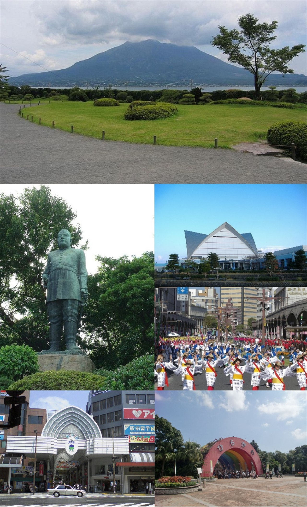
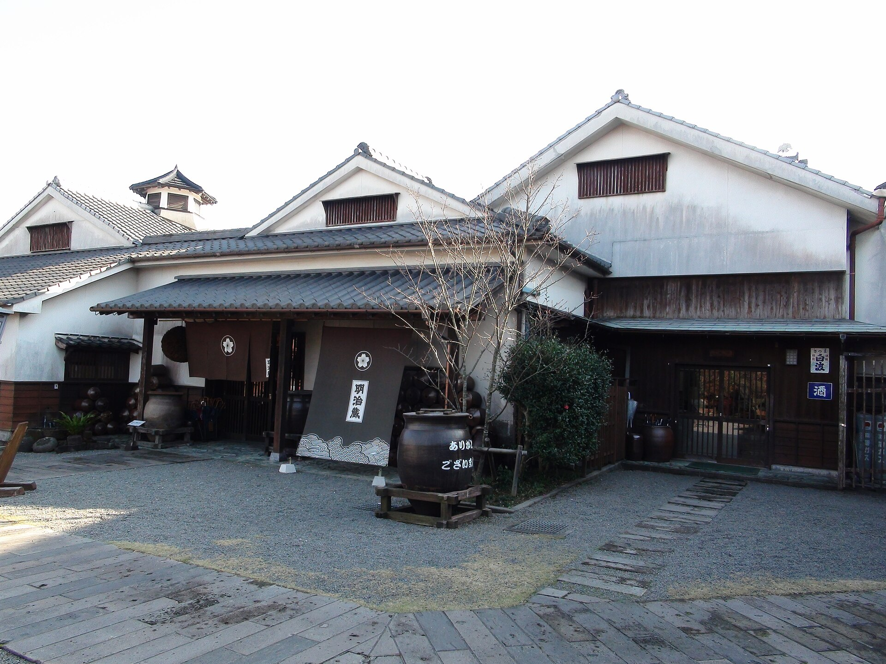

# Kagoshima

Kagoshima is the core honkaku shochu region of southern Kyushu in [Japan](ref:japan). Unlike sake, [shochu](ref:shochu) is a distilled drink: [rice](ref:rice) koji and water first build a yeast starter, steamed Satsuma sweet potato is added for a second fermentation, and the finished mash is distilled in a pot still through [distillation](ref:distillation). Kagoshima's reputation rests on sweet potato, koji, distillation method, and storage vessels, not on sake-style polishing ratios and ginjo aroma.

Figure: Kagoshima. Image: A pool full of water, CC BY-SA 4.0, via Wikimedia Commons ([source page](https://commons.wikimedia.org/wiki/File:Kagoshima_Montage.jpg)).

> **Quick verdict**
> **In one line:** This region helps you judge Kagoshima for flavour and travel, and plan accordingly.
>
> - **Best for:** Anyone comparing Kagoshima with other regions before buying wine or planning a trip.
> - **Not for:** If you want want a “most expensive region” verdict and do not care about style or vintage.
> - **Check first:**
>   - The storage vessel affects texture.
>   - Kagoshima brewery visits follow "kura-meguri" and "shochu street" routes.

## Definition and scope

Kagoshima's shochu is mainly Satsuma sweet-potato shochu. The prefectural tourism site states that Kagoshima has more than 80 breweries and over 2000 honkaku shochu labels, and places it alongside Amami black-sugar shochu as one of the two main honkaku types. "Honkaku shochu" here is not a marketing adjective but a category in the liquor tax law and the industry labelling rules: it belongs to pot-still shochu, with clear boundaries on ingredients and distillation.

The Kagoshima Sake Brewers Association handles regional promotion, brewery introductions, and shochu culture. Breweries are spread across Kagoshima City, Ibusuki, Chiran, Satsuma Sendai, Izumi, Kajiki, Osumi, Kanoya, and Tane-Yaku, a wide north-south range with different sweet-potato varieties, koji, and distillation choices. Treating Kagoshima as one uniform style ignores these regional differences.

## Sweet potato, koji, and the two-stage mash

The main raw material of Satsuma sweet-potato shochu is the Satsuma potato, with common varieties including Kogane Sengan and Annou. Kogane Sengan has long been the mainstream material: high starch and solid aroma. Annou is sweeter and more aromatic, often used for softer styles. Potato variety, steaming, and fermentation temperature directly affect sweetness, aroma, and finish.

Koji is the second main line. The prefectural tourism site divides koji into white, black, and yellow: white koji gives a softer, cleaner drink; black koji brings a thicker body and stronger aroma; yellow koji often shows a fruitier, lighter tone. White and black are the most common for sweet-potato shochu. Black koji tolerates the hot, humid Kagoshima environment better, while white koji keeps the potato aroma cleaner. Breweries choose koji by product concept, not by treating one type as the only authentic option.

The process uses two stages. The first mash mixes steamed rice, rice koji, water, and yeast to build the starter; the second adds steamed sweet potato and water, continuing fermentation into moromi. This differs from sake's moto: shochu's first fermentation centres on rice koji, and only the second stage makes sweet potato the main material. After fermentation comes distillation, which decides how much aroma is retained.

## Distillation: atmospheric and vacuum

Honkaku shochu uses a pot still and belongs to [pot-still distillation](ref:potstill). The National Tax Agency defines pot-still shochu as liquor distilled with a still other than a continuous still, at 45 degrees or less; continuous-still shochu is continuous-still distilled and under 36 degrees. They are not the same product, and honkaku shochu corresponds to the former.

Still pressure directly shapes flavour. Atmospheric distillation runs at a higher temperature and retains more of the raw material's aroma, oils, and complex components, giving a thicker, more individual body. Vacuum distillation runs at a lower temperature, producing a lighter, cleaner aroma often described as the "soft type." Both the Kagoshima tourism site and the National Tax Agency describe atmospheric as aroma-rich and vacuum as light. The choice is a product decision, not a quality hierarchy: atmospheric suits a strong potato aroma and richness, vacuum suits a clean, easy-drinking line.

The distilled spirit is usually high in alcohol and is adjusted with water before bottling. Raw material, koji, fermentation, and distillation build the flavour structure; adding water is only the final balance. Treating "more distillations mean higher grade" as a rule is wrong; honkaku shochu is about pot-still distillation and raw-material expression, not repeated distillation.

## The legal and market meaning of 25 degrees

25 degrees is the most common commercial alcohol level for Kagoshima shochu. Many sweet-potato shochu are bottled at 25 degrees; Meiji Brewery's Satsuma Shirohaku and Kuro Shirohaku are 25 degrees, while its genshu reaches 37 degrees. But 25 degrees is not the legal line between honkaku and non-honkaku. Under the current liquor tax law, pot-still shochu may be up to 45 degrees, and continuous-still shochu is under 36 degrees; the honkaku label depends on the ingredient combination and pot-still distillation, not on being exactly 25 degrees.

Historically, the old liquor tax law used 25 degrees as a tax bracket for shochu Class A, with higher degrees taxed more, which made 25 degrees a production and pricing convention. The market still treats 25 degrees as the comfortable standard for sweet-potato shochu, but consumers should not mistake it for a legal boundary. When you see 25 degrees, 37 degrees, or a stronger genshu, check the "honkaku shochu" label and the ingredient and distillation statements rather than judging by alcohol level alone.

## Kame storage and maturation

The storage vessel affects texture. Traditional Kagoshima breweries use kame pots (kame-tsubo); the pottery's fine pores allow slow oxidation and trace evaporation, softening the sharpness of new spirit and rounding the aroma. [Meiji Brewery](ref:meijigura) still uses kame-pot mashing and storage, and its Satsuma Shirohaku Meiji Brewery edition highlights the potato's rich aroma and white koji's lightness through that method.

Modern breweries also use stainless steel tanks, wooden barrels, or glass. Each vessel changes maturation speed and flavour. Kame storage is not the only correct method, but it explains why some Kagoshima shochu retains depth at a lower alcohol level. Maturation ranges from months to years, and terms such as "long-aged" or "koshu" should be checked against the specific definition and source, not judged from packaging alone.

## Labelling rules for honkaku shochu

Honkaku shochu labelling is governed by the liquor tax law and industry fair-competition rules. According to the Japan Sake and Shochu Makers Association, honkaku shochu is pot-still shochu made from specified combinations of grains, tubers, their koji, and water, with a ceiling of 45 degrees; it may not use continuous distillation or freely add flavourings. The labelling rules exist to separate honkaku shochu from blended "shochu A/B" products.

Start with the appellation and its permitted varieties. From there, consider the vintage and the producer, then how the wine is labelled. That is how a practical judgment about Kagoshima is built.

## Breweries and visiting

Kagoshima brewery visits follow "kura-meguri" and "shochu street" routes. The prefectural tourism site and the brewers association introduce regional breweries, tastings, and events. Meiji Brewery in Makurazaki preserves a Meiji-era building and kame-pot mashing, letting visitors see the traditional process up close. [Kirishima Factory Garden](ref:kirishima) is another model, combining shochu production, a garden, and dining in one site, and is useful for understanding the modern face of Kagoshima shochu.

Visitors should remember that a shochu brewery is a production site with safety limits around fermentation and distillation. Opening hours, reservations, and tastings depend on the brewery's notice. Do not drive after tasting; minors should not drink, and excessive drinking is harmful. Combining a brewery visit with local food such as satsuma-age, black pork, and seafood gives a better sense of sweet-potato shochu's place at the Kagoshima table.

## Common misconceptions

First, shochu is not a type of sake. Shochu is distilled; sake is brewed. Their raw materials, fermentation, and finished-product logic differ.

Second, 25 degrees is not the legal boundary. It is a common commercial level and an old tax bracket; under current law honkaku shochu may be up to 45 degrees and continuous-still shochu is under 36 degrees, and the core distinction is distillation method and ingredients.

Third, white or black koji is not the "only authentic" choice. White, black, and yellow koji each suit different flavours and processes; breweries choose by product concept, not by rank.

Fourth, atmospheric distillation is not "backward" and vacuum distillation is not "superior." Atmospheric retains more raw-material aroma; vacuum is lighter and cleaner. They are style choices.

Fifth, "sweet-potato shochu" is not the same as "honkaku shochu." Sweet-potato shochu can be a blend; only a product labelled honkaku shochu and meeting the pot-still and ingredient rules belongs to that category.

## References

- Kagoshima Prefecture Tourism Site, "The Kingdom of Shochu: Honkaku Shochu of Kagoshima": https://www.kagoshima-kankou.com/gourmet/shochu/siru
- Kagoshima Sake Brewers Association, "Kagoshima Shochu for Everyone": https://www.honkakushochu.or.jp/
- Tokyo Regional Taxation Bureau, "Materials on Shochu": https://www.nta.go.jp/about/organization/tokyo/sake/abc/abc-shochu.htm
- Japan Sake and Shochu Makers Association, "Japanese Sake, Honkaku Shochu and Awamori": https://www.japansake.or.jp/honkaku/about/all/
- Satsuma Shuzo, "Meijigura": https://www.meijigura.com/

## Related images

Image: Related photograph of Satsuma Shochu Meijigura. Credit: Sakaori ( talk ), CC BY 3.0, via Wikimedia Commons ([source page](https://commons.wikimedia.org/wiki/File:Satsuma_Shuzo%27s_Kedogawa_Shochu_factory_and_museum,_Meijigura.JPG)). Related image for Kagoshima.

Image: Category image for Japan. Credit: OS6, CC BY-SA 3.0, via Wikimedia Commons ([source page](https://commons.wikimedia.org/wiki/File:Kamotsuru_Sake_Brewing.jpg)). Related image for Kagoshima.
