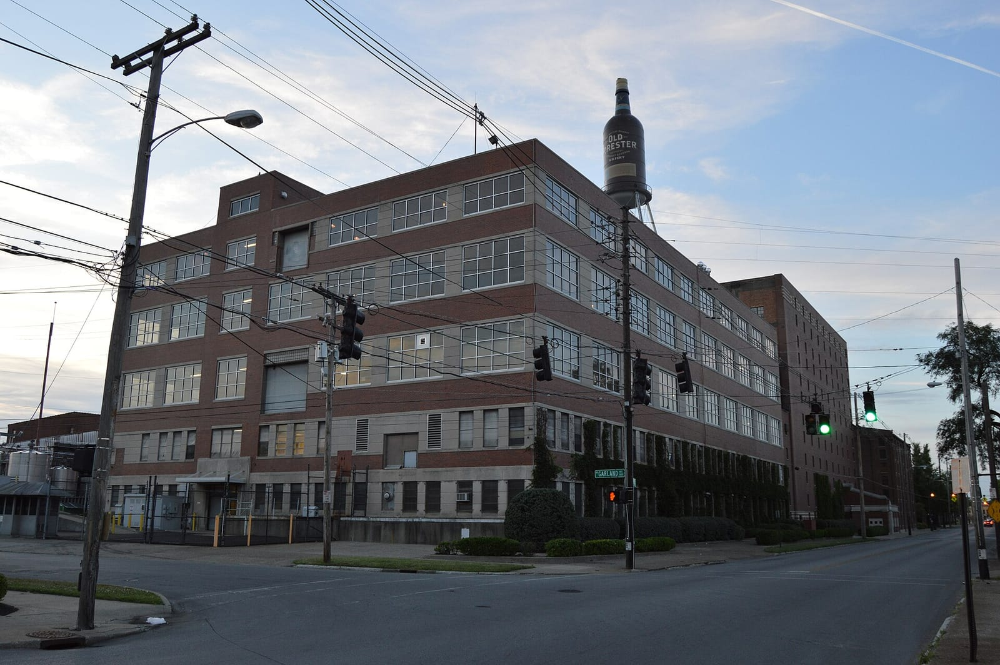
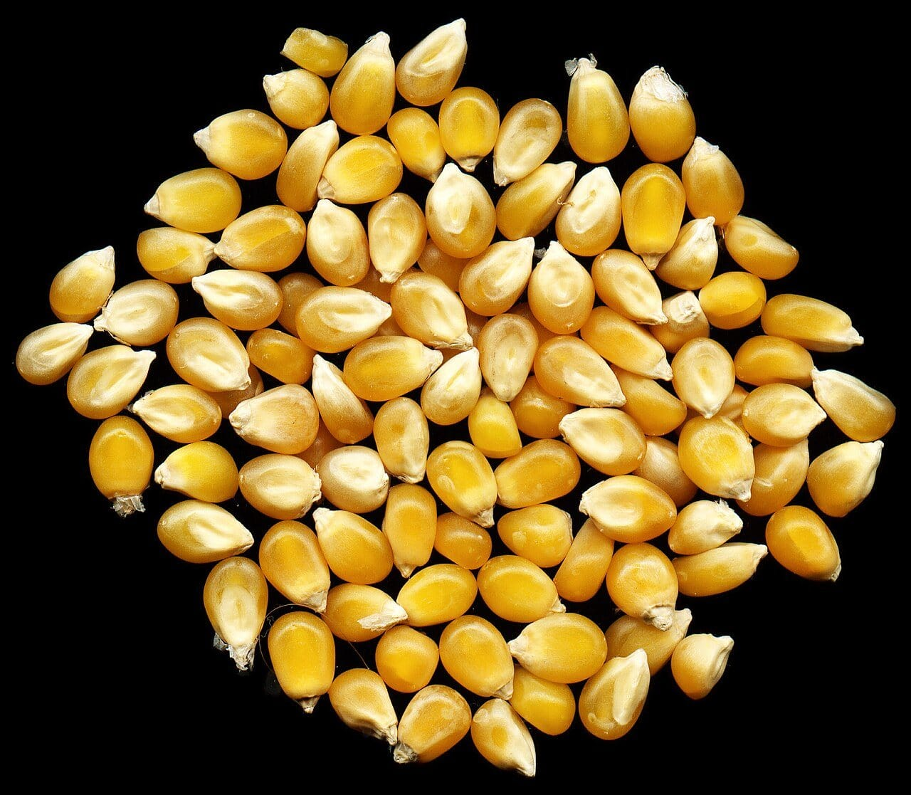
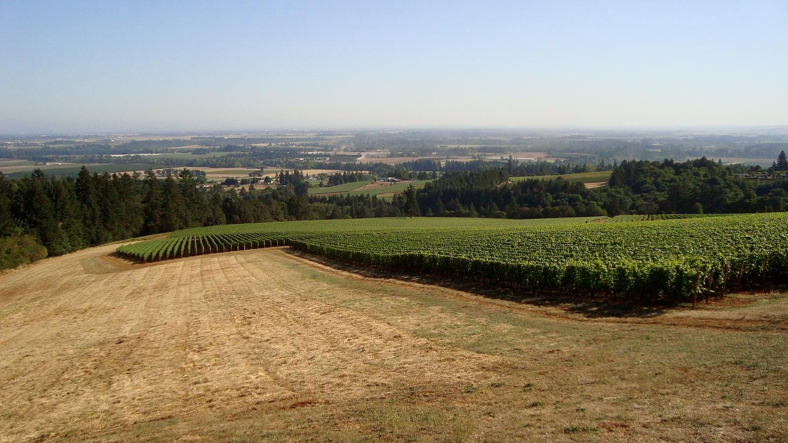

# Kentucky

Kentucky lies in the east-central United States and is the most concentrated area of bourbon production. According to the Kentucky Distillers' Association, about 95% of the global bourbon supply comes from here; the state has about 100 licensed distilleries in 42 counties, operated by 84 companies. That figure is easily read as "bourbon equals Kentucky", but legally it does not: bourbon is a nationwide US category, and Kentucky is only its dominant production region. Keeping origin, regulation and brand apart is the first step to understanding Kentucky whisky.

Figure: Kentucky. Photograph: File:Brown-Forman warehouse A and bottling house.jpg. Credit: Nyttend, Public domain ([source page](https://commons.wikimedia.org/wiki/File:Brown-Forman_warehouse_A_and_bottling_house.jpg)). Category image; not a claim that it shows the exact product, site or event.

## Geography: from Louisville to Bardstown

Kentucky borders the Ohio River to the north and Tennessee to the south, with hills and karst topography. Whisky production clusters along several corridors: Louisville is the largest city and logistics hub; Bardstown calls itself the Bourbon Capital; Frankfort, Lawrenceburg, Clermont, Loretto, Versailles and Shelbyville all have important distilleries. Distribution follows rivers, roads, limestone water and historic migration routes.

## Climate and water

Kentucky has a humid subtropical climate, with hot humid summers and cold but not extreme winters, and a clear seasonal temperature range. That range is central to maturation: liquid expands in the heat and contracts in the cold, moving in and out of the wood and extracting vanilla, caramel and oak flavour. The state's limestone aquifer gives hard water with low iron, suited to saccharification and fermentation; limestone also filters impurities and has historically influenced distillery siting.

## Soils and terrain

The central Bluegrass region is known for limestone parent rock, phosphate-rich soils and rolling pasture. Soil drainage affects corn, rye and barley cultivation and also the mineral composition of water. Although whisky flavour comes mainly from grain, yeast, distillation and oak, water quality and grain quality remain the starting point of regional difference.

## Legal definition: federal rules, not state law

US federal regulation 27 CFR Part 5 defines bourbon whisky: at least 51% corn in the mashbill, distilled in the United States, distilled at no more than 160 proof, entered into the barrel at no more than 125 proof, aged only in new charred oak containers, with no added colouring or flavouring. The rules do not require bourbon to be made in Kentucky, so "Bourbon" and "Kentucky Bourbon" are different levels of concept. The word Kentucky on a label states origin, but it does not follow that all bourbon comes from the state.

## History: tax, war and Prohibition

European settlers brought grain distilling west of the Appalachians in the 18th century, and surplus corn and limestone springs encouraged early distilleries. Bourbon County in Kentucky is often linked to the name bourbon, though accounts of its origin differ. The federal excise tax of 1791 sparked the Whiskey Rebellion of 1794, a sign of the industry's long entanglement with taxation. In the 19th century Bardstown and Louisville became production and shipping centres; Prohibition from 1920-1933 shut most distilleries, some surviving on medicinal permits; after 1933 the industry rebuilt, and large companies came to dominate brands in the 20th century. In 1964 the US Congress passed a resolution calling bourbon America's native spirit.

## Process: sour mash, column still and new oak

A typical mashbill is mostly corn, with rye or wheat for flavour and malted barley for enzymes; corn variety, grind size and cooking all affect sweetness and body. Fermentation usually follows the sour-mash method, adding part of the previous batch's spent mash to the new mash to suppress competing microbes and keep batches stable. Distillation is often in a column still followed by a pot doubler; new barrels are toasted or charred, commonly at char level 3 or 4, and the standard barrel holds 53 gallons. Warehouses, or rickhouses, are often corrugated metal or brick and timber, and winter-to-summer temperature swings move liquid in and out of the wood.

## Style: high rye, wheat and single barrel

Bourbon commonly shows vanilla, caramel, coconut and sweet oak, with a sweet entry and a finish of spice and wood. High-rye recipes are spicier, wheated recipes softer, and high-corn recipes sweeter. Single barrel means the liquid comes from one barrel, and cask strength means little or no dilution; neither is a quality grade. An age statement refers to the youngest whisky in the bottle, not an average of all components.

## Distilleries and places

Representative Kentucky distilleries include Jim Beam in Clermont, Wild Turkey and Four Roses in Lawrenceburg, Maker's Mark in Loretto, Heaven Hill in Bardstown, Buffalo Trace in Frankfort, Woodford Reserve in Versailles, Barton 1792 in Bardstown, Bulleit in Shelbyville, Angel's Envy and Michter's in Louisville, and Old Forester in Louisville. From large-scale production to small craft distilling, the industry is far more layered than the phrase Bourbon Country suggests.

## Vintages and market

Whisky has no grape vintage, but it does have distillation year, barrel-entry year and bottling year. Age is usually stated in whole years, commonly 4, 6, 8, 10 and 12 years or more; older is not always better, and excessive ageing can bring too much wood and bitterness. Kentucky bourbon has grown in both the domestic and export markets, and the Kentucky Bourbon Trail, founded in 1999, links distillery tours, festivals and tourism into an important tool of regional branding.

## Controversy: dry counties, definition and small batch

First, not every Kentucky county permits alcohol sales; the dry-county system still exists, and distillery distribution is shaped by local licensing and tourism policy. Second, the federal definition does not require Kentucky origin, and equating the two misleads consumers. Third, small batch has no single legal definition and is used very differently by different distilleries. Fourth, an age statement guarantees only the youngest whisky, not the age of all components. Fifth, bourbon must use new charred oak and cannot reuse old barrels as Scotch whisky does.

## Drinking and pairing

Serve bourbon neat at 18-20℃; water or ice changes aroma release, and high-strength cask whiskey benefits from a little water. Pair with grilled meat, smoked ribs, fried chicken, pecan pie and dark chocolate. Classic cocktails include the Old Fashioned, Manhattan and Mint Julep. Excessive drinking is harmful to health, and minors should not drink; the legal drinking age in the United States is 21.

## Common misconceptions

First, that bourbon must come from Kentucky. Second, that all Kentucky whisky is bourbon. Third, that bourbon can reuse old barrels. Fourth, that small batch is a legal grade. Fifth, that older is always better. Sixth, that the age on the label is an average age.

Kentucky is best read by starting with the appellation and its permitted varieties, moving to the vintage and the producer, and ending with how the wine is labelled.

## Further reading

- [United States](ref:usa): the wider framework of US drinks regions and the AVA system.
- [Bourbon](ref:bourbon): the legal definition, raw materials and ageing rules.
- [Maize](ref:maize): corn as the main grain in bourbon.
- [Oak ageing](ref:oak-ageing): how new charred oak shapes flavour.
- [Distillation](ref:distillation): column distillation and second distillation.
- [Fermentation](ref:fermentation): sour-mash fermentation and flavour precursors.

## Related images

Image: Dried maize kernels. Dent or flint maize is typical for brewing; sweet corn is not the main raw material.. Credit: Joel Penner, CC BY 2.0, via Wikimedia Commons ([source page](https://commons.wikimedia.org/wiki/File:Maize_Corn.jpg)). Related image for Kentucky.

Image: Category image for United States. Credit: Luke, CC BY-SA 2.0, via Wikimedia Commons ([source page](https://commons.wikimedia.org/wiki/File:Wine_Country_of_the_Dundee_Hills,_Oregon.jpg)). Related image for Kentucky.
